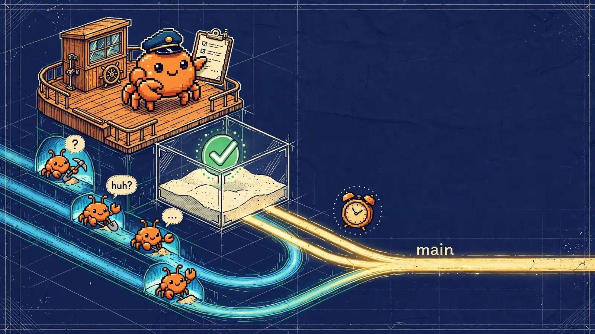
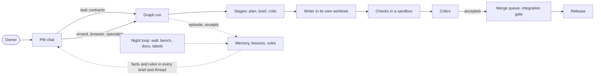

# Lane Pilot

Lane Pilot is a BB plugin that runs coding work from a project chat. The owner talks to a PM chat; Lane Pilot turns the request into task contracts, hands each task to a writer agent in its own git worktree, checks the result in a sandbox, has critics review it, merges what passes, and keeps what it learned in one project memory on the BB hub. The same machinery runs research, browser and Mac errands, specialist work, councils and scheduled routines. Every piece of work it runs is a graph (a workflow); the PM chat is the door to the machine, not its engine.

It is for people who run several agents on one codebase and want the boring parts (isolation, verification, retries, merging, memory, night maintenance) done by code, not by a chat.

## If you are an agent, read this first

1. **What this repository is.** The plugin's code: `server.ts` (hub server, SQLite), `host.ts` (git, sandbox and machine work on enrolled hosts), `app.tsx` (UI). Each subsystem is a room in `src/rooms/<room>/`; other rooms import only its `index.ts`, `server/index.ts` or `ui/index.ts`. Shared code lives in `packages/*`, shipped graphs in `workflows/*.json`.
2. **Where to look a thing up.** The [interactive system map](https://vkirill.github.io/bb-plugin-lane-pilot/map/) and the [atlas](docs/atlas.md) are generated from the code: every room with its public API, every task stage, the attempt state machine, every `bb lane-pilot` command and every shipped graph. The [guide](#the-guide) below explains how the parts work together; deep pages per subsystem are in the [documentation map](#documentation-map).
3. **Project facts that are not in the code** (who the owner is, decisions, lessons) live in the hub memory: `bb lane-pilot memory search "<question>"`, record one with `bb lane-pilot memory write "<fact>"`. Not in local memory files.
4. **Rules that bite.** The database schema is append-only (see [Development](docs/guide/development.md#database-migrations)). A release goes only through the deploy script and ends with a drill that rolls back on red. Run focused tests while working (`npx vitest related <files> --run`); the full suite runs at the gate. Traps: [gotchas](docs/gotchas.md).
5. **When you change behaviour,** fix the guide page that describes it in the same commit, and run `npx tsx scripts/generate-atlas.ts` when you add a room, command, graph, stage or RPC method (the atlas test fails until you do).

## How it works in one picture

> **[Open the interactive map of the whole system](https://vkirill.github.io/bb-plugin-lane-pilot/map/)**: every room, table, command, agent tool, graph action, shipped graph, role, task stage and attempt state, and the links between them (imports, table reads, graph runs and calls, roles). Every node and link is read from the code; click a node to see what it contains, what it uses and what uses it. Source: [docs/map/index.html](docs/map/index.html), written by `npx tsx scripts/generate-atlas.ts`.

The PM plans and talks; code does the rest. Each step leaves a receipt in the database, so a failure has a recorded cause, and the night loop turns repeated failures and repeated work into rules, skills, scripts and graphs.

## Numbers

<!-- numbers:start d3b5cb8f58092732 -->
| What | Count |
|---|---:|
| Version | 0.1.517 |
| Rooms (components in `src/rooms/`) | 73 |
| Workspace packages (`packages/`) | 18 |
| Shipped graphs (published / own maintenance `lp.*`) | 113 (103 / 24) |
| Task stages / attempt state transitions | 20 / 26 |
| `bb lane-pilot` commands | 118 |
| RPC methods | 225 |
| Memory delivery paths | 23 |
| Settings in the catalog | 265 |
| Test files / lines of source (TypeScript, without tests) | 1038 / 197911 |

Generated by `npx tsx scripts/generate-atlas.ts` together with [the atlas](docs/atlas.md), which lists every room, command and graph.
<!-- numbers:end -->

**Live numbers** come from the hub, not from this file:

| Question | Command |
|---|---|
| How did the project's tasks go (stages, time, tokens, cost) | `bb lane-pilot metrics <project-id> [--days N]` |
| Which errands repeat and what they cost | `bb lane-pilot errands diagnose [--days 30]` |
| What waits for the owner | `bb lane-pilot waiting` |
| What the night loop did | `bb lane-pilot wall` |
| How accurate each Jev judgment is | `bb lane-pilot jev calibrate --by-source` |
| Monthly spend and its cap | `bb lane-pilot money` |
| The full story of one task | `bb lane-pilot timeline <task-id>` |

## What it is and what it needs

Lane Pilot is one plugin with three entries declared in `package.json`: a server (`server.ts`, owns the plugin SQLite database and all room services), a host worker (`host.ts`, runs git, sandbox and machine operations on enrolled hosts) and a UI app (`app.tsx`, the settings, Tasks board and composer action).

| Requirement | Detail |
|---|---|
| BB | A BB server `>= 0.43.3` with plugin SDK `>= 0.4.104` and the experimental `vk` core APIs. Required: `experimental_vkSetDispatchData`, `experimental_vkPluginLifecycle`. Optional (the plugin degrades without them): session policy, compiled main agent, quiet child threads, keyed spawn, schedule, hook timeouts, plugin metadata, last turn. The list is in `vk-requires.json`. |
| Runtime | Node `^22.19.0 \|\| ^24.0.0 \|\| ^26.0.0`. |
| Hosts | The project must be bound to an enrolled BB host. Writer worktrees, checks and merges run there through host calls. A folder without git runs in live-folder mode (one writer at a time, rollback from a backup of the task's `owns_paths`, no merge). |
| Providers | The PM runs as a Claude Code agent. Writers and helpers run on the providers you connect in BB (Claude Code, Codex, OpenCode v2 and others, see [Roles, agents and models](docs/guide/roles.md)). The small Jev judgments (routing, writer pick, skill pick, failure class and others) need a Jev key in the BB Env Catalog: `TYPESAFE_API_KEY` for the official TypeSafe service (the default) or `OPENLUX_API_KEY` for the OpenLux reseller (setting `jev.provider`). Without a key every judgment falls back to its code rule. |

### Quick start

1. Install Lane Pilot through BB's plugin manager (or, for a path plugin, `bb-plugin-push lane-pilot` from the checkout, see [Development](docs/guide/development.md)).
2. Connect the project to an enrolled host and open **Lane Pilot** in the project navigation. The Overview tab shows what is missing (for example, no writer chosen).
3. Pick the writer model in **Team**. Models per role come from a role table; the writer of each task is picked by Jev (see below).
4. In a new project chat open **Lane Pilot / agent** under the message box, turn Lane Pilot on and send the task. The first activation installs the Lane Pilot stack on the host by itself; its state is under **Runs, Service**.
5. The PM dispatches tasks, you watch them on **Tasks** (board or list) and in the chat's info panel, and the PM ships the merged result.

For development, `npm install` then `npm run check` (see [Development](docs/guide/development.md)).

## The guide

How the system works, one page per part. Start with the first one.

| Page | What it answers |
|---|---|
| [How a piece of work flows](docs/guide/flow.md) | What happens between the owner's message and the merged commit: the 13 steps. |
| [Everything is a graph](docs/guide/graphs.md) | Why every job is a graph, which graphs ship, how a graph is built, tested and started. |
| [Roles, agents and models](docs/guide/roles.md) | Who does what (PM, writer, critics, lead, specialists, errands), which model each role gets, providers, Jev. |
| [The hand-off standard](docs/guide/handoff.md) | What crosses the boundary when one agent gives work to another: the task message, the result, the honest exit, how an answer is read. |
| [The hook standard](docs/guide/hooks.md) | The six rules for session hooks on a machine (fail-open, anchored to the project root, quiet, budgeted), the layers, the audit command. |
| [Failure handling and stability](docs/guide/failures.md) | Failure classes, retries, held writers, self-repair, deploys, drills, budgets. |
| [Memory](docs/guide/memory.md) | The one project memory: who writes it, how it reaches agents, search, import, proof that it works. |
| [Self-improvement](docs/guide/self-improvement.md) | The night loop, LP-Bench, lessons to rules, episodes and crystallization of repeated work. |
| [Observability](docs/guide/observability.md) | Morning summary, owner inbox, receipts, boards, where each signal lives. |
| [Settings and experimental features](docs/guide/settings.md) | The six settings tabs, the important keys, what is off by default. |
| [CLI, agent tools, UI and RPC](docs/guide/interfaces.md) | The doors into the system: commands, tools, screens, RPC and BB hooks. |
| [Development](docs/guide/development.md) | Layout, commands, tests, migrations, deploy. |

## Keeping these docs current

- The numbers above, the [system map](docs/map/index.html) and the [atlas](docs/atlas.md) (rooms, stages, commands, graphs, RPC) are generated from the code; `tests/atlas.test.ts` fails when they are stale.
- Every night the docs pass (`lp.docs-night`, [docs night](docs/docs-night.md)) reads the day's diff, finds the pages and README sections it made wrong, rewrites them and commits. `bb lane-pilot docs-nightly <project-id>` runs it now.
- [CHANGELOG.md](CHANGELOG.md) has every release; a guide page cites it rather than repeating it.

## Documentation map

The full generated list is [docs/index.md](docs/index.md). Pages by topic:

| Topic | Pages |
|---|---|
| Start here | [overview](docs/overview.md), [architecture](docs/architecture.md), [the task pipeline](docs/flows/task-pipeline.md), [gotchas](docs/gotchas.md), [decisions](docs/decisions.md), [PROJECT.md](PROJECT.md) |
| Runtime and contracts | [data model](docs/data-model.md), [RPC and host-call contracts](docs/rpc-callers.md), [RPC route details](docs/rpc-details.md), [native agent activation](docs/native-agent.md), [packages](docs/packages.md), [package operations](docs/package-operations.md), [deployment](docs/deployment.md), [atlas (generated)](docs/atlas.md), [wires](docs/wires.md) |
| Writer path | [validator decisions](docs/validator-decisions.md), [plan against fact](docs/plan-fact.md), [baseline and regression pass](docs/baseline.md), [return to an earlier stage](docs/stage-return.md), [pilot, then fan-out](docs/pilot.md), [backlog to tasks](docs/backlog.md), [ship](docs/ship.md), [run-goal check](docs/run-goal.md), [rolling back](docs/rollback.md), [phases](docs/phases.md) |
| Graphs | [workflow engine](docs/workflow-engine.md), [router](docs/workflow-router.md), [triggers](docs/workflow-triggers.md), [executors](docs/workflow-executors.md), [workflow-engine package docs](packages/workflow-engine/docs/index.md) |
| Models and providers | [role table and model pools](docs/role-models.md), [Jev adapter](docs/jev-adapter.md), [Jev judgments](docs/jev-judgments.md), [capability table](docs/capability.md), [relay between threads](docs/relay.md) |
| Stability | [watchdog](docs/watchdog.md), [outage record and conveyor](docs/outage-conveyor.md), [checkers](docs/checkers.md), [twins](docs/twins.md), [coverage](docs/coverage.md) |
| Memory and owner profile | [memory](docs/memory.md), [memory tiers](docs/memory-tiers.md), [anamnesis](docs/anamnesis.md), [learning from the owner's messages](docs/learning.md) |
| Self-improvement | [wall and the night loop](docs/wall.md), [LP-Bench](docs/lp-bench.md), [hypotheses](docs/hypotheses.md), [writer harness](docs/harness.md), [rule forms](docs/rule-forms.md), [night policy](docs/night-policy.md), [Self-improvement settings](docs/self-improvement-settings.md), [research adoption](docs/research-adoption.md), [SMA self-check](docs/sma-self-check.md), [design evaluation](docs/design-eval.md), [forecast](docs/forecast.md), [docs night](docs/docs-night.md) |
| Observability and owner | [Tasks board](docs/task-board.md), [work graph](docs/work-graph.md), [schedule board](docs/schedule-board.md), [errands](docs/errands.md), [waiting for the owner](docs/owner-waiting.md), [owner presence](docs/owner-presence.md), [deferrals](docs/deferrals.md) |
| Settings | [enabled settings (generated)](docs/enabled-settings.md), [adoc applicability](docs/adoc-applicability.md) |
| Workspaces | [i18n](packages/i18n/docs/index.md), [ui-kit](packages/ui-kit/docs/index.md), [workflow-engine](packages/workflow-engine/docs/index.md), [world-sim](packages/world-sim/docs/index.md) |
| Specific flows | [invoice-send](docs/invoice-send.md) |

