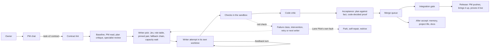

# Lane Pilot

Lane Pilot is a BB plugin that runs coding work from a project chat. The owner talks to a PM chat; Lane Pilot turns the request into task contracts, hands each task to a writer agent in its own git worktree, checks the result in a sandbox, has critics review it, merges what passes, and keeps what it learned in a project memory. The same machinery runs research, browser errands, specialist work, councils and scheduled routines. Every piece of work it runs is a graph (a workflow); the PM chat is the door to the machine, not its engine.

It is for people who run several agents on one codebase and want the boring parts (isolation, verification, retries, merging, memory, night maintenance) done by code, not by a chat.

## Contents

1. [What it is and what it needs](#what-it-is-and-what-it-needs)
2. [How a piece of work flows](#how-a-piece-of-work-flows)
3. [Everything is a graph](#everything-is-a-graph)
4. [Roles, agents and models](#roles-agents-and-models)
5. [Failure handling and stability](#failure-handling-and-stability)
6. [Memory](#memory)
7. [Self-improvement](#self-improvement)
8. [Observability](#observability)
9. [Settings](#settings)
10. [Experimental features](#experimental-features)
11. [CLI, agent tools and UI](#cli-agent-tools-and-ui)
12. [Development](#development)
13. [Documentation index](#documentation-index)

## What it is and what it needs

Lane Pilot is one plugin with three entries declared in `package.json`: a server (`server.ts`, owns the plugin SQLite database and all room services), a host worker (`host.ts`, runs git, sandbox and machine operations on enrolled hosts) and a UI app (`app.tsx`, the settings, Tasks board and composer action).

| Requirement | Detail |
|---|---|
| BB | A BB server `>= 0.43.3` with plugin SDK `>= 0.4.104` and the experimental `vk` core APIs. Required: `experimental_vkSetDispatchData`, `experimental_vkPluginLifecycle`. Optional (the plugin degrades without them): session policy, compiled main agent, quiet child threads, keyed spawn, schedule, hook timeouts, plugin metadata, last turn. The list is in `vk-requires.json`. |
| Runtime | Node `^22.19.0 \|\| ^24.0.0 \|\| ^26.0.0`. |
| Hosts | The project must be bound to an enrolled BB host. Writer worktrees, checks and merges run there through host calls. A folder without git runs in live-folder mode (one writer at a time, rollback from a backup of the task's `owns_paths`, no merge). |
| Providers | The PM runs as a Claude Code agent. Writers and helpers run on the providers you connect in BB (Claude Code, Codex, OpenCode v2 and others, see [Roles, agents and models](#roles-agents-and-models)). The small Jev judgments (routing, writer pick, skill pick, failure class and others) need a Jev key in the BB Env Catalog: `TYPESAFE_API_KEY` for the official TypeSafe service (the default) or `OPENLUX_API_KEY` for the OpenLux reseller (setting `jev.provider`). Without a key every judgment falls back to its code rule. |

### Quick start

1. Install Lane Pilot through BB's plugin manager (or, for a path plugin, `bb-plugin-push lane-pilot` from the checkout, see [Development](#development)).
2. Connect the project to an enrolled host and open **Lane Pilot** in the project navigation. The Overview tab shows what is missing (for example, no writer chosen).
3. Pick the writer model in **Team**. Models per role come from a role table; the writer of each task is picked by Jev (see below).
4. In a new project chat open **Lane Pilot / agent** under the message box, turn Lane Pilot on and send the task. The first activation installs the Lane Pilot stack on the host by itself; its state is under **Runs, Service**.
5. The PM dispatches tasks, you watch them on **Tasks** (board or list) and in the chat's info panel, and the PM ships the merged result.

For development, `npm install` then `npm run check` (see [Development](#development)).

## How a piece of work flows

Every piece of work in Lane Pilot is a graph (a workflow). The PM chat is the door: it talks to the owner and passes his words into the machine. It does not do the work itself. This section follows one code task from the owner's message to a pushed release. Defaults come from `docs/enabled-settings.md` and the settings catalog; a setting with no default listed is unset.

### 1. The PM chat as the door

- The owner enables Lane Pilot in the composer ("Enable Lane Pilot") of a new project chat. The UI needs a selected project and a resolvable writer binding, then starts the chat as a Claude Code PM session (it tries `claude-opus-5-5[1m]`, then `claude-opus-5-5`). See `docs/native-agent.md`.
- The PM prompt (`LANE_PILOT_PM_SESSION`) says: send every repository change, however small, through `lane_pilot_dispatch_writer`. The shell guard refuses PM edits of project files. The PM may write only `.agents/`, its chat folder, `docs/plans/`, `.env*` and `/tmp`.
- Asking the owner is the exception: only for business meaning, money or irreversible data, a missing secret, or a real ambiguity. A failing test or contract is dispatched as a fix, not asked about.
- Size rule in the prompt: one task is one outcome a strong writer finishes in 30 to 120 minutes (a page, a feature, an issue). Findings about one page go into one task; findings about different areas become separate tasks that run side by side.

| Need | PM tool |
|---|---|
| Change repository code | `lane_pilot_dispatch_writer`, then `lane_pilot_wait_writer`, `lane_pilot_update_task`, `lane_pilot_answer_writer`, `lane_pilot_cancel_task`, `lane_pilot_reassign_task` |
| Research, digest, post, anything that is not repo code | `lane_pilot_route` (picks a ready graph), then `lane_pilot_run_workflow`, `lane_pilot_workflow_status`, `lane_pilot_workflow_amend` |
| Heavy goal | `lane_pilot_phase` (answer, revise, return, correct, status) |
| Specialists, one browser step | `lane_pilot_helpers` (`specialist`, `wait_specialist`, `browser`) |
| Long browser or account work | `lane_pilot_errand`, `lane_pilot_wait_errand` |
| Council, schedule, memory, relay | `lane_pilot_council`, `lane_pilot_schedule`, `lane_pilot_memory`, `lane_pilot_relay` |
| Owner question as a form | `lane_pilot_ask_owner` |

### 2. The task-v2 contract and its lint

The PM writes a task-v2 contract. Required: `id`, `title`, `risk`, `lane`, `project_cwd`, `read_first`, `interfaces`, `invariants`, `out_of_scope`, `expected_outputs`, `owns_paths`, `never_touch`, `depends_on`, `objective`, `acceptance`, `verify`, `verification[]`. Each check in `verification[]` has `command`, `cwd`, optional `timeout_sec`, optional `secrets` (Env Catalog names) and optional `hidden`.

Optional fields include `display_title`, `kind` (feature, fix, check, docs, refactor, research, chore), `area`, `skills`, `quality_mode`, `qa_cases` with `qa_url`, `qa_env_class`, `qa_dev_server`, `convergence`, `files`, `appetite`, `forecast`, `promise`, `priority`, `clarify`, `drawing`, `wires`. The task standard (`display_title`, `kind`, `area`) is mandatory at dispatch. The first dispatch of a run must also carry the run `objective`.

`lane_pilot_dispatch_writer` lints the contract before any task or attempt exists. Errors return to the PM in one message, with no attempt spent. Warnings travel with the answer.

| Rule | What it enforces |
|---|---|
| Ownership | Paths are relative and safe. `expected_outputs`, `files[]` and tests of owned code lie inside `owns_paths` and outside `never_touch`. A path that does not exist and has no folder is an error (`owns_missing`, `output_missing`). |
| Checks that can fail | Rejects `true`, `exit 0`, a bare `echo`, `\|\| true`, a masked pipe exit, `--passWithNoTests`, and a check that only tests a file that already exists on the base. |
| Red before green | For risk medium or higher, a warning when no check names a file missing on the base (`no_red_before_green`). |
| One focused check | While an integration gate is active, a whole-suite command or a repeated runner chain is an error (`whole_suite_with_gate`). |
| Runnable | The check program must exist on the writer's machine; `cwd` must lie inside the project; a command that timed out before needs a larger `timeout_sec`. |
| Secrets | `secrets` names must exist in Env Catalog and pass `secrets.allow`. A missing name is a warning; the task then waits as `waiting_secret:NAME` and spends no attempt. |
| Acceptance size | More than 3 items in quick or standard mode is a warning only (`acceptance_too_many`). |
| Browser | With `quality_mode` full, `qa_cases` need `qa_url` (error). |
| Dependencies | `depends_on` a task that already ended blocked or canceled is an error; overlapping open `owns_paths` is a warning (the task waits). |

Dispatch also does the following.

- A repeat of the same task and plan within 30 minutes returns the existing task.
- A second member of a task family (`x`, `x.2`) while one runs or is parked returns `task_in_progress`.
- The wall can refuse a family (`wall_stop`).
- The `topic_loop` guard refuses a fourth task on a topic: three earlier families in 72 hours on the same file (small fix-like tasks owning at most 3 entries) or the same test. The machine hunts that topic instead (see `docs/wall.md`).
- `batchAdvice` in the answer lists the open tasks that hold the new one and, when three or more own one path, the fix. A `grain` line warns when a task is far smaller than the project's median accepted task.
- A spend reserve check runs when a run token budget and a task `appetite.tokens` exist.

### 3. Stages before the writer

The graph `lp-task-pipeline` runs these steps in order (`docs/flows/task-pipeline.md`):

1. `worth-check`: the Jev judgment `critique.worth` (shadow by default) may skip critics. In shadow, or when unsure, every critic runs.
2. `pm-read`: reads the `read_first` excerpts into a summary. Off by default (`pm_read.enabled` false, `pm_read.min_lines` 350). A failed summary stops nothing.
3. `plan-critique`: by `quality_mode`. In `standard` it runs for risk high or critical, or when the run has 3 or more write tasks (`plan_critique.min_score` 7, `min_write_tasks` 3, `on_high_risk` true). In `plan_critique.mode` gate (default) a refusal stops the attempt before any writer starts.
4. `specialist-review`: off by default (`specialist.enabled` false; `specialist.when` high_risk).
5. `ownership-base`: records the ownership base commit; if it cannot be taken, the task is blocked with the reason.
6. `task-folder`, then the `writer` step (sections 4 to 9).

If a run has `run_gate=pre-merge`, dispatch blocks the run with a `run-gate` receipt before any of this.

### 4. Writer picked per task

| Layer | How it works | Settings |
|---|---|---|
| Role to model table | Every agent step names a role; `role_model.<role>` names its model and optional pool (least loaded provider first). The writer is not a row of the table. See `docs/role-models.md`. | `role_model.<role>` |
| Jev pick | Once per task (`writer.model` judgment, active by default, 8 s timeout) Jev reads the task and each candidate's profile and picks one. A strong-tier model only when complexity or risk is high; provider load breaks ties. Below `min_p` 0.45, or with Jev off, the project's own writer stays. | `writer.pick` (off disables), `writer.provider`, `writer.model` |
| Held candidates | A provider whose usage window is spent (see `usage.skip_percent`) or a ZCode that cannot work now is not offered to Jev. | `usage.skip_percent` 90 |
| Skills | Jev picks technology skills (bar 0.4) and craft skills for UI or text tasks, with a 45 s deadline. Failure leaves the role skills. PM hints go in the contract `skills` (max 8). | `writer.skill_pick` on |
| Pinned pair | The task's provider and model stay for its life across restarts and redispatch. The pin moves only on a provider failure or a failure-class intervention, with the reason recorded. | `writer.pair_pin` on |
| Route record | Candidates, exclusions with reasons and the pick are kept for the attempt receipt and the task screen. | `writer.route_record` on |
| Fallback chain | The picked writer's old project writer becomes fallback 1; then `writer.fallback1..3.*` (defaults: GLM 5.3 Flash, Gemini 3.8 Flash high, slot 3 off), then the PM model. A provider, limit or catalog fault walks the chain. | `writer.fallback_on_provider_failure` after_retry (or `immediate`) |
| Capacity wait | When every offered writer provider is over its window, the attempt ends blocked as `capacity_saturated:<reset>` instead of failing. | `writer.capacity_wait` on |

Sticky area writers: tasks of one `area` run one at a time. The area's writer takes the next task in its own thread for 3 hours after its last accepted task, unless the writer setting changed. After that a fresh writer starts with the area's history. Tasks with overlapping `owns_paths` also queue. Four lane queues (writing, checks, docs, research) can be capped with `queue.lane_caps` (no catalog row).

### 5. Worktree per attempt

- A git project gets a worktree of its own for every attempt (`docs/decisions.md`, ADR 1). Dependencies are linked or mirrored into it. The base commit is recorded so the attempt can be rolled back (`docs/rollback.md`).
- A folder without git runs in live-folder mode (`docs/gotchas.md`). There is no worktree, commit or merge. One writer works per folder, so tasks queue. A snapshot covers at most 50,000 paths. Backups of owned files last 7 days and refuse sets over 2 GiB. A task that is not accepted is rolled back from the backup of its `owns_paths`; files outside `owns_paths` are not restored. A folder with over 50,000 files needs git. The dispatch answer carries a `mode live-folder` warning.
- A task whose paths all lie inside a git repository nested in the folder moves into that repository and gets its own worktree (`mode repository`).
- Finished attempt environments and expired sticky worktrees are released by a sweep every 10 minutes (`attempt-worktree-sweep`).

### 6. Baseline before the writer, regression after acceptance

Details in `docs/baseline.md`.

- Before the first writer, the task's checks run once on the base in a throwaway worktree (skipped for mainfix tasks and live folders). `baseline.time_cap_sec` 300 bounds the estimated check time; checks with secrets are skipped.
- If every check is green on the base, a `fix` or `check` task closes accepted without a writer (`checks.require_red_on_base` medium). Another kind at that risk is stopped. Otherwise `baseline.already_built` decides: `notify` (default) tells the PM and the writer starts; `stop` ends the attempt before any writer.
- A check that cannot run, or is red only outside the task's files, stops the task before any writer and spends no attempt.
- After the merge, checks that were green on the base and are red on main are named to the PM and drive a `-mainfix` follow-up.
- The nightly `regress-nightly` pass (03:25) reruns recently accepted tasks' checks on main and bisects a regression to the commit and task. It never reverts or merges (`regress.nightly` on, `regress.last_n` 30, `regress.last_days` 14).

### 7. Checks in the sandbox

- A writer attempt ends with a `plan-fact` table. The writer attempt is gated by `owns_paths` and by `expected_outputs` existing with content; then every `verification[]` command runs in the sandbox.
- `sandbox.backend` is `auto`: Seatbelt on macOS, bubblewrap on Linux. If the backend is missing, the check fails closed.
- A failing command is run once more. A pass on re-run is recorded as flaky with machine-pressure evidence. A timeout (exit 124) is not repeated. A check that passed but ran no test fails.
- A check receives its Env Catalog `secrets` as environment variables and its output is masked; the writer never sees the values. A full failing output is saved under the task folder so the retry reads it.

### 8. Critics

| Stage | Default | Effect |
|---|---|---|
| `pm-read` | off | Context only. |
| `plan-critique` | on by risk, mode `gate` | Refusal stops the attempt before the writer. |
| `specialist-review` | off | Risk opinion. |
| `code-critique` | by risk (below), mode `advisory` | Findings go back to the writer for `code_critique.max_rounds` (1, max 3) repair rounds when `code_critique.auto_fix` (true). |

`quality_mode` (task field or project setting, default `standard`) selects the depth.

- `quick` disables both critiques.
- `standard` reads the project settings. With `code_critique.enabled` unset, `critic.code.default_for_risk` medium turns the code critic on for risk medium or higher.
- `full` enables both critiques on every task and requires `qa_url` next to `qa_cases`.

Advisory stops a task only on a block or a blocking finding on a rubric criterion; mode `gate` stops on any change request. Parsers read the form of each opinion: a critical or high finding must cite a file and line the critic was shown, or it is read as medium (`docs/overview.md`, "Stage proof").

### 9. Acceptance

- Stage proof: every stage declares what decides it. A code predicate (exit code, gate, receipt, schema, file) or `advisory` (a model's opinion). An opinion never accepts a task, though it can stop one.
- Before the acceptance receipt, the finish step collects the stages that passed (`writer-agent` gates, `verification`, advisory `code-critique`). A set with no code-decided stage blocks the attempt as `acceptance_without_code_proof`.
- `plan-fact` (`docs/plan-fact.md`): code checks each acceptance row's evidence in the writer's table against the diff and the check results, never the prose. `plan_fact.mode` is `record` by default (shows findings; a missing table is only skipped) or `gate` (an unproven item returns the task to the writer).
- `critic.challenge_high` (off) can require the code critic's pass for high or critical risk.
- `owner.words` (no catalog row): in code it is on unless set to `off`. A verified task waits in place, up to 6 hours, for the owner's yes recorded through `lane_pilot_queue` (action `word`); a no blocks it.
- The `acceptance-receipt` is validated against the acceptance-v2 schema. The acceptance card (`task_acceptance_card`) shows the contract, each stage with its proof kind, gate events, the plan-fact table, what did not run and the cost of the attempts.

### 10. Merge queue and conflicts

- The attempt merges into main of the project's checkout under one lock per checkout. If main moved, the attempt is replayed on the new main and the task's checks (those without secrets) run again before the merge.
- A conflict, or red replayed checks, goes back to the same writer in its own thread. It does not spend an attempt (failure class `merge`).
- If another merge holds the lock, the task polls every 20 seconds for up to 15 minutes, then blocks as `merge_queue_timeout`. A reminder wakes the PM when the holder frees the checkout.
- If the base checkout has uncommitted edits in files the task changes (`dirty_base`), Lane Pilot asks the chats working there to commit them and waits up to 2 hours, then blocks as `merge_blocked`. The task is parked and restarts by itself.
- After a merge, the task's checks run again on main. Two tasks green alone can break main together; a red result creates one `-mainfix` task, and a mainfix that breaks main again is reported, not chained.

### 11. Integration gate

The whole suite runs once per batch, not per task. `integration.gate_command` sets the command (empty means detected, `off` disables the gate). `integration.gate_when` is `queue_drained` (default) or `every_n`; `integration.gate_every` is 5. A failure is attributed to the writer whose task caused it and goes back to that writer. Without a gate, the PM runs the suite before shipping.

### 12. Browser check and the after-accept pass

- Browser check: when an accepted task carries `qa_cases` and `qa_url`, the same graph runs `lp.browser-qa` after acceptance (step `lp.qa-gate`). The task is not done until the check passes; on a failure the PM sends a follow-up task with the same `qa_url` and `qa_cases`. `lane_pilot_wait_writer` returns only after the verdict. In the code, an explicit `browser_qa.enabled` of false skips the check.
- After accept (`lp.after-accept`): the memory maintainer and the project-life maintainer run side by side. They write what the task taught and update PROGRESS and plans. A failure of either leaves the accepted task as it is.
- Docs are a separate nightly pass (`lp.docs-night`, `docs.maintain`): it rewrites `docs/`, `README.md` and `PROJECT.md` from the code, lints them, and reverts hand edits.
- Lane Pilot itself sends the PM batched task results: a blocked task within minutes, accepted tasks once none is at work or every 30 minutes.

### 13. Release

Shipping is a PM duty, not a graph stage (`docs/ship.md`). When every task of the batch is accepted: (1) `git push origin <branch>` from the checkout (a force-push is refused; a rejected push means fetch, report, dispatch an integrating writer); (2) bring the project up the way it already runs (`PROJECT.md`, package scripts, `scripts/deploy.sh`, compose, systemd); (3) prove it live with a healthcheck, a request or the service log. The PM reports each command, its exit code and the live check.

- `bb lane-pilot reverify <task>` reruns an accepted task's checks on its merge commit. `bb lane-pilot revert <task> [--dry-run] [--no-gate]` takes the accepted work out in a scratch worktree and merges the revert (`docs/rollback.md`). `pause` and `resume` hold a run at stage boundaries.
- Heavy goals run as phases on the `lp.*` graphs in their own candidate worktree and branch (`docs/phases.md`). Each stage has 2 tries (6 over the phase's life) and a replan 2 times.
- Every 20 minutes the run-goal sweep checks finished runs: all accepted tasks' checks run together on main, and a red one is bisected to the culprit (`docs/run-goal.md`; `bb lane-pilot run-goal`).

## Everything is a graph

A workflow is a JSON file (`workflows/*.json`): inputs, outputs, `requires` (skills, plugins, secrets, machines), guards, triggers, nodes and edges. The shared engine (`packages/workflow-engine`) validates it, runs it as a resumable graph, journals every step in SQLite and resolves subworkflows. Node types in the shipped graphs: `agent` (a model step with a role), `action` (code), `jev` (a small judgment), `decision`, `human` (a form to the owner), `parallel`/`join`, `subworkflow` and `lp-task` (the writer task pipeline). The model of a step belongs to its **role**, never to the node (see [Roles, agents and models](#roles-agents-and-models)).

- **Catalog.** 79 graphs ship with the plugin (69 `published`, 10 `tested`). A `tested` graph shows **Run for real** in the Workflows tab; one success makes it published. Owners can add graphs in the global or a project workflow folder.
- **Router.** `lane_pilot_route` matches a request to a published graph: BM25 plus trigram match against names, tags and examples, priority rules in code, `not_for` and `requires` checks, then a Jev choice (an Opus helper thread decides the unclear cases). Under 60 percent confidence it returns up to three questions instead of a guess. `lane_pilot_run_workflow` starts the choice with the inputs and goals the owner confirmed.
- **Triggers.** A graph starts from the PM chat (`chat`), by hand from the Workflows tab (`manual`), from a schedule, or from another plugin (`telegram`). All four go through the same checks.
- **Authoring.** The Workflow architect agent drafts, patches and tests a graph on stubs (nothing is touched); publishing waits for the owner's yes. A published graph can run on a schedule.
- **Runs audit their goals.** A run is checked against the goals the owner confirmed before it closes; a run blocked on unmet goals is fixed or amended with a reason in its journal.

### Shipped graphs

`(tested)` marks graphs that have not yet had a successful live run.

**Writer tasks and phases**

| Graph | What it does |
|---|---|
| `lp-task-pipeline` | The pipeline of every writer task: PM read, plan critique, specialist review, ownership base, the code task in its own worktree with checks, code critique and merge, then the browser check when the task has `qa_cases`. Not offered by the router. |
| `lp.after-accept` | Runs after a task is accepted: the memory maintainer and the project-life maintainer, side by side. |
| `lp.plan` | Turns a goal into task contracts in waves, lints them and has the whole plan critiqued. |
| `lp.build` | Runs task contracts through the pipeline (writer, sandbox verification, code critic, merge queue) and the batch gate. |
| `lp.analyze` | Read-only analysis of an area with locked, free and deferred decisions, risks and a scope verdict. |
| `lp.review` | Multi-dimension review of a diff, PR or file set; the verdict is computed by code. |
| `lp.brainstorm` | Role authors in parallel, a fresh cross-role reviewer, conflicts resolved with the owner, a guidance specification of at most 8 features. |
| `lp.draw` | The design lead draws the screens a plan changes as clickable HTML mock-ups; another role checks them. |
| `lp.close` | Checks each goal's `done_when` against evidence, detects intent drift, stages knowledge candidates, updates project life. |
| `analyze-plan-execute` | Default path for a normal code task: analysis, task contracts, plan critique, writers in worktrees, code critic, merge, goal audit, memory. |
| `companion` | A mechanically clear, bounded change: one writer task in quick mode, no plan, no critics. |
| `issue-quick` | A small issue from a title and text: one cheap call writes the task, the writer builds it. A large issue is proposed to the full path. |
| `issue-quick-legacy` | The previous quick path (triage, plan, build); used when `issue_quick.short_path` is off. |
| `issue-full` | Root cause, plan, build, review; reports fixed only after a green review. |
| `issue-batch` | Several small independent fixes in one request, edits of one file as one task, independent areas built in one wave. |
| `issue-discover` | Eight read-only perspectives (security, performance, reliability and more) scan an area; findings are deduplicated. |
| `plan-only` | Analyze and write task contracts with plan critique, saved as a draft; nothing is built. |
| `plan-review-convergence` | Two critics of different models review a plan for up to three rounds until both approve. |
| `full-lifecycle` | Plan, build, independent review with a fix loop, browser check, owner acceptance for UI, goal audit, knowledge closeout. |
| `blueprint-driven` | For a new product: brief, PRD, architecture decisions, epics, a readiness gate, the spec in the repository, then build per epic. |
| `brainstorm-driven` | From a vague idea: optional research, multi-role brainstorm, guidance spec, plan, build, close. |
| `grill-driven` | For big or risky changes: an adversarial walk through the plan against the real code, then brainstorm, plan, build, close. |
| `grill-plan` | The adversarial review of a plan on its own; changes nothing. |
| `roadmap-driven` | For large goals: a DAG of sessions approved by the owner, each run as `analyze-plan-execute`. |
| `impeccable-build` | A UI from scratch: design brief, DESIGN.md pack, build in worktrees, browser verification at 375 and 1280 px, DESIGN.md from the result. |
| `refactor` | Behaviour-preserving restructuring: baseline first, plan with critique, writers, equivalence check, review. |
| `quality-loop` | Review, missing tests by layer, failure classification, diagnosis, fix and re-check; schedulable at night. |
| `review-fix` | Takes review findings (or runs a review), groups them by root cause, fixes and re-reviews up to two rounds. |
| `test-gen` | Writes missing tests for named gaps in test paths only; never edits source or existing tests. |
| `ai-integration-phase` | Before a phase that ships model behaviour: framework and model choice, research, AI-SPEC.md with guards, evaluation plan and cost ceiling. |

**Read-only analysis and audits**

| Graph | What it does |
|---|---|
| `analyze-code` | Understand or evaluate a module or change; reports decisions, risks and confidence. |
| `code-review` | Independent review of a branch, PR, commit range or file set with file:line findings. |
| `debug` | Scientific-method diagnosis (hypotheses, evidence log, at most 3 refuted); returns the diagnosis, touches no code. |
| `security-audit` | Tiered audit (OWASP Top 10, dependencies, secrets, CI/CD, STRIDE on the deep tier); secrets reported by location only. |
| `ui-audit` | Live UI audit in the browser on six dimensions with scored findings and screenshots. |
| `eval-review` | Audits the evaluation of an AI feature (gold set independence, metric honesty, gaming, leakage). |
| `validate-phase` | Checks that every promise of a phase has a check that would fail without the work; writes VALIDATION.md. |
| `spike` | A time-boxed throw-away experiment answering one technical question. |

**Delivery, milestones and housekeeping**

| Graph | What it does |
|---|---|
| `ship` | Turns a verified phase into a pull request and runs post-ship hooks. |
| `pr-branch` | Makes a review branch without the planning commits. |
| `deploy` (tested) | Preflight, owner approval for production, deploy by the repo script or an errand, post-deploy check, rollback offer. |
| `project-start` | Value map first, a preview of stack, tests and memory, infra profile, working style, recap with next steps. |
| `new-milestone` | Starts the next milestone: goals, requirements, roadmap phases. |
| `milestone-close` | Checks the run is finished, audits goals, runs a retrospective, stages knowledge candidates, archives the run. |
| `retrospective` | Four lenses (technical, process, quality, decision); stages rule or note candidates, writes no knowledge without approval. |
| `cleanup` | Archives finished phases, stale spikes, merged review branches and leftover worktrees; lists before moving. |

**Helpers outside the writer path**

| Graph | What it does |
|---|---|
| `specialist` | One specialist (design-lead, copy-lead, seo-specialist, tavily, video-lead or an owner-created agent) does a task as a child thread of the PM chat. |
| `agent-routine` | What a schedule of kind `agent` runs: a named agent does its standing task with its own prompt, skills and memory of earlier runs. |
| `errand` | A non-code job done end to end by one helper: a browser, a mailbox, a cloud console, a deploy with Env Catalog accounts. Accounts are checked first. |
| `browser-step` | One goal in the owner's signed-in Chrome on the browser machine through jev-ultrafast, then the page it ends on. |
| `lp.browser-qa` | The browser check of an accepted task: a verdict per case and viewport. |
| `lp.route` | The model step of `lane_pilot_route` when Jev cannot decide a request alone. |
| `council` | A council of directors: a chair, role-bound seats each on its own model, a written decision. |

**Research, content and media**

| Graph | What it does |
|---|---|
| `web-research` (tested) | Sub-questions, parallel search, claims checked against independent sources, a cited report. |
| `research-dossier` | Sources found, links and quotes verified, unverified sources discarded, a verified dossier. |
| `insights-post` (tested) | Finds the most discussed posts on a topic, mines comments into insight artifacts, hands the author a writing pack. |
| `ins.post` | Collects the comments of one post and analyzes them by lenses, with a critic and a validator. |
| `social-post` | A topic to an audience-validated post in the author's voice, formatted as a Telegram Rich Message. |
| `x-to-telegram-digest` (tested) | A digest of recent public X posts on a topic, quotes checked in code, sent to Telegram. |
| `seo-cocoon` (tested) | Semantic cocoon: audience evidence, page architecture, content briefs, audit; changes no site. |
| `seo-page` | A targeted SEO page built on `seo-cocoon`, proofread and exported to site files. |
| `reels` (tested) | Long video to vertical clips, or a short code-rendered animated film from a subject. |
| `3d-asset` | Brief, concept images, modeling in Blender, geometry QA, export. |
| `roblox-asset` | A Roblox model or accessory, scale and collision checked, deployed via Rojo or Studio. |
| `macos-routine` | Operational routines on the Mac mini with screenshot evidence. |
| `invoice-send` (tested) | An invoice in Kontur.Elba made, checked in code and by a Jev judgment, approved by the owner, then sent. |
| `billing-batch` | A list of clients and services invoiced through `invoice-send`, with a summary registry and owner approval before dispatch. |

**Owner profile (Anamnesis)**

| Graph | What it does |
|---|---|
| `resume` (tested) | A one-page resume from the confirmed, public anamnesis records. |
| `about-site` (tested) | A one-page personal site from the same records, with no link or address the facts lack. |
| `year-review` (tested) | The year in review from the public records. |

**Self-improvement and maintenance (started by Lane Pilot itself)**

| Graph | What it does |
|---|---|
| `lp.self-repair` | One repair of a failure that is Lane Pilot's own fault, in its own worktree, with a test. |
| `lp.wall-hunt` | The night loop's model work on one wall: read-only hunters from three sides over one evidence pack, citations held by code. |
| `lp.rules-scan` | The night scan of a project's writer failures that writes project rules and judges rules on trial. |
| `lp.rules-ask` | One prompt to the rules analyzer (the learning review of the owner's messages). |
| `lp.harness-edit` | One improvement round of the writer harness for a key (project, area, writer model), put on trial in alternation. |
| `lp.harness-reflect` | After a decided harness trial: a reflection session and at most one lesson that transfers. |
| `lp.critic-edit` | Monthly: reads each critic's verdict accuracy and writes a prompt proposal when it is under half on four or more verdicts. |
| `lp.docs-maintenance` | The docs maintainer of one accepted task: edits returned as JSON, validated by code, written. |
| `lp.docs-night` | One docs folder brought up to date overnight, with Jev anchors and gap finding. |

## Roles, agents and models

Every agent step in Lane Pilot names a role, and the role names the model. One table, `role_model.<role>`, applies to every graph, at the global, project or section level. There is no per-step model override. Two things sit outside the table: the writer of a task (picked per task by a Jev judgment) and the PM chat (the model the owner started the chat on).

### Who does what

| Actor | What it does | How its model is chosen |
|---|---|---|
| PM (`dev-orchestrator`, shown as "Development coordinator") | The chat the owner talks to. Plans, dispatches writers, starts workflows, councils, errands and specialists, reads results, ships. Edits no product code. Started from the composer action "Lane Pilot / agent". | The model of the chat. The composer tries Claude Opus 5.5 with the 1M context first, then plain Opus 5.5. |
| Writers | Implement one task in a git worktree, one attempt per worktree. Run in a BB thread on any provider BB offers. | Not in the role table. A Jev judgment `writer.model` reads the task (files, objective, kind, risk, checks) and the writers' profiles in `packages/models/src/model-profiles.ts`, and picks one. It also sees how busy each provider is. `writer.pick` = off turns it off; `writer.models` limits the candidates; `writer.rotation_share` (25 by default) sends part of the tasks to the first fallback writer. |
| Sticky area writers | Tasks with the same area go one after another in the same writer thread, so the writer keeps its context. A thread that cannot take a turn is marked and not offered again. | The thread keeps its writer; the next task's turn carries the rules that apply to its contract. |
| Best-of | With `writer.best_of` = 3 (default off), three writers of the fallback chain run the task at once, each in its own worktree. The task's checks pick the winner, then the code critic's verdict. Losers close as superseded. `writer.best_of.rounds`, `.token_budget` and `.slot_cap` bound the cost. | Writers from the fallback chain. |
| Plan critic (`plan-critic`) | Judges the planner's plan before work starts. `plan_critique.enabled` defaults to true, mode `gate`. | Role table. |
| Specialist reviewer (`specialist-reviewer`) | A second, domain-minded look at the plan. `specialist.enabled` defaults to false; `specialist.when` defaults to `high_risk`. | Role table. |
| Code critic (`code-critic`) | Judges the writer's diff and every dimension of a wave review (`lp.review`). Runs on a model of another family than the writer. `quality_mode` (quick, standard, full) decides which review stages a task goes through; `full` puts both critics on every task. | Role table; never the writer's own model. |
| `critic-tiebreak`, `triager` | The third voice when two critics disagree on a rubric item; the sorter of a failed gate into its class. | Role table. |
| PM reader (`pm-reader`) | Reads long files and returns what the PM asked for. Off by default (`pm_read.enabled`, threshold `pm_read.min_lines` = 350). | Role table. |
| Auditor, debugger | Audit finished work against the goal; find the cause of a failure from logs and code. | Role table (GPT-6.1 Sol high). |

### Employees and specialists

The PM starts a specialist with `lane_pilot_helpers` (action `specialist`); it runs as a child thread the owner can open. The stock roles come from the employee manifest and the bundled agents. Employees run only on Claude Code agent profiles. Each employee has a domain, a machine affinity, a deliverables folder under `.agents/`, 0-3 always-loaded skills and the catalog sections it searches first.

| Role id | Shown as | Focus | Machine |
|---|---|---|---|
| `design-lead` | Designer | Flows, prototypes, mockups, `DESIGN.md`, UX audits | any |
| `copy-lead` | Copy editor | Offers, headlines, microcopy, audience | any |
| `seo-specialist` | SEO specialist | Semantics, titles, meta, content plans | any |
| `video-lead` | Video | Explainers, reels, procedural films, captions | any |
| `tavily` | Researcher | Web research with a cited note | any |
| `3d-artist` | 3D artist | Blender assets | Mac mini |
| `game-dev` | Game developer | Games in any engine; engine and genre come from the catalog | Mac mini |
| `social-manager` | Social manager | Posts, replies, audience reads | any |
| `billing-assistant` | Billing assistant | Invoices and closing documents (Elba on the Mac mini, Diadoc on Windows) | Mac mini |
| `visual-artist` | Visual artist | Pictures through Image Studio | any |
| `macos-operator` | macOS operator | The owner's Mac routine through computer-use | Mac mini |

Eleven more stock agents are bundled as standalone roles: `advisor-researcher`, `ai-researcher`, `animator`, `doc-classifier`, `domain-researcher`, `eval-auditor`, `eval-planner`, `framework-selector` (shown as "Model selector"), `mempalace-curator`, `nyquist-auditor` (shown as "Check auditor") and `ui-researcher`. `project-onboarder` is an internal orientation session, and `browser-qa` is reserved for the `lp.browser-qa` graph.

The owner can create custom agents on the Agents page or with `bb lane-pilot agents create|update|delete|list|show` (JSON, or markdown with frontmatter: id, display name, prompt, tools, skills, MCP servers, optional model and effort). Custom agents without a row of their own use the `specialist` row. A specialist can also be pinned to a model per agent. The "Agent access" part of the Team tab sets, per kind of helper, what its session loads. An owner remark about how an employee should work is stored as a dated rule line by `lane_pilot_employee_lesson`, and a Jev judgment (`employee.remark`) tells whether a message is such a remark.

### Errands, browser, councils, forge, relay, repair, upkeep

| Part | What it is |
|---|---|
| Errand (`lane_pilot_errand`, then `lane_pilot_wait_errand`) | The `errand` graph for non-code work: a helper thread works in a cloud console in the owner's browser, a mailbox, a screen recording or an account from Env Catalog. Changes need `authorized: true`; accounts, BB plugins, skills and MCP servers are named per call. Role `errand`. |
| Browser (`lane_pilot_browser`) | The `browser-step` graph: one goal in the owner's signed-in Chrome on the browser machine (the Mac mini) through `jev-ultrafast`. It returns the final URL, a status (done, blocked, error) and up to 6000 characters of the page text. |
| Browser QA (`lane_pilot_browser_qa`) | The `lp.browser-qa` graph checks an accepted task in a browser per case and viewport. Role `browser-qa`. |
| Council of directors (`lane_pilot_council`, `bb lane-pilot council`) | Role-bound seats on different models argue a product or business question. Seats: `product`, `demand`, `audience`, `skeptic` (always speaks last), `growth`, `ux`; the default set is the first four. The chair writes a decision page under `docs/decisions` and hands next tasks over. Mode `room` (default) or `rounds`; 1-6 rounds (`council.max_rounds`, default 3); optional `judge` and `materials`. Seat models come from `council.<role>.provider|model|reasoning_effort`, else distinct pairs from the stage selections. The chair is the `council` row of the role table. The owner can speak into a running council or ask it to decide. The Council page shows the session with an isometric office view on screens of 1024 px and wider. |
| Forge / Creator (`lane_pilot_forge`) | The Creator writes exactly one skill, role or workflow draft into `.agents/forge/<kind>s/<name>/`. A lint checks its shape and forbids grants such as bypassed permissions, all tools, secrets, guard changes or piped downloads. A receipt keeps the bytes that passed. Enabling takes two steps: request, then confirm. |
| Relay (`lane_pilot_relay`) | Thread-to-thread layer. `ask` queues a question into another thread without interrupting it; `reply` answers an `askId`; `list` shows asks and reminders and can cancel a reminder. Limits: 6 asks per thread pair per hour, 20 open reminders per thread, 150 reminders per thread per day, 7 days of retention. Reminders fire by time, when a watched thread settles, or when a set of task ids reaches a state. A sweep retries every 30 seconds. Task outcomes go to the PM as one batched message when the PM is idle. |
| Self-repair engineer (`repairer`) | Every 15 minutes Lane Pilot looks for failures that are its own fault. Each new kind of problem gets one repair thread in the Lane Pilot repository: it finds the cause, fixes it, adds a test and tells the affected PM. RPCs `self_repair_status`, `self_repair_configure`, `self_repair_tick`. Judgment `selfrepair.group` files a new signature under a known group. |
| Docs maintainer (`docs-maintainer`) | Refreshes repository docs at night from the code diff (`docs.hour` default 5, `docs.enabled` default auto). `bb lane-pilot docs-nightly` runs it now. |
| Memory maintainer (`memory`) | Distils notes and facts into project memory (`memory.maintain`, default on). |
| Project-life maintainer (`project-life`) | Keeps `.agents/PROGRESS.md` and `.agents/CHANGELOG.md` current; may also touch `.agents/plans/` and `.agents/todos/`. |
| Rules analyzer (`rules-analyzer`) | Reads failed writer attempts at night and writes project rules that would have prevented them. |
| Workflow architect (`workflow-architect`) | An agent profile started from the composer in any chat. It interviews the owner about a repeatable process and builds it as a tested chain with the `lane_pilot_workflow_draft` tools. It edits no product code and dispatches no writers. Role `workflow-architect`. |
| Planner, analyst | Write the analysis and the phase plans every task is cut from. The planner never runs below the `strong` tier. |

### Role -> model table

Built-in defaults from `ROLE_TABLE` in `packages/models/src/role-models.ts`. Authors are Claude, judges come from another family, cheap judgments use small models. A row can name any provider's model and an optional `pool` of extras; the least loaded provider takes each run.

| Role | Default model | Effort | Why |
|---|---|---|---|
| `analyst` | Claude Opus 5.5 | high | Writes the analysis the plan stands on; an author. |
| `planner` | Claude Opus 5.5 | high | Writes the phase plans; strongest author. Least tier: strong. |
| `workflow-architect` | Claude Opus 5.5 | high | Designs a graph from a conversation; an author. |
| `specialist` | Claude Opus 5.5 | high | An owner-created agent without a row of its own. |
| `copy-lead`, `seo-specialist`, `design-lead`, `video-lead`, `tavily`, `3d-artist`, `game-dev`, `visual-artist` | Claude Sonnet 5.5 | high | Judgment plus tool use; Opus stays for planning. |
| `social-manager`, `billing-assistant`, `macos-operator` | Claude Sonnet 5.5 | medium | Routines with tools and checklists. |
| `plan-critic`, `specialist-reviewer`, `code-critic`, `critic-tiebreak`, `triager` | Gemini 3.8 Flash high (9router) | medium | Another family than the Claude authors, on a near-free subscription so Claude and GPT limits go to authors. Fallback: GPT-6.1 Sol high (tiebreak and triager: GPT-6 Luna high). |
| `auditor`, `debugger`, `council` (chair) | GPT-6.1 Sol | high | Strongest model of the other family; judges, not authors. |
| `pm-reader` | Claude Haiku 5.5 | low | Cheap, fast extraction. |
| `memory`, `project-life` | Claude Haiku 5.5 | medium | Short, careful text jobs. |
| `errand`, `browser-qa` | Claude Sonnet 5.5 | medium | Tool use without deep thinking. |
| `rules-analyzer`, `docs-maintainer` | GPT-6 Luna | high | Cheap, runs every night, a checker stands behind it. |
| `repairer` | GPT-6.1 Sol | high | Self-repair engineer; kept off Claude's weekly window. |

Resolution order, first hit wins: the owner's row (`role_model.<role>`), then an older stage selection (`plan_critique.*`, `specialist.*`, `pm_read.*`, `errand.*`, `memory.*`, `project_life.*`, `docs.*`), then the built-in default, then the role's fallback pair, then the PM chat's model. A deciding role (planner, auditor, code critic, debugger) is never lowered below its least tier by an inherited selection. The judge-against-author rule keeps a critic out of the writer's family. `bb lane-pilot council-seats` and the RPC `get_role_models` show what is resolved; `list_model_overrides` and `reset_model_overrides` clear per-place rows.

ZCode: the `zcode` provider offers one model, `glm-5.3-flash-free`, which never bills the plan. It is used only on the Mac mini, from 15:00 to 01:00 UTC (`zcode.window` = `always` lifts the limit), with at most three parallel ZCode tasks. Background rows `docs-maintainer`, `rules-analyzer`, `memory` and `project-life` try it first (`zcode.background` = false turns that off).

### Providers

Lane Pilot does not hard-code a provider list. It reads the provider and model catalog from BB (`bb.sdk.providers`), per machine, and checks every choice against it. The ids the code handles explicitly:

| Provider id | Used for |
|---|---|
| `claude-code` | PM, employees, Claude writers and authors |
| `codex` | GPT models: judges, repairer, GPT writers |
| `opencode2` (OpenCode v2) | Gemini 3.8 Flash through 9router, GLM-5.3 Flash (`zai-coding-plan`); replaces the removed `acp-opencode` (saved choices were migrated) |
| `acp-cursor` | Composer 2.5 and Grok 4.6 writers through the Cursor subscription |
| `zcode` | ZCode GLM-5.3 Flash Free (see above) |

The writer profiles also list MiniMax M3.1 Flash, Gemini Pro and Gemini 4 Argon, all marked unavailable and kept out of the pick. An hourly capability sweep (`bb lane-pilot capabilities [--probe]`, RPC `capability_table`) probes each provider adapter version once; a failed probe opens that provider's breaker and writers fall back to another provider.

### Jev (TypeSafe and OpenLux)

Jev is TypeSafe's System One model: it answers typed questions (a Noul probability, a Choice, a Score) that code combines. Each use is a named judgment in a registry with a version, questions, thresholds, a pure decision rule and a deterministic fallback. Lane Pilot never takes a Jev answer without a threshold, and a failed call returns the fallback.

- Providers: `typesafe` (`api.typesafe.ai`, model `jev-1.14.0`, key `TYPESAFE_API_KEY`) and `openlux` (`api.openlux.ai`, `jev-1.14.0:stable`, key `OPENLUX_API_KEY`). The owner picks one in the Jev panel on the global Work settings (setting `jev.provider`). If the chosen provider has no key, the TypeSafe key is tried. RPCs `jev_provider_status`, `jev_provider_save_key`, `jev_provider_test`.
- Modes per judgment: `off` (not asked, fallback), `shadow` (asked and recorded in `lane_pilot_jev_receipt`, but the fallback is returned), `active` (the decision is used; a close call can escalate to a stronger judge). `jev.modes` takes `judgment=mode` pairs; `jev.thresholds` takes `judgment.name=number` pairs, clamped to the allowed range; `jev.enabled` = false turns every judgment off; `jev.calibrated_thresholds` is written by `bb lane-pilot jev calibrate --save` and applies only while the judgment's fingerprint matches.
- Writer effort: for writers, Jev classifies the task plan and its effort is used only if the chosen model advertises that level; otherwise the manual effort applies.
- CLI: `bb lane-pilot jev calibrate|planfact|watch|failure|autoresearch`.
- Safety of the output guard in `shadow`: about 1 output in 10 is sampled, at most 2000 characters, never text that touched a secret. In `active` every output is asked about, up to 6000 characters. Receipts keep a hash and size of the state, not the text.

Judgments, with the default mode:

| Judgment | Default | Purpose |
|---|---|---|
| `writer.model` | active | Picks the model that writes a task. |
| `route.workflow` | active | Matches an owner request to a ready workflow. |
| `route.recheck` | shadow | Second look at that match. |
| `intake.weight`, `intake.path_class` | active | Weigh the owner's message and classify its paths for the phase rails. |
| `critique.screen` | active | Cheap first pass before the code critic; a close call escalates to the critic. |
| `critique.worth` | shadow | Which advisory critics a task is worth spawning. |
| `review.confirm_screen` | shadow | Cheap first pass over the `lp.review` confirm swarm. |
| `anamnesis.fragment`, `anamnesis.match` | active | What a fragment of the owner's message says about the owner; matching it to a stored record. |
| `learning.owner_message`, `learning.same_as`, `learning.pm_rule_relevance`, `learning.unkept_promise`, `learning.owner_question`, `learning.complexity` | active | Learning from the owner's own messages (own switch `learning:config`). |
| `learning.rule_diff` | shadow | Checks accepted writer rules against an attempt's diff. |
| `invoice.check` | active | Does the made invoice say what the owner asked for. |
| `failure.class` | shadow | Class of a failure when the regular expressions find no confident match (`min_p` 0.7, `min_margin` 0.3). |
| `selfrepair.group` | shadow | Files a new repair signature under a known group (`min_p` 0.75). |
| `output.guard` | shadow | Blocks outputs carrying a secret value (0.85) or instructions for the reader (0.9). |
| `plan.check`, `close.goal_screen`, `accept.composite`, `plan.fact` | shadow | Cheap batteries before the plan critic and the goal auditor; per-axis acceptance of non-code work; a blind read of acceptance items against the diff. |
| `graph.step_trivial` | shadow | Is a workflow step cheap enough for a lighter model. |
| `writer.log_trim`, `writer.finish_scan`, `session.tool_pair`, `logs.error_find` | shadow | Trim a failing check's log, scan a finishing attempt for risk, drop stale tool calls on compaction, find the one log line that explains a failure. |
| `memory.rerank`, `skills.tree_pick` | shadow | Re-rank memory hits; pick skills down the catalog tree. |
| `audit.trace`, `research.citation`, `ui.page_shots`, `d.render_match`, `invoice.scan`, `employee.remark`, `guard.host_command`, `wall.hunt_filter` | shadow | Trace checks, citation support, screenshot checks, 3D render versus concept, scanned invoices, employee remarks, a guard in front of risky shell commands, filtering wall failures before a hunt. |

## Failure handling and stability

### Failure classes and what each one does

Every ended attempt gets a class from `failureClass` (rules on the reason). Each class maps to a MAST-14 bucket recorded in the receipt as `mast` (specification and system design, inter-agent misalignment, task verification, plus `external` for causes MAST does not cover).

| Class | Meaning | Charged | MAST bucket |
|---|---|---|---|
| `task` | The task's own work is red, incomplete or missing a file | yes | verification:incomplete_work |
| `provider` | Model provider fault, empty answer, silent writer | yes (hands over) | external:provider |
| `merge` | Main moved or conflict; redone on the new main | free | misalignment:base_moved |
| `dirty_base` | Uncommitted edits block the merge; parked | free | external:dirty_base |
| `harness` | Lane Pilot's own fault (`internal_error`, `merge_failed`, `spawn failed`, `reconcile_*`, `attempt_worktree_*`); parked | free | specification:system_failure |
| `infra` | The machine: disk, git lock, host offline, network; parked | free | external:machine |
| `contract` | The PM's to fix: blocked verdict, unsafe path, no git, waiting secret | not retried as is | misalignment:contract_gap |
| `judgment` | A writer question for the PM (`needs_human`) | no attempt spent | misalignment:owner_decision |
| `budget` | A `run.max_*` limit was hit | free, not retried | specification:budget |
| `limit` | Provider plan, quota or credits spent, breaker open | free, next writer | external:provider_limit |
| `reassign` | The PM moved the task to a fresh writer | free | misalignment:reassigned |
| `verification_timeout` | The host killed a check for time | one retry | external:check_timeout |

A red check that carries an environment marker (disk full, permission error of the machine, a dead Studio runner) is `infra`, not `task`. A test runner reporting failing tests stays `task`.

### Interventions and retry limits

| Mechanism | Behaviour | Setting and default |
|---|---|---|
| Interventions | A streak of same-class failures gets that class's move: `free_redo` (merge, reassign), `next_writer` (provider, limit), `narrow_brief` (task, streak of 2: the task stops with a `narrow_brief:` reason and the PM must narrow it), `park` (classes with their own path). | `failure.interventions` on (`off` = plain same retry) |
| Attempts per task | 2 charged attempts, plus up to 3 free retries (merge, infra, harness, limit and others). | fixed (`MAIN_ATTEMPT_LIMIT` 2, `FREE_RETRY_LIMIT` 3) |
| Feedback turns | A failed check goes back to the same writer in its own thread. At most 5 turns or 120 minutes. Two turns with the same failure and the same diff stop early; a red check then passes to the next writer. | fixed (`SESSION_MAX_TURNS` 5, `SESSION_MAX_MS` 120 min) |
| Overall budget | Every fresh writer (retry or fallback) spends one unit; feedback turns do not. Spent: `retry_budget_exhausted`, ends for the PM. | fixed (`TASK_ATTEMPT_BUDGET` 12) |
| Repeated failure | Two consecutive attempts of a family failing the same way (same fingerprint) block the task as `repeated_failure:` and open the wall ladder. | fixed |
| Retry safety gate | An automatic retry stops when commits or files in the failed attempt's worktree changed after it ended, `.agents/` evidence was rewritten, or a catalog secret sits in the diff. | `writer.retry_safety` on |
| Escalate on red | Send the first red check to the next writer. | `writer.retry_escalate` false |
| Provider handoff | A provider refusal moves to the next writer at once or after one retry. A stream cut is retried once in the same thread. | `writer.fallback_on_provider_failure` after_retry |
| Class cooldowns | Pause after an attempt ends, per class, before the next one: a JSON map class to seconds. | `writer.class_cooldowns` unset; `writer.cooldown_max_ms` 0 (no cap) |
| Task wall-clock cap | A task older than this across attempts and restarts ends as `task_wall_clock`. | `writer.task_wall_clock_min` 720 |
| Verify-pass cap | Failed or rejected verification passes; ends as `verify_passes_exhausted`. | `writer.verify_max_passes` 10 |
| Timed-out check | One retry, then `verification_timeout_budget`; the PM raises `timeout_sec` or narrows the command. | fixed |
| Writer watchdog | A silent running writer is nudged (max 2 nudges), then the attempt ends `writer_silent_after_nudge` and the task moves to the next writer. | `writer.silence_nudge_min` 20 |
| Unanswered question | After 1 hour the machine answers a routine question with a safe default; a product decision ends the attempt uncharged and goes to the owner's list. | fixed |

### Lane Pilot's fault versus the task's fault

- `harness`, `infra` and `dirty_base` failures park the task in `stability:parked` instead of leaving it blocked. A harness-parked task restarts from its writer stage once a newer Lane Pilot version runs. An infra or dirty-base task restarts after a backoff of 10 minutes doubled per try, up to 3 tries. At most 3 tasks per project restart per sweep. A task that a sibling already took over or accepted is not restarted. A task waiting for a secret restarts when the secret is saved, and is dropped after 24 hours.
- Project breaker: the same harness fingerprint 3 times in 15 minutes opens the project's breaker and holds new writers. After 30 minutes one task is let through to probe. A breaker from another version is discarded, since the fix may have shipped.
- The PM is told once a minute at most, in one message, only about parked tasks that need it. The PM must not diagnose Lane Pilot or redispatch a parked task.
- Disk guard: writers wait with `disk_low` while a machine has less than max(3 GB, min(5 GB, 5% of the disk)) free. Lock guard: a stale `index.lock` or an unwritable index is `infra`; merges queue behind the checkout lock.

### Self-repair, wall and the night loop

- Self-repair (`src/rooms/self-repair`): every 15 minutes it looks for Lane Pilot's own faults (triage origin orchestrator, system block reasons, attempts stuck after their writer idled, repeats, parked tasks, breakers, drill and hook failures). Each new problem signature starts one repair thread in the Lane Pilot repository. The code default is Codex `gpt-6.1-sol`, high, at most 4 repairs a day; the drill sandbox is ignored. RPC `self_repair_status`, `self_repair_configure`, `self_repair_tick` (dry run by default). Introduced in 0.1.81.
- `scripts/self-repair-watchdog.sh` (launchd, every 30 minutes) starts a repair thread itself when Lane Pilot does not answer or its watcher made no pass for 45 minutes, at most once in 6 hours.
- The wall (`docs/wall.md`): at 03:00 each night failures are grouped into classes and follow the 3 of 10, 5 of 100, 6 of 500 recurrence ladder. At most 3 classes (`wall.max_classes_per_night`) go to self-repair with a proof. A task family enters the ladder only through `repeated_failure:`.

### Providers

- Provider breaker (`packages/resilience`): 3 failures in 10 minutes open a provider and model pair. A plan, quota or credits refusal opens it at once, until the reset time the error named, else for a 5 minute cooldown, then one half-open trial call.
- Capability sweep (`docs/capability.md`): hourly, each provider in use is probed once per adapter version. A failed "answers" probe opens that provider's breaker, so writers and helpers fall back. `bb lane-pilot capabilities [--probe]`, RPC `capability_table`.
- Usage skip: `usage.skip_percent` (default 90; 0 turns it off) moves a writer off a provider whose usage window is nearly spent, using BB's `provider-usage` sources. Without a source nothing is held.
- BB's `provider-retry` queued retries are cancelled for a thread Lane Pilot has given up on, so the abandoned thread cannot redo the work.

### Deploys, reloads and recovery

- Deploy drain: before a reload, calls that write a checkout (merge, worktree, rollback, install) and acceptance checks wait, and running ones finish. A drain nobody turned off ends after 20 minutes. The manifest gives the lifecycle drain 300,000 ms. `deploy_drain` RPC is the manual switch (`docs/deployment.md`, `docs/gotchas.md`).
- Reload recovery (`reconcile`): a writer thread found idle or errored with its attempt still running is resumed in the same thread with its saved workspace. A canceled attempt closes as canceled. A missing thread ends as a spawn failure; an ambiguous scan blocks. `task-reconcile` runs every 5 minutes and `runs-sweep` every 15.
- Hub watchdog (`docs/watchdog.md`, `scripts/hub-watchdog.sh`): knocks on BB every 15 seconds, suspects after 8 silences, kills a hung server and lifts it with doubling pauses (30, 60, 120 s). After 5 lifts in an hour it stops and asks for a human.
- Hook time limits: a BB hook that is late is recorded and read by the self-repair watcher.

### Drills, canary and quality checks

- Canary and error budget (`scripts/lp-canary.sh`, RPC `canary_status`, schedule `canary-check` every 10 minutes): a new version is watched during its first 20 attempts or 120 minutes. It trips at more than 5% own faults with at least 3 faults; the PMs are told once. The 7-day budget (5%, at least 20 attempts) is exhausted by harness and dirty-base faults, and then only an incident deploy with a `Lane-Pilot-Incident:` trailer goes out. Drill and sandbox projects are excluded. The script prints rollback commands and never runs them.
- Deploy drill (`scripts/lp-drill.sh`, `scripts/lp-drill.py`): a live regression check that `bb-plugin-push` runs with `--quick` on every deploy. Scenarios: `guard_hash`, `deferrals`, `checkers`, `memory_paths`, `helper_providers`, `parallel3`, `phase_route`, `conflict`, `main_moved`, `provider_limit`, `reload`, `provider`, `nogit`, `nogit_repo`, `watchdog`. The receipt goes to `.agents/runs/drills/<date>.json`. Exit 1 means a scenario failed. A weekly in-process fire drill (`stability-drill`, Monday 05:10) plants a stale `index.lock` and a cut-off merge.
- Checkers scorecard (`docs/checkers.md`, `bb lane-pilot checkers score|scorecard|drill|defects`): known defects are planted into accepted candidates and each checker's hit rate is scored per class. The `checkers` drill scenario also blinds the ownership checker and requires red. `decideCodeCritic` recommends `medium` only if the critic caught at least 60% of escapes, judged at least 8, and flagged at most 30% of clean candidates.
- Twins (`docs/twins.md`): `scripts/record-real-shapes.ts` records the shape of real BB answers; tests fail when a double names a key the real answer lacks, or when a record is over a year old.

### Run budgets and the owner

- Run budgets `run.max_attempts`, `run.max_wall_minutes`, `run.max_tokens`, `run.max_children` are unset by default. A running writer is stopped at the wall or token limit; attempt and child limits refuse the next spawn. The reason `run_budget_exceeded:` is class `budget`: free, not retried. A task `appetite.minutes` stops a writer past it; `appetite.tokens` is a forecast.
- Owner waiting (`docs/owner-waiting.md`): one screen and `bb lane-pilot waiting` hold what the owner's own words started and what callers post. The Telegram push (`owner_push.enabled` true; `owner_push.quiet` 23:00-08:00; `owner_push.timezone` Europe/Madrid) sends one message per waiting item, never again after an acknowledgement.

### Jev failure-class judgment

When the rules have no confident match for a reason (`confident` false), the writer loop asks the Jev judgment `failure.class` once. It chooses among task, provider, harness, infra, merge and contract. It starts in `shadow`: the rules' class is used and Jev's answer is recorded. Jev's class is accepted only if its top probability is at least 0.7 (`min_p`) and its lead over the runner-up at least 0.3 (`min_margin`). Receipts are labeled by the run's end state. Once at least 10 labeled outcomes exist and at least 75% agree (checked once a minute), the recorded shadow class is used as if the judgment were active. `jev.modes` can set `failure.class=active` or `off`; `jev.thresholds` overrides the numbers.

## Memory

Lane Pilot keeps one project memory, and it lives on the hub in the plugin's SQLite database (tables `lane_pilot_memory`, its FTS5 index and a trigram index). It is not a per-machine store. Sessions on any machine reach it through the hub RPCs `session_memory_project`, `session_memory_write`, `session_memory_search`, `session_memory_core` and `session_lesson`. The Claude Lane file sync and the `lane-memory` terminal client are gone (0.1.384): the hub memory stays, the terminal is no longer a consumer. The engine is the `@lane-pilot/memory-core` package; the rooms are `memory`, `memory-tiers`, `memory-eval` and `memory-probe`.

### Who writes what

One owner per kind of knowledge (`docs/memory.md`, decision X-2, and the maintainer prompt):

| Store | Owns |
|---|---|
| Lane Pilot memory | Project technical facts and project rules |
| Anamnesis | Facts about the owner |
| BB memory | The preference index |
| agentmemory plugin | An observation archive, not an author. The write door refuses core records from origin `agentmemory`. |
| Code and docs | Behaviour |

A fact does not get a second author by being copied into another store. A rule that comes from a mistake is not memory: the rules pipeline owns it (see Self-improvement).

### Records

- **Kind.** `core` is always loaded for a role. `note` is retrieved by relevance. A rule is a core record tagged `rule`; the Knowledge tab lists rules apart and does not delete them through the facts action.
- **Audience.** `owner`, `subagent` (default) or `export`. `memory.personal_bot` isolates bot-scoped memory.
- **Scope.** A record belongs to the project root (`[]`) or to a section chain (`section:<id>`). A reader sees the root plus the prefixes of its own chain, never a sibling section. A reader that passes no chain sees the root only. Root core that names a file waits for a section unless it is tagged `convention`; a stored `memory.scope_map:<project>` can move such rows onto sections.
- **Trust.** `confirmed` (maintainer, rule, file, or two sources) or `observed` (one session wrote it). Observed notes reach writers after a second source or 24 hours. A hedged maintainer note ("maybe", "seems") is stored as observed.
- **Lifecycle.** `active`, `superseded` (a newer record replaced it) or `expired` (date passed, evicted for budget, idle 90 days, or a failed check quoted it). Hidden records stay in the table and leave every index.
- **Usefulness.** Each record counts how often it went into a brief and how often that attempt was accepted; the counters rank PM context and reviewer tiers.

### Session writes and the PM tools

A session on any machine can write a note through `session_memory_write` (kind `core` or `note`, content up to 8000 characters, up to 24 concepts). The hub stores it for the `subagent` audience as `observed` with origin `session`, under the section chain the caller passes, and returns `stored`, `corroborated` or `duplicate`; with memory disabled it returns `memory_disabled`. `session_memory_project` maps a folder to the deepest docs place that contains it, which gives the project and its scopes. `session_lesson` proposes a rule (8 to 600 characters) into the rules pipeline. The PM reaches memory through the `lane_pilot_memory` tool (its `context` and `learned` actions are documented) and its rules through the PM rules tool. The UI lists records with `memory_records_list` and deletes facts with `memory_record_delete`.

### Cold tier

Expired notes that have no end date and no replacement stay stored as a cold tier (idle expiry is 90 days without use). When a PM `lane_pilot_memory {action:"context"}` query finds fewer than three active notes, up to three matching cold notes are restored to active. Past tasks (episodes) that match the query are added, and a query that finds nothing is logged as a memory miss. `bb lane-pilot memory-tiers [--project P]` prints the cold count, the needed-again share and the recent misses. The misses feed the "miss curriculum" (`bb lane-pilot curriculum`).

### The maintainer

After an accepted task a stage `memory-maintenance` distils durable facts with a model that calls no tools. Every candidate is checked in code: it must be a JSON array, no credentials, no instruction-override text, and each claimed path, version or number must appear in the accepted result (unsupported ones are dropped). Rule-tagged entries are refused. Entries below the salience score (0 to 100: concepts +40, a concrete claim +35, 60 characters or more +25) are dropped before the write door. A core entry that does not fit the core budget is stored as a note. A restated note replaces the older one, dates and idleness expire notes, a full shelf hides the least useful notes, and a rule waiting for room can take the place of the oldest never-used maintainer conventions. The stage result records `stored`, `unsupportedDropped`, `salienceDropped`, `coreDemotedToNotes`, `evictedIds` and `supersededIds`.

| Setting | Default | Meaning |
|---|---|---|
| `memory.enabled` | `true` | Master switch |
| `memory.maintain` | `true` | Run the maintainer after accepted work |
| `memory.maintain_mode` | `wave` | `wave`: a free fact per accepted task, one maintainer run when the wave goes idle; `task`: one helper per task |
| `memory.maintain_every` | `3` | Run on every Nth accepted task |
| `memory.salience_min` | `40` | Admission floor, 0 to 100 |
| `memory.inject` | `true` | Put memory in writer briefs |
| `memory.audience` | `subagent` | `owner`, `subagent` or `export` |
| `memory.search_engine` | `auto` | `auto`, `fts5` or `bm25` |
| `memory.core_budget` / `note_budget` / `index_budget` | `3072` / `24000` / `65536` | Token caps (bytes / 4); over a note or index cap the whole batch is rejected |
| `memory.context_budget` | `2500` | Injected context cap; role caps apply on top |
| `memory.pack_mode` | `shadow` | ContextPack compiler stage (below) |
| `memory.personal_bot` | empty | Isolates bot-scoped memory (`claude`, `codex`, `grok`, `qwen`, `kimi`, `agy`, `cursor`) |
| `memory.agent`, `memory.provider` | `memory-maintainer`, `codex` with the onboarding model default | Role label and model of the maintainer |

### Relevance floor

`memory.query_floor` (default `on`) puts a relevance floor on the query paths: the PM memory tool, `session_memory_search`, the council and the context pack. Search used to return its best matches even when the question had nothing to do with memory, so a question the notes cannot answer got noise back. Now a record clears the floor when it names a path written in the question, or when the words it shares with the question add up to enough weight. A shared word weighs `ln(1 + notes / notes holding the word) / ln(1 + notes)`: a word only one note holds weighs close to 1, a word in half the notes about 0.1, so no stop-word list is needed. The weight a record must reach grows with the length of the question: 2 at 17 or more distinct words (a whole task text shares words by chance), 0 at 12 or fewer, linear between. When nothing clears the floor the tool answers "Memory has nothing relevant to this query. Do not assume or invent project facts; read the code or ask the owner." The writer's brief and the reviewers do not use the floor (their path anchors already are one). `off` restores the earlier behaviour; `bb lane-pilot memory-eval --floor` tunes the numbers on the evaluation set.

### Search and injection

Search fuses an FTS5 word index (`bm25`) with an FTS5 trigram index (word forms and substrings), with a plain lexical fallback. Only active, in-date, non-held, in-scope records are visible. Query words are cut by a cheap suffix rule (two letters off words of six or more, never below four), so Russian endings still match; there is no real stemmer. Role caps on injected memory are PM 1600, writer 1600, critic 1200 and helper 600 tokens; a project may only narrow them. A writer brief carries at most three notes that name a folder of its task (in search order), then core conventions; a note whose named files changed since it was written is left out. Reviewers and the night review get up to five notes, with review-tagged notes and core conventions, and a drifted note is marked `[needs_review]`. `MEMORY_PATHS` registers every delivery path (writer brief, writer turn, repair round, PM start/resume, PM rules and memory tools, code critic, night review, council, scheduled agents).

### Conflicts

`findConflicts` compares a new note with active notes of the same project and audience, deterministically and without a model. Two notes conflict when they name the same file or share most tags and disagree on a value, a literal constant or a polarity. The older note is retired as `superseded` by the newer one and the pair is kept in `lane_pilot_memory_conflict`; one write that finds more than five pairs settles none. Older held pairs settle by hand: `bb lane-pilot memory-conflicts [--project P] [--state held|settled] [--detect]`, `bb lane-pilot memory-conflict-settle <mc_id> --keep a|b|both|none --evidence <why>`.

### Context pack compiler

`buildContextPack` compiles one pack per project, repo, section chain and role. Required sources (rules) pack first and a build fails with `context_pack_oversized` rather than cut a rule; optional notes go in by relevance and are cut first; stale notes are excluded for re-verification. On main the compiler runs in shadow only: with `memory.pack_mode` other than `off`, a pack is built next to the legacy writer mix and compared (kept, added, dropped, bytes), and nothing it builds is delivered.

### Proving memory works

- `bb lane-pilot memory-probe <project-id> [--paths a,b] [--keep] [--clean] [--report] [--force]` plants a note, a core convention and a rule with a unique token and checks that each registered path hands them to its agent (sandbox projects only unless `--force`). A drill scenario `memory_paths` runs it on every deploy.
- `bb lane-pilot memory-eval [--sizes 30,300,3000] [--seed N] [--scope project|pile] [--shelf] [--source f] [--export f] [--json]` (also `scripts/memory-eval.ts`) scores retrieval on real accepted tasks and on questions whose right answer is nothing, against a plain path-and-keyword baseline, with bootstrap intervals. `--shelf` replays the hub's history through the real write door. It found and fixed a ranking defect (writer hit@3 41 % to 62 %) and moved the default `memory.note_budget` to 24000 (hit@3 69 %).
- A frozen 40-case gate (`tests/fixtures/memory-gate.json`: namespace, change, no-answer, needed, budget; 8 cases each) must show no leak, no cut rule and no overflow.
- `scripts/memory-unlearning-audit.ts` deletes a seeded fact the way `memory_record_delete` does and sweeps the indexes, searches, cold tier and conflict register for residue; it exits 1 on any leak.
- `scripts/memory-scope-dry-run.ts` lists scopes the reader cannot place; `--apply` rebinds bare-label scopes to sections with a journal, `--revert` restores them.

### UI

The Knowledge tab has Memory, Docs, Rules and Anamnesis segments. Memory shows the switch, the project's records (facts and rules apart, kind, date, concepts; only facts have a remove button, via `memory_record_delete`) and, in advanced mode, the settings above.

## Self-improvement

Lane Pilot learns from its own failures and from the owner's messages, and tests every change against evidence before it keeps it. The whole flow has one screen, System, Self-improvement, which saves global settings with `save_setting` (`wall.*`, `bench.*`, `harness.*`, `owner_push.*`, `baseline.*`, `regress.*`, `plan_fact.mode`, `critic.code.default_for_risk`, `memory.note_budget`). Long jobs stay commands.

| Job | When | What it does |
|---|---|---|
| `wall-night` | 03:00 | Groups failures into classes, queues repairs |
| `wall-advance` | :05 :20 :35 :50 | Verdicts, merges, acceptance, task walls |
| `bench-nightly` | 01:30 | Runs every active bench set as the night arm |
| `bench-weekly` | Sunday 02:00 | Weekly compare and the sealed holdout probe |
| `regress-nightly` | 03:25 | Re-checks recent accepted tasks on main |
| `rules-nightly` | 03:30 | Rule scan, then classifies new rules by form |
| `harness-nightly` | 04:10 | Judges trials, starts writer-harness editors |
| `critic-edit-monthly` | 05:20, day 1 | Critic calibration and prompt proposal |
| `learning-review`, `learning-extract`, `learning-digest` | every 3 h, twice an hour, 18:20 | Owner-message learning |

### The nightly loop (wall)

A class is `failure class : hash of the normalised reason`. Each class follows a recurrence ladder: rung 3 means it is within 3 of the last 10, 5 of 100 and 6 of 500 finished real attempts. Sandbox, bench and drill traffic stay out. A night picks at most three classes, each on Lane Pilot's side or recurring three times in seven days, and queues a repair for the self-repair watcher (a regression test that fails without the change, a whole-repository search for other sites, `NIGHT-REPORT` at the end). The night policy decides whether the repair may merge alone. After the merge the loop watches the release train: the drill of the shipped version must be green, the canary quiet, the bench subset not worse, and the class must stop recurring; otherwise the merge is reverted in code. Two normal moves, then three read-only hunters on another model (their citations are checked by code), then one informed move, then the backlog with a full analysis. Failed attempts of a repaired class are re-run on the new head in sandbox and bench projects only; real projects are listed. `bb lane-pilot wall status|night [--dry-run]|advance|show|close|rerun|config|morning`.

| Setting | Default |
|---|---|
| `wall.enabled` | `true` |
| `wall.max_classes_per_night` / `wall.rounds_per_night` | `3` / `2` |
| `wall.walks` / `wall.hunters` | `2` / `3` |
| `wall.night_token_cap` / `wall.hunt_share_percent` | `20000000` / `25` |
| `wall.assumed_repair_tokens` | `4000000` |
| `wall.hunter_provider` / `wall.hunter_model` / `wall.hunter_reasoning_effort` | `codex` / `gpt-6.1-sol` / `medium` |
| `wall.bench_subset` / `wall.recurrence_floor` / `wall.rerun_sandbox_only` | `8` / `3` / `true` |

### LP-Bench

A fixed set of real past tasks, replayed on an arm (writer, harness tree, settings) and compared in pairs. Code decides everything: a task passes when its `verification[]` passed and the gates accepted the attempt.

- **Sets.** Built from accepted tasks with at least two checks, no `depends_on`, no secrets or network, in allowed projects. Each task is warmed up: some check fails on the bare base and every check passes with the accepted solution applied. A set is immutable (triggers refuse UPDATE and DELETE; the manifest hash is re-checked before each run). Memory and rules are off for the replay.
- **Strata.** `selfystudio-page`, `selfystudio-feature`, `selfystudio-other`, `bb-service`, `cakekeeper`, plus `fresh`, `small`, `long`, `noncode` and `sealed`. At least 30 % of each stratum is "hard" (not accepted on attempt 1).
- **Noise.** `bench noise A B` compares two identical arms; flipped tasks become unstable and cannot fail a comparison, and the measured spread widens the 10 % cost and time tolerance. A comparison passes when stages are not worse, cost and time are within tolerance and no task that passed on A fails on B. Cost keeps `not_measured`, never 0.
- **Sealed weekly set.** On Sunday a `sealed-week-*` holdout is built from candidates the open strata skipped and run with the week's arm. If its pass share trails the open set by more than `bench.sealed_gap_pp` (15), the loop flags possible overfit and holds new fixes.
- **Critic bench.** Two bundled advisory sets of PR-shaped tasks (`bench/known-bugs-v1.json`, 20 buggy patches with expected findings; `bench/real-prs-v1.json`, 15 real PRs with outcomes) score the code critic: bad PRs caught, false alarms on clean PRs.
- Commands: `bb lane-pilot bench build|show|prepare|run|noise|compare|status|sweep|config|baseline|gate`. `bench baseline` needs no model (false-done rate, phantom writes, git loss recoverability).

| Setting | Default |
|---|---|
| `bench.budget_tokens` / `bench.budget_hours` | `120000000` / `6` per arm |
| `bench.nightly_sets` | `all` |
| `bench.nightly`, `bench.weekly` | on (read from global settings, not in the catalog) |
| `bench.sealed_gap_pp` | `15` (not in the catalog) |

### Rules from lessons

Failures and owner messages become rule proposals. `collectLessonSources` reads night-review findings, rejected stage receipts and failed attempts (drill tasks and noise reasons excluded); a lesson that repeats within 30 days becomes a proposal. A rule the system adopts goes on trial: confirmed after 5 attempts without a recurrence, rewritten after 2 recurrences, rewritten at most twice, then retired if it keeps recurring, and retired after 60 days of not being needed; at most 12 system rules per project. The owner can accept, reject or revoke any rule in Knowledge, Rules; owner decisions are never touched by the trial. A scan can also ask the project's rules analyzer to read recent failures.

Every rule gets a form with a recorded reason, from a deterministic classifier (85 % right on the hub's 118 rules at 2026-10-22, below the bar a rule is `undecided` and stays `always`):

| Form | Meaning |
|---|---|
| `check` | A contract lint, ownership check or test can refuse the mistake |
| `hook` | A guard on a tool call |
| `skill` | A procedure a role loads when it does that work |
| `memory` | A fact about the project, a machine or the owner |
| `always` | A stance no mechanism can hold |

A recurring `check` or `hook` rule can be promoted: `rules promote` stores a task contract for a mechanism (never dispatched or merged by the generator; a mechanism that touches the judge is `owner_only`). A rule that a mechanism fully refuses records it (`mechanized_by`) and leaves the brief: `rules mechanize [--apply]`. Commands: `bb lane-pilot rules forms|classify|promote|mechanize`.

### Learning from the owner's messages

Owner messages in visible top-level threads are judged by Jev, masked for personal data and, in `active` mode, extracted into a rule on trial, a preference, a decision note, a reminder or a recorded fact. It starts in `observe`. Every three hours a strong model labels judged cases; with seven days of observation and 50 checked cases at 80 % or better it switches to `active` itself. Settings live in the `learning:config` store (`bb lane-pilot learning config key=value`): `mode` `observe`, `sample` `1`, `dailyJudgeCap` `300`, `secondOpinionDailyCap` `60`, `pmRulesTokens` and `writerRulesTokens` `1600`. A message that matches sensitive words goes to Jev only and keeps no text.

### The writer harness and the critic edit

The harness adds a tree per (project, area, writer model) on top of the fixed brief: always-on text, skills, checks, hooks and memory. At night an editor reads recent attempts and trajectories and proposes a candidate tree (two editors and a composer; a replay probe, default 24000 tokens, checks it). The candidate runs on trial in alternation with the active tree, then a reflection writes per-edit verdicts and at most one lesson, which enters the rules pipeline. `harness.adopt_by` defaults to `bench`: a tree is adopted only after `bench compare ... --harness-id` records a passed verdict; `live` restores adoption by live alternation. Defaults: enabled, 5 attempts over 7 days spanning at least 3 days, 2 keys per night, a trial decides at 6 attempts per arm (3 after 14 days) and adopts when acceptance is within 5 points and blocking findings and retries do not rise. Editing workflow JSON is off. CLI: `bb lane-pilot harness|harness-edit|harness-tick|harness-trajectory`. `lp.critic-edit` runs monthly: when a critic's verdict matched the outcome less than half the time over four or more verdicts, it stores a prompt proposal; the same bench gate and 14-day deadline apply and no prompt changes without a passed verdict (trial flag `lp.critic.edit.trial`, on by default).

### The Self-improvement page

| Section | Controls | Read-only |
|---|---|---|
| Night loop | `wall.*` | A dry run of the night |
| Bench set | `bench.budget_tokens`, `bench.budget_hours`, `harness.adopt_by` | Newest set: tasks, candidates, date |
| Night policy | none, on purpose (it is the judge) | Version, freeze date, exam progress, lists |
| Checks | `baseline.*`, `checks.require_red_on_base`, `plan_fact.mode`, `critic.code.default_for_risk`, `regress.*` | Defaults for all projects |
| Waiting for the owner | `owner_push.*` | Deferral counts |
| Memory | `memory.note_budget` | Pointer to Knowledge, Memory |

A status strip shows the last and next night, the newest bench set size, the policy exam progress and the count of what waits for the owner. Each control writes the global level with the setting's version; a CLI write moves the version, so an open page reloads on its next save.

### Hypotheses, coverage and the checkers

- `bb lane-pilot hypothesis add|test|verdict|revert|list`: an idea written as settings, tested on the bench (arms `hyp-<id>-base` and `hyp-<id>`); not worse goes to the night policy as a `setting_change`. Seeded: `role-contracts` (`writer.brief_mode=narrow`).
- `bb lane-pilot coverage`: for every stage, transition, failure class, gate, memory path, room and mechanism, the drill scenario that runs it or the reason none does; a test fails when a node has no entry.
- `bb lane-pilot checkers`: plants known defects in accepted candidates and scores each checker per defect class; a code-only version is a drill scenario.
- Baseline and regression: a task's checks run once on its base before the writer (`baseline.already_built` `notify`, `baseline.time_cap_sec` `300`, `checks.require_red_on_base` `medium`); `regress.nightly` (`true`, last `30` tasks within `14` days) re-runs accepted checks on main and bisects red ones.
- `scripts/lp-design-eval.ts <url>` scores a page by code at 375 and 1280 px (overflow, contrast, targets, tiny text, one H1, spacing).

### SMA map, research adoption, night policy

- `bb lane-pilot sma-map [--status ...] [--check-proofs] [--live [--days N]]` lists the SMA product map node by node with the proof link and the contract tests that check each card. The static entries hold 1798 nodes. A node with a failing behaviour test (`it.todo`) shows as partial, so a proof link alone does not count as checked.
- `docs/research-adoption.md` logs which external ideas were adopted and which rejected, one line each with the reason. `docs/sma-self-check.md` records a 20/20 self-assessment (Russian).
- Night policy (`policy/night-policy.json`, frozen with a hash): every change gets a tier, `night_decides` (LP-fault repair with bench proof and a one-step revert, docs regeneration, memory expiry, retiring a losing harness tree), `night_proposes` (rules, default models, stage or graph edits, core memory edits) or `owner_only` (budgets, secrets, the judge, standing prohibitions, anything outside the repository). The most restrictive match wins. The exam (`bb lane-pilot policy-exam`, exit 0 passed, 1 failed, 2 too few items) scores the policy on owner decisions made after its freeze; it needs 20 unseen items at 0.8; it is a measurement, not a gate. `shouldStopCycle` ends the night series after two cycles without a bench gain.

### Anamnesis

Anamnesis is the owner profile. `bb lane-pilot anamnesis status|list|show|history|add|edit|confirm|reject|forget|sources|host` works on records with evidence and a sensitivity class. Collectors read git history, journals, the project registry, Claude and BB memory, and, only when the owner switches them on, selected Telegram channels and Elba deal files. Detected personal data (e-mail, IBAN, card, phone, account and identity numbers, addresses) is masked, and sensitive records are hidden from reviews and shown only on explicit request.

### Forecast and plan against fact

The PM may put a `forecast` (files, first-try checks, tokens, minutes) in the task contract; the writer never sees it. After acceptance `bb lane-pilot forecast [--project P] [--days 30]` compares it with the facts per area, and the PM reads one calibration line once three tasks are scored. `plan_fact.mode` (`record` default, `gate`) checks the writer's acceptance table against the diff and check results in code.

### Measurements that are off by default

Five further measurements feed the morning summary: the diff-hidden audit of the checkers (`checkers.diff_hidden_limit`), the monthly re-bench of Jev's model routing (`bench.model_rebench`), the skill-switch metric, the export of rejected writer trajectories (`writer.trajectory_export`) and the nightly PM `context.md` (`pm.context_file`). Each is described, with how to turn it on, under [Experimental features](#experimental-features).

## Observability

### Morning summary and the wall journal

The night loop writes a journal (`lane_pilot_wall_*` tables) of failure classes, repairs, hunts and spend against the night cap. `bb lane-pilot wall morning` and `bb lane-pilot policy morning` print the morning list: rules put on trial or confirmed, what went red in the last 24 hours, what was accepted, deferrals, plus three wall lines (classes and spend; repairs merged, accepted, held, rolled back; hunts, backlog and re-runs).

### Daily report and the owner push (Telegram)

Lane Pilot has no Telegram sender of its own. Two shell scripts in `scripts/` run on the hub, are installed by hand next to `~/.config/lp-metrics/tg.env`, and post through the Telegram Bot API:

- `lp-metrics-daily.sh` runs as a BB automation at 09:00 Europe/Madrid. It reads the hub database read-only and sends a Russian-language daily report for real projects on the current version (stability headline, failure origins, sandbox and old-version lines, usage coverage, deferrals), then appends `lp-morning.sql`, `lp-wall-morning.sql`, graph coverage and outage lines when those files are installed. `DRY_RUN=1` prints it. `lp-metrics.sh [days]` prints the same metrics on the command line.
- `lp-owner-push.sh` runs every 30 minutes. It asks the RPC `owner_waiting_digest`, sends the text, then calls `owner_waiting_ack`. Only items that wake the owner are pushed, one message per waiting, nothing in quiet hours (`owner_push.quiet` `23:00-08:00`, `owner_push.timezone` `Europe/Madrid`, `owner_push.enabled` `true`), at most six items named.

### Waiting for the owner

The screen "Waiting for you" (`bb lane-pilot waiting`) holds only what needs a person: learned items pending the owner, a writer's product question unanswered for an hour, phase turns, workflow runs without a PM chat, wall classes out of moves, outages, scheduled-agent blocks and anything posted with `waiting post`. Each item says why it is the owner's, links evidence and gives the exact action. Nothing waits for an answer: the work goes on. It also shows what went red overnight and what was accepted.

### Stage receipts, attempt metrics and the acceptance card

- Every stage leaves a receipt and events (`lane_pilot_stage_event`) with a proof kind decided by code (`command`, `file`, `gate`, `receipt`, `schema`, or `advisory` for a model's opinion that never accepts a task alone). `bb lane-pilot passport <attempt-id>`, `receipt-chain`, `manifest`, `pr-passport` and `preship` assemble them.
- `bb lane-pilot metrics <project-id> [--days N] [--json]` prints per attempt the stages passed or failed, seconds per stage, writer tokens and list-price cost (a price table, also on a subscription). A provider that reports no usage is `not_measured`, never 0; a thread shared by several attempts puts its tokens on the last one and marks the others `partial`.
- The task size metric (files, diff lines, minutes, attempts of each accepted task) rides the acceptance receipt; with five accepted tasks the median warns when a plan slices work far below the project's grain.
- The task page loads the acceptance card (`task_acceptance_card`): the contract, plan against fact per item, stage receipts with proof kind, gate events, what did not run (apart from "no findings"), risk, base commit and cost. `acceptance_stats` reports per project and ISO week first-try and eventual acceptance, attempts per accepted task and failure causes.

### Tasks board and work graph

System, Tasks shows tasks and top-level workflow runs as a board (queued, running, checking, blocked, done) or a list grouped by goal, chat, area or project, refreshed every 8 seconds, with a 24 h or 7 d completion window (`task_board`, `task_card`). A task row shows one square per stage that ran (green, red, running, skipped, round count). The task page shows how the work went: per stage rounds, role, model, turns, time, tokens and cost. "Stages and models" gives per stage green share, median rounds, cost and time over 7, 30 or 90 days (newest 400 tasks). The graph of tasks waiting on each other is shown for an open run. Drills and service projects are hidden unless "Show drills" is on.

### In a chat

A PM chat's info panel (`thread_live`, polled every 8 s) lists the tasks at work with phase, stage, model and minutes and their stage squares; a click opens the steps. A writer or helper thread shows its own task. A thread Lane Pilot has no part in shows nothing.

### Schedule board

Lane Pilot schedules workflows, errands, named agent routines and host scripts itself (once or on a five-field cron with an IANA time zone). `schedule-board-tick` runs every minute, materialises due runs idempotently by run key (`<schedule id>:<time>`) and supervises them; a host silent ten minutes past its deadline fails the run. `bb lane-pilot schedule list|show|history|preview|create|update|pause|resume|run-now|delete`; the board is in the Automation tab.

### Where each signal lives

| Signal | Where |
|---|---|
| Daily Telegram report | Hub script `lp-metrics-daily.sh` (09:00 Europe/Madrid) |
| What waits for the owner | Screen "Waiting for you", `waiting`, Telegram push |
| Morning list and wall lines | `policy morning`, `wall morning`, appended to the daily report |
| Per-attempt cost and stages | `metrics`, task page, acceptance card |
| Acceptance by week | RPC `acceptance_stats`, Acceptance stats view |
| Writer reuse | RPC `writer_reuse_stats` (cold threads per accepted task, area share, median minutes to accept) |
| Memory health | `memory-probe --report`, `memory-tiers`, `memory-conflicts`, `memory-eval` |
| Bench and baseline | `bench status`, `bench baseline`, `bench gate` |
| Self-improvement status | System, Self-improvement page |

### Other signals

`bb lane-pilot money` (month-to-date paid spend against `money.monthly_cap_usd`), `outages` (gaps over five minutes in the plugin heartbeat), `owner-presence` (writers keep off a provider the owner used in the last ten minutes), `bench baseline` and the live stability figures in the daily report.

## Settings

Every setting is a row in the plugin database, read at the moment it is used, so **no setting needs a plugin reload** and a change applies to the next attempt, stage or night run. Settings exist on three levels that share the same six tabs: **General settings** (system defaults, the `*` row), a **project**, and a **section** of a project (BB Project Folders). A project value overrides the default; a section value overrides its project. A write carries the setting's version, so two editors cannot silently overwrite each other. Tabs marked below have a **Basic / Advanced** switch; advanced rows are the ones most people never touch.

System pages next to the project list: **General settings**, **Agents** (prompts and access of every role and employee), **Tokens** (token usage by range and project), **Workflows**, **Automation** (the schedule board), **Tasks** (board and work graph), **Self-improvement** (the night loop, bench, policy and checks defaults) and **Waiting for you** (what needs the owner).

The full generated list with defaults is [docs/enabled-settings.md](docs/enabled-settings.md); the Self-improvement controls are explained in [docs/self-improvement-settings.md](docs/self-improvement-settings.md). Defaults below come from the settings catalog (`packages/settings-catalog/src/ui-catalog.ts`).

### The six tabs

| Tab | What it holds |
|---|---|
| **Overview** | Getting-started checklist (writer chosen, stack on the machine, how to start a run), runs in progress, what needs attention, UI language. |
| **Team** | The roster of roles with model, on/off, where the value comes from and what the role's session loads; the project's main agent for new chats; agent access; Browser QA machine settings; council judge. |
| **Work** | Where and how the writer works (workspace mode, quality mode, sandbox), baseline and regression checks, helper context, plan and code critique, specialist review, night review, PM read, council seats, run budgets, integration gate. Settings without a dedicated control (most `writer.*`) appear here as grouped extra rows. |
| **Knowledge** | Segments **Memory**, **Documents**, **Rules** (project level and below) and **Anamnesis** (system level). |
| **Automation** | Segments **Workflows** (catalog, canvas editor, run, model presets) and **Schedule**. |
| **Runs** | Segments **Active**, **History**, **Analytics** (acceptance statistics), **Council** (sessions) and **Service** (the Lane Pilot stack on each host). |

### Most important settings per tab

**Team**

| Setting | Default | What it does |
|---|---|---|
| `role_model.<role>` | role table | The model (and optional pool of extra models) that works a role; any provider's model. The writer of a task is not a row: Jev picks it per task. |
| `writer.provider`, `writer.model`, `writer.reasoning_effort`, `writer.service_tier` | project's choice | The project's own writer; stays the first fallback when Jev picks another one. Fallback slots 1 to 3 are `writer.fallback<N>.provider` / `.model` / `.reasoning_effort` (defaults: GLM 5.3 Flash, then Gemini 3.8 Flash; slot 3 off). |
| `main.agent` | none | Agent that new chats of the project start with; none means you turn Lane Pilot on in the chat. |
| `helper.context_mode` | `roles` | What helper sessions load: by role (default), inherited, or selected allowlists (`helper.skills`, `helper.mcp_servers`, `helper.bb_plugins`, `helper.native_plugins`). |
| `browser_qa.enabled`, `browser_qa.backend`, `browser_qa.provider` | catalog `false`, `bb-browser`, `jev` | The browser check of accepted tasks. Unset, the check still runs for a task that carries `qa_cases` and `qa_url`; an explicit `false` skips it. |
| `council.judge`, `council.<seat>.*` | `true` | Council seats and the judge. |

**Work**

| Setting | Default | What it does |
|---|---|---|
| `quality_mode` | `standard` | `quick` skips both critics; `standard` critiques the plan by risk and the code only if enabled; `full` runs both on every task and requires a browser check for tasks with `qa_cases`. A task contract can set its own. |
| `adoc.040` | `auto` | Workspace routing and the lifecycle of managed worktrees. |
| `workspace.provider` | `auto` | `auto` gives each attempt a BB environment of its own provider with automatic fallback; `off` is the emergency switch to the old worktree path. |
| `sandbox.backend` | `auto` | Seatbelt on macOS or bubblewrap on Linux for checks; fails closed when unavailable. |
| `verification.sandbox_unsafe` | empty | Tests the sandbox cannot run; a whole-suite check must exclude them. |
| `secrets.allow` | empty | Env Catalog names a task's checks may receive. |
| `plan_critique.enabled` / `.mode` / `.min_score` / `.min_write_tasks` / `.on_high_risk` | `true` / `gate` / `7` / `3` / `true` | The plan critic refuses a plan before any writer starts when mode is `gate`. |
| `code_critique.enabled` / `.mode` / `.auto_fix` / `.max_rounds` | `false` / `advisory` / `true` / `1` | The post-writer reviewer; `gate` blocks acceptance on requested changes; auto-fix returns findings to the same writer (up to 3 rounds). |
| `critic.code.default_for_risk` | `medium` | With `code_critique.enabled` unset, turns the code critic on for tasks of that risk or higher (`off`, `medium`, `high`). |
| `specialist.enabled` / `.when` | `false` / `high_risk` | Specialist risk review. |
| `night_review.enabled` / `.auto_merge` / `.max_fix_tasks` | `false` / `off` / `5` | The bounded post-acceptance night reviewer. |
| `pm_read.enabled` / `.min_lines` | `false` / `350` | Pre-reads the task's `read_first` excerpts into a bounded packet. |
| `plan_fact.mode` | `record` | `gate` sends a task back when an acceptance item has no evidence. |
| `owner.words` | `on` (no catalog row) | A verified task waits up to 6 hours for the owner's yes before it lands on main; the PM asks with `lane_pilot_ask_owner` and records the answer with `lane_pilot_queue` action `word`. `off` lands tasks without the wait. |
| `baseline.already_built`, `baseline.time_cap_sec`, `checks.require_red_on_base` | `notify`, `300`, `medium` | The baseline before a writer starts. |
| `regress.nightly`, `.last_n`, `.last_days` | `true`, `30`, `14` | The night re-check of accepted tasks. |
| `integration.gate_command`, `.gate_when`, `.gate_every` | auto-detected, `queue_drained`, `5` | The whole-suite check after a batch merged. |
| `run.max_attempts`, `run.max_children`, `run.max_tokens`, `run.max_wall_minutes`, `run.gate` | unset, `none` | Run budgets and the operator-review gate. |
| `writer.fallback_on_provider_failure`, `writer.pair_pin`, `writer.capacity_wait`, `writer.route_record`, `writer.skill_pick` | `after_retry`, `on`, `on`, `on`, `on` | Writer routing, see [How a piece of work flows](#how-a-piece-of-work-flows). |
| `writer.task_wall_clock_min`, `writer.verify_max_passes`, `writer.retry_safety`, `failure.interventions` | `720`, `10`, `on`, `on` | Retry caps and gates, see [Failure handling and stability](#failure-handling-and-stability). |
| `usage.skip_percent` | `90` | Share of a provider's usage window from which its writer models are skipped until reset. |
| `jev.enabled`, `jev.provider`, `jev.modes`, `jev.thresholds` | `true`, `typesafe`, per judgment, defaults | The Jev judgments. |

**Knowledge**

| Setting | Default | What it does |
|---|---|---|
| `memory.enabled`, `memory.maintain`, `memory.inject` | `true` | Project memory on, maintained after accepted work, injected into briefs. |
| `memory.audience` | `subagent` | Which audience of notes is retrieved. |
| `memory.maintain_mode`, `memory.maintain_every` | `wave`, `3` | `wave`: a free fact per accepted task and one maintainer run when the wave goes idle; `task`: a helper per accepted task. |
| `memory.salience_min` | `40` | Admission floor (0 to 100) for notes the maintainer proposes. |
| `memory.core_budget`, `memory.note_budget`, `memory.index_budget`, `memory.context_budget` | `3072`, `24000`, `65536`, `2500` tokens | Size caps. |
| `memory.search_engine` | `auto` | FTS5 or BM25 retrieval. |
| `memory.pack_mode` | `shadow` | Context pack compiler, see [Experimental features](#experimental-features). |
| `docs.enabled`, `docs.maintain`, `docs.hour`, `docs.since`, `docs.page_cap` | `auto`, `true`, `5`, `yesterday`, `0` | Daily docs maintenance. |
| `project_life.enabled` | `true` | PROGRESS, plan ticks and ROADMAP refreshed after accepted work. |

**Automation**

| Setting | Default | What it does |
|---|---|---|
| `workflow.preset.<name>.*` | built-in presets (`cheap-fast`, `strong`, `ins-*`) | Named model presets used by graph steps. |
| `workflow.debugger.*` | unset | Model of workflow agent steps with no model of their own. |
| Schedule entries | none | Created from the PM (`lane_pilot_schedule`) or the Schedule segment; each has `missed` and `overlap` policies. |

**Self-improvement (system page)**

| Setting | Default | What it does |
|---|---|---|
| `wall.enabled`, `wall.max_classes_per_night`, `wall.rounds_per_night`, `wall.night_token_cap` | `true`, `3`, `2`, `20000000` | The 03:00 night loop and its limits. |
| `bench.budget_tokens`, `bench.budget_hours`, `bench.nightly_sets` | `120000000`, `6`, `all` | LP-Bench series caps and nightly sets. |
| `harness.adopt_by` | `bench` | Whether a taught writer tree is adopted after winning on the bench or by live alternation. |
| `owner_push.enabled`, `.quiet`, `.timezone` | `true`, `23:00-08:00`, `Europe/Madrid` | The Telegram push about what waits for the owner. |

## Experimental features

These switches are off, in shadow, or at their neutral value by default. Each one is a normal setting (live, no reload) with its own evidence trail, so you can turn it on for one project, watch the numbers and turn it off again. Defaults are from the settings catalog. Where a feature has a per-project scope, set it on the project's **Work** tab (advanced rows) or **Knowledge** tab; global ones live on the **Self-improvement** system page or **General settings**.

| Setting | Default | What it is for | How it works | Turn it on, and what to watch |
|---|---|---|---|---|
| `writer.retry_escalate` | `false` | Stop spending a retry on a writer that already failed the task's own check. | After a task-class failure whose reason is `verification failed`, the first red check hands the task to the next writer of the fallback chain, inside the same attempt budget. Off: the same writer retries once first. | Set `true`. Watch the attempt reasons (`retry_escalate: ...`), `bb lane-pilot metrics <project>` and the routing statistics (`lane_pilot_memory` action `routing_stats`) for whether the next writer lands more tasks on the first accepted try. |
| `writer.best_of` | `off` (values `off`, `3`) | Quality on hard tasks: three candidates instead of two sequential retries. | Needs `quality_mode` = `full`. Three writers of the fallback chain run the task at once, each in its own worktree. The task's checks pick the winner; a tie goes to the code critic's verdict; losers close as `superseded` and are never merged. | Set `3` on a project with `quality_mode` `full`. Cost is bounded by `writer.best_of.slot_cap` (default `3`; `1` runs the candidates in turn), `writer.best_of.token_budget` (default `0`, the run's budget rules) and `writer.best_of.rounds`. Watch tokens per accepted task. |
| `writer.best_of.rounds` | `1` | Recursive refinement of best-of. | Above `1`, candidates of the next round start with the previous round's surviving attempts, their check remarks and diff stats. The task budget counts candidates times rounds. | Raise only with `writer.best_of` on; watch the same token numbers. |
| `writer.class_cooldowns` | empty | Give a failure class a pause before the next attempt. | A JSON map class to seconds, for example `{"provider":30,"task":5}`. Empty keeps today's behaviour: classes keep their own waits and nothing else pauses. Classes are `task`, `provider`, `merge`, `dirty_base`, `harness`, `infra`, `contract`, `judgment`, `budget`, `limit`, `reassign`, `verification_timeout`. | Write the map; cap any pause with `writer.cooldown_max_ms` (default `0`, no cap). Watch time-to-accept and whether `provider` failures stop repeating. An unparsable value means no pause. |
| `memory.pack_mode` | `shadow` (values `off`, `shadow`, `adapter`, `canary`) | One budgeted context pack per project, repo, section chain and role instead of the legacy memory mix. | The compiler builds a pack from the same sources as the legacy mix: required rules pack first and fail the build rather than be cut, optional notes go in by relevance, a note whose named files drifted is excluded for re-verification. In this build every value except `off` only compiles and logs `context-pack shadow ...: kept/added/dropped, bytes old->new`; nothing it builds is delivered. | Leave in `shadow` and read the log lines; `off` stops the comparison. `adapter` and `canary` are accepted values but deliver nothing yet. |
| `failure.class` Jev judgment (`jev.modes`: `failure.class=...`) | `shadow` | Classify a failure the regular expressions cannot place, so the right retry (task vs provider vs infra) happens. | Rules classify first; only a reason with no confident match goes to Jev. In `shadow` the rules' class is used and Jev's answer is recorded in a receipt. Each receipt is labelled from the run's terminal state. With 10 or more labelled outcomes and 75 percent or more agreement, the judgment decides as if active, even in shadow, checked once a minute. Below that, the rules' class stands. | Nothing to switch: it promotes itself. `bb lane-pilot jev failure` prints calls, labelled outcomes, agreement and why it is or is not live. Set `failure.class=active` in `jev.modes` to force it, `off` to stop it. |
| `checkers.diff_hidden_limit` | `0` (off) | Check the checkers: find ones that pass or complain without ever looking at the diff. | Re-runs the diff-inspecting checkers on an accepted task with the diff hidden. A *blind pass* is a checker that passes with no code; a *phantom finding* is the same finding reported with no diff. A healthy checker behaves differently with and without the diff. Rows go to `lane_pilot_diff_hidden_audit`; the wall morning summary gets a line. | `bb lane-pilot checkers diff-hidden [--tasks N] [--only id,id] [--checkers a,b] [--json]` runs it on demand. The setting is the number of accepted tasks per night loop (`0` turns the audit off). Watch the blind-pass and phantom counts in the morning line. |
| `bench.model_rebench` | `off` (global) | Notice when Jev's model routing drifts from outcomes. | On the 1st of each month at 05:30 UTC, when `on`, the graph `lp.model-rebench` compares Jev's routing choices (`writer.model` and `route.workflow`) with the real task and workflow outcomes of the last 30 days: accuracy, win rate of the chosen models and recommendations. The result is stored in `lane_pilot_model_rebench` and shown in the morning summary. It recommends; it changes no routing by itself. | Set `on` on General settings. One run per month (idempotent key per month). Watch accuracy and win rate month to month. |
| `writer.trajectory_export` | `off` | Collect failed attempts as a corpus for analysis. | When `on`, every writer attempt that does not end accepted is recorded (task, thread events, output) into `lane_pilot_rejected_trajectory` with known secrets redacted; no file is written on the server. | Set `on`, then `bb lane-pilot writer trajectories export [--since <iso\|ms>] [--out <path>] [--project <id>]` writes JSONL on your machine. Watch the row count and bytes in the morning line. |
| skill-switch metric (no setting) | always recorded | Learn whether writers that jump between skills fail more. | After every writer attempt Lane Pilot counts the skills used and the switches between different ones, with the outcome, in `lane_pilot_skill_metric`. | Read the morning line; nothing to configure. |
| `pm.context_file` | `off` | Give the PM a short, verbatim project state without re-summarising every turn. | When `on`, the night loop compiles for each recently active project a context.md of at most 2000 characters (active run, the last accepted tasks, open or failed tasks, recent memory rules, open walls) into `lane_pilot_pm_context`. The PM prompt builder appends it as a *Project Context* section with secrets stripped and an explicit truncation note. | Set `on` per project. Watch the morning line and the size of the stored context. |
| `memory.query_floor` | `on` | Make memory answer "nothing relevant" instead of the nearest noise. | On the PM memory tool, `session_memory_search`, the council and the context-pack, a record must name a path written in the question or share enough rare words with it. Weight of a shared word: how uncommon it is in the project's notes. The required weight rises with question length. The writer's brief and the reviewers are untouched (their path anchors already are a floor). | Default is on; set `off` to get the old behaviour (every search returns its best matches). Tune with `bb lane-pilot memory-eval --floor`. |

### Other switches that default to the conservative side

| Setting | Default | Turning it on |
|---|---|---|
| `quality_mode` | `standard` | `full` runs plan and code critics on every task and requires a browser check for tasks with `qa_cases`; it is also the precondition of best-of. |
| `plan_fact.mode` | `record` | `gate` sends a task back to the writer when an acceptance item has no evidence that holds. |
| `code_critique.mode` | `advisory` | `gate` blocks acceptance on any change request; `advisory` blocks only on a block or a blocking finding on a rubric criterion. |
| `specialist.enabled`, `pm_read.enabled`, `night_review.enabled` | `false` | Extra review and check stages. `night_review.auto_merge` (default `off`) merges only a verified, approved PR in a managed worktree. |
| `harness.adopt_by` | `bench` | `live` adopts a taught writer tree by alternation on real tasks instead of by the bench. |
| `jev.modes` | per judgment | Each judgment runs `off`, `shadow` (recorded next to the old decision) or `active` (decides the clear cases). `bb lane-pilot jev calibrate` gives each judgment a verdict: `gate`, `sort-only` or `dead`. |

## CLI, agent tools and UI

### The `bb lane-pilot` CLI

One command, `bb lane-pilot <subcommand>`, registered in `src/rooms/tools/server/cli.ts`, with handlers in the rooms. A PM's shell cannot start work (`schedule create|update|run-now`, `dispatch-bb`, `workflow-trigger`, `council`) for a request the phase rails took; automations are not touched.

| Group | Commands | What they do |
|---|---|---|
| Project and runs | `configure`, `activate`, `state`, `finish` (alias `deactivate`), `cancel`, `pause`, `resume`, `recover`, `health`, `budget`, `metrics`, `passport`, `manifest`, `receipt-chain` | Save settings, open or close a PM run, inspect runs and attempts, pause at a safe boundary, set run budgets, show per-attempt metrics and receipts. |
| Dispatch and tasks | `dispatch-bb`, `return`, `returns`, `changes`, `reverify`, `revert`, `baseline`, `regress`, `regressions`, `regress-close`, `run-goal`, `forecast`, `backlog` | Send a task, send it back to a stage with a note, re-run its verification, revert an accepted merge, regression checks and bisect, run-level checks on main, forecasts, issuable todos. |
| Phases | `phase` | List, show, drive, return, pause, resume or close phases on rails. |
| Models and Jev | `council`, `council-say`, `council-status`, `council-seats`, `jev`, `capabilities`, `helper-probe`, `cost`, `money`, `report` | Councils, Jev calibration and watch, provider capability table, a helper probe, cost per verified result, monthly spend and cap. |
| Agents | `agents` | List, show, create, update, delete the agents the owner can pick. |
| Schedule and workflows | `schedule`, `workflow-trigger`, `workflow-answer` | The schedule board (list, show, history, preview, create, update, pause, resume, run-now, delete); start a workflow as its trigger does; answer a question a run put on the owner's list. |
| Memory and learning | `anamnesis`, `learning`, `rules`, `memory-probe`, `memory-eval`, `memory-conflicts`, `memory-conflict-settle`, `memory-tiers`, `curriculum`, `excavate`, `docs-nightly` | Owner profile records, what was learned from the owner's messages, rules by form, retrieval probes and scoring, memory conflicts and cold tier, lesson candidates from history, the nightly docs pass. |
| Learning loop | `harness`, `harness-edit`, `harness-tick`, `harness-trajectory`, `bench`, `hypothesis`, `checkers`, `wall`, `policy`, `policy-exam`, `approvals-suggest`, `design-metrics` | The writer harness that learns, LP-Bench replays, hypotheses on the bench set, checker scorecards, the wall journal and night loop, the night policy. |
| Owner and release | `waiting`, `owner-presence`, `defer`, `defer-close`, `deferrals`, `preship`, `pr-passport`, `conveyor`, `outages`, `unknown-codes`, `coverage`, `sma-map` | What only the owner can decide, deferred checks, what is open before a release, a PR body from receipts, the conveyor switch (`on`/`off`), downtime gaps, coverage and the product map. |
| Machines and probes | `host-detect`, `host-snapshot`, `host-snapshot-manifest`, `host-install`, `host-rollback`, `host-connect-opencode`, `host-import-config`, `remove-claude-lane-leftovers`, `events-list`, `wait-thread`, `start-cancel-probe`, `start-provider-error-probe`, `start-ambiguous-probe` | Low-level host-worker calls and live probes used by operators and the deploy drill. |

Two commands belong to the opt-in measurements described under [Experimental features](#experimental-features): `bb lane-pilot checkers diff-hidden` and `bb lane-pilot writer trajectories export`.

### Agent tools

Tools are registered in the rooms and exposed to agents through the `bb-bridge` server. A compiled Claude Code profile holds at most 64 tools, so the PM sees a folded list: core tools by name, and a few family tools with an `action`. `lane_pilot_tool_search` finds a capability by words or by an old tool name and returns its family, action and argument schema. The old names stay registered for roles that still name them.

**PM core tools (by name)**

| Tool | Purpose |
|---|---|
| `lane_pilot_read` | Read a bounded slice of a file in the run's writer workspace. |
| `lane_pilot_dispatch_writer`, `lane_pilot_wait_writer`, `lane_pilot_answer_writer` | Start a task-v2 contract, wait up to 240 s for the receipt, answer a writer's `NEEDS_HUMAN` question. |
| `lane_pilot_update_task`, `lane_pilot_cancel_task`, `lane_pilot_reassign_task` | Change a queued or blocked task in place, cancel unwanted tasks, move a running task to a fresh writer thread. |
| `lane_pilot_workspace_status`, `lane_pilot_run_health` | Status and diff of the managed workspace; breaker state and run budget. |
| `lane_pilot_ask_owner` | Ask the owner as a form in the chat (with a push). |
| `lane_pilot_errand`, `lane_pilot_wait_errand` | Start and wait for a non-code errand. |
| `lane_pilot_route`, `lane_pilot_run_workflow`, `lane_pilot_workflow_status`, `lane_pilot_workflow_amend` | Match a request to a workflow, start it, read its progress, change a run's goals. |

**PM family tools**

| Tool | Actions |
|---|---|
| `lane_pilot_helpers` | `specialist`, `wait_specialist`, `browser`, `browser_qa` |
| `lane_pilot_council` | `start`, `status`, `say`, `stop` |
| `lane_pilot_relay` | `ask`, `reply`, `list` |
| `lane_pilot_memory` | `context`, `routing_stats`, `lessons_sweep`, `rule_propose`, `lesson`, `learned` |
| `lane_pilot_workflow_draft` | `capabilities`, `create`, `patch`, `get`, `test`, `publish` |
| `lane_pilot_schedule` | List, show with run history, create, change, delete, pause, resume, run now. |
| `lane_pilot_phase` | Take the owner's goal through discussion, planning, design, execution, verification, acceptance and lessons. |
| `lane_pilot_queue` | Hold tasks until a date or a release, release them, list dead letters. |
| `lane_pilot_facts` | Answer questions about tasks, limits, the past or a failure from Lane Pilot's records. |
| `lane_pilot_check` | Run a quick, full or browser check the owner asked for. |
| `lane_pilot_permit` | Allow or deny the one command a guard refused for a writer (permanent deletes, DROP/TRUNCATE). |
| `lane_pilot_forge` | Actions `draft`, `lint`, `enable` (request, confirm), `list`. |
| `lane_pilot_tool_search` | Find a capability by words. |

**Other roles**

| Role | Tools |
|---|---|
| Workflow architect | `lane_pilot_read`, `lane_pilot_ask_owner`, `lane_pilot_workflow_draft`, `lane_pilot_relay`, `lane_pilot_tool_search`, plus read-only Read, Glob, Grep, WebFetch, WebSearch. |
| Specialists and custom agents | `lane_pilot_schedule` only, so "every Monday collect..." can be said in the specialist's own chat. Internal sessions (`project-onboarder`, `browser-qa`) get none. |
| Employees' lessons | `lane_pilot_employee_lesson`, `lane_pilot_employee_remark` (record or judge an owner remark about an employee). |
| Handoff | `lane_pilot_handoff_create`, `_receipt`, `_list`: a typed card (objective, acceptance, inputs, budget, deadline) with a receipt. |
| Diagnostics | `lane_pilot_gate_report`, `lane_pilot_ingest_opencode_telemetry`, `lane_pilot_memory_golden`. |

Writers in code worktrees get no `lane_pilot_*` tools in these allow-lists. In helper threads on Codex, OpenCode v2 and Cursor, `bb`, `ssh`, `scp` and `sftp` sit behind guard wrappers and `LANE_PILOT_ROLE` is set.

### UI surfaces

Lane Pilot adds three pages to the BB sidebar and several panels to threads.

**Pages**

| Page | What it holds |
|---|---|
| Lane Pilot | The settings and operations app. A scope rail on the left; the system pages are General settings, Agents, Tokens, Workflows, Automation (the schedule board), Tasks, Self-improvement and Waiting for you (with a count badge). Below them, one entry per project. |
| Council | Council sessions and the office view. |
| Lane Pilot - cockpit | Screens of the product map: Home, Phases, Today, Tasks, Money, Workers, Forge, Memory, First run, Coordination, Ship, System, Screens. |

**Project tabs.** The same six tabs exist at system, project and section level: Overview, Team, Work, Knowledge, Automation, Runs. Four of them (Team, Work, Knowledge, Automation) have a Basic/Advanced switch.

| Tab | Content |
|---|---|
| Overview | Project status and how to start. |
| Team | The role roster with each role's model and pool, plus "Agent access". |
| Work | Writer, critics, Jev provider panel (global only) and the other work settings. |
| Knowledge | Segments Memory, Documents, Rules, Anamnesis. Rules need a project or section; Anamnesis belongs to the system level. |
| Automation | Segments Workflows, Schedule. |
| Runs | Segments Active, History, Analytics, Council, Service. |

**In chats.** The composer action "Enable Lane Pilot" and the "Lane Pilot / agent" menu pick the PM, a specialist or the workflow architect for a new chat; a banner shows the selected agent. A "Lane Pilot helpers" tab and an actions-menu entry open the helpers of a thread. The thread info panel shows what Lane Pilot is doing for the chat (tasks now, step by step), and a context segment above the composer shows the same. A PM line `::lane-run{id="..."}` renders a live run card. Questions to the owner (PM, gate, repair thread, council) arrive as BB pending interactions, which BB's notification plugin also sends to the phone. Sidebar rows of helper threads carry a short role mark. Several of these slots are feature-tested, so older BB versions draw less.

**Pixel World.** `packages/world-sim` is a deterministic simulation of a small city whose districts, building sites and people follow Lane Pilot's real work. The hub ticks it (`src/rooms/world/server`); it is off until the owner enables it (KV `world:enabled`, RPC `world_enable`). RPCs `world_snapshot`, `world_events` and `world_status` serve a client. `packages/pixel-world` is the three.js engine behind it; the council office is its first scene.

### RPC and BB hooks

The plugin's RPC surface is one validated contract built from eight method maps: shell, native, runs, settings, ops, knowledge, workflow and world. Inputs are strict, and each handler is timed. The host worker has a separate `hostContract` (native install, git worktree and integrate, host jobs, snapshots, council and Jev calls). See `docs/rpc-callers.md` and `docs/rpc-callers/contract-map.md`.

BB hooks: `message.dispatch` runs `handleNativeDispatch` (resolves the selected agent profile and the thread binding, and records owner presence); a mention provider resolves the `native-selection:<token>` the composer attached; an environment contributor adds the native launcher and, for helper threads, `LANE_PILOT_ROLE` and the guard `PATH`. Hook time limits are set in `package.json` (`messageDispatch` 20 s, `contributeEnv` 10 s), with a 300 s drain on reload.

## Development

### Layout

| Path | What lives there |
|---|---|
| `server.ts`, `host.ts`, `app.tsx` | The three BB entries. They only assemble: server wiring and RPC in `server.ts`, host handlers in `host.ts`, the React app in `app.tsx`. |
| `src/rooms/<room>/` | One folder per subsystem (writer, runs, critique, memory, wall, bench, harness, council, workflow, settings, ui-shell and many more). A room exposes three public files: `index.ts` (domain), `server/index.ts` and `ui/index.ts`. Everything else in the room is private. |
| `packages/*` | npm workspaces under the `@lane-pilot/` scope: `contracts`, `council`, `handoff`, `harness-core`, `host-calls`, `i18n`, `jev`, `kit`, `memory-core`, `models`, `pixel-world`, `resilience`, `run-insights`, `settings-catalog`, `thread-observe`, `ui-kit`, `workflow-engine`, `world-sim`. Four of them have their own `docs/` (`i18n`, `ui-kit`, `workflow-engine`, `world-sim`). |
| `workflows/` | The shipped graphs (JSON). |
| `lane-stack/` | Guard hooks, the OpenCode `opencode-lane` plugin, bin helpers and schemas installed on hosts for writer and helper sessions. |
| `policy/`, `bench/` | The night policy and its exam; the bench task sources (`known-bugs-v1.json`, `real-prs-v1.json`). |
| `scripts/` | Drill, canary, metrics, bench, atlas and settings generators, test wrappers. |
| `docs/` | Living documentation, see the [index](#documentation-index). |
| `tests/` | The root test suite; rooms and packages may also keep tests next to their code. |

**Import boundaries** (enforced by `tests/architecture/boundaries.test.ts`, with a deep-import baseline in `tests/architecture/deep-imports.json`): code in one room imports another room only through its public files; packages never import from `src/`; rooms are free of import-time effects so a barrel does not pull unused files into a bundle (files that must run on import are listed in `src/rooms/package.json`). `npm run check:deps` runs dependency-cruiser over the tree.

### Commands

| Command | What it does |
|---|---|
| `npm install` | Installs dependencies and links the workspaces. |
| `npx vitest run` (`npm test`) | The full suite. Vitest runs four projects: `node` (shared module graph), `node-isolated` (files that use `vi.mock`), `ui` and `ui-isolated` (jsdom; pages that cannot share a document), longest file first. |
| `npm run test:changed` | Only tests that changed, tests whose imports match changed sources, and tests of a changed package. `-- --graph` uses Vitest's changed dependency graph. Writes no deploy receipt. |
| `scripts/test-full.sh` | The full suite once per code state: on green and a clean tree it writes the receipt the deploy script checks, keyed by the tree of `HEAD` and the Node version. |
| `npm run typecheck` | `tsc --noEmit`. |
| `npm run build` | `bb plugin build` (server, host and app bundles). |
| `npm run test:layout` | The layout checks of the UI (`tests/layout/run.mjs`). |
| `npm run check` | `npm test`, typecheck, build and layout tests in sequence. |

**Where to run what.** Parallel agents and quick edits run only their own tests. The tests that start git repositories, spawn processes or build worktrees (`tests/verification/**`, `tests/scenarios.test.ts`, `tests/pipeline*.test.ts`, `tests/acceptance-v2.test.ts`) must run outside the Lane Pilot check sandbox: inside a task's own sandboxed check they cannot run, which is what `verification.sandbox_unsafe` is for (a whole-suite check must exclude them with `--exclude`, and the contract lint refuses one that does not). A task's check should be the focused one (for example `npx vitest related <files> --run`); the whole suite is the integration gate's, once per batch. Vitest leaks temporary directories on a busy machine; `tests/global-setup.ts` gives each run one temp directory and removes it afterwards, but check free disk before a full run.

### Database migrations

The plugin's SQLite schema is one positional array in `src/rooms/storage/database.ts`, assembled from the rooms' and packages' migration lists. It is **append-only**: the hub records every applied statement by index and refuses a plugin whose statement at an index differs. Add a new statement at the end of the array (never inside a package list spread in the middle) and add its SHA-256 to `tests/fixtures/migrations.lock.json`; `tests/migration-lineage.test.ts` fails when a locked statement moved or changed and when a new one has no hash. See [docs/data-model.md](docs/data-model.md).

### Deploy

A path plugin runs from the hub's own copy of its folder, so a rebuild on a development machine reaches BB only through the deploy script, `bb-plugin-push lane-pilot` (the infrastructure repository's `plugin-deploy` folder, outside this repository); `lp-deploy` is its wrapper for the OVH development machine. In order: a gate (the error budget and the one-deploy-a-day rule, lifted only for a confirmed incident), the full test suite (or its receipt), a drain of in-flight checkout writes and acceptance checks, the build, a copy of the previous build for rollback, rsync to the hub, a dist-hash check, `bb plugin reload`, a version and hash check, and then **the drill**: `scripts/lp-drill.sh --quick` against the deployed version (shell guard hashes on each host, the deferral register, the checkers drill, three parallel tasks accepted in separate worktrees, a helper probe and others, see the header of `scripts/lp-drill.py`). A red drill or any failure after rsync rolls the hub back to the previous build and, when migrations were applied, to a database snapshot. Never deploy while a bench series is building or running. The drain, reload recovery and the snapshot are described in [docs/deployment.md](docs/deployment.md).

Release notes of every version are in [CHANGELOG.md](CHANGELOG.md); ADRs are in [docs/decisions.md](docs/decisions.md); cross-cutting traps are in [docs/gotchas.md](docs/gotchas.md).

## Documentation index

The full generated list is [docs/index.md](docs/index.md). Pages by topic:

| Topic | Pages |
|---|---|
| Start here | [overview](docs/overview.md), [architecture](docs/architecture.md), [the task pipeline](docs/flows/task-pipeline.md), [gotchas](docs/gotchas.md), [decisions](docs/decisions.md), [PROJECT.md](PROJECT.md) |
| Runtime and contracts | [data model](docs/data-model.md), [RPC and host-call contracts](docs/rpc-callers.md), [RPC route details](docs/rpc-details.md), [native agent activation](docs/native-agent.md), [packages](docs/packages.md), [package operations](docs/package-operations.md), [deployment](docs/deployment.md), [atlas (generated)](docs/atlas.md), [wires](docs/wires.md) |
| Writer path | [validator decisions](docs/validator-decisions.md), [plan against fact](docs/plan-fact.md), [baseline and regression pass](docs/baseline.md), [return to an earlier stage](docs/stage-return.md), [pilot, then fan-out](docs/pilot.md), [backlog to tasks](docs/backlog.md), [ship](docs/ship.md), [run-goal check](docs/run-goal.md), [rolling back](docs/rollback.md), [phases](docs/phases.md) |
| Graphs | [workflow engine](docs/workflow-engine.md), [router](docs/workflow-router.md), [triggers](docs/workflow-triggers.md), [executors](docs/workflow-executors.md), [workflow-engine package docs](packages/workflow-engine/docs/index.md) |
| Models and providers | [role table and model pools](docs/role-models.md), [Jev adapter](docs/jev-adapter.md), [Jev judgments](docs/jev-judgments.md), [capability table](docs/capability.md), [relay between threads](docs/relay.md) |
| Stability | [watchdog](docs/watchdog.md), [outage record and conveyor](docs/outage-conveyor.md), [checkers](docs/checkers.md), [twins](docs/twins.md), [coverage](docs/coverage.md) |
| Memory and owner profile | [memory](docs/memory.md), [memory tiers](docs/memory-tiers.md), [anamnesis](docs/anamnesis.md), [learning from the owner's messages](docs/learning.md) |
| Self-improvement | [wall and the night loop](docs/wall.md), [LP-Bench](docs/lp-bench.md), [hypotheses](docs/hypotheses.md), [writer harness](docs/harness.md), [rule forms](docs/rule-forms.md), [night policy](docs/night-policy.md), [Self-improvement settings](docs/self-improvement-settings.md), [research adoption](docs/research-adoption.md), [SMA self-check](docs/sma-self-check.md), [design evaluation](docs/design-eval.md), [forecast](docs/forecast.md), [docs night](docs/docs-night.md) |
| Observability and owner | [Tasks board](docs/task-board.md), [work graph](docs/work-graph.md), [schedule board](docs/schedule-board.md), [waiting for the owner](docs/owner-waiting.md), [owner presence](docs/owner-presence.md), [deferrals](docs/deferrals.md) |
| Settings | [enabled settings (generated)](docs/enabled-settings.md), [adoc applicability](docs/adoc-applicability.md) |
| Workspaces | [i18n](packages/i18n/docs/index.md), [ui-kit](packages/ui-kit/docs/index.md), [workflow-engine](packages/workflow-engine/docs/index.md), [world-sim](packages/world-sim/docs/index.md) |
| Specific flows | [invoice-send](docs/invoice-send.md) |

[CHANGELOG.md](CHANGELOG.md) has the release notes of every version; [LICENSE](LICENSE) and [THIRD_PARTY_NOTICES.md](THIRD_PARTY_NOTICES.md) cover licensing.
