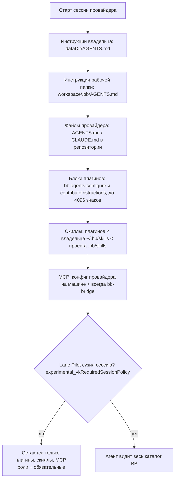

# Что получает каждый агент

> [!important] Где правда
> Правила живут в коде: `ROLE_PROFILES` и `CORE_PROVIDER_GROUPS` в `src/rooms/contracts/helper-context.ts`, сотрудники в `EMPLOYEES` (`src/rooms/contracts/native-agent-static.ts`), модели в `ROLE_TABLE` (`packages/models/src/role-models.ts`). Этот файл объясняет их. Итог для конкретной роли показывает экран P13 «Агенты и загрузка» (`agent_loadout`, см. [`docs/ui/console-map.md`](ui/console-map.md)). Имена ролей описаны в [`docs/agents.md`](agents.md).

## Как BB собирает сессию

| Слой | Правило | Источник |
|---|---|---|
| Инструкции владельца | `<dataDir>/AGENTS.md` добавляется в системный промпт каждого провайдера | `bb guide agent-configuration` |
| Инструкции рабочей папки | `<workspace>/.bb/AGENTS.md` после них; родительские папки не читаются | там же |
| Файлы провайдера | Codex читает `AGENTS.md` в корне репозитория; Claude Code — `AGENTS.md`, если нет `CLAUDE.md` | там же |
| Блоки плагинов | `bb.agents.configure` и `contributeInstructions` только у **включённых** плагинов; обрезаются до 4096 знаков; действуют со следующего старта сессии | SDK `PluginAgents.configure` |
| Скиллы | плагин < владелец (`~/.bb/skills`, источник `bb-user`) < проект (`.bb/skills`). Скиллы плагина берутся только у включённых плагинов. При одинаковом имени побеждает верхний источник, нижний тихо выпадает | `bb guide agent-configuration`, `docs/skill-standard.md` |
| MCP | конфиг провайдера на машине (`~/.claude.json`, `.mcp.json`, `~/.codex/config.toml`, `opencode.json`) + обязательный `bb-bridge` | `native-agent/session-inventory.ts`, `MANDATORY_MCP_SERVERS` |
| Сужение | Lane Pilot передаёт политику сессии: `bbPlugins`, `skills`, `mcpServers`, `nativePlugins`, `userInstructions`, `projectInstructions`, `claudeAiSync` | `helper-context.ts` |
| Что сужает провайдер | claude-code и codex: все четыре группы; opencode2: плагины, скиллы, MCP | `CORE_PROVIDER_GROUPS` |

**Всегда есть в суженной сессии:** плагины `environment-project-checkout` и `project-folders`, MCP `bb-bridge`.

**Инструкции по умолчанию для помощников:** `~/.bb/AGENTS.md` владельца **не** передаётся; инструкции проекта передаются, кроме ролей «только промпт»; синхронизация Claude.ai выключена.

## Порядок выбора для помощника

1. `helper.context_mode`: `roles` (по умолчанию), `inherit`, `selected` или `none`.
2. В режиме `roles`: доступ, заданный владельцем (`helper.role.<role>`: `role` / `all` / `allow`), иначе профиль роли `ROLE_PROFILES[role]`, плюс обязательный набор.
3. Сверху добавляется: скиллы, плагины и MCP шага графа, доступ из профиля сотрудника, подбор скиллов для исполнителя.

**Модель:** шаг графа → `role_model.<role>` раздела, проекта или системы → старая настройка этапа → встроенное значение. У исполнителя кода своя цепочка: `writer.provider` / `writer.model` и до трёх запасных.

## Роли конвейера

| Роль | Плагины | Скиллы | MCP | Модель по умолчанию |
|---|---|---|---|---|
| Исполнитель кода (writer, code-repair, night-fixer) | — | `lp-writer`, `karpathy-guidelines` + подбор | gitnexus | настройки writer |
| Критик плана, сортировщик, читатель PM, аналитик, планировщик, аудитор | — | — | — | Gemini Flash / Haiku / Opus / GPT Sol |
| Критик кода, ревьюер специалиста, разведчик | — | — | gitnexus | Gemini Flash; разведчики: Argon / Sonnet / Terra |
| Отладчик | — | `gitnexus-debugging` | gitnexus | GPT Sol |
| Онбордер | — | `project-life` | — | — |
| Хранитель памяти, анализатор правил, подготовка окружения | — | — | — | Haiku / Luna |
| Проверка в браузере | browser-automation | browser-automation | — | Sonnet, Mac mini |
| Поручение | browser-automation, env-catalog | browser-automation, computer-use, env-catalog | — | по виду поручения |
| Разведка API | browser-automation, env-catalog | browser-automation, env-catalog | — | GPT Terra |
| Штурман (lead) | lane-pilot | — | — | Opus |
| Архитектор графов | lane-pilot | `lane-pilot` | — | Opus |

## Сотрудники

| Сотрудник | Плагины | Основные скиллы | MCP | Машина |
|---|---|---|---|---|
| growth-marketer (маркетолог, на ставке) | env-catalog | env-catalog, mkt-end-to-end-analytics, mkt-organic-content | — | любая |
| seo-specialist (SEO, на ставке) | env-catalog | env-catalog, seo-drmax-orchestrator | — | любая |
| design-lead | env-catalog | env-catalog, project-design, modern-web-guidance, page-prototype | metamcp | любая |
| copy-lead | env-catalog | env-catalog, copywriter | — | любая |
| video-lead | env-catalog | env-catalog, video-lead-playbook | — | любая |
| visual-artist | image-studio | image-prompting | — | любая |
| social-manager | env-catalog | env-catalog, telegram-user | — | любая |
| billing-assistant | env-catalog | env-catalog, kontur-elba | — | Mac mini |
| tavily | env-catalog | env-catalog, tavily | — | любая |
| 3d-artist | — | blender-director | blender | Mac mini |
| game-dev | — | roblox-toolkit | — | Mac mini |
| macos-operator | browser-automation, env-catalog | env-catalog, computer-use | — | Mac mini |
| свой агент | env-catalog | env-catalog + свои | свои | — |

- В открытом чате, в задании от PM и в рутине по расписанию сотрудник получает ещё **пакет направления** (`STANDALONE_SPECIALIST_SKILL_PACKS`): SEO 17 скиллов, маркетинг 9, тексты 11, дизайн 11, видео 11, 3D 14, игры 10, соцсети 8. В шаге графа пакета нет: только основные скиллы и скиллы шага.
- Инструмент у сотрудника один: `lane_pilot_schedule`. Рутина по расписанию код не меняет.

## PM (координатор)

- Инструменты: 30 инструментов `NATIVE_LP_BRIDGE_PM_TOOLS`, плюс gitnexus, metamcp и подагенты из `bundled-agents.json`.
- Инструкции: `LANE_PILOT_PM_SESSION` и `pmRunInstructions`; это единственный тред, куда Lane Pilot добавляет инструкции через `bb.agents.configure`.
- Скиллы: karpathy-guidelines, lane-pilot, project-life, project-resume, project-onboard, project-design, web-design, ui-ux-pro-max, app-architect, page-prototype, metamcp.
- Сессия PM **не сужается**: он видит весь каталог BB. Поэтому P13 показывает для PM список «основных» скиллов и пометку «плюс весь каталог».

## Когда Lane Pilot выключен

Скиллы, блоки инструкций и инструменты Lane Pilot не попадают ни в одну сессию: BB берёт их только у включённых плагинов. Скиллы `mkt-*`, `seo-*`, `project-*` и `karpathy-guidelines` при этом остаются: у них есть копия в `~/.bb/skills` владельца.

## Найденные расхождения (2026-11-27)

| # | Что | Последствие | Куда |
|---|---|---|---|
| 1 | 9 своих скиллов Lane Pilot (`lane-pilot`, `lane-memory`, `lp-writer`, `lp-plan`, `lp-implement`, `lp-verify`, `lp-docs`, `lp-project-setup`, `lp-agentic-discipline`) не объявлены в `package.json → bb.skills` и не опубликованы на хаб | роли, которым они назначены (исполнитель, архитектор, PM), их не получают | решение владельца: объявить корень скиллов или опубликовать на хаб |
| 2 | Копии `mkt-telegram-ads-method`, `mkt-yandex-direct-epk`, `project-resume` на хабе отличаются от репозитория | агенты читают копию хаба | сверить и опубликовать одну версию |
| 3 | `bundled-agents.json` у seo-specialist перечисляет 8 MCP, а `ROLE_PROFILES` их отрезает | в профиле видно больше, чем агент получает | P13 показывает итог, а не профиль |
| 4 | Нет одного места, где видна итоговая загрузка роли | владелец не может проверить, что получит агент | `agent_loadout` и P13 |
