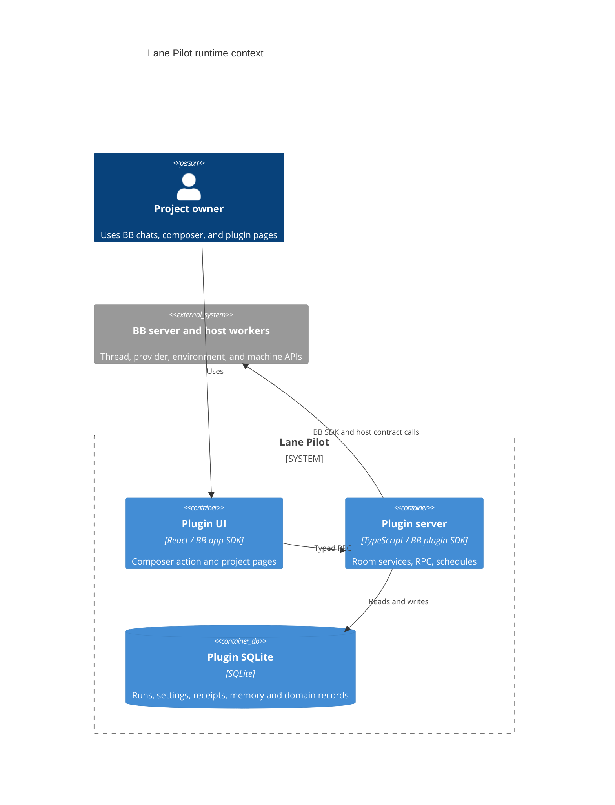
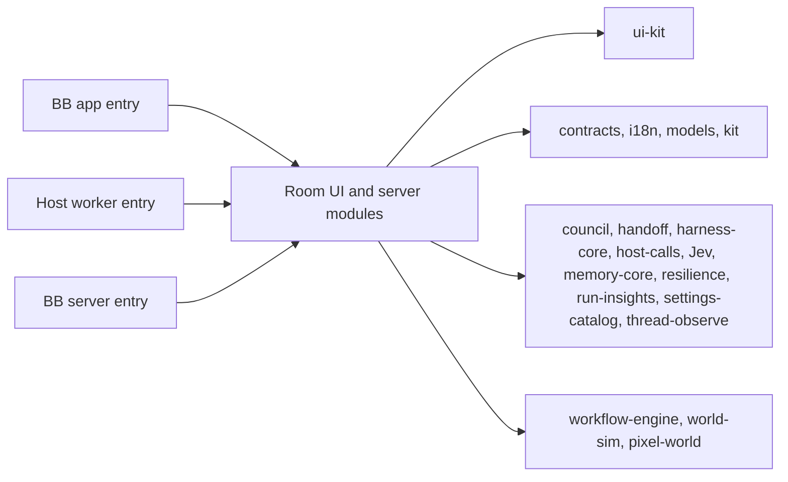

# Lane Pilot architecture

TL;DR: The BB plugin server owns SQLite and room services; the app UI and host workers communicate with it through typed RPC and host contracts.

## System context and containers

The UI and server entries are declared by the package's BB manifest (`package.json:8-18`). The server uses BB's plugin storage database and runs migrations during startup (`src/rooms/storage/database.ts:336-340`). The UI receives methods from the assembled `rpcContract`, while host calls use `hostContract` (`src/rooms/contracts/index.ts:1-27`, `src/rooms/contracts/host.ts:6-15`). The host client wraps checkout-writing calls and acceptance checks with a drain gate (`src/rooms/core/server/core.ts:91-100`, `src/rooms/stability/server/deploy-drain.ts:1-6`).

## Application and package dependencies

The root package declares workspace dependencies and the three BB entries; `server.ts`, `app.tsx`, and `host.ts` import their room-facing implementations (`package.json:8-18`, `package.json:20-54`, `server.ts:1-48`, `app.tsx:1-50`, `host.ts:1-30`). The diagram groups small workspaces by their use from the app, room server, and host entry. Package API ownership is listed in [shared packages](packages.md); UI kit, workflow engine, and world simulation internals are documented in their [workspace pages](../packages/ui-kit/docs/overview.md), [workflow engine overview](../packages/workflow-engine/docs/overview.md), and [world simulation overview](../packages/world-sim/docs/overview.md).

## Startup and service composition

1. BB calls `plugin(bb)`. The entry opens SQLite and installs thread signals, then creates the shared core (`server.ts:55-60`).
2. The core installs disposal state, log redaction, realtime notifications, owner-interaction handling, host RPC and background host jobs (`src/rooms/core/server/core.ts:31-49`, `:87-100`).
3. The entry mounts native message dispatch and environment hooks, then fills a shared `Services` object with room-owned factories for writer, workflow, QA, docs, memory, council, world, stability, and scheduling (`server.ts:61-91`, `src/rooms/core/server/native-wiring.ts:10-34`).
4. Lifecycle events, RPC, tools, CLI, world assets, Anamnesis, and the native worktree provider are registered after services exist (`server.ts:92-110`).
5. The entry schedules run reconciliation, silent-writer checks, and worktree cleanup (`server.ts:111-139`).
6. On reload or shutdown, the lifecycle handler enables the checkout drain, waits for in-flight calls until its deadline or abort, and stores a drain snapshot in BB KV (`src/rooms/native-install/native-install-lifecycle.ts:15-20`, `src/rooms/stability/server/deploy-drain.ts:59-79`). Startup skips immediate periodic scans only after a clean reload drain (`src/rooms/stability/server/deploy-drain.ts:82-89`, `server.ts:174-188`).

`createCore` wraps the host client with job handling and the active schedule abort signal; calls made inside an isolated schedule run carry that signal (`src/rooms/core/server/core.ts:91-100`). The service bag's shared types are defined in `src/rooms/core/server/services.ts`.

## Dependency boundaries

The import boundary test defines public room files as `index.ts`, `server/index.ts`, and `ui/index.ts`, restricts cross-room imports to those files, and rejects package imports into plugin `src/` (`tests/architecture/boundaries.test.ts:12-16`, `:25-40`, `:64-80`, `:122-131`). Entry wiring follows that boundary: `server.ts` imports room server exports and `app.tsx` imports UI-facing room exports (`server.ts:1-48`, `app.tsx:1-50`).

The test's deep-import baseline is recorded in `tests/architecture/deep-imports.json` (`tests/architecture/boundaries.test.ts:122-131`).

## RPC composition and event wiring

`rpcContract` combines shell, native-agent, runs, settings, operations, knowledge, workflow, and world schemas (`src/rooms/contracts/index.ts:18-27`). `registerRpc` combines domain handler maps, wraps them with timing, and registers the result against that contract (`src/rooms/core/server/rpc.ts:28-52`). The runs handlers expose the Tasks board and card; the native helper-thread response can include the open run's dependency graph (`src/rooms/runs/server/rpc/runs.ts:46-50`, `:165-202`, `src/rooms/contracts/rpc-native.ts:127-144`). See [RPC and host-call contracts](rpc-callers.md#how-it-works) and [Tasks board](task-board.md).

`mountNativeWiring` registers the mention provider, `message.dispatch` handler, Claude environment contribution, OpenCode shim, BB shim, and retry handling for dropped provider streams (`src/rooms/core/server/native-wiring.ts:10-58`). `mountLifecycleEvents` adds event listeners only when the BB event API exists and `LANE_PILOT_THREAD_SIGNALS` is not `0`; missing event names are logged and periodic sweeps remain the fallback (`src/rooms/core/server/lifecycle-events.ts:22-37`). It closes runs when their PM thread is archived or deleted and notifies PMs when an attempt is waiting on an owner interaction (`src/rooms/core/server/lifecycle-events.ts:39-72`).

Host methods include native install, Git ownership and worktree operations, long-running host jobs, stability drills, Anamnesis procedures, disk-space queries, OpenCode telemetry, docs/workflow file operations, and coexistence operations (`src/rooms/contracts/host.ts:6-90`, `:114-205`, `:207-260`, `:261-410`). `gitIntegrate` accepts ownership patterns and replay checks for an attempt rebased onto a moved base (`src/rooms/contracts/host.ts:61-71`, `src/rooms/host-worker/host-handlers.ts:75-101`). `runOnHost` is a typed convenience wrapper for `runCommand`; it passes the same host id in the call input and call options and defaults the transport wait to command timeout plus five seconds (`packages/host-calls/src/run-on-host.ts:8-31`).

## Data ownership

The shared SQLite migration array includes stores exported by Jev, council, handoff, run-insights, workflow engine, schedule, learning, world, and the harness room (`src/rooms/storage/database.ts:1-22`, `:319-333`). The [data model overview](data-model.md) links to domain tables. Workspace-specific tables belong to their owning package documentation, including [workflow engine](../packages/workflow-engine/docs/overview.md).

<!-- lane-pilot:backlinks -->
## Referenced by

- [Lane Pilot overview](overview.md)
- [World simulation overview](../packages/world-sim/docs/overview.md)
