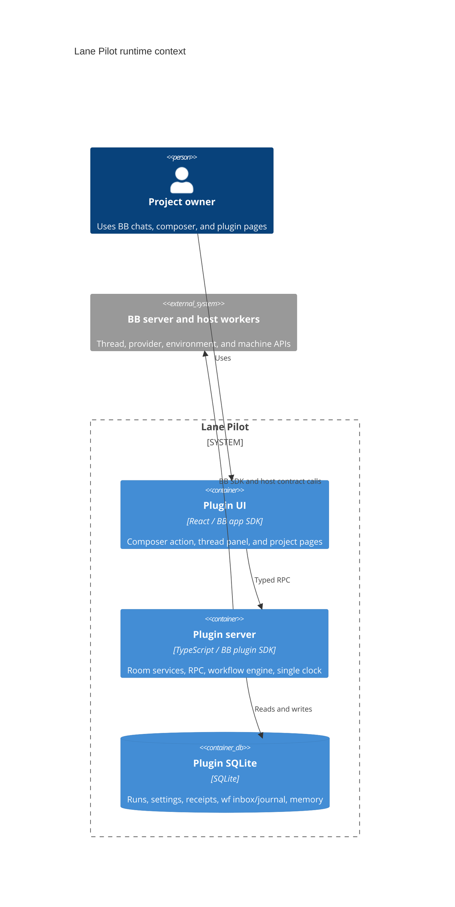
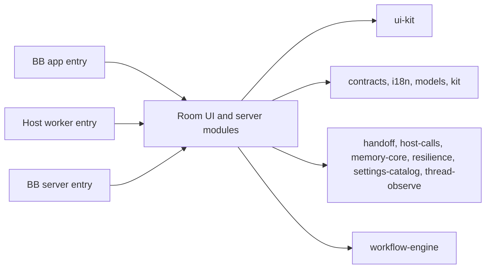

# Lane Pilot architecture

TL;DR: The BB plugin server owns SQLite, the single engine clock, and room services registered via `src/rooms/registry.ts`; the app UI and host workers communicate with it through typed RPC and host contracts.

## System context and containers

The UI, server, and host entries are declared by `package.json:16-18`. The server opens BB's plugin storage database and runs positional migrations during startup (`src/rooms/storage/database.ts`, `src/rooms/migrations.ts`, `server.ts:110`). The UI receives methods from `rpcContract`, while host calls use `hostContract` (`src/rooms/core/server/plugin-contracts.ts:9-16`, `src/rooms/contracts/host.ts:13-24`). The host client wraps checkout-writing calls and acceptance checks with a drain gate (`src/rooms/core/server/core.ts:80-93`, `src/rooms/stability/server/services/deploy-drain.ts`).

## Application and package dependencies

The root package declares the 12 workspace packages under `packages/*`, and `server.ts`, `app.tsx`, and `host.ts` import room-facing implementations (`package.json:16-18`, `package.json:101-103`). Package API ownership is listed in [shared packages](packages.md); UI kit and workflow engine internals are documented in [UI kit overview](../packages/ui-kit/docs/overview.md) and [workflow engine overview](../packages/workflow-engine/docs/overview.md).

## Startup and service composition

1. BB calls `plugin(originalBb)` (`server.ts:104`). It initializes runtime env, wraps `bb` with standard service-tier handling for Lane Pilot threads, opens SQLite with `lanePilotMigrations` and settings validation, installs BB thread signals, and builds `ServerCore` (`createCore`, `server.ts:105-113`).
2. `createCore` installs disposal tracking, log redaction, realtime notifications, owner-interaction handling (`createOwnerAsk`), host RPC (`hostContract`), reload drain (`createDeployDrain`), and background host jobs (`src/rooms/core/server/core.ts:31-95`).
3. `server.ts` mounts native message dispatch and environment hooks (`mountNativeWiring`), then populates the shared `Services` bag (`src/rooms/services.ts`) with room-owned services (`server.ts:119-205`).
4. Dispatch, agent-routine, schedule-script, worktree-cleanup, landing-suite, worktree-release, and specialist executors are registered on `services.workflowEngine`, and each room in `src/rooms/registry.ts` runs `room.startup?.(ctx, services)` (`server.ts:212-233`).
5. System and per-project calendar rows (`SYSTEM_SCHEDULES`, `PROJECT_SCHEDULES`) are ensured on the schedule board, lifecycle events (`mountLifecycleEvents`), RPC (`registerRpc`), tools (`registerTools`), CLI (`registerCli`), and the native worktree provider are mounted (`server.ts:222-290`).
6. A single `startup-recovery` background service runs `taskReconcile.reconcile(db, Date.now(), ...)` once on startup (`server.ts:307-369`), and `startBoardClock` mounts the plugin's single engine clock (`src/rooms/schedule/server/handlers/board-clock.ts:10-25`, `server.ts:371-375`).
7. On reload or shutdown, the lifecycle handler enables the checkout drain, waits for in-flight calls until its deadline or abort, and stores a drain snapshot in BB KV (`src/rooms/stability/server/services/deploy-drain.ts`, `server.ts:323-329`).

## Dependency boundaries and room layout

- **Public room entrypoints:** `tests/architecture/boundaries.test.ts` defines public room files as `index.ts`, `server/index.ts`, and `ui/index.ts`, restricts cross-room imports to those files (ratcheted in `tests/architecture/deep-imports.json`), and rejects package imports into `src/`.
- **Enforced room layout:** `tests/architecture/room-layout.test.ts` enforces the room layout (`index.ts`, `migrations.ts`, `settings.ts`, `models/`, `server/{index.ts,room.ts,handlers,services,repositories}/`, `ui/`), keeping host `fs`/`child_process` files at room level and `host-worker/handlers/` at the top of `host-worker`; `contracts`, `core`, and `storage` are exempt (`tests/architecture/room-layout.json` is `[]`).
- **Room registry:** `tests/architecture/room-registry.test.ts` verifies that every room with `server/` (outside `contracts`, `core`, `tools`) is registered in `src/rooms/registry.ts`.

## RPC composition and event wiring

`rpcContract` merges `scheduleRpcContract` and `rpcMethods` (`rpcShell`, `rpcNative`, `rpcRuns`, `rpcSettings`, `rpcOps`, `rpcKnowledge`, `rpcWorkflow`, `rpcWorkflowExport`, `rpcWorkflowMap`) (`src/rooms/core/server/plugin-contracts.ts:9-12`, `src/rooms/contracts/index.ts:28-40`). `registerRpc` merges explicit handlers with `roomRpcHandlers(ctx, services)` from `src/rooms/registry.ts`, wraps them with timing, and fails startup if any contract key lacks a handler (`src/rooms/core/server/rpc.ts:46-94`). See [RPC and host-call contracts](rpc-callers.md#how-it-works) and [Tasks board](task-board.md).

`mountNativeWiring` registers the mention provider, `message.dispatch` handler, Claude environment contribution, OpenCode shim, BB shim, and retry handling for dropped provider streams (`src/rooms/core/server/native-wiring.ts:16-104`). `mountLifecycleEvents` listens to `thread.archived`, `thread.deleted`, `interaction.pending`, `message.cancelled`, `message.dispatched`, `experimental_environment.removed`, and `experimental_host.deleted` when `bb.events.on` is present and `LANE_PILOT_THREAD_SIGNALS` is not `0` (`src/rooms/core/server/lifecycle-events.ts:26-145`). Thread events and `emitEvent` insert into `lane_pilot_wf_inbox` and call `workflowEngine.wake()` (`src/rooms/workflow/server/services/workflow-triggers.ts:289-356`), while `startBoardClock` drives waiting deadlines and due schedule-board rows from one timer (`packages/workflow-engine/src/engine-clock.ts`).

Host methods cover stack install, Git ownership and worktree operations, long-running host jobs, disk-space queries, OpenCode telemetry, docs/workflow file reads and writes, desktop/browser QA, and coexistence operations (`src/rooms/contracts/host.ts:13-24`). `gitIntegrate` accepts ownership patterns and replay checks for an attempt rebased onto a moved base (`src/rooms/contracts/host/git.ts`, `src/rooms/host-worker/handlers/git.ts`). `runOnHost` wraps `runCommand` with consistent host options and transport timeout padding (`packages/host-calls/src/run-on-host.ts:8-31`).

## Writer-side OpenCode guard plugin

Writer sessions run on each host's shared OpenCode v2 service under agent ids prefixed `lane-`; the `opencode-lane` plugin in `lane-stack` guards only those sessions and leaves any other OpenCode session alone (`lane-stack/opencode/opencode-lane/v2.ts:1-3`, `lane-stack/opencode/opencode-lane/hub-guard.ts:7-10`). Its entry `laneSetup` installs three hooks and returns a no-op disposer (`lane-stack/opencode/opencode-lane/v2.ts:25-91`):

1. `execute.before` checks every tool call of a lane agent. `guardTool` runs the tool guard against the session's working directory — its skills part accepts a skill only when `.opencode/skills/<name>/SKILL.md` exists in the folder or a parent — and `guardMcpV2` checks the call's MCP server against the service's server list; the MCP server list and the agent's permission rules are re-read at most every 30 seconds, and a returned message is thrown to block the call. The skills part is skipped for `lane-critic` and `lane-reviewer`, whose agent files name their own skills (`lane-stack/opencode/opencode-lane/v2.ts:38-53`, `:55-61`, `lane-stack/opencode/opencode-lane/guard.ts:171-186`).
2. `execute.after` fingerprints each result and counts identical repeats per session, keeping a bounded recent-call window; only a successful result gets a note appended. A third identical result gets a reuse hint — read and grep reuse the earlier result, write and edit on the same path must edit instead of rewrite (`lane-stack/opencode/opencode-lane/v2.ts:63-74`, `lane-stack/opencode/opencode-lane/budget.ts:13-14`, `:96-131`, `:133-160`).
3. `permission.evaluate` denies an action the agent's own permission rules deny, allows a `skill` action only when every named skill exists in the session's project folder, and denies shell commands matched by the hub shell denial rules (`lane-stack/opencode/opencode-lane/v2.ts:67-88`, `lane-stack/opencode/opencode-lane/guard.ts:171-183`).

## Data ownership

`migrations` in `src/rooms/migrations.ts` is positional and append-only; it composes slices exported by surviving rooms and packages (`@lane-pilot/workflow-engine`, `@lane-pilot/handoff`, `@lane-pilot/memory-core`, `schedule`, `deferral`, `rollback`, `owner-waiting`, `lead`, `baseline`, `stage-return`, `outage`, `backlog`, `memory-tiers`, `checkers`, `specialist`, `errands`) alongside frozen slices in `src/rooms/legacy-migrations.ts` for deleted rooms so existing databases preserve their exact migration indices (`tests/migration-lineage.test.ts`). The [data model overview](data-model.md) links to domain tables and [workflow engine overview](../packages/workflow-engine/docs/overview.md).

<!-- lane-pilot:backlinks -->
## Referenced by

- [Repository conventions and boundaries](conventions.md)
- [Lane Pilot overview](overview.md)
- [i18n workspace overview](../packages/i18n/docs/overview.md)
- [Kit workspace overview](../packages/kit/docs/overview.md)
