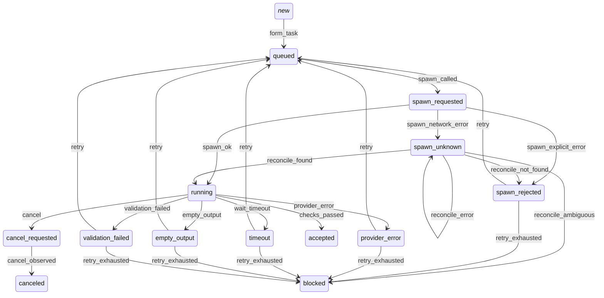

# Atlas of Lane Pilot

> Generated by `npx tsx scripts/generate-atlas.ts` from the code's registries. Do not edit by hand. <!-- atlas:structure 8808ab5efac04e3a -->

## Rooms (77)

Each room is one component: `index.ts` is its public API, `server/` its services, `ui/` its screens. Other rooms import only the public API.

| room | public API | files | lines | covered by |
|---|---|---:|---:|---|
| acceptance | — | 5 | 330 | tests (2) |
| anamnesis | ANAMNESIS_USAGE, EventLike, OwnerMessage, OwnerMessageConsumer, OwnerMessageHub, OwnerMessageMeta, TURN_REQUESTED, ThreadLike, anamnesisFor, anamnesisHandler, anamnesisHostMethods, anamnesisRpcMethods, fragmentJudgment, isOwnerThread, maskPii, matchJudgment, mountAnamnesis, ownerCardBlock, ownerMessagesOf, registerAnamnesisActions, sensitiveReason | 32 | 4260 | tests (2) |
| atlas | AtlasInput, AtlasRoom, atlasHash, atlasStructure, renderAtlas | 2 | 66 | tests (1) |
| backlog | BacklogBoard, MAX_ESTIMATE, TodoMeta, backlogBoard, backlogMigrations, backlogReadCommand, issueMessage, parseBacklogOutput, parseTodoMeta | 5 | 164 | tests (1) |
| baseline | BaselineRecord, EXISTENCE_ONLY_WORDS, NO_RED_KINDS, RegressionRecord, baselineMigrations, getBaseline, isExistenceOnly, listBaselines, listRegressions | 9 | 1318 | tests (4) |
| bench | BenchProjectControl, benchMigrations, getBenchProject, saveVerdict, verdictForHarness | 28 | 3190 | tests (2) |
| capability | CAPABILITIES, Capability, CapabilityReceipt, CapabilityState, adapterVersions, capabilityMigrations, capabilityTable, dueProbes, listReceipts, probeSetupFailed, providersInUse | 8 | 241 | drill: helper_providers |
| checkers | checkerMigrations | 16 | 1529 | drill: checkers |
| cockpit | cockpitRpc | 9 | 901 | tests (1) |
| contracts | AcceptanceCard, HOST_JOB_KINDS, HostJobKind, PrototypeConfig, TASK_KINDS, TASK_V2_OPTIONAL, TaskV2, WORKFLOW_NODE_TONES, hostContract, installReceiptSchema, modelCatalogSchema, prototypeConfigSchema, secretNameSchema, settingValidationSchema, stepExecutorSchema, taskV2Schema, workflowDraftCheckSchema, workflowDraftPatchResultSchema, workflowDraftPublishResultSchema, workflowDraftSummarySchema, workflowDraftTestResultSchema, workflowStatsSchema, workflowTrialCaseSchema, workflowViewEdgeSchema, workflowViewNodeSchema, workflowViewSchema | 11 | 2262 | drill: parallel3 |
| conveyor | CONVEYOR_KEY, ConveyorState, conveyorState, setConveyor | 2 | 25 | tests (2) |
| core | — | 25 | 2353 | drill: parallel3 |
| council | — | 17 | 6877 | tests (4) |
| coverage | COVERAGE, COVERAGE_USAGE, CoverageEntry, CoverageRow, CoverageStatus, CoverageSummary, DrillReceipt, NODE_KINDS, NodeKind, REQUIRED_MECHANISMS, checkReceipt, codeNodes, coverageRows, holes, renderCoverage, runCoverageCli, summarize, transitionId, untermedGaps | 4 | 324 | tests (1) |
| critique | CODE_CRITIC_DEFAULTS, CODE_CRITIC_DEFAULT_SETTING, CRITIC_EDIT_TRIAL_KEY, CRITIC_TIEBREAK_ROLE, CRITIQUE_WORTH_ID, CodeCriticDefault, ConfirmScreenInput, CriticEditRow, CriticEditStore, CriticEditTrialOutcome, CritiqueWorthDecision, CritiqueWorthInput, FAILURE_TRIAGE_METHOD, FRONTEND_VERIFY_METHOD, MAX_FILE_EXCERPT_BYTES, NO_TOOLS_LINE, QUALITY_MODE_SETTING, QualityMode, REVIEW_CONFIRM_SCREEN_ID, SCIENTIFIC_DEBUG_METHOD, SUBJECTIVE_WORDS, TaskQaPlan, TiebreakVote, Verdict, VerdictFinding, VerdictStatus, WriterIdentity, actionableFindings, advisoryFeedback, applyCodeCriticDefault, applyQualityMode, boundedAgentName, browserQaRequired, buildCandidateEvidence, clipped, codeCritiquePrompt, codeCritiqueSource, codeCritiqueStops, codeRepairPrompt, criticEditGate, criticEditTrialOn, criticEditTrialSettle, criticEditWasRejected, criticPromptOf, criticPromptProposal, criticPromptRollback, criticStats, critiqueFromStageResult, critiquePrompt, critiqueWorthJudgment, extractModelJson, findSandboxUnsafeMissingExcludes, findingsHash, isCodeCriticDefault, majorityRubric, nextRepairAction, parseCodeCritique, parseCodeCritiqueSettings, parseCritique, parseSandboxUnsafePatterns, parseTiebreakVotes, parseWriterRepairReply, qaStateToStatus, repairLedgerFromResult, resolveCodeCriticDefault, resolveQualityMode, resolveRetryEffort, resolveRubricTiebreak, reviewConfirmScreenJudgment, roleMethod, rubricDisagreements, runnerFilterArgs, runsWholeSuite, sameUnresolvedFindings, sameWriterIdentity, scanCritiqueCoverage, settingsFromFrozenPolicy, settleVerdict, shouldRequestRepair, taskQaPlan, tiebreakPrompt, verdictSchema, verdictSummary | 25 | 3686 | tests (2) |
| deferral | deferralKindMigrations, deferralMigrations | 11 | 738 | drill: deferrals |
| design-eval | CRITIQUE_AXES, Criterion, CritiqueAxis, DesignJournalLine, DrawingCritique, MEASURE_SCRIPT, Measurement, RUBRIC, compareDesigns, critiqueProblems, designScore, mergeFrames, readinessWords, roleLine, scoreMeasurement, trainedConditions, trainingRatios | 3 | 159 | tests (1) |
| docs | CITATION_SOURCE, DocsPage, expandCitationLists, parseDocsSettings | 10 | 2125 | tests (4) |
| forecast | Calibration, Forecast, ForecastFact, ForecastScore, calibrate, calibrationLine, scoreForecast | 6 | 166 | tests (1) |
| forge | FORBIDDEN_GRANTS, FORGE_KINDS, ForgeKind, ForgeReceipt, LintFinding, creatorBrief, draftFile, draftFolder, enabledPath, lintDraft, mountForge | 3 | 184 | tests (1) |
| front | FIRST_RUN_STEPS, FirstRunDraft, FirstRunStep, ForeignHelper, FrontApi, MUTATING_RPC, PeerSnapshot, answerFirstRun, createFront, firstRunNeeded, firstRunSettings, helperDraft, mountFront, parseHelper, peerLine | 3 | 198 | tests (1) |
| guard-tools | — | 1 | 38 | tests (2) |
| harness | harnessMigrations | 12 | 1780 | tests (4) |
| host-worker | answerPermit, applyOnboardingPages, browserGoal, classifyPlan, closeBacklogItem, coexistenceInventory, coexistenceOperation, connectOpencode, councilJudge, detect, discoverClaudeAgentsHost, diskFree, docsAnchors, docsDepth, docsFlows, docsLineCounts, docsStalenessHandler, docsVerifyCitations, docsWorthinessFacts, gateAttribute, gateBisect, gateRun, gitCommitDocs, gitCreateWorktree, gitDocsScope, gitIntegrate, gitMergeInfo, gitOwnershipBase, gitOwnershipChanges, gitPrepareWorktree, gitRemoveWorktree, gitRevertCommits, gitRevertPaths, gitSyncWorktree, gitUndoCheckWrites, gitWorktreeSnapshot, gitWorktreeState, importConfig, inspectCritiqueCoverage, install, jobCancel, jobStart, jobStatus, listDocsPages, listFolders, listPermitTickets, listWorkflowFiles, openCodeLimitProbe, prepareBbShimHost, prepareClaudeGuardHost, prepareNativeClaudeHost, prepareWorkerHome, probeBrowserQaTarget, readBoundedFile, readOpenCodeTelemetry, readUsageWindows, rollback, runBrowserQa, runCommand, runSandboxedCommand, runScript, sandboxCommandLine, sandboxRelease, snapshot, snapshotDryRun, stabilityDrill, vpnAddress, whichPrograms, writeDocsPages, writeForgeDraft, writeForgeEnabled, writePhaseBook, writePmSettings, writeWorkflowFile | 5 | 1341 | drill: parallel3 |
| hypotheses | BriefMode, HypothesisState, SEEDED, armsOf, briefMode, briefParts, hypothesisMigrations, settingsPair | 7 | 179 | tests (1) |
| improvement | HUB_KEYS, HUB_SPECS, HubArea, HubDb, HubKind, HubSpec, PROJECT_DEFAULT_KEYS, QUIET_PATTERN, hubFields, hubSettingProblem, readHubRows, specOf, validTimeZone, writeHubFields, writeHubSettings | 8 | 720 | tests (2) |
| jev | JEV_USAGE, runJevCli | 3 | 149 | tests (2) |
| learning | FRUSTRATION_KEY, FrustrationRecord, LEARNING_USAGE, MemoryUnanswered, complexity, frustrationReason, judgeRulesOnDiff, learningFor, memoryUnanswered, mountLearning, ownerMessageJudgment, ownerQuestion, pmResumeInstructions, pmRuleRelevance, pmRulesOf, pmRulesPromptBlock, ruleBudget, ruleViolationRemark, runLearningCli, sameAsJudgment, unkeptPromise | 24 | 2438 | tests (2) |
| memory | MEMORY_PATHS, MEMORY_PRIMITIVES, MemoryPath, MemoryPrimitive, MemorySettings, ProbeKind, parseMemorySettings, pathById | 11 | 898 | drill: memory_paths |
| memory-eval | — | 10 | 1047 | tests (2) |
| memory-probe | — | 2 | 225 | drill: memory_paths |
| memory-tiers | Episode, episodeLines, memoryTierMigrations, minHits, queryWords, wordHits | 5 | 200 | tests (1) |
| money | DailyRow, MoneyApi, PAID_PROVIDERS, PRICE_LIST, Price, UsageWindow, capOf, createMoney, isPaid, moneyHold, priceOf, rowUsd, spendBook, windowHold | 3 | 117 | tests (2) |
| native-agent | ACCESS_GROUPS, ACCESS_SWITCHES, AFFINITY_HOSTS, AgentFailure, AgentKind, AgentListItem, CORE_PROVIDER_GROUPS, CustomAgentMeta, DEFAULT_NATIVE_AGENT, EMPLOYEES, EMPLOYEE_IDS, EmployeeManifest, EmployeePlace, ExtraAccess, HELPER_ROLES, HelperPolicySnapshot, HelperRole, ListedProject, MAIN_AGENT_ID, MAIN_AGENT_PROFILE_IDS, MANDATORY_BB_PLUGINS, MANDATORY_MCP_SERVERS, MachineAffinity, NATIVE_LP_BRIDGE_PM_TOOLS, NATIVE_MENTION_PROVIDER, ProjectSourceBinding, RESULT_EXISTS, ROLE_PROFILES, SKILL_CATALOG_BLOCK, SKILL_CATALOG_LIMIT, SKILL_CATALOG_LINE, WriterBindingResolution, agentKind, agentListItem, agentPickerLabel, applyResourceMode, chooseEmployeePlace, collectAgentInventory, compileEffectiveMainAgent, compileMainAgentProfile, coreSkillsOf, createAgentInputSchema, createClaudeGuardEnv, detectCompiledMainAgentCapability, detectRequiredSessionPolicyCapability, discoverClaudeAgents, effectiveGroup, effectiveSwitch, employeeRoleLines, employeeView, finalizeNativeLaneBinding, handleNativeDispatch, installEmployeeSpecialists, isCustomAgentId, isEmployeeSpecialist, isReservedAgentId, isStockProfileId, mentionContext, nativeAgentCliId, nativeContributedEnv, nativeRunReady, nativeSelectionSchema, ownedNativePmRun, parseAgentFile, parseHelperContextSettings, parseOwnedAgents, parseRoleAccess, pendingSwitch, pickableAgent, placeEmployeeOn, prepareBbShim, prepareClaudeGuard, prepareNativeClaude, reconcileClaudeLane, recordRoleLine, resolveWriterBinding, resultExists, roleAccessKey, roleLinesKey, sessionInventory, stockEmployee, updateAgentInputSchema, userVisibleProjects, withRoleLines, writerWorkspaceForPmInstructions | 48 | 6666 | drill: helper_providers, provider |
| native-install | HostContext, NATIVE_HOOK_SOURCES, NATIVE_OPENCODE_SOURCES, PathWindows, SESSION_HOOK_SOURCE, atomicText, connectOpencodeStack, createNativeInstaller, detectStack, experimental_vkLifecycle, importConfigStack, installStack, inventoryCoexistence, parseExecutionLineWindows, rollbackStack, runCoexistenceOperation, snapshotStack | 27 | 7809 | tests (1) |
| night | emergencyFallbackDecision, nightReviewPrompt | 6 | 222 | tests (4) |
| night-graphs | — | 5 | 375 | tests (4) |
| outage | BEAT_KEY, OUTAGE_THRESHOLD_MS, Outage, OutageRecord, gapOutage, listOutages, outageMigrations | 6 | 108 | tests (1) |
| outbound | EVENT_FIELDS, TaskEvent, isOutboundState, mountOutbound, taskEventBody, worldVersion | 2 | 51 | tests (2) |
| owner-presence | PRESENCE_FILE, PRESENCE_WINDOW_MS, Presence, laneOwnedMetadata, presenceHold, readPresence | 4 | 140 | tests (2) |
| owner-waiting | Overnight, OwnerAction, OwnerEvidence, OwnerItem, OwnerWaiting, PostOwnerItem, closeOwnerItem, collectOwnerWaiting, loadPushConfig, ownerWaitingCounts, ownerWaitingMigrations, postOwnerItem, setSandboxProjects | 9 | 601 | tests (3) |
| permits | — | 1 | 101 | tests (1) |
| phase | ACCEPTANCE_LINES, AcceptanceLine, BOOK_SECTIONS, BookPart, BookSection, ContextDoc, FrozenVerdict, GENESIS, GateResult, NextAction, PHASE_STAGES, Phase, PhaseRecord, PhaseStage, PhaseState, PlanItem, RETURN_STAGES, TaskFact, acceptanceLines, blindVerdict, brokenLink, canonical, contextSignature, designDecision, designGate, discussionGate, executionGate, getPhase, intakeJudgment, isMachineMessage, issuable, lessonsNeeded, listParts, listPhases, nextAction, partHash, pathClassJudgment, phaseFolder, phaseMigrations, pieceProblems, planGate, planSignature, renderBook, staleAfterReturn, waveProblems | 15 | 3530 | drill: phase |
| pilot | PILOT_MIN_SIBLINGS, RunTask, pilotOf, pilotUnderWall, runTasks | 3 | 123 | tests (2) |
| policy | ChangeDescriptor, EXAM_RESULT_KEY, POLICY, POLICY_USAGE, StoredExam, TIERS, Tier, authorize, classifyChange, collectAndAppend, composeMorningList, explainChange, globMatch, loadLiveExam, recordOwnerDecision, runExam, runLiveExam, runPolicyCli, shouldStopCycle | 8 | 673 | tests (2) |
| project-life | OnboardingAcceptedEvidence, OnboardingInputPage, ProjectLifeTaskSummary, acceptedOnboardingEvidence, isAllowedProjectLifePath, shouldTriggerProjectLife | 5 | 433 | drill: parallel3 |
| qa | QA_HOST_KEY, mapListedQaHosts, qaSpawnClaimed, runBrowserQaOnHost | 10 | 1668 | tests (1) |
| receipts | — | 1 | 70 | tests (2) |
| relay | OWNER_ASK_RENDERER_ID | 11 | 1342 | tests (2) |
| rollback | rollbackMigrations | 7 | 610 | tests (1) |
| rule-forms | FormAsk, MECHANISMS, Mechanism, PROMOTION_DIGEST_TOP, PromotionRoute, PromotionServiceApi, RULES_USAGE, RuleHold, RuleMechanismName, RuleMechanismPlan, RulesCliDeps, acceptPromotion, applyJevForms, buildMechanismTask, createPromotionService, deliverPromotionDigests, dismissPromotion, dispatchPromotion, formDistribution, jevPickForms, lintBlockedCommand, lintMigrationOrder, lintPathRule, lintVerificationRule, listPromotions, mechanismFor, promotionDigest, promotionMorningLine, promotionRoute, promotionWeeklyLines, promotionWhy, proposePromotions, ruleMechanismPlan, runRulesCli, settlePromotionTask | 8 | 768 | tests (2) |
| run-goal | GoalCoverage, GoalVerdict, MIN_ACCEPTED, RedCheck, RunGoalRecord, TaskState, getRunGoal, goalCoverage, goalVerdict, pmGoalMessage, runGoalCoverageMigrations, runGoalMigrations, runReady | 8 | 312 | tests (2) |
| runs | AttemptState, DISPATCH_IDEMPOTENT_WINDOW_MS, DISPATCH_STAGES_PENDING, ENVIRONMENT_REASON, EXTERNAL_OPS, EXTERNAL_OPS_WARNING, FREE_CLASSES, FREE_RETRY_LIMIT, FailureClass, FailureClassDecision, FailureClassInput, FailureIntervention, FailureSide, IllegalTransitionError, MAIN_ATTEMPT_LIMIT, MAST_OF_FAILURE, NO_ANSWER_REASON, PARKED_CLASSES, REPLAY_CHECK_FAILED, RETRY_ELIGIBLE, S8_RELATIVE_PATHS, SESSION_MAX_MS, SESSION_MAX_TURNS, TARGET_SHA, TRANSITION_TABLE, UPSTREAM_REPO, VERIFICATION_TIMEOUT_RETRIES, WRITER_SILENT_REASON, acceptanceStats, aggregateRun, beginChecks, checksInFlight, checksMoved, cliReceiptAttemptKey, cliReceiptRunKey, failureClass, failureClassCooldownMs, failureClassJudgment, failureClassLive, failureClassReport, failureFingerprint, failureIntervention, failureSide, isCapacitySaturated, isEnvironmentCheckFailure, isKnownReason, isLegalMove, isOwnerDecision, isPreStartStop, isWaitingSecret, isWriterSilent, judgedFailureClass, liveFolderLockNote, nextStep, repeatedFailureReason, taskFamily, turnFailureKey, unknownReasons, verificationTimeoutOverBudget | 37 | 3932 | drill: parallel3 |
| schedule | ERRAND_BUILTIN, SCHEDULE_ERRAND_DEFAULT_KEY, createScheduleStore, errandDefaultProblem, scheduleAgentMigrations, scheduleMigrations, scheduleRpcContract, taskOf | 32 | 3679 | tests (1) |
| secrets | — | 4 | 248 | tests (1) |
| self-improve | — | 1 | 65 | tests (2) |
| self-repair | — | 8 | 2664 | tests (4) |
| session-hooks | buildCapsule, capsuleRestored | 3 | 489 | tests (1) |
| settings | SettingValidationError, readImportConfig, validateSettingValue, validateSettingsObject, validationErrorText | 20 | 3017 | drill: provider_limit |
| sma-map | LiveRow, LiveSource, ProofRoots, SMA_CARDS, SMA_CONTRACT_TESTS, SMA_ENTRIES, SMA_LINKS, SMA_LIVE, SMA_MAP_SHA, SMA_MAP_USAGE, SMA_NODES, SMA_REGIONS, SmaCard, SmaCounts, SmaEntry, SmaEvidence, SmaKind, SmaLinkKind, SmaNode, SmaRow, SmaStateCounts, SmaStatus, brokenProof, defaultProofRoots, isChecked, isDone, readSmaLive, renderSmaLive, renderSmaMap, runSmaLiveCli, runSmaMapCli, smaCheckedPercent, smaCounts, smaDonePercent, smaEvidence, smaGroups, smaHoles, smaRows, smaStateCounts, unjudgedProof | 7 | 9207 | tests (1) |
| stability | ReconcileCursor, ReconcileResult, parseOpenCodeToolTelemetry, reconcile, reconcileCritic, reconcileCursor | 13 | 1483 | drill: reload |
| stage-return | StageReturnRecord, finishReturn, getReturn, insertReturn, listReturns, renderReturnNotes, stageReturnMigrations | 10 | 490 | tests (4) |
| storage | CheckRef, DEPENDENCY_REDO_WAIT_MS, DraftRow, DraftStore, EffectRow, GATE_CATEGORIES, GateEventRow, HARNESS_VERSION, HOLDING_ATTEMPT_STATES, Journal, LanePilotDatabase, RunHistoryRow, RunRow, RunStatus, STATS_EPOCH_DEFAULT, STATS_EPOCH_SETTING, StageEventRow, StageReceiptRow, StepRow, StoredWorkflow, TERMINAL_RUN, TaskOutcome, WorkflowFileSource, WorkflowStore, appendAcceptedFact, appendGateEvaluation, casResetSettings, casUpsertSetting, casUpsertSettings, casWriteWorkflowFile, claimActivation, claimDailySchedule, claimDocsSpawn, claimStageSpawn, clearSettingValue, closeRun, countAttempts, countChargedAttempts, countStageReceipts, countThreadTurns, createAttempt, createDraftStore, createJournal, createRun, createStatusResolver, createTask, definitionSha256, deleteStageReceipt, endSpawnFailure, findOpenNativeRun, freeTaskId, freezeRunBinding, getActivation, getAttempt, getReasoningTrace, getRun, getRunObjective, getRunSettingsScopes, getRunWriterHost, getSettingVersions, getStageReceiptResult, getTask, getTaskGitBase, getTaskPlan, globalWorkflowDir, importSettingsOnce, inspectAttempt, inspectState, latestTaskAttempt, latestTaskAttemptState, listAcceptedFacts, listAttemptsForTask, listCheckDurations, listCheckTimeouts, listGateEvents, listLiveTasksForRun, listOpenAttempts, listOwnSettingLevels, listPendingAcceptedFacts, listRunsPage, listRunsWithAttempts, listSecretIssuance, listSettingRows, listStageEvents, listStageReceiptSummaries, listStageReceipts, listTaskKinds, listTaskTerminalStates, listTasksForRun, listUnansweredWriterQuestions, listUnfinishedStages, listUnreportedTaskOutcomes, loadProjectSettings, loadPrototypeConfig, loadRunHelperPolicyJson, loadWorkflowStore, markAcceptedFactsSummarized, markTaskOutcomesReported, migrations, nodeFileSource, noteToldPmDirectly, onAttemptChanged, openDatabase, persistRunHelperPolicyJson, pmBookkeepingPending, pmHasTasksAtWork, projectWorkflowDir, recordCheckDuration, recordFinishedAttempt, recordSecretIssuance, releaseActivation, removeOwnSettings, reviveCanceledAttempt, saveProjectSetting, savePrototypeConfig, saveReasoningTrace, saveStageReceipt, saveTaskGitBase, saveTaskPlan, searchMemoryRecords, sectionBindingId, setAttemptDirtBefore, setAttemptEnvironment, setAttemptHolderThread, setAttemptWorkspace, setIllegalTransitionLog, setReasoningThread, setRunObjective, setRunSettingsScopes, setRunState, setRunThread, setRunWorkspace, sha256, sha256Text, stableId, statsEpochLine, statsEpochMs, storeMemoryRecords, taskBasePath, toldPmDirectly, transitionAttempt, updateTaskContract | 3 | 1890 | drill: parallel3 |
| tasks | BIRTH_KINDS, BirthKind, BlockingClass, CHECK_HISTORY_MIN_RUNS, CHECK_RECIPES, CheckMeasure, CheckReading, CheckRecipe, CheckRun, CheckVerdict, EvidenceCheck, FACT_KINDS, FactKind, GATE_CODES, GateReport, HOLD_FOREVER, INVARIANT_ITEM, INVARIANT_WORDS, ItemVerdict, LANE_QUEUES, LoopTask, MARKER_BRIEF_LINE, NO_CODE_KINDS, OpenShape, PLAN_FACT_BRIEF_LINE, PLAN_FACT_JEV_ID, PLAN_FACT_RULES, PRIORITIES, PlanFactCheck, PlanFactFacts, PlanFactJevDecision, PlanFactJevInput, PlanFactJevItem, PlanFactTable, Priority, QUESTION_KINDS, QuestionKind, RunWriterPool, SHARED_PATH_TASKS, STAGE_IDS, STAGE_PROOF, StageId, StageProof, StageReceipt, StageState, TASK_SIZE_MIN_SAMPLE, TASK_WORDS_KEY, TOPIC_LOOP, TRUSTED_TOOLING_PATTERNS, TaskSize, TaskSizeMedian, TaskWord, TestFitFile, TestFitHit, TopicLoop, TopicWall, VerifyResult, WORKER_ENVELOPE, WriterMarkers, acceptanceArtifactDir, acceptanceProofGap, applyTrustedTooling, batchShapeAdvice, bbWriterReportMarkdown, birthFindings, blindPlanFact, blockingClass, buildAcceptanceV2, buildRunExecutionProfile, buildRunPolicy, checkProgram, checkRecipe, classifyWriterOutput, clipDiff, commonTaskFolder, deadLetters, diffHunksCommand, existsCommand, existsFromCommandOutput, factKind, gateVocabularyLines, hunksFromCommandOutput, isAdvisoryProof, isMainfixTask, isOutputPath, isTaskBase, isWholeConsent, landingWordGap, laneCap, laneQueueOf, mapBounded, mapVerificationCwd, medianTaskSize, ownerWordFindings, ownerWordsOn, ownsFromOuterBase, p95, parsePlanFact, parseRepoTop, parseRunPolicy, planFactJudgment, planFactOutcome, planWithOutsideReads, priorityRank, questionKind, questionsFromFile, queueOrder, readCheckRun, recordTaskWord, referenceTestEdits, repoTopCommand, rerootTask, retargetTask, secretShaped, sha256, shouldReconcileAttemptThread, shouldResumeWorktreeHolder, shouldScanLostWorktreeHolder, spendReserve, stageReceiptSchema, stageTransition, taskSizeOf, taskSizeText, taskStem, taskWordKey, testFitFindings, testNames, topicHold, topicLoop, topicLoopMessage, trustedToolingFor, trustedToolingHint, trustedToolingHits, unownedExpectedOutputs, untouchedCitations, validateAcceptanceV2, validateStageReceipt, verificationScriptPaths, writerMarkers | 31 | 3169 | drill: parallel3 |
| tools | foldedToolHome, rewriteFoldedToolNames | 8 | 1432 | drill: parallel3 |
| twins | RECORD_MAX_AGE_MS, Shape, shapeOf, twinDiffers | 2 | 38 | tests (1) |
| ui-shell | — | 22 | 2637 | tests (3) |
| usage | AttemptMetrics, AttemptMetricsReport, CostState, TokenBreakdown, attemptMetrics, billedFrom, parseBreakdown, tokenBreakdown, tokenDelta | 10 | 1422 | tests (3) |
| validators | PageReview, ValidatorDeps, validateDeliverable | 2 | 291 | tests (1) |
| verification | EXCLUDE_NOT_GIT, FlakyEvidence, HostMachineFacts, MachineReading, MergeInfo, OwnershipTask, PRESSURE_LIMITS, ReplayCacheEntry, ReplayCheck, ReplayCheckOutcome, RevertResult, SANDBOX_OWN_ENV, TEST_FILE_RE, WORKSPACE_DIRT_COMMAND, WorktreeState, appendExcludeCommand, attributeGateOnHost, bisectGateOnHost, buildDocsAnchors, buildDocsFlows, cachedReplayVerdicts, commitDocs, createProviderGate, createWorktree, darwinAvailableBytes, docsDepth, docsLineCounts, docsStaleness, docsWorthinessFacts, ensureExcludeLinesCommand, findUnownedChanges, findUnownedRunChanges, flakyEvidence, gateTriagePrompt, gitDocsScope, gitOwnershipChangedPaths, integrateWorktree, jevApiKey, jevCallFor, mergeInfo, outputTail, parseGateTriageResult, parseWorkspaceMode, persistTaskFolder, prepareSandboxedCommandLine, prepareWorktree, pressureOf, providerListed, providerSwitchOn, readMachineFacts, readingFrom, readingNote, recordReplayVerdict, recordedReplayFailure, releaseSandboxedCommandLine, removeLaneWorktree, replayCacheLocation, replayKey, requireManagedWorktreeProvider, resolveAttemptWorkspace, resolveGitOwnershipBase, resolveManagedWorkspace, resolveRunOwnershipScope, revertCommitsInWorktree, revertPaths, runGateOnHost, runSandboxedCommandOnHost, runStabilityDrill, safeRelative, snapshotWorktree, suggestTests, syncWorktree, taskFolderRel, testHintLine, undoCheckWrites, userToolBins, usesManagedWorktree, validateOwnershipContract, verifyDocsCitations, waitManagedWorktreeReady, waitProviderEnvironment, worktreeState | 32 | 5379 | drill: parallel3 |
| wall | WALL_FILTER_ID, WallFilterAction, WallFilterCategory, WallFilterDecision, WallFilterInput, buildWallFilterState, wallDeferralKindMigrations, wallFilterJudgment, wallMigrations | 22 | 3135 | tests (4) |
| wires | WIRE_MARK, Wire, WireHop, WireResult, brokenWireReason, readWires, wiresCommand | 2 | 52 | tests (2) |
| work-graph | AttemptIn, CellState, CostState, ExecutorRow, GRAPH_STAGES, GraphStats, ModelStageStat, ReceiptIn, Role, StageBlock, StageCell, StageEventIn, StageStat, TaskGraph, TaskSummary, Tokens, UsageIn, graphStats, median, roleOf, stageCells, taskGraph | 11 | 616 | tests (2) |
| workflow | DOCS_MAINTENANCE, DOCS_NIGHT, DraftCheck, DraftOp, DraftScope, DraftTestResult, GOAL_SCREEN_ID, ISSUE_QUICK_SHORT_PATH, LP_TASK_PIPELINE, NodeExecutor, PLAN_CHECK_ID, ROUTE_WORKFLOW_ID, RawDefinition, Refusal, RunSummary, SELF_REPAIR, SERVICE_JOBS, StepContext, ValidateOptions, WORKFLOW_ARCHITECT_ID, WORKFLOW_ARCHITECT_NAME, WORKFLOW_ARCHITECT_SESSION, WORKFLOW_ARCHITECT_SUMMARY, WORKFLOW_ARCHITECT_TOOLS, Workflow, WorkflowEngine, WorkflowProblem, builtinWorkflow, goalScreenJudgment, issueQuickModelCalls, issueQuickShortPath, issueQuickWorkflowId, planCheckJudgment, routeWorkflow, servicePair, servicePinKey, serviceRole | 61 | 9304 | tests (3) |
| world | worldMigrations | 7 | 534 | tests (4) |
| world-assets | — | 2 | 65 | tests (4) |
| writer | AGENT_TRASH_RELATIVE, BEST_OF_COUNT, BEST_OF_ROUNDS_DEFAULT, BEST_OF_ROUNDS_MAX, BEST_OF_ROUNDS_SETTING, BEST_OF_SETTING, BEST_OF_SLOT_CAP_SETTING, BEST_OF_TOKEN_BUDGET_SETTING, BEST_OF_VALUES, BestOfCandidate, BestOfPlan, DirtSnapshot, FinishScanDecision, FinishScanInput, ROUND_SEED_MAX_CHARS, RoundCandidate, WRITER_FINISH_SCAN_ID, WriterPair, attachStreamRetry, attemptProduced, bestOfBudgetAllows, bestOfPicks, buildCliInvocation, droppedStreamDetail, materializeAgentTrash, memoryLine, ownedAgentTrashPath, parseDirtSnapshots, pathAnchors, pickBestAttempt, reserveAppetite, resolveBestOf, resolveStageWriterSelection, reviewerMemoryPicks, roundSeedBrief, roundSurvivors, runCommandOnHost, writePmSettingsOnHost, writerBriefStats, writerFallbackChain, writerFallbackKeys, writerFallbacks, writerFinishScanJudgment, writerMemory, writerMemoryPicks, writerModelJudgment, writerReuseStats | 57 | 9758 | drill: parallel3 |

## Task stages (21)

| stage | proof | what decides it |
|---|---|---|
| pm-read | advisory | a model's summary of the read_first excerpts; it only hands context to the critics and decides nothing |
| plan-critique | advisory | a model's verdict on the plan: it never accepts a task, and in plan_critique.mode gate (the default, SMA p2_checker) its refusal stops the attempt before the writer |
| run-gate | receipt | the run gate decision and the ownership base preflight are stored in the run-gate receipt; the repository must report a readable base commit |
| specialist-review | advisory | a model's risk opinion on the plan |
| writer-agent | gate | gates owns-paths and validate: the changed files are inside owns_paths and expected_outputs exist with content |
| verification | command | every verification[].command exits 0 in the sandbox (gate verification passed) |
| code-critique | advisory | a model's review of the candidate |
| critic-tiebreak | advisory | a third cheap voice that settles the rubric items two critics answered differently; it decides nothing alone |
| plan-fact | file | blindPlanFact checks each acceptance row of the writer's plan-fact table against the candidate: the cited file is among the changed files, the cited lines overlap a changed hunk, the cited command is a verification[] command that exited 0; the writer's prose is never read |
| acceptance-receipt | schema | the acceptance-v2 receipt validates against lane-stack/schemas/acceptance-v2.schema.json (validateAcceptanceV2) |
| browser-qa | command | the browser cases run on the host and each case's recorded result is passed |
| docs-maintenance | file | validateDocsEdits accepts the edits, and each written file reads back byte for byte |
| onboarding-preview | schema | parseOnboardingPreview validates the passport and module map the onboarder produced |
| onboarding-apply | file | the host applies the previewed files and reports status applied |
| memory-maintenance | schema | parseMemoryCandidates and the memory door's content rules accept every entry (fields, valid_until, core budget) |
| project-life | gate | the committed head matches the commit the helper reports, and every changed path is inside the project-life scope |
| night-review | schema | parseNightReviewResult validates the review verdict and findings |
| night-fix | command | the fix changed only the finding's paths and the task's verification commands exit 0 |
| workspace-status | file | the environment's status and diff are read from the machine, and the status outcome is available |
| opencode-telemetry | file | the telemetry log is read from the host (size and sha256 match), parses without malformed lines and has a matching event |
| gate-triage | schema | parseGateTriageResult validates the triage result |

## Attempt state machine (26 transitions)

States: (new), queued, spawn_requested, running, spawn_rejected, spawn_unknown, blocked, provider_error, timeout, empty_output, validation_failed, accepted, cancel_requested, canceled.

## Memory delivery paths (17)

| path | consumer | carries |
|---|---|---|
| writer.brief | a writer's first prompt (spawnWriterAttempt) | note, core, rule |
| writer.turn | the turn that gives a continuing writer thread its next task (stickyTurnPrompt) | rule |
| writer.repair | the code-critique repair round (the dispatch context of the first brief, kept in the attempt trace) | note, core, rule |
| pm.start | a PM's first prompt (activation) | rule |
| pm.resume | a PM session that starts or resumes (contributeInstructions) | rule |
| pm.rules_tool | the PM tool lane_pilot_memory {action:"learned", op:"rules"} | rule |
| pm.contract | path-scoped rules returned with a queued task contract | rule |
| pm.memory_tool | the PM tool lane_pilot_memory {action:"context"} | note, core |
| schedule.agent | the first message of a scheduled agent run (kind agent of the schedule board): the project's notes for the standing task | note, core |
| critic.code | the code critic's prompt (critique-runs) | note, core |
| night.review | the night review's prompt | note, core |
| council.evidence | the evidence pack of a council of directors | note, core |
| hub.session_rpc | the hub session_memory RPCs, not a Lane Pilot agent prompt |  |
| pm.cold | cold notes added when the PM asks for memory and the active set is thin | note |
| maintainer.existing | the memory maintainer's list of EXISTING NOTES |  |
| memory.golden_eval | the retrieval evaluation (golden queries) |  |
| pm.owner_card | the owner card in a PM's first prompt (anamnesis) |  |

## RPC methods (208)

`acceptance_stats` · `actions_recent` · `activate_pm` · `activation_context` · `anamnesis` · `baseline_status` · `bench_compare` · `bench_status` · `canary_status` · `cancel_attempt` · `capability_table` · `chat_agent_state` · `cockpit_designer` · `cockpit_fault` · `cockpit_forge_order` · `cockpit_memory` · `cockpit_queue` · `cockpit_request` · `cockpit_seen` · `cockpit_seen_list` · `cockpit_task` · `cockpit_today` · `cockpit_update` · `cockpit_windows` · `cockpit_workers` · `conveyor` · `coord_clear` · `coord_status` · `council_say` · `council_stop` · `create_agent` · `critic_stats` · `decide_rule_proposal` · `deferral_close` · `deferral_defer` · `deferral_list` · `delete_agent` · `deploy_drain` · `deploy_status` · `docs_overview` · `door_audience` · `finish_run` · `first_run_answer` · `first_run_finish` · `first_run_get` · `forecast_report` · `get_agent_inventory` · `get_council` · `get_council_defaults` · `get_globals` · `get_preferences` · `get_role_models` · `get_routing_hint` · `get_run_card` · `get_screen` · `get_stage_result` · `halt_run` · `harness_configure` · `harness_edit` · `harness_reflect` · `harness_status` · `harness_tick` · `helper_access_view` · `helper_thread_labels` · `helpers_import` · `helpers_list` · `improvement_view` · `jev_provider_save_key` · `jev_provider_status` · `jev_provider_test` · `list_agents` · `list_councils` · `list_helper_threads` · `list_model_overrides` · `list_projects` · `list_rule_proposals` · `list_run_stages` · `list_runs` · `list_sections` · `lp_attempt_metrics` · `memory_probe` · `memory_record_delete` · `memory_records_list` · `money_status` · `native_install_start` · `native_install_status` · `native_thread` · `owner_waiting` · `owner_waiting_ack` · `owner_waiting_config` · `owner_waiting_digest` · `pause_run` · `peers_list` · `phase_act` · `phase_control` · `phase_get` · `phase_list` · `prepare_native_session` · `regress_close` · `regress_list` · `regress_run` · `remember_project` · `remove_claude_lane_leftovers` · `reset_model_overrides` · `reset_project_settings` · `resume_run` · `resume_runs` · `retry_attempt` · `rule_set_audience` · `run_goal_check` · `run_goal_status` · `save_agent_profile` · `save_code_critique_selection` · `save_council_seat_selection` · `save_docs_selection` · `save_globals` · `save_memory_selection` · `save_night_review_selection` · `save_onboarding_selection` · `save_plan_critique_selection` · `save_pm_read_selection` · `save_project_life_selection` · `save_rules_analyzer` · `save_setting` · `save_settings` · `save_specialist_selection` · `save_writer_binding` · `save_writer_fallback_selection` · `save_writer_selection` · `schedule_agents` · `schedule_calendar` · `schedule_cancel_run` · `schedule_delete` · `schedule_get` · `schedule_list` · `schedule_pause` · `schedule_preview` · `schedule_resume` · `schedule_run_now` · `schedule_runs` · `schedule_upsert` · `secret_issuance` · `self_repair_configure` · `self_repair_status` · `self_repair_tick` · `session_lesson` · `session_memory_core` · `session_memory_project` · `session_memory_search` · `session_memory_write` · `set_locale` · `stack_connect` · `stack_detect` · `stack_install` · `stack_rollback` · `start_rule_scan` · `switch_chat_agent` · `task_acceptance_card` · `task_board` · `task_card` · `task_changes` · `task_return_stage` · `task_returns` · `task_reverify` · `task_revert` · `task_word` · `thread_live` · `token_usage` · `token_usage_rebuild` · `token_usage_sync` · `update_agent` · `wall_config` · `wall_night` · `wall_show` · `wall_status` · `work_graph_stats` · `work_graph_strips` · `work_graph_task` · `workflow_answer` · `workflow_architect_start` · `workflow_capabilities` · `workflow_draft_create` · `workflow_draft_get` · `workflow_draft_list` · `workflow_draft_patch` · `workflow_draft_publish` · `workflow_draft_restore` · `workflow_draft_test` · `workflow_dry_run` · `workflow_get` · `workflow_list` · `workflow_model_catalog` · `workflow_preflight` · `workflow_rerun_node` · `workflow_run` · `workflow_run_snapshot` · `workflow_run_tests` · `workflow_runs` · `workflow_step_executors` · `workspace_provider_reset` · `workspace_provider_status` · `world_enable` · `world_events` · `world_snapshot` · `world_status` · `world_version` · `writer_brief_stats` · `writer_reuse_stats`

## Largest files (candidates to split)

| file | lines |
|---|---:|
| src/rooms/sma-map/graph.ts | 6267 |
| packages/i18n/src/i18n.ts | 2490 |
| src/rooms/native-install/native-hook-sources.ts | 2421 |
| packages/i18n/src/i18n-fields.ts | 2023 |
| src/rooms/storage/database.ts | 1860 |
| src/rooms/sma-map/entries.ts | 1810 |
| packages/workflow-engine/src/engine.ts | 1586 |
| src/rooms/writer/server/start.ts | 1315 |
| src/rooms/self-repair/server/self-repair.ts | 1274 |
| src/rooms/phase/server/driver.ts | 1204 |
| src/rooms/verification/git-integrate.ts | 1063 |
| src/rooms/writer/server/finish.ts | 1028 |
| src/rooms/docs/server/docs-nightly.ts | 1000 |
| src/rooms/critique/server/critique-runs.ts | 943 |
| src/rooms/council/ui/council-office.tsx | 942 |
| src/rooms/host-worker/host-handlers.ts | 936 |
| src/rooms/wall/service.ts | 934 |
| src/rooms/harness/server/harness.ts | 817 |
| src/rooms/native-install/coexistence.ts | 797 |
| src/rooms/council/ui/office-layout.ts | 786 |
| src/rooms/sma-map/contracts.ts | 744 |
| src/rooms/ui-shell/ui/use-lp-page.tsx | 732 |
| src/rooms/workflow/server/workflow-executors.ts | 727 |
| src/rooms/council/ui/office-character.ts | 725 |
| src/rooms/council/ui/office-behaviour.ts | 720 |
