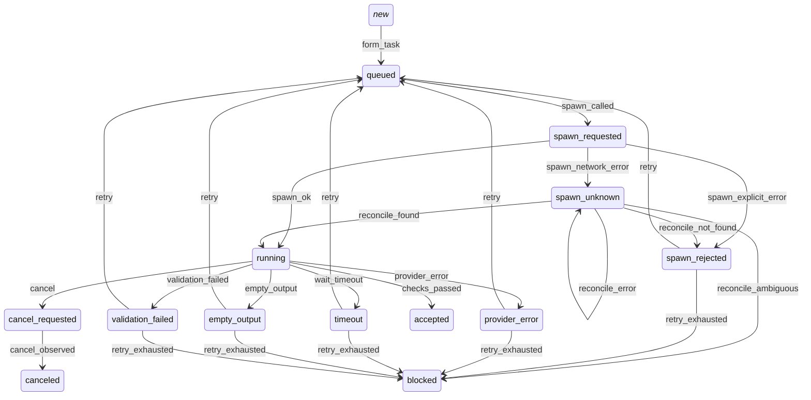

# Atlas of Lane Pilot

> Generated by `npx tsx scripts/generate-atlas.ts` from the code's registries. Do not edit by hand. <!-- atlas:structure b0bd7d4778ff7ccf -->

## Rooms (73)

Each room is one component: `index.ts` is its public API, `server/` its services, `ui/` its screens. Other rooms import only the public API.

| room | public API | files | lines | covered by |
|---|---|---:|---:|---|
| acceptance | — | 5 | 330 | tests (2) |
| anamnesis | ANAMNESIS_USAGE, EventLike, OwnerMessage, OwnerMessageConsumer, OwnerMessageHub, OwnerMessageMeta, TURN_REQUESTED, ThreadLike, anamnesisFor, anamnesisHandler, anamnesisHostMethods, anamnesisRpcMethods, fragmentJudgment, isOwnerThread, maskPii, matchJudgment, mountAnamnesis, ownerCardBlock, ownerMessagesOf, registerAnamnesisActions, scrubQuote, sensitiveReason | 35 | 4852 | tests (2) |
| backlog | BacklogBoard, MAX_ESTIMATE, TodoMeta, backlogBoard, backlogMigrations, backlogReadCommand, issueMessage, parseBacklogOutput, parseTodoMeta | 5 | 195 | tests (1) |
| baseline | BaselineRecord, RegressionRecord, baselineMigrations, commandPathLiterals, countOpenRegressions, getBaseline, hasRegressionForTask, isExistenceOnly, listBaselines, listOpenRegressionRows, listRegressions, openRegressionBriefs, quarantineFileSet, quarantineFilesOf, taskBaselineEntries | 12 | 1684 | tests (4) |
| bench | BenchProjectControl, benchMigrations, getBenchProject, saveVerdict, verdictForHarness | 28 | 3282 | tests (2) |
| brief | — | 1 | 190 | tests (2) |
| capability | CAPABILITIES, Capability, CapabilityReceipt, CapabilityState, adapterVersions, capabilityMigrations, capabilityTable, dueProbes, listReceipts, probeSetupFailed, providersInUse | 8 | 252 | drill: helper_providers |
| checkers | CandidateDiffHiddenAudit, DIFF_INSPECTING_CHECKERS, DiffHiddenAuditReport, DiffHiddenCheckResult, DiffHiddenRow, DiffHiddenSummary, checkerMigrations | 17 | 1950 | drill: checkers |
| cockpit | cockpitRpc | 9 | 913 | tests (1) |
| contracts | AcceptanceCard, AgentScheduleRef, AnalyzerSelection, BIRTH_KINDS, BirthKind, CODE_CRITIC_DEFAULTS, CodeCriticDefault, ErrandEpisodesApi, ErrandOutcome, ErrandRunStart, ErrandVerifiedOutcome, ErrandsApi, EvalData, FAILED_ATTEMPT_STATES, FREE_CLASSES, HOST_JOB_KINDS, HostJobKind, InsightsApi, IsTaskSatisfied, LEAD_ID, LEAD_LAUNCH, LEAD_NAME, LEAD_SESSION, LEAD_SUMMARY, LEAD_TICK, LEAD_TOOLS, LaneProjectNotice, LeadRoadApi, LineWindow, LoopEvidence, LoopSubject, MemoryEvalReport, MemoryEvalRunner, NO_RED_KINDS, NO_WAY_OUT, PathWindows, PrototypeConfig, RawNote, RawQuestion, RawTask, RoadDb, RoadEvidence, RoadKind, RoadRow, RoadSource, RoadState, RuleScanSurface, SANDBOX_OWN_ENV, ScheduleAgentApi, SqlDb, TASK_KINDS, TASK_V2_OPTIONAL, TaskV2, TaskWordDb, TaskWordPort, WAY_OUT, WORKFLOW_NODE_TONES, WallConfigStatus, WallLoopPort, WordTask, asJsonText, bundledAgents, failureClass, hostContract, hostMethods, installReceiptSchema, isCodeCriticDefault, modelCatalogSchema, parseExecutionLineWindows, prototypeConfigSchema, secretNameSchema, settingValidationSchema, spawnClaimed, stepExecutorSchema, taskV2Schema, taskWordItemPrefix, wayOut, workflowDraftCheckSchema, workflowDraftPatchResultSchema, workflowDraftPublishResultSchema, workflowDraftSummarySchema, workflowDraftTestResultSchema, workflowStatsSchema, workflowTrialCaseSchema, workflowViewEdgeSchema, workflowViewNodeSchema, workflowViewSchema | 83 | 9317 | drill: parallel3 |
| core | — | 12 | 1075 | drill: parallel3 |
| council | — | 17 | 6891 | tests (4) |
| coverage | COVERAGE, COVERAGE_USAGE, CoverageEntry, CoverageRow, CoverageStatus, CoverageSummary, DrillReceipt, NODE_KINDS, NodeKind, REQUIRED_MECHANISMS, checkReceipt, codeNodes, coverageRows, holes, renderCoverage, runCoverageCli, summarize, transitionId, untermedGaps | 4 | 329 | tests (1) |
| critique | CRITIC_EDIT_TRIAL_KEY, CRITIQUE_WORTH_ID, ConfirmScreenInput, CriticEditRow, CriticEditStore, CriticEditTrialOutcome, CritiqueWorthDecision, CritiqueWorthInput, FAILURE_TRIAGE_METHOD, MAX_FILE_EXCERPT_BYTES, REVIEW_CONFIRM_SCREEN_ID, SCIENTIFIC_DEBUG_METHOD, TaskBriefField, WriterIdentity, actionableFindings, advisoryFeedback, buildCandidateEvidence, codeCritiquePrompt, codeCritiqueSource, codeCritiqueStops, codeRepairPrompt, criticEditGate, criticEditTrialOn, criticEditTrialSettle, criticEditWasRejected, criticPromptOf, criticPromptProposal, criticPromptRollback, criticStats, critiqueFromStageResult, critiquePrompt, critiqueWorthJudgment, findingsHash, nextRepairAction, parseCodeCritique, parseCodeCritiqueSettings, parseCritique, parseWriterRepairReply, repairLedgerFromResult, resolveRetryEffort, reviewConfirmScreenJudgment, roleMethod, sameUnresolvedFindings, sameWriterIdentity, scanCritiqueCoverage, settingsFromFrozenPolicy, shouldRequestRepair, taskBrief, worthOutcome | 24 | 3761 | tests (2) |
| deferral | deferralKindMigrations, deferralMigrations, wallDeferralKindMigrations | 11 | 765 | drill: deferrals |
| design-eval | CRITIQUE_AXES, Criterion, CritiqueAxis, DESIGN_JOURNAL_KEY, DesignJournalLine, DrawingCritique, MEASURE_SCRIPT, Measurement, RUBRIC, appendDesignJournalLine, compareDesigns, critiqueProblems, designJournalLines, designScore, mergeFrames, noteDesignJournalWord, readinessWords, roleLine, scoreMeasurement, trainedConditions, trainingRatios | 4 | 183 | tests (1) |
| docs | Anchor, CITATION_SOURCE, DOCS_DEFAULT_SELECTION, JevCallAuth, JevCallSource, JevStatus, buildDocsAnchors, buildDocsFlows, commitDocs, docsDepth, docsLineCounts, docsStaleness, docsWorthinessFacts, expandCitationLists, gitDocsScope, jevApiKey, jevCallFor, parseDocsSettings, parseFrontmatter, verifyDocsCitations | 15 | 3473 | tests (4) |
| errands | BackfillResult, DiagnosisKindCost, DiagnosisShare, EPISODE_ENRICH_BACKOFF_MS, EPISODE_SWEEP_LIMIT, ERRANDS_USAGE, ERRAND_EPISODE_ENRICH_COLUMNS, ERRAND_FAILURE_CLASSES, ERRAND_FAILURE_ID, ERRAND_KINDS_WITH_NONE, EpisodeAnswer, EpisodeDeps, EpisodeEnrichDeps, EpisodeRow, EpisodeSkillUse, ErrandFailureClass, ErrandFailureDecision, ErrandFailureInput, ErrandKindOrNone, ErrandRow, ErrandSource, ErrandsDiagnosis, KindSummary, KnownProcessKey, NearProcessKey, PROCESS_KEY_JUDGMENT_ID, PendingEpisode, ProcessKeyDecision, ProcessKeyEvalResult, ProcessKeyInput, ProcessKeyPick, SweepResult, chooseProcessKey, codeFailureClass, diagnosisLines, enrichEpisode, episodeSkills, episodesBackfill, errandFailureJudgment, errandSpawnOf, errandStem, errandTitle, errandsDiagnosis, errandsDiagnosisMorningLine, kindsOverview, listEpisodes, listErrands, nearestKeys, pairwiseF1, parseEpisodeAnswer, pendingEpisodes, pendingErrandEpisode, processKeyEval, processKeyJudgment, recordErrandEpisode, routeConfidence, runErrandsCli, sweepErrandEpisodes, wordJudge | 13 | 1586 | tests (2) |
| forecast | Calibration, Forecast, ForecastFact, ForecastScore, calibrate, calibrationLine, scoreForecast | 6 | 165 | tests (1) |
| forge | FORBIDDEN_GRANTS, FORGE_KINDS, ForgeKind, ForgeReceipt, LintFinding, SKILL_NAME, SkillFile, SkillFinding, creatorBrief, draftFile, draftFolder, enabledPath, lintDraft, lintSkillDir, mountForge, runSkillLintCli | 4 | 319 | tests (1) |
| front | FIRST_RUN_STEPS, FirstRunDraft, FirstRunStep, ForeignHelper, FrontApi, MUTATING_RPC, PeerSnapshot, answerFirstRun, createFront, firstRunNeeded, firstRunSettings, helperDraft, mountFront, parseHelper, peerLine | 3 | 199 | tests (1) |
| harness | harnessMigrations | 12 | 1788 | tests (4) |
| host-worker | HOST_JOB_ARG, HOST_JOB_HANDLERS, answerPermit, applyOnboardingPages, browserGoal, classifyPlan, closeBacklogItem, coexistenceInventory, coexistenceOperation, connectOpencode, councilJudge, detect, discoverClaudeAgentsHost, diskFree, docsAnchors, docsDepth, docsFlows, docsLineCounts, docsStalenessHandler, docsVerifyCitations, docsWorthinessFacts, gateAttribute, gateBisect, gateRun, gitCommitDocs, gitCreateWorktree, gitDocsScope, gitIntegrate, gitMergeInfo, gitOwnershipBase, gitOwnershipChanges, gitPrepareWorktree, gitRemoveWorktree, gitRevertCommits, gitRevertPaths, gitSyncWorktree, gitUndoCheckWrites, gitWorktreeSnapshot, gitWorktreeState, importConfig, inspectCritiqueCoverage, install, jobCancel, jobStart, jobStatus, listDocsPages, listFolders, listPermitTickets, listWorkflowFiles, openCodeLimitProbe, prepareBbShimHost, prepareClaudeGuardHost, prepareNativeClaudeHost, prepareWorkerHome, probeBrowserQaTarget, readBoundedFile, readOpenCodeTelemetry, readUsageWindows, rollback, runBrowserQa, runCommand, runJobProcess, runSandboxedCommand, runScript, sandboxCommandLine, sandboxRelease, snapshot, snapshotDryRun, stabilityDrill, vpnAddress, whichPrograms, worktreeJanitor, writeDocsPages, writeForgeDraft, writeForgeEnabled, writePhaseBook, writePmSettings, writeWorkflowFile | 16 | 1546 | drill: parallel3 |
| hypotheses | HypothesisState, SEEDED, armsOf, hypothesisMigrations, settingsPair | 6 | 173 | tests (1) |
| improvement | — | 5 | 562 | tests (2) |
| jev | JEV_USAGE, judgeAccuracy, runJevCli | 3 | 164 | tests (2) |
| lead | ClassExam, EXAM_RULES, ExamRow, LEAD_DEFAULTS, LEAD_PREDICT_ID, LEAD_SETTING_KEYS, LeadSettingKey, LeadSettings, PredictDecision, PredictInput, RoadEvidence, RoadRow, Verdict, addRoad, answerPhaseWord, answerTaskWord, askPhaseWord, askTaskWord, cohenKappa, doneRoad, examAll, examClass, examEligible, getRoad, leadMigrations, leadPredictJudgment, leadSettingProblem, listRoad, parseLeadSettings, phaseDecisionId, reopenRoad, taskWordItemPrefix, wilsonLower, wordDecisionId | 23 | 2913 | tests (8) |
| learning | Db, FRUSTRATION_KEY, FrustrationRecord, LEARNING_USAGE, MemoryUnanswered, PmRule, complexity, envCatalogKey, frustrationReason, judgeRulesOnDiff, judgedCorrectionRows, learningFor, learningThreadRecorded, listReviewedObservations, memoryUnanswered, mountLearning, ownerMessageJudgment, ownerQuestion, pendingOwnerLearningItems, pmResumeInstructions, pmRuleRelevance, pmRulesBlock, pmRulesOf, pmRulesPromptBlock, poolHasRoom, poolTokens, ruleBudget, ruleTokens, ruleViolationRemark, runLearningCli, sameAsJudgment, setRuleBudgets, startOfDay, unkeptPromise | 24 | 2473 | tests (2) |
| memory | MEMORY_PATHS, MEMORY_PRIMITIVES, MemoryPath, MemoryPrimitive, MemorySettings, ProbeKind, parseMemorySettings, pathById | 19 | 1728 | drill: memory_paths |
| memory-eval | — | 10 | 1045 | tests (2) |
| memory-probe | — | 2 | 244 | drill: memory_paths |
| memory-tiers | Episode, episodeLines, memoryTierMigrations, minHits, queryWords, wordHits | 5 | 194 | tests (1) |
| money | DailyRow, MoneyApi, PAID_PROVIDERS, PRICE_LIST, Price, UsageWindow, capOf, createMoney, isPaid, moneyHold, priceOf, rowUsd, spendBook, windowHold | 3 | 118 | tests (1) |
| native-agent | ARCHITECT_LAUNCH, AgentFailure, CustomAgentMeta, EmployeeManifest, HelperThreadRow, LANE_PILOT_PM_SESSION, ListedHost, NATIVE_LP_BRIDGE_PM_TOOLS, PROFILE_CHECK_WINDOW_MS, ProfileReport, ProjectSourceBinding, ProviderVerdict, RolePolicyCount, SKILL_CATALOG_BLOCK, SKILL_CATALOG_LIMIT, SKILL_CATALOG_LINE, UNLISTED_STOCK_IDS, WORKFLOW_ARCHITECT_NAME, WORKFLOW_ARCHITECT_SESSION, WORKFLOW_ARCHITECT_TOOLS, WriterBindingResolution, affinityHostId, agentKind, agentListItem, applyResourceMode, buildProfileReport, chooseEmployeePlace, collectAgentInventory, compileEffectiveMainAgent, compileMainAgentProfile, createAgentInputSchema, createClaudeGuardEnv, detectCompiledMainAgentCapability, discoverClaudeAgents, employeeRoleLines, finalizeNativeLaneBinding, handleNativeDispatch, helperThreads, latestProfileCheck, mentionContext, narrowedByCeiling, nativeAgentTypeKey, nativeContributedEnv, nativeEnvKey, nativeRunReady, nativeSelectionKey, nativeThreadKey, ownedNativePmRun, parseAgentFile, parseOwnedAgents, pendingSwitch, placeEmployeeOn, pmSkillName, prepareBbShim, prepareClaudeGuard, prepareNativeClaude, profileCheckMorningLine, providerVerdicts, reconcileClaudeLane, recordRoleLine, requestArchitectLaunch, resolveWriterBinding, rolePolicyCounts, saveProfileCheck, sessionInventory, takeArchitectLaunch, updateAgentInputSchema, withRoleLines, writerWorkspaceForPmInstructions | 44 | 5834 | drill: helper_providers, provider |
| native-install | HostContext, connectOpencodeStack, createNativeInstaller, detectStack, experimental_vkLifecycle, importConfigStack, installStack, inventoryCoexistence, rollbackStack, runCoexistenceOperation, snapshotStack | 25 | 4417 | tests (1) |
| night | nightReviewPrompt | 5 | 192 | tests (4) |
| night-graphs | EPISODES_SCHEDULE, EPISODES_WORKFLOW, JEV_LABELS_SCHEDULE, JEV_LABELS_WORKFLOW, MODEL_REBENCH_SCHEDULE, MODEL_REBENCH_WORKFLOW, ModelRebenchMetrics, evaluateModelRouting, latestModelRebenchSummary, modelRebenchMorningLine, mountEpisodesGraph, mountJevLabelsGraph, mountModelRebenchGraph, saveModelRebenchResult | 9 | 1014 | tests (4) |
| outage | BEAT_KEY, OUTAGE_THRESHOLD_MS, Outage, OutageRecord, gapOutage, listOutages, outageMigrations | 6 | 108 | tests (1) |
| owner-presence | PRESENCE_FILE, PRESENCE_WINDOW_MS, Presence, laneOwnedMetadata, presenceHold, readPresence | 4 | 140 | tests (2) |
| owner-waiting | Answered, LearningItemsReader, NOW_CAP, OWNER_FACT_TTL_MS, OWNER_NOTE_TTL_MS, OpenOwnerItemFilter, Overnight, OwnerAction, OwnerEvidence, OwnerItem, OwnerItemSweep, OwnerWaiting, PendingLearningItem, PostOwnerItem, callReason, closeOwnerItem, closeOwnerItemsByPrefix, collectOwnerWaiting, countOpenOwnerItems, hasOpenOwnerItem, isSandboxProject, listOpenOwnerItemKeys, loadPushConfig, ownerItemPrefixCount, ownerWaitingCounts, ownerWaitingMigrations, postOwnerItem, rpcLine, setSandboxProjects, sweepOwnerItems, tableExists | 9 | 771 | tests (3) |
| pages | LanePilotPage, LpPage | 22 | 2972 | tests (5) |
| phase | ACCEPTANCE_LINES, AcceptanceLine, BOOK_SECTIONS, BookPart, BookSection, ContextDoc, FrozenVerdict, GENESIS, GateResult, NextAction, PHASE_STAGES, Phase, PhaseRecord, PhaseStage, PhaseState, PlanItem, RETURN_STAGES, TaskFact, acceptanceLines, blindVerdict, brokenLink, canonical, contextSignature, designDecision, designGate, discussionGate, executionGate, getPhase, intakeJudgment, isMachineMessage, issuable, lessonsNeeded, listParts, listPhasePartsSince, listPhases, nextAction, partHash, pathClassJudgment, phaseFolder, phaseMigrations, pieceProblems, planGate, planSignature, renderBook, staleAfterReturn, waveProblems | 23 | 4039 | drill: phase |
| platform | — | 25 | 2209 | drill: parallel3 |
| pm-replay | PM_REPLAY_USAGE, PmReplay, ReplayResult, Scenario, correctionObservations, decideReplay, getScenario, harvestPrompt, importScenarios, insertResult, insertScenario, latestVerdicts, linkScenariosToRule, listScenarios, parseHarvested, pmReplayMigrations, pmThreadIds, replayLine, replayStats, retireScenario, runPmReplayCli | 10 | 788 | tests (1) |
| policy | ChangeDescriptor, EXAM_RESULT_KEY, POLICY, POLICY_USAGE, StoredExam, TIERS, Tier, authorize, classifyChange, collectAndAppend, composeMorningList, explainChange, globMatch, loadLiveExam, recordOwnerDecision, runExam, runLiveExam, runPolicyCli, shouldStopCycle | 8 | 676 | tests (2) |
| project-life | OnboardingAcceptedEvidence, OnboardingInputPage, acceptedOnboardingEvidence, isAllowedProjectLifePath, shouldTriggerProjectLife | 5 | 499 | drill: parallel3 |
| qa | runBrowserQaOnHost | 10 | 1806 | tests (1) |
| relay | OWNER_ASK_RENDERER_ID | 12 | 1458 | tests (2) |
| rollback | TaskReceiptState, getAttemptChange, listAttemptChanges, listTaskReceipts, rollbackMigrations | 7 | 679 | tests (1) |
| rule-forms | FormAsk, MECHANISMS, Mechanism, PROMOTION_DIGEST_TOP, PromotionRoute, PromotionServiceApi, RULES_USAGE, RuleHold, RuleMechanismName, RuleMechanismPlan, RulesCliDeps, acceptPromotion, applyJevForms, buildMechanismTask, createPromotionService, dismissPromotion, dispatchPromotion, formDistribution, jevPickForms, lintBlockedCommand, lintMigrationOrder, lintPathRule, lintVerificationRule, listPromotions, mechanismFor, promotionDigest, promotionMorningLine, promotionRoute, promotionWhy, proposePromotions, ruleMechanismPlan, runRulesCli, settlePromotionTask | 8 | 732 | tests (2) |
| run-goal | GoalCoverage, GoalVerdict, MIN_ACCEPTED, RedCheck, RunGoalRecord, TaskState, getRunGoal, goalCoverage, goalFailedText, goalVerdict, runGoalCoverageMigrations, runGoalMigrations, runReady | 8 | 346 | tests (2) |
| runs | CONVEYOR_KEY, ConveyorState, DISPATCH_IDEMPOTENT_WINDOW_MS, DISPATCH_STAGES_PENDING, EXTERNAL_OPS, EXTERNAL_OPS_BY_ACTION, EXTERNAL_OPS_WARNING, FailureClassDecision, FailureClassInput, S8_RELATIVE_PATHS, TARGET_SHA, TaskTimeline, TimelineEntry, UPSTREAM_REPO, acceptanceStats, aggregateRun, beginChecks, checksInFlight, checksMoved, cliReceiptAttemptKey, cliReceiptRunKey, conveyorState, failureClassJudgment, failureClassLive, failureClassReport, isKnownReason, judgedFailureClass, renderTimeline, setConveyor, sweepFailureClassOutcomes, sweepInvoiceCheckOutcomes, sweepPlanFactOutcomes, sweepRouteWorkflowOutcomes, sweepWriterModelOutcomes, taskTimeline, unknownReasons | 35 | 3356 | drill: parallel3 |
| schedule | ERRAND_BUILTIN, ERRAND_KINDS, ERRAND_KIND_ID, ErrandKind, ErrandKindHints, ErrandKindPick, SCHEDULE_ERRAND_DEFAULT_KEY, classifyErrand, createScheduleStore, errandDefaultProblem, errandKindJudgment, errandKindRole, errandRoleFor, fireTimes, hintedErrandKind, isErrandKind, scheduleAgentMigrations, scheduleMigrations, scheduleNameOf, scheduleRpcContract, taskOf | 35 | 3982 | tests (1) |
| secrets | — | 4 | 248 | tests (1) |
| self-repair | — | 17 | 3069 | tests (4) |
| session-hooks | buildCapsule, capsuleRestored | 3 | 518 | tests (1) |
| settings | SettingValidationError, argvValidationMap, coupledSettingKeys, readImportConfig, validateSettingChanges, validateSettingValue, validateSettingsObject, validationErrorText | 13 | 1886 | drill: provider_limit |
| sma-map | LiveRow, LiveSource, ProofRoots, SMA_CARDS, SMA_CONTRACT_TESTS, SMA_ENTRIES, SMA_LINKS, SMA_LIVE, SMA_MAP_SHA, SMA_MAP_USAGE, SMA_NODES, SMA_REGIONS, SmaCard, SmaCounts, SmaEntry, SmaEvidence, SmaKind, SmaLinkKind, SmaNode, SmaRow, SmaStateCounts, SmaStatus, brokenProof, darkTableNames, defaultProofRoots, fixProofsInFile, isChecked, isDone, proofDrift, proofRelocation, readSmaLive, renderSmaLive, renderSmaMap, runSmaLiveCli, runSmaMapCli, smaCheckedPercent, smaCounts, smaDonePercent, smaEvidence, smaGroups, smaHoles, smaRows, smaStateCounts, unjudgedProof | 9 | 9572 | tests (1) |
| stability | DrillCheck, ReconcileCursor, parseOpenCodeToolTelemetry, reconcile, reconcileCritic, reconcileCursor, runStabilityDrill | 15 | 1789 | drill: reload |
| stage-return | StageReturnRecord, finishReturn, getReturn, insertReturn, listReturns, renderReturnNotes, stageReturnMigrations | 10 | 510 | tests (4) |
| storage | ATTEMPT_TABLE, AcceptedFactRow, AttemptFailureFields, CANCEL_CODES, CancelCode, CheckRef, DEPENDENCY_REDO_WAIT_MS, DiffHiddenAuditRow, DraftRow, DraftStore, EffectRow, GATE_CATEGORIES, GateCategory, GateEventRow, GateEventStatus, GateRunRow, GateRunState, HARNESS_VERSION, ImportedYaml, Journal, LanePilotDatabase, RUN_TABLE, ReasoningTrace, RunHistoryRow, RunRow, RunStatus, SCREEN_REASON_CHARS, STATE_REASON_CHARS, STATE_REASON_PAGE_CHARS, STATS_EPOCH_DEFAULT, STATS_EPOCH_SETTING, SaveSettingsResult, SecretIssuance, SettingChange, StageEventRow, StageReceiptRow, StepRow, StoredWorkflow, TERMINAL_RUN, TaskOutcome, WorkflowFileSource, WorkflowStore, WorktreeOwner, WorktreeOwnerKind, WorktreeRow, acceptanceAttemptRows, acceptedAttemptCiting, acceptedAttemptProjectIds, acceptedAttemptTaskRefs, acceptedFamilyAttemptId, acceptedTaskCountsByProject, acceptedTaskIdsOfRun, activeRunForProject, activeRunForWorkspacePath, adoptableBlockedAttempts, appendAcceptedFact, appendGateEvaluation, assignAttemptHarness, attemptEnvironmentRows, attemptHarnessTreeId, attemptIdsOfThread, attemptReasonsForTask, attemptRowWithProject, attemptRunAndThread, attemptRunRef, attemptStateCounts, attemptStateForTaskRun, attemptThreadsOfRun, attemptTimelineRows, attemptTraceContext, attemptTransitionsForTask, attemptWorkspacePaths, attemptWorkspaceRow, attemptedTaskIdsOfRun, bareWorkspaceAttemptExists, bindingSettingValue, blockedReasonCount, boundSettingValue, canaryAttemptRows, cancelCodeCounts, canceledLatestTaskIds, casResetSettings, casSetting, casUpsertSetting, casUpsertSettings, casWriteWorkflowFile, checkHistoryKey, checkIdentity, checkoutBase, claimActivation, claimAttemptWake, claimDailySchedule, claimDocsSpawn, claimRunPlacement, claimStageSpawn, clearAttemptWake, clearReconcileCursor, clearSettingValue, clearTaskClosedWords, closeRun, countAcceptedForProject, countAttempts, countAttemptsInStates, countChargedAttempts, countHarnessArmAttempts, countLanePilotTables, countOtherLiveAttemptsInArea, countProjectTasksSince, countStageReceipts, countStageReceiptsSince, countThreadAttempts, countThreadTaskAttempts, countThreadTurns, countVerificationGateFailures, createAttempt, createDraftStore, createJournal, createRun, createStatusResolver, createTask, declaredWorktreeOwner, definitionSha256, deleteBoundSetting, deleteStageReceipt, diffHiddenAuditSummary, endSpawnFailure, errandEpisodeColumns, failedAttemptStateCounts, failedBackgroundStageRows, failedStageCounts, failureFieldsOf, findOpenNativeRun, finishGateRun, finishedIntakeTaskRows, firstAttemptAt, freeTaskId, freezeRunBinding, gateEventFailureCounts, gateEventsForTask, gateRunRow, getActivation, getAttempt, getReasoningTrace, getReasoningTraceJson, getRun, getRunCard, getRunObjective, getRunSettingsScopes, getRunWriterHost, getSettingVersions, getStageReceiptResult, getTask, getTaskContractJson, getTaskGitBase, getTaskPlan, getTaskRow, globalWorkflowDir, hasAcceptedAttempt, hasFailedStageReceipt, hasLiveAttempt, hasReconcileCursor, hasRunForPmThread, hasTask, importSettingsOnce, inspectAttempt, inspectState, janitorKeptSample, janitorSums, lastStageReceiptAt, laterFamilyAttemptTaskIds, latestAcceptedAttemptRef, latestAreaWriterBinding, latestAttemptByRowid, latestAttemptEnvironmentId, latestAttemptHarnessVersion, latestAttemptIdForThread, latestAttemptRow, latestAttemptStateCreated, latestAttemptWorkForThread, latestAttemptsForProject, latestAttemptsPerTask, latestDocsTaskAt, latestErrandEpisodeRows, latestGateRun, latestGateRunForTask, latestOpenPmThreadForProject, latestProfileCheckReportJson, latestRunForPmThread, latestRunForProjectThread, latestRunIdForPmThread, latestStageResultJson, latestStageWorkForThread, latestTaskAttempt, latestTaskAttemptRow, latestTaskAttemptState, listAcceptedAttemptsForTask, listAcceptedAttemptsWithThread, listAcceptedFacts, listAcceptedJoinRows, listActiveProjectIds, listAllRunRefs, listAttemptBriefRows, listAttemptEvidenceRows, listAttemptHistory, listAttemptIdsInStates, listAttemptReasonsLike, listAttemptReasonsSince, listAttemptRowsForProject, listAttemptStatesForTask, listAttemptTracesForRun, listAttemptsForProjectOrdered, listAttemptsForTask, listAttemptsInStates, listAttemptsUpdatedSince, listBbTaskRowsForRun, listBenchStabilityMarks, listBoardAttemptRows, listCandidateTaskRows, listCheckDurations, listCheckFailureRows, listCheckRuns, listCheckTimeouts, listCliPmProjects, listCliPmThreads, listComplexTaskRows, listDueWakes, listEndedTaskIds, listErrandEpisodeFacts, listErrandEpisodeRows, listErrandEpisodeRunIds, listErrandEpisodeStates, listErrandEpisodeTraces, listErrandProcessKeys, listFailedAttemptRows, listFailedAttemptsSince, listFailedAttemptsSinceDesc, listFailedStageReceipts, listFamilyAttemptRows, listFinishedAttemptRows, listForecastTaskRows, listGateEvents, listGateEventsForTask, listHarnessTrialAttempts, listHarnessVersionTimeline, listIdleAttemptsInStates, listJournalAttemptRows, listLiveRuns, listLiveTasksForRun, listOpenAttempts, listOpenCliRuns, listOpenLaneRuns, listOpenStageTasks, listOpenWorktrees, listOwnSettingLevels, listPendingAcceptedFacts, listPendingErrandEpisodes, listPmNoticeThreadIdsSince, listPmSkillUsesSince, listPmThreadIdsSince, listProjectAttemptStates, listProjectAttemptsSince, listProjectEpisodeTaskRows, listProjectGateEventsSince, listProjectStageEventsSince, listProjectTasks, listProjectTransitionsSince, listProjectsWithBindingSettings, listProjectsWithCriticReceipts, listProjectsWithGlobalSettings, listProviderSettingRows, listRecentFailedAttemptRows, listReviewStageRows, listRunAttemptStates, listRunCloseRows, listRunIdsForProject, listRunQueueAttempts, listRunTaskRows, listRunTaskSummaries, listRunTransitions, listRunsForPmThread, listRunsPage, listRunsWithAttempts, listRunsWithPmThread, listSecretIssuance, listSettingRows, listSkillMetrics, listStageEvents, listStageReceiptStates, listStageReceiptSummaries, listStageReceipts, listStageReceiptsForProject, listStaleAttemptsInState, listStaleOpenStages, listStaleQueuedAttempts, listTaskAcceptanceRows, listTaskAttemptRows, listTaskIdsForRun, listTaskKinds, listTaskLatestAttemptStates, listTaskTerminalStates, listTasksForRun, listTeachingKeys, listTracedAttemptsSince, listUnansweredWriterQuestions, listUnfinishedStages, listUnreportedTaskOutcomes, listVersionedAttemptRows, listWriterThreadTurns, loadProjectSettings, loadPrototypeConfig, loadRunHelperPolicyJson, loadWorkflowStore, markAcceptedFactsSummarized, markCancelCode, markTaskOutcomesReported, modelRebenchSummary, newestAttemptState, nodeFileSource, noteCleanAdmission, noteGateRunStart, noteToldPmDirectly, onAttemptChanged, openAttemptBriefs, openAttemptIdsOfRun, openAttemptsForPause, openDatabase, openIntakeAttemptRows, openIntakeTaskRows, openRunIdForPmThread, openRunOfPmThread, otherAttemptsOfRun, parkAttemptWake, persistRunHelperPolicyJson, pluginThreadInStoreTables, pmBookkeepingPending, pmHasTasksAtWork, pmTasksWaiting, pmThreadOfCliRun, previousHarnessVersion, priorAttemptStates, projectHasScopedRun, projectIdForPmThread, projectSettingValue, projectWorkflowDir, putGlobalSettingValue, recentWriterHostIds, reconcileCursorPage, recordCheckDuration, recordFinishedAttempt, recordJanitorSweep, recordPmSkillUse, recordSecretIssuance, recordSkillMetric, registerWorktree, releaseActivation, releaseWorktree, releaseWorktreeById, removeOwnSettings, reviveCanceledAttempt, runAttemptOutcomeRows, runClosedAt, runEnvironmentIds, runIdForPmThread, runPmThreadId, runProjectId, runStateCounts, runTaskCardRows, saveBenchStabilityMarks, saveDiffHiddenRows, saveModelRebench, saveProfileCheckReport, saveProjectSetting, savePrototypeConfig, saveReasoningTrace, saveReconcileCursor, saveStageReceipt, saveTaskGitBase, saveTaskPlan, secretIssuedForTask, sectionBindingId, setAttemptDirtBefore, setAttemptEnvironment, setAttemptHolderThread, setAttemptWorkspace, setIllegalTransitionLog, setReasoningThread, setRunObjective, setRunSettingsScopes, setRunState, setRunThread, setRunWorkspace, setTaskClosedWords, setTaskHeldUntil, settingValue, settingValues, sha256, silentThreadInStoreTables, stableId, stageEventKeysSince, stageEventsForTask, stageEventsForTimeline, stageReceiptAttemptState, stageReceiptProviderModel, stageReceiptState, stageReceiptStateResultJson, stageReceiptStates, stageReceiptsForTimeline, staleStageReceipts, statsEpochLine, statsEpochMs, stemAttemptRows, stickyWorktreeAttemptRows, taskBasePath, taskCheckLogRows, taskCreatedAt, taskGraphRows, taskHeldUntil, taskTimelineRow, toldPmDirectly, trailingQueuedParks, transitionAttempt, updateTaskContract, updateTaskContractJson, writerBaseForWorkspace | 14 | 3333 | drill: parallel3 |
| tasks | BIRTH_KINDS, BirthKind, BlockingClass, CHECK_HISTORY_MIN_RUNS, CHECK_RECIPES, CheckMeasure, CheckReading, CheckRecipe, CheckRun, CheckVerdict, EvidenceCheck, FACT_KINDS, FactKind, GateReport, HOLD_FOREVER, INVARIANT_ITEM, INVARIANT_WORDS, ItemVerdict, LANE_QUEUES, LoopTask, MARKER_BRIEF_LINE, NO_CODE_KINDS, OWNER_WORD_WAIT_MS, OpenShape, OwnerWordsMode, PLAN_FACT_BRIEF_LINE, PLAN_FACT_RULES, PRIORITIES, PlanFactCheck, PlanFactFacts, PlanFactJevDecision, PlanFactJevInput, PlanFactJevItem, PlanFactTable, Priority, QUESTION_KINDS, QuestionKind, RunWriterPool, SHARED_PATH_TASKS, STAGE_IDS, STAGE_PROOF, StageId, StageProof, StageReceipt, StageState, TASK_SIZE_MIN_SAMPLE, TASK_WORDS_KEY, TOPIC_LOOP, TRUSTED_TOOLING_PATTERNS, TaskSize, TaskSizeMedian, TaskWord, TestFitFile, TestFitHit, TopicLoop, TopicWall, VerifyResult, WORKER_ENVELOPE, WriterMarkers, acceptanceArtifactDir, acceptanceProofGap, applyTrustedTooling, batchShapeAdvice, bbWriterReportMarkdown, birthFindings, blindPlanFact, blockingClass, buildAcceptanceV2, buildRunExecutionProfile, buildRunPolicy, checkProgram, checkRecipe, checkScriptEdits, checkoutOwnsOverlap, classifyWriterOutput, clipDiff, commonTaskFolder, deadLetters, dependsOnTask, diffHunksCommand, existsCommand, existsFromCommandOutput, factKind, hunksFromCommandOutput, isAdvisoryProof, isMainfixTask, isOutputPath, isTaskBase, isWholeConsent, landingWordAsked, landingWordGap, laneCap, laneQueueOf, mapBounded, mapVerificationCwd, ownerWordFindings, ownerWordsMode, ownerWordsOn, ownsFromOuterBase, p95, parsePlanFact, parseRepoTop, parseRunPolicy, planFactJudgment, planFactOutcome, planWithOutsideReads, priorityRank, questionKind, questionsFromFile, queueOrder, readCheckRun, readTaskApproach, recordTaskApproach, recordTaskQuestions, recordTaskWord, referenceTestEdits, repoTopCommand, rerootTask, retargetTask, secretShaped, sha256, shouldReconcileAttemptThread, shouldResumeWorktreeHolder, shouldScanLostWorktreeHolder, spendReserve, stageReceiptSchema, stageTransition, taskApproachKey, taskQuestionsKey, taskSizeOf, taskSizeText, taskStem, taskWordKey, testFitFindings, testNames, topicHold, topicLoop, topicLoopMessage, trustedToolingFor, trustedToolingHint, trustedToolingHits, unownedExpectedOutputs, untouchedCitations, validateAcceptanceV2, validateStageReceipt, verificationScriptPaths, writerMarkers | 31 | 3264 | drill: parallel3 |
| tools | — | 7 | 1755 | drill: parallel3 |
| ui-shell | — | 18 | 1321 | tests (5) |
| usage | AttemptMetrics, AttemptMetricsReport, CostState, TokenBreakdown, attemptMetrics, billedFrom, parseBreakdown, projectTokenTotalsSince, tokenBreakdown, tokenDelta | 10 | 1511 | tests (5) |
| validators | PageReview, ValidatorDeps, validateDeliverable | 2 | 292 | tests (1) |
| verification | DEFAULT_WORKER, EXCLUDE_NOT_GIT, HostMachineFacts, JANITOR_TMP_PREFIXES, JanitorKept, JanitorReceipt, MergeInfo, PRESSURE_LIMITS, ReplayCacheEntry, ReplayCheck, ReplayCheckOutcome, RevertResult, TEST_FILE_RE, WORKSPACE_DIRT_COMMAND, WorktreeState, appendExcludeCommand, attributeGateOnHost, bisectGateOnHost, cachedReplayVerdicts, createProviderGate, createWorktree, darwinAvailableBytes, ensureExcludeLinesCommand, flakyEvidence, gateTriagePrompt, gitOwnershipChangedPaths, integrateWorktree, mergeInfo, outputTail, parseGateTriageResult, parseWorkspaceMode, persistTaskFolder, prepareSandboxedCommandLine, prepareWorktree, pressureOf, providerListed, providerSwitchOn, readMachineFacts, readingFrom, readingNote, recordReplayVerdict, recordedReplayFailure, releaseSandboxedCommandLine, removeLaneWorktree, replayCacheLocation, replayKey, requireManagedWorktreeProvider, resolveAttemptWorkspace, resolveGitOwnershipBase, resolveManagedWorkspace, revertCommitsInWorktree, revertPaths, runGateOnHost, runSandboxedCommandOnHost, snapshotWorktree, suggestTests, sweepLaneWorktrees, syncWorktree, taskFolderRel, testHintLine, undoCheckWrites, userToolBins, usesManagedWorktree, waitManagedWorktreeReady, waitProviderEnvironment, withBaseLock, worktreeState | 27 | 4374 | drill: parallel3 |
| wall | WALL_FILTER_ID, WallFilterAction, WallFilterCategory, WallFilterDecision, WallFilterInput, WallRow, buildWallFilterState, listWalls, wallFilterJudgment, wallMigrations | 22 | 3314 | tests (4) |
| wires | WIRE_MARK, Wire, WireHop, WireResult, brokenWireReason, readWires, wiresCommand | 2 | 52 | tests (2) |
| work-graph | AttemptIn, CellState, CostState, ExecutorRow, GRAPH_STAGES, GraphStats, ModelStageStat, ReceiptIn, Role, StageBlock, StageCell, StageEventIn, StageStat, TaskGraph, TaskSummary, Tokens, UsageIn, graphStats, median, roleOf, stageCells, taskGraph | 11 | 619 | tests (2) |
| workflow | DOCS_MAINTENANCE, DOCS_NIGHT, DraftCheck, DraftOp, DraftScope, DraftTestResult, GOAL_SCREEN_ID, ISSUE_QUICK_SHORT_PATH, LP_TASK_PIPELINE, NodeExecutor, PLAN_CHECK_ID, RawDefinition, Refusal, RunSummary, SELF_REPAIR, StepContext, ValidateOptions, Workflow, WorkflowEngine, WorkflowProblem, builtinWorkflow, builtinWorkflows, goalScreenJudgment, issueQuickModelCalls, issueQuickShortPath, issueQuickWorkflowId, planCheckJudgment, routeWorkflow | 64 | 10712 | tests (5) |
| world | worldMigrations | 8 | 598 | tests (4) |
| writer | AGENT_TRASH_RELATIVE, BEST_OF_COUNT, BEST_OF_ROUNDS_DEFAULT, BEST_OF_ROUNDS_MAX, BEST_OF_ROUNDS_SETTING, BEST_OF_SETTING, BEST_OF_SLOT_CAP_SETTING, BEST_OF_TOKEN_BUDGET_SETTING, BEST_OF_VALUES, BestOfCandidate, BestOfPlan, DirtSnapshot, FinishScanDecision, FinishScanInput, LIVE_FOLDER_FILE_CAP, ROUND_SEED_MAX_CHARS, RoundCandidate, SkillSwitchRecord, SkillSwitchStats, WRITER_FINISH_SCAN_ID, WriterPair, attachStreamRetry, attemptProduced, bestOfBudgetAllows, bestOfPicks, buildCliInvocation, calculateSkillSwitches, droppedStreamDetail, getSkillSwitchStats, materializeAgentTrash, ownedAgentTrashPath, parseDirtSnapshots, pickBestAttempt, recordSkillSwitchMetric, reserveAppetite, resolveBestOf, roundSeedBrief, roundSurvivors, runCommandOnHost, skillSwitchMorningLine, writePmSettingsOnHost, writerFinishScanJudgment, writerModelJudgment | 69 | 11630 | drill: parallel3 |

## Task stages (20)

| stage | proof | what decides it |
|---|---|---|
| pm-read | advisory | a model's summary of the read_first excerpts; it only hands context to the critics and decides nothing |
| plan-critique | advisory | a model's verdict on the plan: it never accepts a task, and in plan_critique.mode gate (the default, SMA p2_checker) its refusal stops the attempt before the writer |
| run-gate | receipt | the run gate decision and the ownership base preflight are stored in the run-gate receipt; the repository must report a readable base commit |
| specialist-review | advisory | a model's risk opinion on the plan |
| writer-agent | gate | gates owns-paths and validate: the changed files are inside owns_paths and expected_outputs exist with content |
| verification | command | every verification[].command exits 0 in the sandbox (gate verification passed) |
| code-critique | advisory | a model's review of the candidate |
| plan-fact | file | blindPlanFact checks each acceptance row of the writer's plan-fact table against the candidate: the cited file is among the changed files, the cited lines overlap a changed hunk, the cited command is a verification[] command that exited 0; the writer's prose is never read |
| acceptance-receipt | schema | the acceptance-v2 receipt validates against lane-stack/schemas/acceptance-v2.schema.json (validateAcceptanceV2) |
| browser-qa | command | the browser cases run on the host and each case's recorded result is passed |
| docs-maintenance | file | validateDocsEdits accepts the edits, and each written file reads back byte for byte |
| onboarding-preview | schema | parseOnboardingPreview validates the passport and module map the onboarder produced |
| onboarding-apply | file | the host applies the previewed files and reports status applied |
| memory-maintenance | schema | parseMemoryCandidates and the memory door's content rules accept every entry (fields, valid_until, core budget) |
| project-life | gate | the committed head matches the commit the helper reports, and every changed path is inside the project-life scope |
| night-review | schema | parseNightReviewResult validates the review verdict and findings |
| night-fix | command | the fix changed only the finding's paths and the task's verification commands exit 0 |
| workspace-status | file | the environment's status and diff are read from the machine, and the status outcome is available |
| opencode-telemetry | file | the telemetry log is read from the host (size and sha256 match), parses without malformed lines and has a matching event |
| gate-triage | schema | parseGateTriageResult validates the triage result |

## Attempt state machine (26 transitions)

States: (new), queued, spawn_requested, running, spawn_rejected, spawn_unknown, blocked, provider_error, timeout, empty_output, validation_failed, accepted, cancel_requested, canceled.

## Memory delivery paths (20)

| path | consumer | carries |
|---|---|---|
| writer.brief | a writer's first prompt (spawnWriterAttempt) | note, core, rule |
| writer.turn | the turn that gives a continuing writer thread its next task (stickyTurnPrompt) | rule |
| writer.repair | the code-critique repair round (the dispatch context of the first brief, kept in the attempt trace) | note, core, rule |
| pm.start | a PM's first prompt (activation) | rule |
| pm.resume | a PM session that starts or resumes (contributeInstructions) | rule |
| bb.thread | every ordinary BB thread of the project (contributeInstructions, the L1 showcase) | core |
| pm.rules_tool | the PM tool lane_pilot_memory {action:"learned", op:"rules"} | rule |
| pm.contract | path-scoped rules returned with a queued task contract | rule |
| pm.memory_tool | the PM tool lane_pilot_memory {action:"context"} | note, core |
| schedule.agent | the first message of a scheduled agent run (kind agent of the schedule board): the project's notes for the standing task | note, core |
| critic.code | the code critic's prompt (critique-runs) | note, core |
| night.review | the night review's prompt | note, core |
| council.evidence | the evidence pack of a council of directors | note, core |
| hub.memory_import_eval | the M1 import gate (RPC memory_import_eval): measures how many imported records the PM search finds |  |
| hub.session_rpc | the hub session_memory RPCs, not a Lane Pilot agent prompt |  |
| pm.cold | cold notes added when the PM asks for memory and the active set is thin | note |
| maintainer.existing | the memory maintainer's list of EXISTING NOTES |  |
| memory.golden_eval | the retrieval evaluation (golden queries) |  |
| pm.replay_arm | the PM prompt a pm-replay arm is graded on (armPrompt in src/rooms/pm-replay/surface.ts) | rule |
| pm.owner_card | the owner card in a PM's first prompt (anamnesis) |  |

## CLI commands (102)

Every `bb lane-pilot <command>`; `bb lane-pilot <command> --help` or the bare `bb lane-pilot` prints the full usage.

| command | what it does |
|---|---|
| `activate` | Spawn a visible isolated PM thread |
| `agents` | The agents the owner can pick: list and show the bundled ones, create, update and delete his own (a JSON or a markdown file with frontmatter) |
| `anamnesis` | What Lane Pilot knows about its owner (records on the owner's machine); sensitive ones only on explicit request |
| `approvals-suggest` | Owner decisions that repeat the same way three times or more: candidates for an automatic night rule |
| `backlog` | A project's ready todos sorted for issue: issuable in queue order (estimate at most 13, dependencies done), to estimate, to split, blocked; --scan hands the next ones to the PMs now |
| `baseline` | The checks already green or red on the base a task started from, and what turned red after its merge |
| `bench` | LP-Bench: a fixed set of real past tasks replayed on an arm (writer, harness tree, setting) and compared in pairs: stages passed, cost, time |
| `budget` | Set or show the run budget of a project (attempts, wall minutes, tokens, child threads; empty value clears) |
| `cancel` | Stop a writer and persist canceled after observing idle |
| `capabilities` | Per provider in use: the adapter (BB plugin) version installed and whether it is proven to answer; --probe tries the unproven ones now |
| `changes` | What is on record for a task or an attempt: base, merge, changed files (deletions included) and the reverify / revert receipts |
| `checkers` | Checking the checkers: plant known defects in accepted candidates, run every checker on them and print the checker scorecard (score, scorecard, drill, defects) |
| `configure` | Save prototype project settings |
| `conveyor` | The conveyor switch: off, no new work is issued anywhere (writers wait, parked tasks stay, the night queues nothing) while running stages finish and checks go on |
| `cost` | Cost per verified result: writer tokens per accepted task, per project, over 30 days |
| `council` | Convene a council of directors on a question in an open PM run |
| `council-say` | Say something to a running council as the owner, or decide=1 to ask for the decision |
| `council-seats` | Which provider/model pair each seat would get in a project and the pairs the stage selections offer |
| `council-status` | A council session and its feed |
| `coverage` | What proves each pipeline stage, attempt transition, failure class, gate, memory path, room and key mechanism: covered live by a deploy-drill scenario, covered by tests only (and why no drill), or not covered; --receipt checks the live claims against a drill receipt |
| `curriculum` | The queries memory failed to answer lately, grouped (the next lessons to write) |
| `deactivate` | Alias for finish |
| `defer` | Put a mandatory check off: write it in the register with the reason. It is born with no term (only a date in a message of the owner sets one, --owner-msg) and counts as unproven in its project's phase acceptance until closed with evidence |
| `defer-close` | Close a deferral with the evidence that settles it |
| `deferrals` | The register of deferrals: overdue and open, with their terms |
| `design-metrics` | The designer's training: the four ratios from the design measurement journal, the four conditions of «trained» and the readiness words |
| `dispatch-bb` | Dispatch a BB writer task, optional task-v2 JSON |
| `docs-nightly` | Run the nightly docs pass now for docs-enabled folders of a project |
| `errands` | Errands: backfill episode rows for past runs (repeated processes first); the process-key eval over the gold set |
| `events-list` | Read-only SDK events.list probe |
| `excavate` | Fix commits of a repository's history as lesson candidates (runs git log on the given run's machine) |
| `finish` | Close a PM run after observing it idle and release activation |
| `forecast` | The PM's forecasts (contract `forecast`) against the facts of accepted tasks: files, first try, tokens and minutes, per area |
| `harness` | The writer harness that learns: active trees, trials and their arms, keys with enough attempts |
| `harness-edit` | Run the harness editor now for one key (two editors, one composer; the result goes on trial) |
| `harness-tick` | Judge the project's trials and start the night's editors (dry=1 only reports) |
| `harness-trajectory` | A writer thread rendered as the trajectory the harness editor reads, cut to one task when given |
| `health` | Provider breaker state and the budgets of open runs |
| `helper-probe` | Start one cheap helper (pm-read path) on a provider and check it answered |
| `host-connect-opencode` | S5 JSONC plugin patch |
| `host-detect` | Call the host worker detect method |
| `host-import-config` | S7 one-shot YAML read |
| `host-install` | Install target SHA without external ops |
| `host-rollback` | Rollback a snapshot |
| `host-snapshot` | Call read-only snapshotDryRun |
| `host-snapshot-manifest` | Full §11.1 snapshot |
| `hypothesis` | Ideas to make the system better (from outside or inside) as the settings that carry them, checked on the bench set: two arms, the verdict, adoption through the night policy |
| `jev` | Jev judgments: calibration, labels by source, watch |
| `lead` | Штурман, the lead over the runs: its state and ticks, the road tree, the owner's answers to its proposals, the rights per class, the decision journal with the prediction made before each answer, the exam and the backtest |
| `learning` | What Lane Pilot learned from the owner's own messages: status, review, learned items, yes or no, settings |
| `manifest` | This build: name, version, its tables |
| `memory` | The project memory on the hub: search it with a question, write one fact; inside a BB thread the project is the thread's own |
| `memory-conflict-settle` | Settle a held memory conflict: keep one note, both, or neither, with the evidence |
| `memory-conflicts` | Memory notes that disagree: held out of every brief until a person settles them; --detect looks for new ones |
| `memory-eval` | Score memory retrieval at 30, 300 and 3000 notes on real accepted tasks (right answer, nothing relevant, off-topic) against a plain path-and-keyword baseline; reads the hub data, writes nothing |
| `memory-probe` | Plant a token through the memory write door and check that every delivery path (writer brief, PM, critics) hands it to its agent; sandbox project only unless --force |
| `memory-tiers` | The memory's cold tier (notes unused for 90 days, kept out of briefs) and how many of it a PM needed again, plus the PM queries that found nothing (candidates for memory-eval's golden set) |
| `metrics` | Per attempt: stages passed or failed, seconds per stage, writer tokens and list-price cost; cost shows not measured where the provider reports no usage, never 0 |
| `money` | Money: spent month to date on paid lanes, the 14-day series, the monthly cap (money.monthly_cap_usd) and what is left |
| `outages` | The gaps of more than 5 minutes when Lane Pilot was not running |
| `owner-presence` | Where the owner typed in a session of his own in the last minutes: Lane Pilot's writers keep off that provider meanwhile |
| `passport` | An attempt's passport: provider, model, harness and Lane Pilot versions, the receipts of its stages |
| `pause` | Pause a run at a safe boundary: new tasks wait, running attempts finish their current stage and then wait, nothing is canceled |
| `phase` | Phases on rails: list, show (with the phase book), drive now, return to an earlier stage with a note, pause, resume, close in words |
| `pm-replay` | The PM replay set: scenarios grown from the owner's corrections, replayed on the PM surface to prove PM rules |
| `pm-skill-use` | Record that a PM session opened a skill |
| `pm-skills` | Which skills PM sessions opened lately |
| `policy` | The night policy: show the lists, classify a change descriptor, the three-line morning list |
| `policy-exam` | Score the night policy on the newest unseen split (owner decisions made after its freeze) and store the result; a failed or short exam is a measurement and does not change what the night may decide |
| `pr-passport` | A pull request body assembled from a task's receipts |
| `preship` | What is open before a release (unfinished tasks, open regressions, deferrals) and the disposition each needs; exit 1 when not clear |
| `receipt-chain` | A task's stage receipts hashed in order (tip), or verify a tip recorded earlier |
| `recover` | Reconcile a known writer identity and emit its validated receipt |
| `regress` | Regression after acceptance: the last accepted tasks' cheap checks on current main, a bisect to the first bad commit for the ones gone red; --plan only picks, --dry-run writes nothing, nothing is reverted |
| `regress-close` | Settle a regression finding by hand |
| `regressions` | The regression findings still open (--all for settled ones too) |
| `remove-claude-lane-leftovers` | Move Claude Lane leftovers on one machine into a dated backup. Dry-run unless --apply |
| `report` | A local HTML report: the SMA map by region, the spend, the cost per verified result |
| `resume` | Reconcile orphaned writer attempts without spawning duplicates |
| `return` | Send a task back to discussion, planning or the writer with a note: recorded, the stale receipts reset, the running attempt stopped with the exit confirmed, the work restarted from that stage with the note in its input |
| `returns` | The returns on record for a task: the note, the stale and kept stages, how far each got |
| `reverify` | Run a task's verification[] again on its recorded base plus the accepted change, in a fresh worktree on the project host; exit 0 only when every item passes, a receipt is kept |
| `revert` | Revert an accepted task's merge commit(s) with git revert in a worktree, check them, merge through the normal merge queue; refuses with the next step when later commits touch the same lines |
| `rules` | The rules by form (always \| skill \| check \| hook \| memory) and the mechanism that enforces each; classify them, generate mechanism tasks for the recurring check rules, retire the text a mechanism now holds |
| `run-goal` | Every accepted task's checks of a run together on the final main (two tasks green alone can break each other): check one run, sweep the finished ones, or read a verdict |
| `schedule` | The schedule board: scheduled workflows, errands and scripts (list, show, history, preview, create, update, pause, resume, run-now, delete) |
| `skill-lint` | Lint a local skill folder against the skill standard (SKILL.md, references/, scripts/): errors and warnings, exit 1 on errors |
| `skills` | Searchable skill catalog list for the PM |
| `sma-map` | The SMA product map node by node: what Lane Pilot has for each of its 1798 nodes, the card text, the proof link, the contract tests that check it, and the shares mapped and checked |
| `start-ambiguous-probe` | Create duplicate metadata and prove reconcile blocks |
| `start-cancel-probe` | Spawn a long-running writer for a live stop observation |
| `start-provider-error-probe` | Observe a live provider error and persist provider_error |
| `state` | Inspect a project's runs and attempts, newest first, one page at a time |
| `task` | One task's record for another agent: what it asked for, what the server saw done (changed files, merge), acceptance against fact, what is left |
| `timeline` | One task's record in time order, as written while it ran: attempts, every state move with its reason, stage and gate events, the baseline; the post-mortem view |
| `unknown-codes` | Failure reasons no class or rule names yet (the unknown code register), most frequent first, over the last 14 days |
| `wait-thread` | Read-only waitThreadIdle probe |
| `waiting` | Everything only the owner can decide, with why, evidence and the exact action; what went red overnight; the Telegram digest of new items (quiet hours 23:00-08:00 Europe/Madrid by default) |
| `wall` | The wall journal and the night loop: failures grouped by class, the 3/10-5/100-6/500 recurrence, the night's repairs, hunters and the backlog, re-runs on the new head |
| `workflow-answer` | Answer the question a workflow run in a project without a PM chat put on the owner's list (the option, or words that name one, or a free answer) |
| `workflow-cancel` | Stop a running or waiting workflow run and its child runs: open steps end canceled, helper threads are stopped; exit 1 when the run is not found or already over. A writer attempt it started goes on: stop it with `cancel <attempt-id>` |
| `workflow-trigger` | Start a workflow in a project as its schedule trigger does (the automation of a schedule calls this); exit 1 with the reason when it cannot start |

## Shipped graphs (101)

Every piece of work Lane Pilot runs is one of these graphs (`workflows/<id>.json`); `lp.*` are its own maintenance graphs.

| graph | name | status | what it does |
|---|---|---|---|
| 3d-asset | 3D Asset | published | Full 3D asset pipeline: brief, concept generation via Image Studio, modeling in Blender on Mac mini, QA geometry and preview verification (n-gons, normals, polycount vs budget), and production export. |
| about-site | A personal page from the public anamnesis | tested | Writes a one-page personal site about the owner from the records of the anamnesis that the owner confirmed and marked public (nothing private or sensitive is read), checks that it carries no link or address the facts do not have, and saves |
| agent-routine | A scheduled agent's routine | published | What a schedule of kind «agent» runs: the named agent (a bundled specialist or one the owner created) does its standing task as itself, with its own prompt, skills and MCP servers, reading what its earlier runs found and the project's notes. |
| ai-integration-phase | AI integration phase | published | Before a phase that ships model behaviour: selects the AI framework and model, researches it, and writes AI-SPEC.md with typed inputs and outputs, failure guards, the evaluation plan and the cost ceiling. |
| analyze-code | Analyze (read-only) | published | Understand or evaluate a module, idea or change and report decisions, risks, scope verdict and confidence. |
| analyze-plan-execute | Analyze, plan, execute | published | Default path for a normal code task - quick analysis, task contracts, plan critique, writers in worktrees with sandbox verification and code critic, merge, goal audit, memory. |
| api-recon | API reconnaissance of a web service | published | Maps the API behind a web service's personal account so we can build our own API or automation on it: a computer-use helper (role api-recon, GPT-6.1 Terra) signs in to the personal account with credentials from Env Catalog, records every fe |
| billing-batch | Batch Invoicing (Kontur.Elba) | published | Processes a list of clients and services, creates invoices in Kontur.Elba on Mac mini via the invoice-send subworkflow, checks each invoice, compiles a summary registry, and asks for owner approval before any client dispatch. |
| blueprint-driven | Spec package first | published | For a new product or service - brief, PRD with MoSCoW, architecture decisions, epics, a readiness score gate, the spec committed to the repository, then plan and build per epic. |
| brainstorm-driven | Brainstorm first | published | From a vague idea - optional web research, multi-role brainstorm with conflict resolution, guidance spec, plan, build and close. |
| browser-step | Browser step | published | One goal in the owner's signed-in Chrome on the browser machine through jev-ultrafast, then the page it ends on: its address, a status, the number of actions and the visible text. |
| cleanup | Clean up closed phases | published | Archives what finished work leaves behind: closed phases' folders into the milestone archive, stale spikes and sketches, merged review branches and leftover worktrees; lists everything first and moves nothing it cannot name. |
| code-review | Code review (no fixes) | published | Independent multi-dimension review of a branch, PR, commit range or file set; returns a thresholded verdict and findings with file:line. |
| companion | Small task, no plan | published | A mechanically clear, bounded change with a named target (a typo, a constant, a one-line config) - one writer task in quick mode, sandbox verification only, no plan, no critics. |
| council | Council | published | A council of directors on a product or business question: the chair sets an agenda from the project's files and materials, role-bound seats, each on its own model, speak in turn or when they have something to add (the owner may join at any |
| debug | Debug (diagnosis only) | published | Finds the root cause of a failure by the scientific method - hypotheses with predictions, evidence log, backward tracing, at most 3 refuted hypotheses - and returns the diagnosis and fix directions without touching the code. |
| deploy | Deploy with check and rollback | tested | Preflight (clean pushed HEAD, green suite, no running work), owner approval for production, deploy through the repo script or an errand with Env Catalog accounts, post-deploy check, and a rollback offer if the check fails. |
| errand | Errand | published | A task that is not a code change, done end to end by one helper: a page in the owner's signed-in browser, a mailbox, a cloud console, a deploy with an SSH or FTP account from Env Catalog. |
| eval-review | AI eval review | published | Audits the evaluation of an AI feature: is the gold set independent of the prompt, does the metric track the user goal, can the model game it, is there leakage; writes EVAL-REVIEW.md with a verdict. |
| full-lifecycle | Full lifecycle | published | Plan, build, independent review with a fix loop, browser check, owner acceptance for UI, goal audit and knowledge closeout. |
| grill-driven | Grill the plan first | published | For big or risky changes - adversarial Socratic walk through the plan against the real code (3/5/8 branches), then multi-role brainstorm, plan, build, close. |
| grill-plan | Grill the plan | published | Adversarial Socratic review of a plan or idea against the real code - branches of questions with file:line, locked/open/deferred decisions and a risk register. |
| idea-shootdown | Idea shootdown | published | Attacks one confirmed hypothesis through fixed adversarial lenses (YAGNI, cost, UX, migration, ops, debt, inventive catalyst), then multi-role authors answer the objections and a guidance specification with alternatives weighed is saved und |
| impeccable-build | Build a UI from scratch | published | Design brief and direction contract, DESIGN.md pack and tokens, plan, build in worktrees, browser verification at 375 and 1280, bounded fresh-reviewer finish, DESIGN.md from the built result. |
| ins.post | Analyze one post | published | Collect comments of one post, analyze by lenses, psychology, critic with validator, digest. |
| insights-post | Audience insights for a post | tested | Finds the most discussed posts on a topic in Threads, Instagram or VK, mines their comments into verified insight artifacts (pains, beliefs, language, angles), enriches them with external research and counterevidence, and hands the author a |
| invoice-send | Invoice in Kontur.Elba: make, check, approve, send | tested | Makes (or finds) the invoice for an existing client in Kontur.Elba in the owner's signed-in browser on the Mac mini and downloads the PDF, checks the amount, INN and bank details in code and the client and service line with a Jev judgment a |
| issue-batch | A batch of small fixes | published | Several independent small fixes given in one request - edits of one component or file are one task, edits in independent areas are separate tasks built together in one wave, the batch reported on green sandbox verifications. |
| issue-discover | Discover issues | published | Eight read-only perspectives (security, performance, reliability, maintainability, scalability, ux, accessibility, compliance) scan an area in two batches of four; findings are deduplicated and returned as the run's list, with file:line and |
| issue-full | Issue, full path | published | Takes an issue given as a title and a text, finds the root cause, plans a fix, builds it, reviews it and reports it fixed only after a green review. |
| issue-quick-legacy | Issue, the previous quick path | published | The issue-quick graph from before the short path: a triage call, then a plan, then the build. |
| issue-quick | Issue, quick path | published | A small issue given as a title and a text. |
| lead-tick | The lead's tick | published | One tick of the lead («Штурман»): code reads the hub (projects, runs, phases, the road tree, the open proposals, the exam per class, the budget left today) and writes the brief with the identity first; the lead agent updates the tree and na |
| lp-task-pipeline | Task pipeline | published | The Lane Pilot task pipeline: the PM read, the plan critique (by quality mode), the specialist risk review, the ownership base, then the code task in its own worktree with checks, code critique and merge. |
| lp.after-accept | After acceptance | published | What Lane Pilot does once a task is accepted: the memory maintainer keeps what the task taught, and the project-life maintainer updates PROGRESS and the plans, side by side. |
| lp.analyze | Analyze | published | Read-only analysis of the area with locked/free/deferred decisions, risks, scope verdict and confidence. |
| lp.brainstorm | Multi-role brainstorm | published | Role authors work in parallel, a fresh cross-role reviewer finds conflicts, gaps and synergies, conflicts are resolved with the owner, a guidance specification with at most 8 features is written. |
| lp.browser-qa | Browser check of an accepted task | published | The browser check of an accepted task: a child thread drives the BB browser on the project's Browser QA machine and returns a verdict per case and viewport. |
| lp.build | Build in worktrees | published | Runs task-v2 contracts through the Lane Pilot pipeline (writer, sandbox verification, code critic, merge queue) and the batch gate. |
| lp.close | Goal audit and closeout | published | Checks every goal's done_when against evidence, detects intent drift, stages knowledge candidates and updates project life. |
| lp.critic-edit | Critic edit | published | Once a month, for a project: read how often each critic's verdict matched the outcome, and when accuracy is under half on four or more verdicts write a prompt proposal. |
| lp.docs-maintenance | Docs after an accepted task | published | The docs maintainer of one accepted task: it reads the docs pages changed lately, the docs agent returns edits as a JSON array, Lane Pilot validates them and writes the pages. |
| lp.docs-night | Nightly docs of one unit | published | One docs folder of a place (a workspace's docs, a business flow's page or the root docs) brought up to date overnight. |
| lp.draw | Draw the screens | published | The phase drawing: the design lead draws the screens the plan's pieces change as clickable HTML mock-ups in the phase folder; another role checks them against the pieces and the design system. |
| lp.episodes | Hourly errand episode enrichment | published | The hourly sweep that adds meaning to errand episodes: reads each pending episode's helper thread, masks secrets and PII before the model sees it, asks the episode-analyst role for a strict JSON summary with a failure class and a process-ke |
| lp.harness-edit | Harness edit | published | One improvement round of the writer harness for a key (project, area, writer model): the editors read the key's recent attempts, the invariant and the domain editor propose a tree side by side, a composer merges them, and the composed tree |
| lp.harness-reflect | Harness reflection | published | What follows a decided harness trial: the evidence of both arms is written beside the repository, one reflection session writes what each edit did and at most one lesson that transfers, and the lesson enters the experience library and, with |
| lp.jev-labels | Nightly Jev judge labeling | published | Writes labels onto Jev judgment receipts: outcome labels from the pipeline's own later truth, then model labels where a second judge of another family re-answers sampled receipts blind. |
| lp.model-rebench | Monthly model routing re-bench | published | Runs monthly to evaluate Jev model routing choices against actual task and workflow outcomes, measuring routing accuracy, win rate per model, and deriving adjustments. |
| lp.plan | Plan and critique | published | Turns a goal (or review gaps) into task-v2 contracts in waves, lints them and has the whole plan critiqued. |
| lp.pm-replay | PM replay night | published | The PM's replay set grows and proves its rules by itself: harvest rebuilds the owner's corrections in PM chats of the last 24h into replay scenarios (cap 20, sandbox projects skipped), run replays the set on a host with the claude CLI again |
| lp.review | Review (read-only) | published | Multi-dimension code review of a diff, PR or file set with a thresholded verdict computed by code. |
| lp.route | Workflow routing question | published | The model step of lane_pilot_route when System One cannot decide a request alone: a read-only helper thread sees the owner's request and the cards of the top candidate workflows and chooses among them, with the pattern, the rejected options |
| lp.rules-ask | Rules analyzer question | published | One prompt to the rules analyzer (a hidden thread of the model the project chose for rules) and its answer: what the learning review of the owner's messages asks when it needs a model. |
| lp.rules-scan | Rules scan | published | The night scan of one project's writer failures: System One sorts the failed attempts of the last 30 days, the analyzer reads the writer groups big enough to teach something and writes project rules for them, and the rules already on trial |
| lp.self-repair | Self-repair of one kind of failure | published | One repair of a failure that is Lane Pilot's own fault. |
| lp.wall-hunt | Wall hunt | published | The night wall's model work on one wall (a class of failures, a stopped task family or an exhausted loop): read-only hunters from three sides (the task, the system, the big picture) read the same evidence pack side by side; code holds every |
| macos-routine | macOS Routine (Mac mini) | published | Executes operational routines and system tasks on Mac mini: plans discrete steps, drives app UI through agent-desktop (skill computer-use) and runs files and commands in the shell, captures screenshot evidence, and produces a verified compl |
| milestone-close | Close the milestone | published | Checks that the run is really finished (open tasks, unmerged work, gate), audits the goals, runs a short retrospective, stages knowledge candidates for the owner's approval, updates project life and archives the run. |
| new-milestone | New milestone | published | Starts the next milestone: its goals, the requirements it delivers (REQUIREMENTS.md rows), and the roadmap phases that get there (lane-plan phase add), after the previous milestone is archived. |
| plan-only | Plan only | published | Analyze and write task contracts with plan critique and save them as a draft for approval. |
| plan-review-convergence | Plan review convergence | published | Reviews a plan with two critics of different models, merges their findings, and repeats up to three rounds until both approve or the rounds run out; the phase driver gets the converged decision. |
| pr-branch | Clean PR branch | published | Makes a review branch without the planning commits: the phase's code commits cherry-picked onto the base, .agents/planning and .agents/phases left out, so the reviewer sees only the product change. |
| project-start | Project start (value map first) | published | Starts work on a project: a value map before any question (who it is for, what they get, how we know), a preview of the stack, the tests and the memory it already has, the infra profile, the owner's working style and risk, then a recap with |
| quality-loop | Quality loop | published | Review, add missing tests by layers, classify failures (test/code/env defect), diagnose code defects, fix and re-check. |
| reels | Reels / Video Presentation | tested | Turns a supplied long video or link into finished vertical clips (transcribe, select coherent excerpts, edit plan, reframe, captions, render, verify), or makes a short code-rendered animated film, video presentation, or business motion film |
| refactor | Refactor (behavior preserved) | published | Restructure code without changing behavior - baseline of tests and metrics first, plan with mandatory critique, writers, equivalence check against the baseline, code review. |
| research-dossier | Research Dossier (Verified Sources) | published | Searches for sources on a question via Tavily and WebSearch, verifies that each link responds and quotes exist on the page, discards unverified sources, and synthesizes a verified research dossier. |
| resume | A resume from the public anamnesis | tested | Writes a one-page resume (Markdown) from the records of the anamnesis that the owner confirmed and marked public: who they are, skills with their levels, projects, milestones, tools. |
| retrospective | Retrospective | published | Looks back on a finished run through four lenses (technical, process, quality, decision) and stages insights as rule or note candidates. |
| review-fix | Review and fix findings | published | Takes existing review findings (or runs a review first), turns them into fix tasks grouped by root cause, builds them and re-reviews until nothing actionable remains or two rounds are spent. |
| roadmap-driven | Roadmap and staged delivery | published | For large goals - splits requirements into a DAG of sessions (default one), gets the owner's approval of the DAG, runs each session as analyze-plan-execute respecting dependencies, then closes. |
| roblox-asset | Roblox Asset | published | Author or prepare a Roblox model or accessory, verify scale, dimensions and collision fidelity (UCX/UHX, CanCollide), and deploy to the project via Rojo or Studio. |
| security-audit | Security audit (read-only) | published | Tiered read-only audit - OWASP Top 10, dependencies, secrets, CI/CD, and on the deep tier STRIDE and git history. |
| seo-brief | GIST brief for one page | published | One page's GIST brief: entity passport and focus formula, a SERP gap with a snippet-first wireframe, job/core/decision map, missing decision nodes, link rows, graded evidence cards and the utility gate. |
| seo-cocoon | Semantic cocoon (Cocoon Engine X4) | tested | Turns a research package into a cocoon architecture: topic boundaries, an entity graph, page decisions (H2 or its own URL), roles, canonical parents, the internal link graph, a mutable-fact registry and link acceptors; then a GIST brief per |
| seo-drop-diagnosis | SEO drop diagnosis | published | Diagnosis of a traffic drop or a post-core-update loss: aligned comparison windows, a mechanism label per cohort, the scope (page, template or site), parallel layer checks, scored hypothesis cards with falsifiers, an independent falsificati |
| seo-linkbuilding | SEO link building | published | Link program planning and execution: the acceptor registry and monthly admission gate, consolidation of competing acceptors, competitor placement audit and own-profile risk audit, a cluster-first sprint (layers, anchors with context, donor |
| seo-mentions | SEO mentions | published | Weekly harvest of brand and entity mentions: triage into linked, unlinked, wrong fact and toxic, reclamation drafts, canonical source-page specs for cited entities, and lost-link recovery against URL changes. |
| seo-monitor | SEO monitor | published | The weekly loop over a live site: segmented GSC/analytics cohorts, robots and sitemap watch, CWV groups, anomaly buckets, a scored task queue, the monthly link-response review and the cadence checks. |
| seo-outreach | SEO outreach | published | Drafts outreach per channel of the sprint plan (guest columns, partner links, digital PR, expert kits and roundups, AI-cited listicles, local links), humanises and proofreads every message, and sends only the batch the owner approved. |
| seo-page-refresh | SEO page refresh | published | Maintenance of an existing URL: pull GSC and SERP data, diagnose why the page stalls or drops, pick one hypothesis, then apply the matching fix - a CTR snippet rewrite, a declutter and Information Gain upgrade spec for seo-page, a targeted |
| seo-page | SEO Page (Cocoon to Site) | published | Takes one approved page from brief to a verified package in the site's files: cocoon context, a GIST brief, grounded drafting, media brief, an independent quality audit, compression and language pass, metadata and JSON-LD, a claim risk scan |
| seo-project-intake | SEO project passport | published | The project passport, built once before any SEO work: business scope and topic boundaries, a verified company fact base, a cost-of-error tier per topic, local-SEO and young-domain flags, and the lowest broken layer. |
| seo-release | SEO release | published | The single path for any change to a live site: baseline and control cohort in the SEO Change Log, wave or cohort plan, redirect map, staging QA, the owner's go, one named publish step, production QA, sitemap and URL submission, and the dela |
| seo-research | SEO research package | published | Demand and audience research for a topic: an owner-approved charter, a provenance-registered corpus, demand and decision maps (Reddit Mapper), a task and latent-intent map, SERP-verified groups and gap verdicts; on an existing site also a s |
| seo-structure-audit | SEO structure audit | published | Restructures an established site: a URL decision registry (prune, merge, canonicalize, noindex, 410, enrich), cohort-level systemic quality checks, an internal link graph audit and section restructures. |
| seo-tech-audit | SEO technical audit | published | Full technical audit of a site: GSC baseline, a JS-rendering crawl and Googlebot log checks in parallel, then a per-area specialist audit (index, robots, sitemap, canonical, parameters, pagination, rendering, CWV, hreflang, traps, duplicate |
| seo-template-scale | SEO template scale | published | Template-level work for catalogs and service/geo matrices: page-type passports, the facet whitelist and stock-driven indexation rules, a commercial investigation chain, the service hierarchy and Difference Map for geo pages, the proof layer |
| seo-trust | SEO trust layer | published | Site-wide trust: trust nodes, an editorial and methodology policy, a connected Organization @graph, author and reviewer hubs, the brand entity footprint and poisoning forensics, a real-vs-imitation E-E-A-T audit, optional bottom-up trust re |
| ship | Ship a phase (PR) | published | Turns a verified phase into a pull request: checks the verification passed and the full gate marker, lists untriaged vendor updates, pushes the branch, writes the PR body from the phase book and opens it, records the shipment and runs the p |
| social-post | Social Post (Telegram Rich Message) | published | Turns a topic into an audience-validated social post: extracts pains and insights via insights-post, writes text in Kirill Vechkasov's author voice, formats as a Telegram Rich Message, and delivers a preview for the owner to publish. |
| specialist | A specialist's task | published | What the PM's lane_pilot_helpers (action specialist) starts: one specialist (design-lead, copy-lead, seo-specialist, tavily, video-lead, or an agent the owner created) does the task it was handed, as itself, with its own prompt, skills and |
| spike | Spike (time-boxed experiment) | published | Answers one technical question by a throw-away experiment inside a time box: the question, the experiment, the result and the decision in .agents/planning/spikes/; a finished spike can be wrapped into a skill draft. |
| telegram-send | Send to a Telegram chat (shared fragment) | published | The one Telegram send of the graph library: a text, a file or a file with a caption goes to a chat (@username, a numeric id, a link or «me») from the owner's account, once, confirmed by reading the sent message back. |
| test-gen | Generate tests | published | Writes missing tests for named gaps in the test paths only, runs them layer by layer, classifies failures (test/code/env defect) and iterates up to three times. |
| ui-audit | UI audit (evidence-based) | published | Audits a live UI in the browser on six dimensions (visual hierarchy, interaction states, accessibility, responsiveness, micro-interactions, edge cases) and returns scored findings with screenshots. |
| validate-phase | Validate a phase (check coverage) | published | Audits whether every promise and requirement of a phase has a check that would fail without the work, samples the checks against a broken copy, and writes VALIDATION.md with the gaps. |
| web-research | Web research with sources | tested | Splits a question into sub-questions, searches in parallel (Tavily), reads the best sources, checks each claim against independent sources, and writes a cited report in which every statement carries a numbered source. |
| x-to-telegram-digest | X (Twitter) digest to Telegram | tested | Collects recent public posts from X on a topic in the owner's signed-in browser (read-only), dedupes, scores relevance in parallel, writes a digest with verbatim quotes and links, checks quotes in code and sends it to a Telegram chat as the |
| year-review | The year in review from the public anamnesis | tested | Writes the owner's year in review (Markdown) from the public, confirmed records of the anamnesis: skills that grew, projects started or worked on, the activity and the milestones of the year. |

## RPC methods (212)

`acceptance_stats` · `actions_recent` · `activate_pm` · `activation_context` · `backlog_issue` · `baseline_status` · `bench_compare` · `bench_status` · `canary_status` · `cancel_attempt` · `capability_table` · `chat_agent_state` · `cockpit_designer` · `cockpit_fault` · `cockpit_forge_order` · `cockpit_memory` · `cockpit_queue` · `cockpit_request` · `cockpit_seen` · `cockpit_seen_list` · `cockpit_task` · `cockpit_today` · `cockpit_update` · `cockpit_windows` · `cockpit_workers` · `conveyor` · `coord_clear` · `coord_status` · `council_say` · `council_stop` · `create_agent` · `critic_stats` · `decide_rule_proposal` · `deferral_close` · `deferral_defer` · `deferral_list` · `delete_agent` · `deploy_drain` · `deploy_status` · `docs_overview` · `door_audience` · `errands_diagnosis` · `errands_overview` · `finish_run` · `first_run_answer` · `first_run_finish` · `first_run_get` · `forecast_report` · `get_agent_inventory` · `get_council` · `get_council_defaults` · `get_globals` · `get_preferences` · `get_role_models` · `get_routing_hint` · `get_run_card` · `get_screen` · `get_stage_result` · `halt_run` · `harness_configure` · `harness_edit` · `harness_reflect` · `harness_status` · `harness_tick` · `helper_access_view` · `helper_thread_labels` · `helpers_import` · `helpers_list` · `improvement_view` · `jev_provider_save_key` · `jev_provider_status` · `jev_provider_test` · `lead_chat_start` · `lead_decide` · `lead_label` · `lead_road` · `lead_set_enabled` · `lead_state` · `lead_tick_now` · `learning_decide` · `list_agents` · `list_councils` · `list_helper_threads` · `list_model_overrides` · `list_projects` · `list_rule_proposals` · `list_run_stages` · `list_runs` · `list_sections` · `lp_attempt_metrics` · `memory_import` · `memory_import_eval` · `memory_probe` · `memory_record_delete` · `memory_records_list` · `memory_thread_block` · `money_status` · `native_install_start` · `native_install_status` · `native_thread` · `owner_waiting` · `owner_waiting_ack` · `owner_waiting_close` · `owner_waiting_config` · `owner_waiting_digest` · `pause_run` · `peers_list` · `phase_act` · `phase_control` · `phase_get` · `phase_list` · `prepare_native_session` · `regress_close` · `regress_list` · `regress_run` · `remember_project` · `remove_claude_lane_leftovers` · `reset_model_overrides` · `reset_project_settings` · `resume_run` · `resume_runs` · `retry_attempt` · `rule_set_audience` · `run_goal_check` · `run_goal_status` · `save_agent_profile` · `save_code_critique_selection` · `save_council_seat_selection` · `save_docs_selection` · `save_globals` · `save_memory_selection` · `save_night_review_selection` · `save_onboarding_selection` · `save_plan_critique_selection` · `save_pm_read_selection` · `save_project_life_selection` · `save_rules_analyzer` · `save_setting` · `save_settings` · `save_specialist_selection` · `save_writer_binding` · `save_writer_fallback_selection` · `save_writer_selection` · `secret_issuance` · `self_repair_configure` · `self_repair_status` · `self_repair_tick` · `session_lesson` · `session_memory_core` · `session_memory_project` · `session_memory_search` · `session_memory_write` · `set_locale` · `stack_connect` · `stack_detect` · `stack_install` · `stack_rollback` · `start_rule_scan` · `switch_chat_agent` · `task_acceptance_card` · `task_board` · `task_card` · `task_changes` · `task_return_stage` · `task_returns` · `task_reverify` · `task_revert` · `task_word` · `thread_live` · `token_usage` · `token_usage_rebuild` · `token_usage_sync` · `update_agent` · `wall_config` · `wall_night` · `wall_show` · `wall_status` · `work_graph_stats` · `work_graph_strips` · `work_graph_task` · `workflow_answer` · `workflow_architect_start` · `workflow_capabilities` · `workflow_draft_create` · `workflow_draft_get` · `workflow_draft_list` · `workflow_draft_patch` · `workflow_draft_publish` · `workflow_draft_restore` · `workflow_draft_test` · `workflow_dry_run` · `workflow_export` · `workflow_get` · `workflow_list` · `workflow_map` · `workflow_model_catalog` · `workflow_preflight` · `workflow_rerun_node` · `workflow_run` · `workflow_run_snapshot` · `workflow_run_tests` · `workflow_runs` · `workflow_step_executors` · `workspace_provider_reset` · `workspace_provider_status` · `world_enable` · `world_events` · `world_snapshot` · `world_status` · `world_version` · `writer_brief_stats` · `writer_reuse_stats`

## Largest files (candidates to split)

| file | lines |
|---|---:|
| src/rooms/sma-map/graph.ts | 6267 |
| packages/i18n/src/i18n.ts | 2608 |
| src/rooms/contracts/native-hook-sources.ts | 2460 |
| packages/i18n/src/i18n-fields.ts | 2125 |
| src/rooms/sma-map/entries.ts | 1810 |
| src/rooms/writer/server/start.ts | 1650 |
| packages/workflow-engine/src/engine.ts | 1620 |
| src/rooms/storage/attempts-store.ts | 1274 |
| src/rooms/verification/git-integrate.ts | 1171 |
| src/rooms/docs/server/docs-nightly.ts | 1065 |
| src/rooms/writer/server/finish.ts | 1053 |
| src/rooms/wall/service.ts | 997 |
| src/rooms/council/ui/council-office.tsx | 942 |
| src/rooms/critique/server/critique-runs.ts | 922 |
| src/rooms/tools/server/cli.ts | 883 |
| src/rooms/self-repair/server/self-repair.ts | 856 |
| src/rooms/harness/server/harness.ts | 832 |
| src/rooms/verification/server/integration-gate.ts | 811 |
| src/rooms/native-install/coexistence.ts | 795 |
| src/rooms/council/ui/office-layout.ts | 783 |
| src/rooms/writer/server/spawn.ts | 776 |
| src/rooms/workflow/server/workflow-executors.ts | 771 |
| src/rooms/critique/code-critique.ts | 769 |
| src/rooms/relay/server/relay.ts | 758 |
| packages/run-insights/src/rules.ts | 742 |
