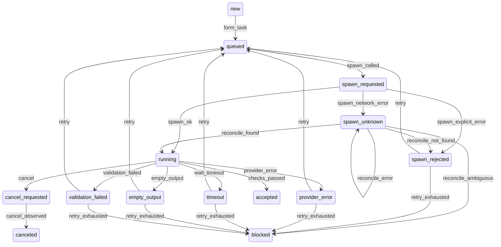

# Atlas of Lane Pilot

> Generated by `npx tsx scripts/generate-atlas.ts` from the code's registries. Do not edit by hand. <!-- atlas:structure 5e00244f53b4958a -->

## Rooms (56)

Each room is one component: `index.ts` is its public API, `server/` its services, `ui/` its screens. Other rooms import only the public API.

| room | public API | files | lines | covered by |
|---|---|---:|---:|---|
| backlog | BACKLOG_MARK, BATCH_MAX_ESTIMATE, BacklogBoard, FULL_LANE_PATHS, MAX_ESTIMATE, PER_DAY, PER_PROJECT_PER_DAY, TodoMeta, backlogBoard, backlogMatches, backlogMigrations, backlogReadCommand, backlogSettings, batchItemIsFullLane, batchReceiptGaps, issueMessage, offerKey, parseBacklogOutput, parseTodoMeta, pickBatch | 10 | 472 | tests (1) |
| baseline | BaselineRecord, baselineMigrations, getBaseline, isExistenceOnly, listBaselines, taskBaselineEntries | 9 | 824 | tests (3) |
| brief | chatBriefSection, chatCode | 3 | 245 | tests (2) |
| checkers | OUTPUT_DEFECT_KINDS, OutputDefectKind, OutputVerifierCase, PlantOutputOptions, VerifierFn, VerifierScore, buildScorecard, checkerMigrations, checkerRows, latestCheckerRun, plantOutputDefect, scoreVerifier | 20 | 1924 | drill: checkers |
| contracts | AcceptanceCard, AgentScheduleRef, AnalyzerSelection, BIRTH_GATES, BIRTH_KINDS, BirthKind, CODE_CRITIC_DEFAULTS, CodeCriticDefault, ErrandOutcome, ErrandRunStart, ErrandVerifiedOutcome, ErrandsApi, EvalData, FAILED_ATTEMPT_STATES, FREE_CLASSES, HOST_JOB_KINDS, HandOverResult, HandOverStarted, HostJobKind, INTAKE_KINDS, IntakeKind, IntakeRecord, IsTaskSatisfied, LEAD_ID, LEAD_NAME, LEAD_SESSION, LEAD_SUMMARY, LEAD_TICK, LEAD_TOOLS, LP_EVENTS, LaneProjectNotice, LeadRoadApi, LineWindow, LpEventName, MemoryEvalReport, MemoryEvalRunner, NATIVE_HOOK_SOURCES, NO_RED_KINDS, NO_WAY_OUT, NativeSelection, PathWindows, PhaseIntake, PrototypeConfig, QA_DEFAULT_PORTS, RawNote, RawQuestion, RawTask, RoadDb, RoadEvidence, RoadKind, RoadRow, RoadSource, RoadState, Room, RoomCliCall, RoomCliVerb, RuleScanSurface, SANDBOX_OWN_ENV, SERVICE_KINDS, ScheduleAgentApi, ServiceKind, SqlDb, TASK_KINDS, TASK_V2_OPTIONAL, TaskV2, TaskWordDb, TaskWordPort, WAY_OUT, WORKFLOW_NODE_TONES, WordTask, asJsonText, birthGates, bundledAgents, failureClass, hostContract, hostMethods, installReceiptSchema, isCodeCriticDefault, isMachineMessage, modelCatalogSchema, parseExecutionLineWindows, prototypeConfigSchema, secretNameSchema, settingValidationSchema, spawnClaimed, stepExecutorSchema, taskV2Schema, taskWordItemPrefix, wayOut, workflowDraftCheckSchema, workflowDraftPatchResultSchema, workflowDraftPublishResultSchema, workflowDraftSummarySchema, workflowDraftTestResultSchema, workflowStatsSchema, workflowTrialCaseSchema, workflowViewEdgeSchema, workflowViewNodeSchema, workflowViewSchema | 87 | 12005 | drill: parallel3 |
| core | — | 11 | 887 | drill: parallel3 |
| coverage | COVERAGE, COVERAGE_USAGE, CoverageEntry, CoverageRow, CoverageStatus, CoverageSummary, DrillReceipt, NODE_KINDS, NodeKind, REQUIRED_MECHANISMS, checkReceipt, codeNodes, coverageRows, holes, renderCoverage, room, runCoverageCli, summarize, transitionId, untermedGaps | 6 | 332 | tests (1) |
| critique | callerLabels, codeCritiquePrompt, collectGitNexusCallerPaths, scanCritiqueCoverage | 52 | 5650 | tests (2) |
| deferral | Counts, DEFERRAL_KINDS, DeferInput, Deferral, DeferralKind, DeferralList, DeferralState, DeferralView, DueSource, NamedDate, OwnerRef, ResolvedTerm, SEED_ENTRIES, SeedEntry, countDeferrals, dayOf, dayOfArg, deferralKindMigrations, deferralMigrations, endOfDay, namedDates, quoteOf, resolveTerm, view, wallDeferralKindMigrations | 13 | 792 | drill: deferrals |
| docs | DOCS_ENABLED_KEY, commitDocs, docsLineCounts, docsWorthinessFacts, gitDocsScope | 19 | 972 | tests (1) |
| errands | DiagnosisKindCost, DiagnosisShare, ERRAND_FAILURE_CLASSES, ERRAND_KINDS_WITH_NONE, EpisodeSkillUse, ErrandCheck, ErrandFailureClass, ErrandKindOrNone, ErrandRow, ErrandSnapshot, ErrandSource, ErrandStart, ErrandVerified, ErrandsDiagnosis, KindSummary, KnownProcessKey, NearProcessKey, ProcessKeyPick, RecordTrajectoryDeltaInput, RecordTrajectoryDeltaResult, ResolveSkillIntentOptions, ResolvedSkillMatch, SKILL_DOMAIN_SYNONYMS, SkillCatalogItem, SkillIntentLogLevel, TRAJECTORY_DELTA_TABLE, TRAJECTORY_INTERVENTION_KINDS, TrajectoryDeltaRow, TrajectoryInterventionKind, chooseProcessKey, diagnosisLines, episodeSkills, errandAccountLines, errandCheck, errandPrompt, errandStem, errandTitle, errandVerdict, errandsSettings, hasExplicitSkillIntent, nearestKeys, pairwiseF1, resolveSkillIntent, routeConfidence, trajectoryDeltaMigrations | 26 | 2519 | tests (2) |
| evolve | AdoptBy, ArenaRow, ArenaTable, ArmAttempt, ArmMetrics, ArmSummary, ArmWriter, BenchResult, BenchVerdictInput, BootstrapInterval, CANARY_DEFAULTS, COST_TIME_TOLERANCE, CanaryConfig, CanaryDecision, CanaryRow, Check, CompareArmsOptions, Comparison, EVOLVE_DEFAULTS, EVOLVE_ENABLED_KEY, EVOLVE_GRAPHS_KEY, EVOLVE_REPLAY_MAX_RUNS_KEY, EVOLVE_SETTING_KEYS, EvolveSettings, Flip, MIN_MEASURED_PAIRS, MIN_PAIRED_SHARE, MIN_PAIRED_TASKS, NoiseMetrics, NoiseRecord, PassReport, TRIAL_DEFAULTS, TaskStat, TrialConfig, TrialDecision, TrialPrediction, arenaTable, armMetrics, compareArms, computeNoise, costPerAccepted, decideCanary, decideTrial, evolveSettingProblem, evolveSettings, median, noiseOfRepeats, pairedBootstrapInterval, pairedDiffInterval, parseEvolveSettings, passReport, predictionHeldTrial, renderArenaTable, renderComparison, stabilityMarks, summarizeArm, wilsonInterval | 24 | 5068 | tests (2) |
| file-cards | CATALOG_USAGE, FileCard, GitFacts, Touch, appendTouch, buildCatalog, buildFileCard, cardNotes, catalogDir, catalogExists, catalogNeedsBuild, collectCards, collectGitFacts, findRepo, readCatalog, readMeta, readTouches, repoHead, runCatalogCli, startCatalogBuild, trackedFiles, writeCatalog | 8 | 511 | tests (1) |
| forecast | Calibration, CalibrationBadge, Forecast, ForecastFact, ForecastScore, calibrate, calibrationBadge, calibrationLine, dependenciesAddedInDiff, scoreForecast, stampForecastModel | 6 | 264 | tests (1) |
| front | FIRST_RUN_STEPS, FirstRunDraft, FirstRunStep, FrontApi, answerFirstRun, createFront, firstRunNeeded, firstRunSettings | 5 | 98 | tests (1) |
| guard-tools | — | 1 | 246 | tests (1) |
| host-worker | HOST_JOB_ARG, HOST_JOB_HANDLERS, answerPermit, applyOnboardingPages, closeBacklogItem, coexistenceInventory, coexistenceOperation, connectOpencode, detect, discoverClaudeAgentsHost, diskFree, docsAnchors, docsFlows, docsLineCounts, docsWorthinessFacts, findBrowserQaTarget, gateAttribute, gateBisect, gateRun, gitCommitDocs, gitCreateWorktree, gitDocsScope, gitIntegrate, gitMergeInfo, gitOwnershipBase, gitOwnershipChanges, gitOwnsBarrier, gitPrepareWorktree, gitRemoveWorktree, gitRevertCommits, gitRevertPaths, gitSyncWorktree, gitUndoCheckWrites, gitWorktreeSnapshot, gitWorktreeState, inspectCritiqueCoverage, install, jobCancel, jobStart, jobStatus, listDocsPages, listFolders, listPermitTickets, listWorkflowFiles, openCodeLimitProbe, prepareBbShimHost, prepareClaudeGuardHost, prepareNativeClaudeHost, prepareWorkerHome, probeBrowserQaTarget, readBoundedFile, readOpenCodeTelemetry, readUsageWindows, removeWorkerHome, rollback, runBrowserQa, runCommand, runJobProcess, runSandboxedCommand, runScript, sandboxCommandLine, sandboxRelease, snapshot, snapshotDryRun, vpnAddress, whichPrograms, worktreeJanitor, writeDocsPages, writeForgeDraft, writeForgeEnabled, writePhaseBook, writePmSettings, writeUsageSnapshot, writeWorkflowFile | 15 | 1546 | drill: parallel3 |
| lead | DEFAULT_PATHS_BRANCH_DRAFT_REPEATS, DEFAULT_PATHS_BRANCH_WINDOW_DAYS, DEFAULT_PATHS_DEDUPE_THRESHOLD, LEAD_DEFAULTS, LEAD_SETTING_KEYS, LeadSettingKey, LeadSettings, PATHS_BRANCH_DRAFT_REPEATS_KEY, PATHS_BRANCH_WINDOW_DAYS_KEY, PATHS_DEDUPE_THRESHOLD_KEY, RoadEvidence, RoadRow, addRoad, answerTaskWord, askTaskWord, doneRoad, getRoad, leadMigrations, leadSettingProblem, listRoad, parseLeadSettings, reopenRoad, taskWordItemPrefix, wordDecisionId | 21 | 2010 | tests (4) |
| memory | MAX_QUOTE, MEMORY_LINE_CHARS, MEMORY_PATHS, MEMORY_PRIMITIVES, MEMORY_SETTING_KEYS, Masked, MemoryPath, MemoryPrimitive, MemorySettings, PiiKind, ProbeKind, WriterPickOptions, maskPii, memoryLine, parseMemorySettings, pathAnchors, pathById, reviewerMemoryPicks, scrubQuote, writerMemory, writerMemoryPicks | 42 | 4290 | drill: memory_paths |
| memory-eval | Classified, CorpusNote, EVAL_PROJECT, EvalQuestion, EvalScope, MASLOV_FILLER, OFFTOPIC, PlanInput, QuestionKind, SUITE_CASES, SUITE_NOTES, SUITE_PACK_NOTES, SUITE_PROJECT, SizePlan, SuiteCase, SuiteFamily, SuiteNote, candidateQuestions, classify, fileKey, folderKey, notesNaming, planCorpus, poisonCopy, prng, queryOf, shuffled, syntheticCopy | 20 | 2327 | tests (1) |
| memory-probe | MemoryProbeReport, MemoryProbeRow, PROBE_ANCHOR, Probe, judge | 5 | 202 | drill: memory_paths |
| memory-tiers | Episode, episodeLines, memoryTierMigrations, minHits, queryWords, wordHits | 7 | 260 | tests (1) |
| money | DailyRow, MoneyApi, PAID_PROVIDERS, Price, capOf, createMoney, isPaid, moneyCapFrom, moneyHold, paidModelPrice, paidRowUsd, spendBook | 6 | 226 | tests (1) |
| native-agent | ARCHITECT_LAUNCH, AgentFailure, CustomAgentMeta, EmployeeManifest, HELPER_DISALLOWED_TOOLS, InventoryGroup, LANE_PILOT_PM_SESSION, ListedHost, NATIVE_LP_BRIDGE_PM_TOOLS, PARITY_LAYERS, ParityLayer, ParityLayerSet, ParityLine, ProjectSourceBinding, RESOURCE_KEYS, ResourceKey, ResourceMode, SKILL_CATALOG_BLOCK, SKILL_CATALOG_LIMIT, SKILL_CATALOG_LINE, UNLISTED_STOCK_IDS, WORKFLOW_ARCHITECT_NAME, WORKFLOW_ARCHITECT_SESSION, WORKFLOW_ARCHITECT_TOOLS, WRITER_DISALLOWED_TOOLS, WRITER_MAX_TURNS, WriterBindingResolution, affinityHostId, agentKind, agentListItem, applyResourceMode, chooseEmployeePlace, collectAgentInventory, compileEffectiveMainAgent, compileMainAgentProfile, createAgentInputSchema, detectCompiledMainAgentCapability, discoverClaudeAgents, mentionContext, mergeInventoryItems, nativeAgentTypeKey, nativeEnvGenerationKey, nativeEnvKey, nativeSelectionKey, nativeThreadKey, parseAgentFile, parseOwnedAgents, pendingSwitch, permissionEntries, placeEmployeeOn, pmSkillName, prepareBbShim, prepareClaudeGuard, prepareNativeClaude, reconcileClaudeLane, requestArchitectLaunch, resolveWriterBinding, resourceModeOf, sessionInventory, takeArchitectLaunch, terminalParity, updateAgentInputSchema, writerWorkspaceForPmInstructions | 62 | 6854 | drill: helper_providers, provider |
| native-install | FeatureCapability, FeatureRuntime, HostContext, connectOpencodeStack, createNativeInstaller, detectStack, experimental_vkLifecycle, featureRegistry, featureRegistryGaps, installStack, inventoryCoexistence, rollbackStack, runCoexistenceOperation, snapshotStack | 29 | 4439 | tests (1) |
| outage | BEAT_KEY, OUTAGE_THRESHOLD_MS, Outage, OutageRecord, gapOutage, listOutages, outageMigrations | 9 | 136 | tests (1) |
| owner-presence | JOURNAL_KEEP_DAYS, JOURNAL_MAX_ROWS, JournalRow, PRESENCE_FILE, PRESENCE_WINDOW_MS, Presence, journalAppend, laneOwnedMetadata, outsideWorkSummary, presenceHold, readPresence | 8 | 251 | tests (2) |
| owner-waiting | Answered, CollectOwnerWaitingOptions, NOW_CAP, OWNER_FACT_TTL_MS, OWNER_NOTE_TTL_MS, OpenOwnerItemFilter, Overnight, OwnerAction, OwnerEvidence, OwnerItem, OwnerItemCreatedEvent, OwnerItemSweep, OwnerWaiting, OwnerWaitingRow, PostOwnerItem, callReason, closeOwnerItem, closeOwnerItemsByPrefix, collectOwnerWaiting, countOpenOwnerItems, decidedOwnerItem, hasOpenOwnerItem, isSandboxProject, lanePilotProjectOrNotice, listOpenOwnerItemKeys, listOpenOwnerItems, loadPushConfig, onOwnerItemCreated, ownerAnsweredItem, ownerItemOutcome, ownerItemPrefixCount, ownerWaitingCounts, ownerWaitingMigrations, postOwnerItem, rpcLine, setSandboxProjects, sweepOwnerItems, tableExists | 19 | 1691 | tests (4) |
| pages | LanePilotPage, LpPage | 25 | 2952 | tests (5) |
| platform | — | 44 | 3308 | drill: parallel3 |
| project-git | BASELINE_LIMITS, BootstrapRecord, BootstrapStage, GitProbe, GitProbeState, IGNORE_PATTERNS, RepoReadback, SavedScope, ScopeChoice, isWithin, namesOperation, pythonSecretSources, repoDescription, repoNameFor, sameRemote, scopeQuestion, verifyReadback | 9 | 981 | tests (3) |
| protections | DISARM_TERM_MS, PROTECTIONS, disarmKey, disarmedProjects, noteProtectionDisarm, readDisarm, renewDisarm | 1 | 62 | tests (1) |
| qa | runBrowserQaOnHost | 15 | 1542 | tests (1) |
| relay | OWNER_ASK_RENDERER_ID | 24 | 1894 | tests (2) |
| reports | ComposeReviewDeskResult, DAILY_DRY_KEY, DAILY_SENT_KEY, DESK_KEEP_OPTIONS, DESK_SECTIONS, DESK_SECTION_LABELS, DailySummary, DeskItem, DeskItemAction, DeskSection, DeskSectionView, DigestLike, DurabilityDeskItem, DurabilitySummary, LoopHealthEntry, OwnerPushOutcome, TG_CHAT_NAME, TG_TOKEN_NAME, TG_TOPIC_NAME, TelegramNotReadyError, TelegramSend, TelegramSendError, buildDurabilityDeskItems, composeDailyReport, dailyDue, deskWeekKey, formatDurabilitySection, formatReviewDeskText, localDayHour, normalizeDeskOption, reviewDeskOwnerItemKey | 19 | 2060 | tests (1) |
| rollback | rollbackMigrations | 20 | 1453 | tests (1) |
| runs | runsSettings | 54 | 4403 | drill: parallel3 |
| schedule | ERRAND_BUILTIN, ERRAND_KINDS, ErrandKind, ErrandKindHints, ErrandKindPick, SCHEDULE_ERRAND_DEFAULT_KEY, ScheduleBoardContract, classifyErrand, createScheduleStore, errandDefaultProblem, errandKindRole, errandRoleFor, fireTimes, hintedErrandKind, isErrandKind, scheduleAgentMigrations, scheduleMigrations, scheduleNameOf, scheduleRpcContract, taskOf | 41 | 4380 | tests (1) |
| secrets | secretsSettings | 10 | 262 | tests (1) |
| session-hooks | ConventionGate, GUARD_INVENTORY, GuardRow, SNAPSHOT_MAX_AGE_MS, STREAMS, SpendWindow, StreamName, buildCapsule, capsuleRestored, conventionGateHits, guardInventoryGaps, sessionSummaryLine, spentWindows, windowAppliesTo | 7 | 1235 | tests (1) |
| settings | SettingValidationError, SwitchScope, UNLISTED_SWITCHES, argvValidationMap, coupledSettingKeys, switchValue, validateSettingChanges, validateSettingValue, validateSettingsObject, validationErrorText | 15 | 1958 | drill: provider_limit |
| specialist | ActionOrder, ActionOrderKind, BankQuestion, CostEstimate, DEFAULT_SPECIALIST_SNAPSHOT_BYTES, DbOrderKind, IntervalForecast, MAX_SPECIALIST_SNAPSHOT_BYTES, MIN_SPECIALIST_SNAPSHOT_BYTES, QuestionBankFile, REASON_CODES, ReasonCode, SPECIALIST_SNAPSHOT_BYTES_KEY, SP_ACTION_KEYS, SpActionKey, ToolTier, actionOrderKindSchema, actionOrderSchema, canonicalJson, checkRuSeasonality, classifyToolTier, computeIdemKey, computeSemanticKey, dbOrderKindOf, estimateActionOrderCost, execPluginPythonAsync, execPluginPythonSync, hasPluginScript, intervalForecastSchema, loadMergedQuestions, loadQuestionBank, loadRuCalendar, loadSpPolicy, loadToolTiers, mergeShadowQuestions, normalizeOrdersInput, parseSpecialistSnapshotBytes, resolvePluginRoot, spAutonomyGrantMigrations, spHypothesisMigrations, spIntentOutcomeMigrations, spMigrations, spRuleMigrations | 31 | 7783 | tests (2) |
| stability | — | 41 | 3002 | drill: reload |
| stage-return | ReturnState, StageReturnRecord, finishReturn, getReturn, insertReturn, listReturns, renderReturnNotes, stageReturnMigrations | 12 | 528 | tests (4) |
| storage | ATTEMPT_STREAM_EXCERPT_CHARS, ATTEMPT_TABLE, AcceptedFactRow, AttemptFailureFields, CANCEL_CODES, CancelCode, CasFilesLike, CheckRef, CreateOnlyFilesApi, DEPENDENCY_REDO_WAIT_MS, DISARM_TERM_MS, DarkDb, DarkTableRow, DirectOwnerChatCandidate, DirectoryMove, Disarm, DraftRow, DraftStore, EffectRow, ErrandEpisodeWindowRow, EvidenceCheck, EvidenceRecord, FULL_GATE_VALID_MS, GATE_CATEGORIES, GateCategory, GateEventRow, GateEventStatus, GateRunRow, GateRunState, HARNESS_VERSION, Journal, LanePilotDatabase, PROTECTIONS, PilotDayAttemptFact, PilotDayCandidate, PilotDayCategoryHint, PilotDayChildWfFact, PilotDayDigestInput, PilotDayDigestRow, PilotDayEpisodeFact, PilotDaySourceKind, PilotDayStageFact, ProjectArtifactRow, RUN_FILE_KINDS, RUN_HOME_ROOT, RUN_MANIFEST_SCHEMA, RUN_TABLE, ReadRunFile, ReadTaskFile, ReasoningTrace, ReplacingWrite, ResolvedRunFile, ResolvedTaskFile, RunFileKind, RunFileRow, RunHistoryRow, RunHomeRow, RunRow, RunStatus, SCREEN_REASON_CHARS, STATE_REASON_CHARS, STATE_REASON_PAGE_CHARS, STATS_EPOCH_DEFAULT, STATS_EPOCH_SETTING, SaveSettingsResult, SecretIssuance, SettingChange, SkillEvolutionEventInput, SkillEvolutionFileEntry, SkillEvolutionRow, SkillEvolutionStatus, SkillEvolutionStoreOptions, StageEventRow, StageReceiptRow, StepRow, StoredWorkflow, SupersededWorkflowSnapshot, TABLE_SKIP_RE, TASK_FILE_KINDS, TASK_HOME_EXCLUDE, TASK_HOME_ROOT, TASK_MANIFEST_FILE, TASK_MANIFEST_SCHEMA, TERMINAL_RUN, TRANSITION_KEY, TaskDraftRow, TaskFileIo, TaskFileKind, TaskFileProducer, TaskFileRow, TaskHomeRow, TaskOutcome, UpsertProjectArtifactInput, WorkflowFileSource, WorkflowStore, WorktreeOwner, WorktreeOwnerKind, WorktreeRow, acceptanceAttemptRows, acceptedAttemptCiting, acceptedAttemptProjectIds, acceptedAttemptTaskRefs, acceptedFamilyAttemptId, acceptedTaskCountsByProject, acceptedTaskIdsOfRun, activeRunForProject, activeRunForWorkspacePath, adoptableBlockedAttempts, appendAcceptedFact, appendGateEvaluation, appendSkillEvolutionEvent, assertRunAdmission, assignAttemptHarness, attemptContractRowsSince, attemptEnvironmentCandidates, attemptEnvironmentRows, attemptHarnessTreeId, attemptIdsOfThread, attemptReasonsForTask, attemptRowWithProject, attemptRunAndThread, attemptRunRef, attemptStateCounts, attemptStateForTaskRun, attemptThreadsOfRun, attemptTimelineRows, attemptTraceContext, attemptTransitionsForTask, attemptUpdatedAt, attemptWorkspacePaths, attemptWorkspaceRow, attemptedTaskIdsOfRun, bareWorkspaceAttemptExists, bbTaskFileIo, beginRunAdmission, bindingSettingValue, blockedReasonCount, boundSettingValue, canaryAttemptRows, cancelCodeCounts, canceledLatestTaskIds, casResetSettings, casSetting, casUpsertSetting, casUpsertSettings, casWriteWorkflowFile, checkHistoryKey, checkIdentity, checkoutBase, checkoutRunProject, claimActivation, claimAttemptWake, claimDailySchedule, claimRunPlacement, claimStageSpawn, clearAttemptWake, clearDirectoryMove, clearReconcileCursor, clearSettingValue, clearTaskClosedWords, clockForColumns, closeRun, contractEditions, countAcceptedForProject, countActiveProjectArtifacts, countAttempts, countAttemptsInStates, countChargedAttempts, countHarnessArmAttempts, countLanePilotTables, countOtherLiveAttemptsInArea, countProjectTasksSince, countStageReceipts, countStageReceiptsSince, countTaskFiles, countThreadAttempts, countThreadTaskAttempts, countThreadTurns, countVerificationGateFailures, createAttempt, createDraftStore, createJournal, createRun, createStatusResolver, createTask, currentTaskFilePaths, darkClockExpr, darkTableNames, darkTables, declaredWorktreeOwner, definitionSha256, deleteBoundSetting, deleteStageReceipt, directoryMove, disarmKey, disarmedProjects, endDisarm, endSpawnFailure, errandEpisodeColumns, failedAttemptStateCounts, failedBackgroundStageRows, failedStageCounts, failedStageReceiptsSince, failedTasksAllProjects, failureFieldsOf, finalTaskIdsSince, findOpenNativeRun, finishGateRun, finishedIntakeTaskRows, firstAttemptAt, freeTaskId, freezeRunBinding, fullGateVerdict, gateEventFailureCounts, gateEventsForTask, gateRunRow, getActivation, getAttempt, getProjectArtifact, getReasoningTrace, getReasoningTraceJson, getRun, getRunCard, getRunObjective, getRunSettingsScopes, getRunWriterHost, getSettingVersions, getStageReceiptResult, getTask, getTaskContractJson, getTaskDraftRow, getTaskGitBase, getTaskPlan, getTaskRow, globalWorkflowDir, hasAcceptedAttempt, hasFailedStageReceipt, hasLiveAttempt, hasReconcileCursor, hasRunAdmission, hasRunForPmThread, hasTask, hasTaskHome, hostActivityToday, inferArtifactMetaFromRelPath, insertTaskDraftRow, inspectAttempt, inspectState, isArmed, isRunFileKind, isTaskFileKind, isTaskHomePath, janitorKeptSample, janitorSums, lastJanitorKept, lastStageReceiptAt, laterFamilyAttemptTaskIds, latestAcceptedAttemptOfTask, latestAcceptedAttemptRef, latestAreaWriterBinding, latestAttemptByRowid, latestAttemptEnvironmentId, latestAttemptHarnessVersion, latestAttemptIdForThread, latestAttemptRow, latestAttemptStateCreated, latestAttemptWorkForThread, latestAttemptsForProject, latestAttemptsPerTask, latestDocsTaskAt, latestErrandEpisodeRows, latestFamilyAttemptInRun, latestGateRun, latestGateRunForTask, latestOpenPmThreadForProject, latestPublishedSkillEvolutionBySkill, latestPublishedSkillEvolutionForDraft, latestRunForPmThread, latestRunForProjectThread, latestRunIdForPmThread, latestRunTaskAttempt, latestRunTaskAttemptState, latestSkillEvolutionForDraft, latestStageResultJson, latestStageWorkForThread, latestTaskAttempt, latestTaskAttemptId, latestTaskAttemptRow, latestTaskAttemptState, legacyReadCount, legacyTaskFilePath, listAcceptedAttemptsForTask, listAcceptedAttemptsSince, listAcceptedAttemptsWithThread, listAcceptedFacts, listAcceptedJoinRows, listActiveProjectIds, listAllRunRefs, listAttemptBriefRows, listAttemptEvidenceRows, listAttemptHistory, listAttemptIdsInStates, listAttemptOutcomesSince, listAttemptReasonsLike, listAttemptReasonsSince, listAttemptRefsSince, listAttemptRowsForProject, listAttemptStatesForTask, listAttemptTracesForRun, listAttemptsForProjectOrdered, listAttemptsForTask, listAttemptsInStates, listAttemptsUpdatedSince, listBatchDraftRows, listBbTaskRowsForRun, listBoardAttemptRows, listCandidateTaskRows, listCheckDurations, listCheckFailureRows, listCheckRuns, listCheckTimeouts, listCliPmProjects, listCliPmThreads, listComplexTaskRows, listDistinctSettingKeys, listDueWakes, listEndedTaskIds, listErrandEpisodeFacts, listErrandEpisodeRunIds, listErrandEpisodeTraces, listErrandEpisodesInWindow, listEvidence, listFailedAttemptRows, listFailedAttemptsSince, listFailedAttemptsSinceDesc, listFailedStageReceipts, listFamilyAttemptRows, listFinishedAttemptRows, listForecastTaskRows, listGateEvents, listGateEventsForTask, listHarnessTrialAttempts, listHarnessVersionTimeline, listIdleAttemptsInStates, listJournalAttemptRows, listLatestActivePublishedSkillEvolutionsForDraft, listLatestBlockedAttemptRefs, listLiveRuns, listLiveTasksForRun, listOpenAttempts, listOpenCliRuns, listOpenLaneRuns, listOpenStageTasks, listOpenWorktrees, listOwnSettingLevels, listPendingAcceptedFacts, listPilotDayCandidates, listPilotDayDigests, listPmNoticeThreadIdsSince, listPmSkillUsesSince, listPmThreadIdsSince, listProjectArtifacts, listProjectAttemptReasons, listProjectAttemptStates, listProjectAttemptsSince, listProjectEpisodeTaskRows, listProjectGateEventsSince, listProjectStageEventsSince, listProjectTasks, listProjectTransitionsSince, listProjectsWithBindingSettings, listProjectsWithCriticReceipts, listProjectsWithGlobalSettings, listProviderSettingRows, listRecentFailedAttemptRows, listReviewStageRows, listRunAttemptStates, listRunCloseRows, listRunFiles, listRunIdsForProject, listRunQueueAttempts, listRunTaskRows, listRunTaskSummaries, listRunTransitions, listRunWorkspacePaths, listRunWriterThreadIds, listRunsForPmThread, listRunsPage, listRunsWithAttempts, listRunsWithPmThread, listSecretIssuance, listSettingRows, listSkillEvolutionsForDraft, listSkillMetrics, listStageEvents, listStageReceiptStates, listStageReceiptSummaries, listStageReceipts, listStageReceiptsForProject, listStageStatesForRun, listStaleAttemptsInState, listStaleOpenStages, listStaleQueuedAttempts, listTaskAcceptanceRows, listTaskAttemptRows, listTaskFiles, listTaskIdsForRun, listTaskKinds, listTaskLatestAttemptStates, listTaskLatestAttempts, listTaskTerminalStates, listTaskTransitions, listTasksForRun, listTeachingKeys, listTracedAttemptsSince, listUnansweredWriterQuestions, listUnfinishedStages, listUnmovedLiveAttempts, listUnreportedTaskOutcomes, listVersionedAttemptRows, listWriterThreadTurns, liveAttemptsOfRun, loadProjectSettings, loadPrototypeConfig, loadRunHelperPolicyJson, loadWorkflowStore, markAcceptedFactsSummarized, markCancelCode, markTaskOutcomesReported, nativeDirectoryMigrations, newestAttemptIdForThread, newestAttemptState, nodeFileSource, noteAttemptStream, noteCleanAdmission, noteGateRunStart, noteProtectionDisarm, noteRunFileRead, noteTaskFileRead, noteToldPmDirectly, onAttemptChanged, onSettingChanged, openAttemptBriefs, openAttemptIdsOfRun, openAttemptsForPause, openDatabase, openIntakeAttemptRows, openIntakeTaskRows, openProjectTaskOwnsRows, openRunHome, openRunIdForPmThread, openRunOfPmThread, openTaskAttemptWorkspace, openTaskHome, otherAttemptsOfRun, parkAttemptWake, persistRunHelperPolicyJson, placeTaskHome, planSourcePaths, planningHomeInputs, pluginThreadInStoreTables, pmHasTasksAtWork, pmTasksWaiting, pmThreadOfCliRun, previousHarnessVersion, priorAttemptStates, projectHasScopedRun, projectIdForCheckoutPath, projectIdForPmThread, projectIdForWorkspacePath, projectLiveAttempts, projectSettingValue, projectWorkflowDir, pruneTaskDraftRows, putGlobalSettingValue, readDisarm, readLoopMode, readLoopModes, readParkedTasks, readRunFile, readTaskFile, recentAttemptWorkspaces, recentRunWorkspaces, reconcileCursorPage, recordCheckDuration, recordContractEdition, recordEvidence, recordFinishedAttempt, recordJanitorSweep, recordPmSkillUse, recordRunFile, recordRunFileRow, recordSecretIssuance, recordSkillMetric, recordTaskFile, recordTaskFileRow, registerWorktree, releaseActivation, releaseWorktree, releaseWorktreeById, releaseWorktreesUnder, removeOwnSettings, renderArtifactsManifestJson, renderRunManifest, renderRunManifestJson, renderTaskManifest, renderTaskManifestJson, renewDisarm, resolveLatestPointer, resolveRunFile, resolveTaskFile, reviveCanceledAttempt, runAttemptOutcomeRows, runClosedAt, runClosedBy, runEnvironmentIds, runHomeOf, runHomeRel, runIdForPmThread, runPmThreadId, runProjectId, runStateCounts, runTaskCardRows, saveDirectoryMove, saveDraftResults, savePilotDayDigest, saveProjectSetting, savePrototypeConfig, saveReasoningTrace, saveReconcileCursor, saveStageReceipt, saveTaskGitBase, saveTaskPlan, secretIssuedForTask, sectionBindingId, setAttemptBarrier, setAttemptDirtBefore, setAttemptEnvironment, setAttemptHolderThread, setAttemptWorkspace, setIllegalTransitionLog, setReasoningThread, setRunObjective, setRunSettingsScopes, setRunState, setRunThread, setRunWorkspace, setTaskClosedWords, setTaskHeldUntil, settingValue, settingValues, settingsScopesForWorkspacePath, sha256, silentThreadInStoreTables, skillMetricSkillsForAttempt, stableId, stageEventKeysSince, stageEventsForTask, stageEventsForTimeline, stageReceiptAttemptState, stageReceiptProviderModel, stageReceiptState, stageReceiptStateResultJson, stageReceiptStates, stageReceiptsForTimeline, staleDisarms, staleStageReceipts, statsEpochLine, statsEpochMs, stemAttemptRows, stickyWorktreeAttemptRows, storedProtectionValue, tableClocks, taskBasePath, taskCheckLogRows, taskContractEditionNumber, taskCreatedAt, taskFileAttempts, taskGraphRows, taskHeldUntil, taskHomeAbs, taskHomeOf, taskHomeOwner, taskHomeRel, taskPlanDbCopy, taskTimelineRow, toldPmDirectly, trackWorkflowAdmissions, trailingQueuedParks, transitionAttempt, updateTaskContract, updateTaskContractJson, upsertProjectArtifact, workerHomeKey, workerOutcomesSince, workerPresenceNow, writeCasCheckoutFile, writeFileCreateOnly, writeReplacing, writeRunManifest, writeTaskManifest, writerBaseForWorkspace | 39 | 5999 | drill: parallel3 |
| tasks | OWNER_WORDS_KEY, STAGE_IDS, STAGE_PROOF, StageId, StageProof, StageReceipt, StageState, acceptanceProofGap, isAdvisoryProof, stageReceiptSchema, stageTransition, tasksSettings, validateStageReceipt | 52 | 5018 | drill: parallel3 |
| tools | — | 22 | 2261 | drill: parallel3 |
| ui-shell | — | 18 | 1289 | tests (5) |
| usage | DEFAULT_USAGE_SKIP_PERCENT, USAGE_SKIP_KEY, attemptMetrics, projectTokenTotalsSince, usageSettings | 25 | 2318 | tests (5) |
| validators | PageReview, ValidatorDeps, validateDeliverable | 2 | 211 | tests (1) |
| verification | CREDENTIAL_DIRS, CREDENTIAL_FILES, CREDENTIAL_SYMLINK_DIRS, DEFAULT_WORKER, HostMachineFacts, MergeInfo, ReplayCacheEntry, RevertResult, WORKER_SECRET_PATHS, WorktreeState, attributeGateOnHost, bisectGateOnHost, cachedReplayVerdicts, credentialDirs, darwinAvailableBytes, gitOwnershipChangedPaths, mergeInfo, prepareSandboxedCommandLine, readMachineFacts, recordReplayVerdict, recordedReplayFailure, releaseSandboxedCommandLine, replayCacheLocation, replayKey, resolveCredentialPaths, resolveGitOwnershipBase, revertCommitsInWorktree, runGateOnHost, runSandboxedCommandOnHost, undoCheckWrites, userToolBins, workerSecretReach, worktreeState | 42 | 4729 | drill: parallel3 |
| wires | WIRE_MARK, Wire, WireHop, WireResult, brokenWireReason, readWires, wiresCommand | 2 | 52 | tests (2) |
| work-graph | AttemptIn, CellState, CostState, ExecutorRow, GRAPH_STAGES, GraphStats, ModelStageStat, ReceiptIn, Role, StageBlock, StageCell, StageEventIn, StageStat, TaskGraph, TaskSummary, Tokens, UsageIn, ceilingLine, graphStats, median, roleOf, stageCells, tailWords, taskGraph | 15 | 740 | tests (2) |
| workflow | BuiltinWorkflowCategory, DraftCheck, DraftOp, DraftScope, DraftTestResult, GENERIC_PROJECT_WORKFLOW_IDS, HEAVY_LENGTH, INTAKE_KINDS, INTERNAL_UPKEEP_WORKFLOWS, ISSUE_QUICK_SHORT_PATH, IntakeKind, LOOP_HOOK_MANIFEST, LOOP_HOOK_POINTS, LP_TASK_PIPELINE, LoopHookManifest, LoopHookPoint, LoopHookRefusal, NodeExecutor, PROFILE_KEYS, PROFILE_SETTING_KEYS, PROFILE_VALUE_MAX, PreparedLoopWorkflow, RawDefinition, Refusal, RunSummary, SELF_REPAIR, SERVICE_KINDS, STATE_BLOCK_END, STATE_BLOCK_START, STATE_MANUAL, ServiceKind, StepContext, ValidateOptions, WORKFLOW_CATEGORIES, Workflow, WorkflowCategory, WorkflowEngine, WorkflowProblem, binaryFileCommand, binaryFileFingerprint, compareWorkflowCategories, extractCategoryLabel, humanizeCategorySlug, instructionForms, intakeByRules, intakeRunGoals, intakeTitle, isBuiltinWorkflowCategory, isInternalUpkeep, isMachineMessage, issueQuickModelCalls, issueQuickShortPath, issueQuickWorkflowId, markRoadmap, milestoneOf, missingTemplateInputsQuestion, nextRoadmapRow, oneLine, ownsPathProblems, parkRoadmapRow, parseLoopHookManifest, parseMissingInputsAnswer, parseState, phaseFolder, prepareLoopWorkflow, processHint, profilePairProblem, publishedHint, quickRow, resolveCategoryLabel, roadmapAnalysis, roadmapNumberingGaps, roadmapSection, sameStateIgnoringTime, secretKeyName, serviceByRules, stateBlockSections, stateBlockText, stateHasHeader, stateText, unsafeReason, workflowCategory | 121 | 19329 | tests (5) |
| worktree | — | 18 | 2236 | drill: parallel3 |
| writer | AGENT_TRASH_RELATIVE, materializeAgentTrash, ownedAgentTrashPath, runCommandOnHost, writePmSettingsOnHost | 143 | 16944 | drill: parallel3 |

## Task stages (21)

| stage | proof | what decides it |
|---|---|---|
| execution-packet | gate | buildExecutionPacket over the task's read_first: a malformed hint, a line window outside the file, a source that changed mid-read, a refused path or an uncertain read error blocks the attempt before any paid stage; a missing source or one deferred to a required on-site read (windowless over 512 KiB, beyond the host read limit or an unsupported host bound) stays advisory |
| pm-read | advisory | a model's summary of the read_first excerpts; it only hands context to the critics and decides nothing |
| plan-critique | advisory | a model's verdict on the plan: it never accepts a task, and in plan_critique.mode gate (the default, SMA p2_checker) its refusal stops the attempt before the writer |
| run-gate | receipt | the run gate decision and the ownership base preflight are stored in the run-gate receipt; the repository must report a readable base commit |
| specialist-review | advisory | a model's risk opinion on the plan |
| writer-agent | gate | gates owns-paths and validate: the changed files are inside owns_paths and expected_outputs exist with content |
| verification | command | every verification[].command exits 0 in the sandbox (gate verification passed) |
| code-critique | advisory | a model's review of the candidate |
| plan-fact | file | blindPlanFact checks each acceptance row of the writer's plan-fact table against the candidate: the cited file is among the changed files, the cited lines overlap a changed hunk, the cited command is a verification[] command that exited 0; the writer's prose is never read |
| acceptance-receipt | schema | the acceptance-v2 receipt validates against lane-stack/schemas/acceptance-v2.schema.json (validateAcceptanceV2) |
| browser-qa | command | the browser cases run on the host and each case's recorded result is passed |
| docs-maintenance | file | validateDocsEdits accepts the edits, and each written file reads back byte for byte |
| onboarding-preview | schema | parseOnboardingPreview validates the passport and module map the onboarder produced |
| onboarding-apply | file | the host applies the previewed files and reports status applied |
| memory-maintenance | schema | parseMemoryCandidates and the memory door's content rules accept every entry (fields, valid_until, core budget) |
| project-life | gate | the committed head matches the commit the helper reports, and every changed path is inside the project-life scope |
| night-review | schema | parseNightReviewResult validates the review verdict and findings |
| night-fix | command | the fix changed only the finding's paths and the task's verification commands exit 0 |
| workspace-status | file | the environment's status and diff are read from the machine, and the status outcome is available |
| opencode-telemetry | file | the telemetry log is read from the host (size and sha256 match), parses without malformed lines and has a matching event |
| gate-triage | schema | parseGateTriageResult validates the triage result |

## Attempt state machine (26 transitions)

States: (new), queued, spawn_requested, running, spawn_rejected, spawn_unknown, blocked, provider_error, timeout, empty_output, validation_failed, accepted, cancel_requested, canceled.

## Memory delivery paths (14)

| path | consumer | carries |
|---|---|---|
| writer.brief | a writer's first prompt (spawnWriterAttempt) | note, core |
| writer.repair | the code-critique repair round (the dispatch context of the first brief, kept in the attempt trace) | note, core |
| bb.thread | every ordinary BB thread of the project (contributeInstructions, the L1 showcase) | core |
| pm.memory_tool | the PM tool lane_pilot_memory {action:"context"} | note, core |
| schedule.agent | the first message of a scheduled agent run (kind agent of the schedule board): the project's notes for the standing task | note, core |
| critic.code | the code critic's prompt (critique-runs) | note, core |
| hub.memory_import_eval | the M1 import gate (RPC memory_import_eval): measures how many imported records the PM search finds |  |
| hub.session_rpc | the hub session_memory RPCs, not a Lane Pilot agent prompt |  |
| hook.prompt_recall | the pointers the session hook prints under a prompt (`bb lane-pilot memory search --recall`, confirmedWordHits) |  |
| cli.memory_load | `bb lane-pilot memory load --tags a,b`: the core plus the notes carrying the tags, printed for whoever ran the command |  |
| pm.cold | cold notes added when the PM asks for memory and the active set is thin | note |
| maintainer.existing | the memory maintainer's list of EXISTING NOTES |  |
| cli.parity_report | `bb lane-pilot parity`: which memory ids an attempt and a terminal session would both get |  |
| writer.file_notes | the file-note advice of the guard (FILECARDS.md of the task folder, written at dispatch and task update) |  |

## CLI commands (74)

Every `bb lane-pilot <command>`; `bb lane-pilot <command> --help` or the bare `bb lane-pilot` prints the full usage.

| command | what it does |
|---|---|
| `activate` | Spawn a visible isolated PM thread |
| `agents` | The agents the owner can pick: list and show the bundled ones, create, update and delete his own (a JSON or a markdown file with frontmatter) |
| `airbag` | List, prune and probe the return points (refs/lane-airbag/*) of a project's checkout |
| `attempt` | One attempt's whole record: writer thread, stage receipts and gate events of that attempt, dispatch context, verification results, critic input hash, the attempt-change row |
| `budget` | Set or show the run budget of a project (attempts, wall minutes, tokens, child threads; empty value clears) |
| `cancel` | Stop a writer and persist canceled after observing idle |
| `changes` | What is on record for a task or an attempt: base, merge, changed files (deletions included) and the reverify / revert receipts |
| `configure` | Save prototype project settings |
| `conveyor` | The conveyor switch: off, no new work is issued anywhere (writers wait, parked tasks stay, the night queues nothing) while running stages finish and checks go on |
| `defer` | Put a mandatory check off: write it in the register with the reason. It is born with no term (only a date in a message of the owner sets one, --owner-msg) and counts as unproven in its project's phase acceptance until closed with evidence |
| `defer-close` | Close a deferral with the evidence that settles it |
| `deferrals` | The register of deferrals: overdue and open, with their terms |
| `dispatch-bb` | Dispatch a BB writer task, optional task-v2 JSON |
| `errands` | Errands: backfill episode rows for past runs (repeated processes first) |
| `events-list` | Read-only SDK events.list probe |
| `evidence` | The reason and checks stored before each risky operation, newest first |
| `explain` | One word about a verb or a concept: the verb's summary and usage with the doc that names it, or the guide doc whose front matter declares the topic |
| `failures` | Every failed task of every project, one line per task (the latest attempt in a failed state): the unified failure journal |
| `finish` | Close a PM run after observing it idle and release activation |
| `forecast` | The PM's forecasts (contract `forecast`) against the facts of accepted tasks: files, first try, tokens and minutes, per area |
| `frontmatter` | Read, set and merge a file's YAML header; the body is never touched and a file changed under the read is refused |
| `gates` | Gate firings: mark one a false alarm so it stops counting against the gate |
| `health` | Provider breaker state and the budgets of open runs |
| `host-connect-opencode` | S5 JSONC plugin patch |
| `host-detect` | Call the host worker detect method |
| `host-install` | Install target SHA without external ops |
| `host-rollback` | Rollback a snapshot |
| `host-snapshot` | Call read-only snapshotDryRun |
| `host-snapshot-manifest` | Full §11.1 snapshot |
| `integrity` | Each protection with its hazard, armed and current value, disarm term and shadow findings; renew a disarm with a reason |
| `manifest` | This build: name, version, its tables |
| `memory` | The project memory on the hub: search it with a question, write one fact; inside a BB thread the project is the thread's own |
| `memory-compress` | Heavy memory notes and the shorter wording each would get; nothing is applied without --apply <id> |
| `memory-conflict-settle` | Settle a held memory conflict: keep one note, both, or neither, with the evidence |
| `memory-conflicts` | Memory notes that disagree: held out of every brief until a person settles them; --detect looks for new ones |
| `memory-eval` | Score memory retrieval at 30, 300 and 3000 notes on real accepted tasks (right answer, nothing relevant, off-topic) against a plain path-and-keyword baseline; reads the hub data, writes nothing |
| `memory-probe` | Plant a token through the memory write door and check that every delivery path (writer brief, PM, critics) hands it to its agent; sandbox project only unless --force |
| `memory-tiers` | The memory's cold tier (notes unused for 90 days, kept out of briefs) and how many of it a PM needed again, plus the PM queries that found nothing (candidates for memory-eval's golden set) |
| `metrics` | Per attempt: stages passed or failed, seconds per stage, writer tokens and list-price cost; cost shows not measured where the provider reports no usage, never 0 |
| `money` | Money: spent month to date on paid lanes, the 14-day series, the monthly cap (money.monthly_cap_usd) and what is left |
| `outages` | The gaps of more than 5 minutes when Lane Pilot was not running |
| `owner-presence` | Where the owner typed in a session of his own in the last minutes: Lane Pilot's writers keep off that provider meanwhile |
| `parity` | Session and terminal parity of one attempt: six lines (hooks, memory, rules, skills, permissions, model) saying whether the BB session and a terminal session got the same layer |
| `passport` | An attempt's passport: provider, model, harness and Lane Pilot versions, the receipts of its stages; --calibration prints the current PM model's calibration badge |
| `pause` | Pause a run at a safe boundary: new tasks wait, running attempts finish their current stage and then wait, nothing is canceled |
| `planning` | The planning verdicts inventory: every spike and sketch under .agents/planning with its question and verdict (open when none) |
| `pm-skill-use` | Record that a PM session opened a skill |
| `pm-skills` | Which skills PM sessions opened lately |
| `preship` | What is open before a release (unfinished tasks, deferrals) and the disposition each needs; exit 1 when not clear |
| `profile` | The project's infra profile (stack, test command, release, hosts, start, deploy, logs, style): read it, or set a key from the owner's terminal or the project's own PM chat |
| `recover` | Reconcile a known writer identity and emit its validated receipt |
| `remove-claude-lane-leftovers` | Move Claude Lane leftovers on one machine into a dated backup. Dry-run unless --apply |
| `resume` | Reconcile orphaned writer attempts without spawning duplicates |
| `return` | Send a task back to discussion, planning or the writer with a note: recorded, the stale receipts reset, the running attempt stopped with the exit confirmed, the work restarted from that stage with the note in its input |
| `returns` | The returns on record for a task: the note, the stale and kept stages, how far each got |
| `reverify` | Run a task's verification[] again on its recorded base plus the accepted change, in a fresh worktree on the project host; exit 0 only when every item passes, a receipt is kept |
| `revert` | Revert an accepted task's merge commit(s) with git revert in a worktree, check them, merge through the normal merge queue; refuses with the next step when later commits touch the same lines |
| `schedule` | The schedule board: scheduled workflows, errands and scripts (list, show, history, preview, create, update, pause, resume, run-now, delete) |
| `session-brief` | The checkout's coordination brief for a starting session: live and stale windows, a merge in flight, other windows' claims and weakly calibrated areas |
| `setting` | The settings that have no row in the settings window: list them with what each does, show a project's or the hub's values, set one (empty value clears). Only the owner at a terminal sets |
| `skill-lint` | Lint a local skill folder against the skill standard (SKILL.md, references/, scripts/): errors and warnings, exit 1 on errors |
| `skills` | Searchable skill catalog list for the PM |
| `state` | Inspect a project's runs and attempts, newest first, one page at a time |
| `stats` | Project report (sma-stats): phases, plans, requirements, git metrics, a timeline and the attempt metrics |
| `statusline` | One status-line segment of a machine's subscription windows (5h and 7d), for the person's own statusLine command |
| `subagent-pack` | The rules and confirmed lessons a Task subagent is born with (a project switches it on with hook.subagent_pack) |
| `task` | One task's record for another agent: what it asked for, what the server saw done (changed files, merge), acceptance against fact, what is left |
| `timeline` | One task's record in time order, as written while it ran: attempts, every state move with its reason, stage and gate events, the baseline; the post-mortem view |
| `unknown-codes` | Failure reasons no class or rule names yet (the unknown code register), most frequent first, over the last 14 days |
| `wait-thread` | Read-only waitThreadIdle probe |
| `waiting` | Everything only the owner can decide, with why, evidence and the exact action; what went red overnight; the Telegram digest of new items (quiet hours 23:00-08:00 Europe/Madrid by default) |
| `workflow-answer` | Answer the question a workflow run in a project without a PM chat put on the owner's list (the option, or words that name one, or a free answer) |
| `workflow-trigger` | Start a workflow in a project as its schedule trigger does (the automation of a schedule calls this); exit 1 with the reason when it cannot start |
| `worktree-cleanup` | The worktree cleanup pass by hand, its report printed: the hourly sweep, --daily the daily pass, --dry-run the daily pass deciding only (nothing removed, no janitor row, no owner line) |

## Shipped graphs (120)

Every piece of work Lane Pilot runs is one of these graphs (`workflows/<id>.json`); `lp.*` are its own maintenance graphs.

| graph | name | status | what it does |
|---|---|---|---|
| 3d-asset | 3D Asset | published | Full 3D asset pipeline: brief, concept generation via Image Studio, modeling in Blender on Mac mini, QA geometry and preview verification (n-gons, normals, polycount vs budget), and production export. |
| agent-routine | A scheduled agent's routine | published | What a schedule of kind «agent» runs: the named agent (a bundled specialist or one the owner created) does its standing task as itself, with its own prompt, skills and MCP servers, reading what its earlier runs found and the project's notes. |
| ai-integration-phase | AI integration phase | published | Before a phase that ships model behaviour: selects the AI framework and model, researches it, and writes AI-SPEC.md with typed inputs and outputs, failure guards, the evaluation plan and the cost ceiling. |
| analyze-code | Analyze (read-only) | published | Understand or evaluate a module, idea or change and report decisions, risks, scope verdict and confidence. |
| analyze-plan-execute | Analyze, plan, execute | published | Default path for a normal code task - quick analysis, task contracts, plan critique, writers in worktrees with sandbox verification and code critic, merge, goal audit, memory. |
| api-recon | API reconnaissance of a web service | published | Maps the API behind a web service's personal account so we can build our own API or automation on it: a computer-use helper (role api-recon, GPT-6.1 Terra) signs in to the personal account with credentials from Env Catalog, records every fe |
| audit-uat | UAT audit | published | Every open acceptance item across all phases plus a manual test plan, written to .agents/planning/UAT-AUDIT.md. |
| backlog-add | Add to the roadmap backlog | published | An item into the roadmap's parking lot under the next 999.N number (SMA k_c_backlog). |
| billing-batch | Batch Invoicing (Kontur.Elba) | published | Processes a list of clients and services, creates invoices in Kontur.Elba on Mac mini via the invoice-send subworkflow, checks each invoice, compiles a summary registry, and asks for owner approval before any client dispatch. |
| blueprint-driven | Spec package first | published | For a new product or service - brief, PRD with MoSCoW, architecture decisions, epics, a readiness score gate, the spec committed to the repository, then plan and build per epic. |
| brainstorm-driven | Brainstorm first | published | From a vague idea - optional web research, multi-role brainstorm with conflict resolution, guidance spec, plan, build and close. |
| browser-step | Browser step | published | One goal in the owner's real signed-in Chrome on the browser machine, then the page it ends on: its address, a status, the number of actions and the visible text. |
| cleanup | Clean up closed phases | published | Archives what finished work leaves behind: closed phases' folders into the milestone archive, stale spikes and sketches, merged review branches and leftover worktrees; lists everything first and moves nothing it cannot name. |
| code-review | Code review (no fixes) | published | Independent multi-dimension review of a branch, PR, commit range or file set; returns a thresholded verdict and findings with file:line. |
| companion | Small task, no plan | published | A mechanically clear, bounded change with a named target (a typo, a constant, a one-line config) - one writer task in quick mode, sandbox verification only, no plan, no critics. |
| debug | Debug (diagnosis only) | published | Finds the root cause of a failure by the scientific method - hypotheses with predictions, evidence log, backward tracing, at most 3 refuted hypotheses - and returns the diagnosis and fix directions without touching the code. |
| deliver | Deliver message or file via channel (shared brick) | published | Channel-agnostic delivery brick: routes a text, file, or delayed dispatch through the selected channel (currently telegram via telegram-send) and returns the delivery status unchanged. |
| deploy | Deploy with check and rollback | tested | Preflight (clean pushed HEAD, green suite, no running work), owner approval for production, deploy through the repo script or an errand with Env Catalog accounts, post-deploy check, and a rollback offer if the check fails. |
| docs-synthesis-check | Validate document conflict | published | Internal subworkflow that checks both sides of a document conflict and returns structured evidence for docs-synthesis. |
| docs-synthesis-rank | Count a precedence entry | published | Internal subworkflow that evaluates and echoes one document precedence kind for docs-synthesis conflict resolution. |
| docs-synthesis | Find document conflicts | published | Identify conflicts in existing project documents with both sources and record unresolved decisions. |
| errand | Errand | published | A task that is not a code change, done end to end by one helper: a page in the owner's signed-in browser, a mailbox, a cloud console, a deploy with an SSH or FTP account from Env Catalog. |
| eval-review | AI eval review | published | Audits the evaluation of an AI feature: is the gold set independent of the prompt, does the metric track the user goal, can the model game it, is there leakage; writes EVAL-REVIEW.md with a verdict. |
| full-lifecycle | Full lifecycle | published | Plan, build, independent review with a fix loop, browser check, owner acceptance for UI, goal audit and knowledge closeout. |
| grill-driven | Grill the plan first | published | For big or risky changes - adversarial Socratic walk through the plan against the real code (3/5/8 branches), then multi-role brainstorm, plan, build, close. |
| grill-plan | Grill the plan | published | Adversarial Socratic review of a plan or idea against the real code - branches of questions with file:line, locked/open/deferred decisions and a risk register. |
| idea-shootdown | Idea shootdown | published | Attacks one confirmed hypothesis through fixed adversarial lenses (YAGNI, cost, UX, migration, ops, debt, inventive catalyst), then multi-role authors answer the objections and a guidance specification with alternatives weighed is saved und |
| impeccable-build | Build a UI from scratch | published | Design brief and direction contract, DESIGN.md pack and tokens, plan, build in worktrees, browser verification at 375 and 1280, bounded fresh-reviewer finish, DESIGN.md from the built result. |
| ins.post | Analyze one post | published | Collect comments of one post, analyze by lenses, psychology, critic with validator, digest. |
| insights-post | Audience insights for a post | tested | Finds the most discussed posts on a topic in Threads, Instagram or VK, mines their comments into verified insight artifacts (pains, beliefs, language, angles), enriches them with external research and counterevidence, and hands the author a |
| invoice-send | Invoice in Kontur.Elba: make, check, approve, send | tested | Makes (or finds) the invoice for an existing client in Kontur.Elba in the owner's signed-in browser on the Mac mini and downloads the PDF, checks the amount, INN and bank details in code and the client and service line with a Jev judgment a |
| issue-batch | A batch of small fixes | published | Several independent small fixes given in one request - edits of one component or file are one task, edits in independent areas are separate tasks built together in one wave, the batch reported on green sandbox verifications. |
| issue-discover | Discover issues | published | Eight read-only perspectives (security, performance, reliability, maintainability, scalability, ux, accessibility, compliance) scan an area in two batches of four; findings are deduplicated and returned as the run's list, with file:line and |
| issue-full | Issue, full path | published | Takes an issue given as a title and a text, finds the root cause, plans a fix, builds it, reviews it and reports it fixed only after a green review. |
| issue-quick-legacy | Issue, the previous quick path | published | The issue-quick graph from before the short path: a triage call, then a plan, then the build. |
| issue-quick | Issue, quick path | published | A small issue given as a title and a text. |
| lead-tick | The lead's tick | published | One tick of the lead («Штурман»): code reads the project/hub state and writes the brief with the identity first; the lead agent updates the tree and names proposals with evidence and a price; code records them in the road and evolve ledger |
| lp-task-pipeline | Task pipeline | published | The Lane Pilot task pipeline: the PM read, the plan critique (by quality mode) with the planner's revision rounds when the critic returns the plan, the specialist risk review, the ownership base, then the code task in its own worktree with |
| lp.after-accept | After acceptance | published | What Lane Pilot does once a task is accepted: the memory maintainer keeps what the task taught. |
| lp.analyze | Analyze | published | Read-only analysis of the area with locked/free/deferred decisions, risks, scope verdict and confidence. |
| lp.backlog-scan | Backlog Scan | published | Reads a project's .agents/todos/items/*.yaml and automatically issues one ready item per cap window to its PM chat without creating owner cards. |
| lp.brainstorm | Multi-role brainstorm | published | Role authors work in parallel, a fresh cross-role reviewer finds conflicts, gaps and synergies, conflicts are resolved with the owner, a guidance specification with at most 8 features is written. |
| lp.browser-qa | Browser check of an accepted task | published | The browser check of an accepted task: a child thread drives the BB browser on the project's Browser QA machine and returns a verdict per case and viewport. |
| lp.build | Build in worktrees | published | Runs task-v2 contracts through the Lane Pilot pipeline (writer, sandbox verification, code critic, merge queue) and the batch gate. |
| lp.canary-check | Attempt Finished Canary Check | published | Event-driven stability service workflow triggered on terminal attempt completion to inspect harness version failure rates and flag regressions. |
| lp.clarify | Clarification by a model | published | Before work starts, one analyst reads the goal and the project's task tree (.agents/tasks/<task-id>/manifest.json and the plan file it lists, .agents/phases/*/BOOK.md) and proposes at most 10 clarification questions, each naming the task or |
| lp.close | Goal audit and closeout | published | Checks every goal's done_when against evidence, detects intent drift, stages knowledge candidates and updates project life. |
| lp.daily-report | Owner Daily Status Digest | published | Scheduled service workflow that builds a compact 9-line daily summary of attempts, workflow runs, and measured costs from SQLite and sends it to Telegram. |
| lp.draw | Draw the screens | published | The phase drawing: the design lead draws the screens the plan's pieces change as clickable HTML mock-ups in the phase folder; another role checks them against the pieces and the design system. |
| lp.evolve | Graph Evolution Loop | published | Event-driven evolution graph triggered by finished runs, threshold crossings, and model catalog changes. |
| lp.landing-suite | Post-merge landing suite | published | Event-driven landing verification workflow triggered by lp.attempt.merged after a task merges into main. |
| lp.owner-bell | Owner Browser Bell | published | Reacts to newly created owner-waiting items, parks during quiet hours or after the daily cap via durable wait, and folds overflow alerts into a single digest notice. |
| lp.owner-push | Owner Waiting Telegram Push | published | Scheduled service workflow that collects unannounced wake items from the owner-waiting queue and delivers them to the owner's Telegram topic. |
| lp.plan | Plan and critique | published | Turns a goal (or review gaps) into task-v2 contracts in waves, lints them and has the whole plan critiqued. |
| lp.review-desk | Weekly Owner Review Desk | published | Scheduled service workflow that composes the weekly owner review desk with pre-selected defaults across all learning loops, posts one decision item, and sends a compact summary to Telegram. |
| lp.review | Review (read-only) | published | Multi-dimension code review of a diff, PR or file set with a thresholded verdict computed by code. |
| lp.schedule-script | Scheduled script | published | Body of a schedule of kind script: resolves allowed Env Catalog secrets and runs the command on the target machine through a host job. |
| lp.worktree-cleanup | Worktree cleanup | published | The body of Lane Pilot's two system schedules on the schedule board (docs/worktrees.md). |
| lp.worktree-release | Attempt worktree release | published | Event-driven worktree release workflow triggered by lp.attempt.finished. |
| macos-routine | macOS Routine (Mac mini) | published | Executes operational routines and system tasks on Mac mini: plans discrete steps, drives app UI through agent-desktop (skill computer-use) and runs files and commands in the shell, captures screenshot evidence, and produces a verified compl |
| milestone-close | Close the milestone | published | Checks that the run is really finished (open tasks, unmerged work, gate), audits the goals, runs a short retrospective, stages knowledge candidates for the owner's approval, updates project life and archives the run. |
| milestone-summary | Milestone summary | published | A readable project summary from the milestone's artifacts: what shipped per phase in plain words, the decisions, the lessons, the open items and how to try it. |
| mkt-direct-search-campaign | Yandex Direct campaign | published | Builds or rebuilds a Yandex Direct unified (EPK) campaign: keyword clusters, cross-negatives, responsive ad texts with ORD marking, autotargeting and placements, offline conversion goals, bids and strategy; owner approval before budget goes |
| mkt-experiment-cycle | Marketing experiment cycle | published | One A/B hypothesis from plan to verdict: MDE and sample size, bucketing, budget reservation and sample lock, variants, launch through a channel workflow, and closing the test when its sample lock matures (readiness 1.0): scale the winner or |
| mkt-landing-cro-audit | Landing page CRO audit | published | Read-only conversion audit of a paid landing or paywall: first screen offer, speed, mobile layout, trust and proof, the form; writes a loss map and hands design, copy and a code task for an A/B variant in a branch. |
| mkt-project-intake | Marketing project intake | published | Cold start of a paid-marketing direction: reads unit economics (margin, LTV, max CAC), maps the funnel, writes the marketing charter with the North Star and budgets, and asks the owner the few facts only they know. |
| mkt-pulse-monitor | Marketing pulse monitor | published | The scheduled daily (or hourly) marketing sweep over paid channels: spend, CPA, CR and funnel deltas against the corridor, alert rules, sample readiness of running tests; wakes tracking, CRO, experiment close or drop diagnosis only when a m |
| mkt-tg-ads-campaign | Telegram Ads campaign | published | Builds or extends an official Telegram Ads campaign: channel and bot pools, a one-to-one ad matrix, start= deep-link codes, CPM in TON, owner approval before paid delivery and the ads-sync check on the next tick. |
| mkt-tracking-setup | Marketing tracking setup | published | End-to-end analytics repair: UTM and start-parameter passing, Metrika/GA4 goals, GTM dataLayer events, CRM and server-to-server conversions, the gap between analytics and the database. |
| mvp-phase | MVP phase from a user story | published | Starts a phase from a user story: who, what, why, the MVP cut as one vertical slice and what stays out; a plan critic checks the splitting before the story is handed to planning. |
| new-milestone | New milestone | published | Starts the next milestone: its goals, the requirements it delivers (REQUIREMENTS.md rows), and the roadmap phases that get there (lp.phase_add), after the previous milestone is archived. |
| note-add | A note without questions | published | Saves a note with no questions: one write to .agents/todos/notes/ and one confirmation line. |
| phase-assumptions | Phase assumptions | published | Lists the assumptions made about a phase before planning: each with its evidence file:line or none, what breaks if it is wrong and a confidence, split Verified and Unverified. |
| plan-import | Import an external plan | published | /sma-import: an external plan is grilled for conflicts with the code and locked decisions, resolved by the owner, cut into task-v2 pieces and waves, then opened as a phase whose own check is the independent check. |
| plan-only | Plan only | published | Analyze and write task contracts with plan critique and save them as a draft for approval. |
| plan-review-convergence-proof | Plan review convergence proof | published | Runs the independent plan critics and closes with code-owned checker evidence. |
| pr-branch | Clean PR branch | published | Makes a review branch without the planning commits: the phase's code commits cherry-picked onto the base, .agents/planning and .agents/phases left out, so the reviewer sees only the product change. |
| project-start | Project start (value map first) | published | Starts work on a project: a value map before any question (who it is for, what they get, how we know), a preview of the stack, the tests and the memory it already has, the infra profile, the owner's working style and risk, then a recap with |
| quality-loop | Quality loop | published | Review, add missing tests by layers, classify failures (test/code/env defect), diagnose code defects, fix and re-check. |
| reels | Reels / Video Presentation | tested | Turns a supplied long video or link into finished vertical clips (transcribe, select coherent excerpts, edit plan, reframe, captions, render, verify), or makes a short code-rendered animated film, video presentation, or business motion film |
| refactor | Refactor (behavior preserved) | published | Restructure code without changing behavior - baseline of tests and metrics first, plan with mandatory critique, writers, equivalence check against the baseline, code review. |
| research-dossier | Research Dossier (Verified Sources) | published | Searches for sources on a question via Tavily and WebSearch, verifies that each link responds and quotes exist on the page, discards unverified sources, and synthesizes a verified research dossier. |
| retrospective | Retrospective | published | Looks back on a finished run through four lenses (technical, process, quality, decision) and stages insights as rule or note candidates. |
| review-fix | Review and fix findings | published | Takes existing review findings (or runs a review first), turns them into fix tasks grouped by root cause, builds them and re-reviews until nothing actionable remains or two rounds are spent. |
| roadmap-driven | Roadmap and staged delivery | published | For large goals - splits requirements into a DAG of sessions (default one), gets the owner's approval of the DAG, runs each session as analyze-plan-execute respecting dependencies, then closes. |
| roblox-asset | Roblox Asset | published | Author or prepare a Roblox model or accessory, verify scale, dimensions and collision fidelity (UCX/UHX, CanCollide), and deploy to the project via Rojo or Studio. |
| scout | Parallel scout and multi-angle audit | published | Runs 3 parallel read-only scouts before planning (architecture & entry points, existing patterns & conventions, dependencies & verification) or 2-6 custom audit angles (e.g. |
| secure-phase | Close the phase threat register | published | Checks that the plan's threat register is closed: for each threat of the phase's SECURITY.md a disposition mitigated (file:line or check), accepted (the owner's word) or open; the status table goes back into SECURITY.md and open threats end |
| security-audit | Security audit (read-only) | published | Tiered read-only audit - OWASP Top 10, dependencies, secrets, CI/CD, and on the deep tier STRIDE and git history. |
| seo-ai-visibility | SEO AI visibility | published | Measures whether the brand and pages are shown and cited inside AI answers (Alice AI, Google AI Overviews, ChatGPT, Perplexity): an audience question panel and a visibility and citation matrix; also checks the case where positions hold and |
| seo-brief | GIST brief for one page | published | One page's GIST brief: entity passport and focus formula, a SERP gap with a snippet-first wireframe, job/core/decision map, missing decision nodes, link rows, graded evidence cards and the utility gate. |
| seo-cocoon | Semantic cocoon (Cocoon Engine X4) | tested | Turns a research package into a cocoon architecture: topic boundaries, an entity graph, page decisions (H2 or its own URL), roles, canonical parents, the internal link graph, a mutable-fact registry and link acceptors; then a GIST brief per |
| seo-drop-diagnosis | SEO drop diagnosis | published | Diagnosis of a traffic drop or a post-core-update loss: aligned comparison windows, a mechanism label per cohort, the scope (page, template or site), parallel layer checks, scored hypothesis cards with falsifiers, an independent falsificati |
| seo-linkbuilding | SEO link building | published | Link program planning and execution: the acceptor registry and monthly admission gate, consolidation of competing acceptors, competitor placement audit and own-profile risk audit, a cluster-first sprint (layers, anchors with context, donor |
| seo-mentions | SEO mentions | published | Weekly harvest of brand and entity mentions: triage into linked, unlinked, wrong fact and toxic, reclamation drafts, canonical source-page specs for cited entities, and lost-link recovery against URL changes. |
| seo-monitor | SEO monitor | published | The weekly loop over a live site: segmented GSC/analytics cohorts, robots and sitemap watch, CWV groups, anomaly buckets, a scored task queue, the monthly link-response review and the cadence checks. |
| seo-outreach | SEO outreach | published | Drafts outreach per channel of the sprint plan (guest columns, partner links, digital PR, expert kits and roundups, AI-cited listicles, local links), humanises and proofreads every message, and sends only the batch the owner approved. |
| seo-page-refresh | SEO page refresh | published | Maintenance of an existing URL: pull GSC and SERP data, diagnose why the page stalls or drops, pick one hypothesis, then apply the matching fix - a CTR snippet rewrite, a declutter and Information Gain upgrade spec for seo-page, a targeted |
| seo-page | SEO Page (Cocoon to Site) | published | Takes one approved page from brief to a verified package in the site's files: cocoon context, a GIST brief, grounded drafting, media brief, an independent quality audit, compression and language pass, metadata and JSON-LD, a claim risk scan |
| seo-project-intake | SEO project passport | published | The project passport, built once before any SEO work: business scope and topic boundaries, a verified company fact base, a cost-of-error tier per topic, local-SEO and young-domain flags, and the lowest broken layer. |
| seo-release | SEO release | published | The single path for any change to a live site: baseline and control cohort in the SEO Change Log, wave or cohort plan, redirect map, staging QA, the owner's go, one named publish step, production QA, sitemap and URL submission, and the dela |
| seo-research | SEO research package | published | Demand and audience research for a topic: an owner-approved charter, a provenance-registered corpus, demand and decision maps (Reddit Mapper), a task and latent-intent map, SERP-verified groups and gap verdicts; on an existing site also a s |
| seo-structure-audit | SEO structure audit | published | Restructures an established site: a URL decision registry (prune, merge, canonicalize, noindex, 410, enrich), cohort-level systemic quality checks, an internal link graph audit and section restructures. |
| seo-tech-audit | SEO technical audit | published | Full technical audit of a site: GSC baseline, a JS-rendering crawl and Googlebot log checks in parallel, then a per-area specialist audit (index, robots, sitemap, canonical, parameters, pagination, rendering, CWV, hreflang, traps, duplicate |
| seo-template-scale | SEO template scale | published | Template-level work for catalogs and service/geo matrices: page-type passports, the facet whitelist and stock-driven indexation rules, a commercial investigation chain, the service hierarchy and Difference Map for geo pages, the proof layer |
| seo-trust | SEO trust layer | published | Site-wide trust: trust nodes, an editorial and methodology policy, a connected Organization @graph, author and reviewer hubs, the brand entity footprint and poisoning forensics, a real-vs-imitation E-E-A-T audit, optional bottom-up trust re |
| ship | Ship a phase (PR) | published | Turns a verified phase into a pull request: checks the verification passed and the full gate marker, lists untriaged vendor updates, pushes the branch, writes the PR body from the phase book and opens it, records the shipment and runs the p |
| sketch-wrap-up | Wrap sketch findings into a skill | published | Turns the winning findings from a sketch into a project skill draft and persists it without overwriting an existing skill. |
| social-post | Social Post (Telegram Rich Message) | published | Turns a topic into an audience-validated social post: extracts pains and insights via insights-post, writes text in Kirill Vechkasov's author voice, formats as a Telegram Rich Message, and delivers a preview for the owner to publish. |
| sp-specialist-tick | Specialist tick | published | Starts one whole autonomous shift of a lead specialist when no concrete problem is named yet: reads the charter and locks, collects metric deltas, sweeps the question bank and only then chooses which workflow to dispatch. |
| spec-phase | What the phase delivers (SPEC) | published | Fixes what the phase delivers by a Socratic interview: an ambiguity score 0..1 on goal, boundaries, constraints and acceptance, questions on the weakest dimension until it clears, then SPEC.md with requirement ids and Given/When/Then promis |
| specialist | A specialist's task | published | What the PM's lane_pilot_helpers (action specialist) starts: one specialist (design-lead, copy-lead, seo-specialist, growth-marketer, tavily, video-lead, social-manager, billing-assistant, visual-artist, 3d-artist, game-dev, macos-operator, |
| spike | Spike (time-boxed experiment) | published | Answers one technical question by a throw-away experiment inside a time box: the question, the experiment, the result and the decision in .agents/planning/spikes/; a finished spike can be wrapped into a skill draft. |
| telegram-send | Send to a Telegram chat (shared fragment) | published | The one Telegram send of the graph library: a text, a file or a file with a caption goes to a chat (@username, a numeric id, a link or «me») from the owner's account, once, confirmed by reading the sent message back. |
| test-gen | Generate tests | published | Writes missing tests for named gaps in the test paths only, runs them layer by layer, classifies failures (test/code/env defect) and iterates up to three times. |
| todo-add | A todo for later | published | A thought that came up in a session becomes a structured todo under .agents/todos/items/ that the backlog scanner reads unchanged. |
| ui-audit | UI audit (evidence-based) | published | Audits a live UI in the browser on six dimensions (visual hierarchy, interaction states, accessibility, responsiveness, micro-interactions, edge cases) and returns scored findings with screenshots. |
| validate-phase | Validate a phase (check coverage) | published | Audits whether every promise and requirement of a phase has a check that would fail without the work, samples the checks against a broken copy, and writes VALIDATION.md with the gaps. |
| web-research | Web research with sources | tested | Splits a question into sub-questions, searches in parallel (Tavily), reads the best sources, checks each claim against independent sources, and writes a cited report in which every statement carries a numbered source. |
| x-to-telegram-digest | X (Twitter) digest to Telegram | tested | Collects recent public posts from X on a topic in the owner's signed-in browser (read-only), dedupes, scores relevance in parallel, writes a digest with verbatim quotes and links, checks quotes in code and sends it to a Telegram chat as the |

## Feature capabilities (18)

First-party install capabilities from `src/rooms/native-install/models/feature-registry.ts` — which agents, skills and hooks each brings (SMA k_t_capgen).

| feature | runtimes | agents | skills | hooks |
|---|---:|---:|---:|---:|
| dev-orchestrator | 2 | 2 | 22 | 0 |
| copy-lead | 2 | 2 | 20 | 0 |
| seo-specialist | 2 | 2 | 50 | 0 |
| design-lead | 2 | 2 | 14 | 0 |
| project-onboarder | 2 | 2 | 2 | 0 |
| tavily | 2 | 2 | 2 | 0 |
| advisor-researcher | 2 | 2 | 2 | 0 |
| ai-researcher | 2 | 2 | 2 | 0 |
| animator | 2 | 2 | 0 | 0 |
| doc-classifier | 2 | 2 | 0 | 0 |
| domain-researcher | 2 | 2 | 2 | 0 |
| eval-auditor | 2 | 2 | 0 | 0 |
| eval-planner | 2 | 2 | 0 | 0 |
| framework-selector | 2 | 2 | 0 | 0 |
| mempalace-curator | 2 | 2 | 0 | 0 |
| nyquist-auditor | 2 | 2 | 2 | 0 |
| ui-researcher | 2 | 2 | 2 | 0 |
| session-guard | 2 | 0 | 0 | 12 |

## RPC methods (138)

`acceptance_stats` · `activate_pm` · `activation_context` · `attempt_log_tail` · `canary_status` · `cancel_attempt` · `chat_agent_state` · `conveyor` · `create_agent` · `critic_stats` · `deferral_close` · `deferral_defer` · `deferral_list` · `delete_agent` · `deploy_drain` · `docs_overview` · `errands_diagnosis` · `errands_overview` · `experimental_vk_directory_move` · `finish_run` · `first_run_answer` · `first_run_finish` · `first_run_get` · `get_agent_inventory` · `get_globals` · `get_preferences` · `get_role_models` · `get_routing_hint` · `get_run_card` · `get_screen` · `get_stage_result` · `halt_run` · `helper_access_view` · `helper_thread_labels` · `list_agents` · `list_helper_threads` · `list_model_overrides` · `list_projects` · `list_run_stages` · `list_runs` · `list_sections` · `lp_attempt_metrics` · `memory_import` · `memory_import_eval` · `memory_probe` · `memory_record_delete` · `memory_records_list` · `memory_thread_block` · `money_status` · `native_install_start` · `native_install_status` · `native_thread` · `owner_waiting` · `owner_waiting_ack` · `owner_waiting_close` · `owner_waiting_config` · `owner_waiting_digest` · `prepare_native_session` · `remember_project` · `remove_claude_lane_leftovers` · `reset_model_overrides` · `reset_project_settings` · `resume_runs` · `retry_attempt` · `save_agent_profile` · `save_code_critique_selection` · `save_docs_selection` · `save_globals` · `save_memory_selection` · `save_night_review_selection` · `save_onboarding_selection` · `save_plan_critique_selection` · `save_pm_read_selection` · `save_project_life_selection` · `save_setting` · `save_settings` · `save_specialist_selection` · `save_writer_binding` · `save_writer_fallback_selection` · `save_writer_selection` · `secret_issuance` · `session_memory_core` · `session_memory_project` · `session_memory_search` · `session_memory_write` · `set_locale` · `specialist_overview` · `stack_connect` · `stack_detect` · `stack_install` · `stack_rollback` · `switch_chat_agent` · `task_acceptance_card` · `task_board` · `task_card` · `task_diff` · `task_draft_card` · `task_draft_create` · `task_return_stage` · `task_word` · `thread_live` · `token_usage` · `token_usage_sync` · `ui_version` · `update_agent` · `work_file_read` · `work_graph_stats` · `work_graph_strips` · `work_graph_task` · `workflow_answer` · `workflow_architect_start` · `workflow_capabilities` · `workflow_draft_create` · `workflow_draft_get` · `workflow_draft_grant` · `workflow_draft_list` · `workflow_draft_patch` · `workflow_draft_publish` · `workflow_draft_restore` · `workflow_draft_rollback` · `workflow_draft_test` · `workflow_dry_run` · `workflow_evolution_list` · `workflow_evolution_publish` · `workflow_export` · `workflow_get` · `workflow_list` · `workflow_map` · `workflow_model_catalog` · `workflow_preflight` · `workflow_rerun_node` · `workflow_run` · `workflow_run_snapshot` · `workflow_run_tests` · `workflow_runs` · `workflow_step_executors` · `workspace_provider_reset` · `writer_reuse_stats`

## Largest files (candidates to split)

| file | lines |
|---|---:|
| src/rooms/contracts/native-hook-sources.ts | 3736 |
| packages/i18n/src/i18n.ts | 2147 |
| src/rooms/contracts/session-hook-source.ts | 1425 |
| src/rooms/migrations.ts | 904 |
| packages/memory-core/src/store.ts | 798 |
| src/rooms/native-install/coexistence.ts | 796 |
| packages/i18n/src/i18n-fields.ts | 734 |
| src/rooms/legacy-migrations.ts | 694 |
| packages/workflow-engine/src/router.ts | 686 |
| src/rooms/workflow/ui/workflow-map.tsx | 652 |
| src/rooms/contracts/helper-context.ts | 631 |
| packages/workflow-engine/src/journal.ts | 600 |
| packages/workflow-engine/src/validate.ts | 593 |
| src/rooms/contracts/native-opencode-sources.ts | 561 |
| src/rooms/runs/ui/task-board.tsx | 526 |
| src/rooms/verification/sandbox.ts | 517 |
| packages/workflow-engine/src/schema.ts | 500 |
| src/rooms/worktree/worktree-sweep.ts | 498 |
| src/rooms/evolve/server/services/replay.ts | 497 |
| src/rooms/storage/settings-store.ts | 496 |
| src/rooms/native-agent/server/services/native-dispatch.ts | 495 |
| src/rooms/specialist/server/repositories/sp-store.ts | 493 |
| src/rooms/writer/server/services/update-task.ts | 493 |
| packages/settings-catalog/src/define-setting.ts | 493 |
| src/rooms/workflow/ui/workflow-edit-panels.tsx | 492 |
