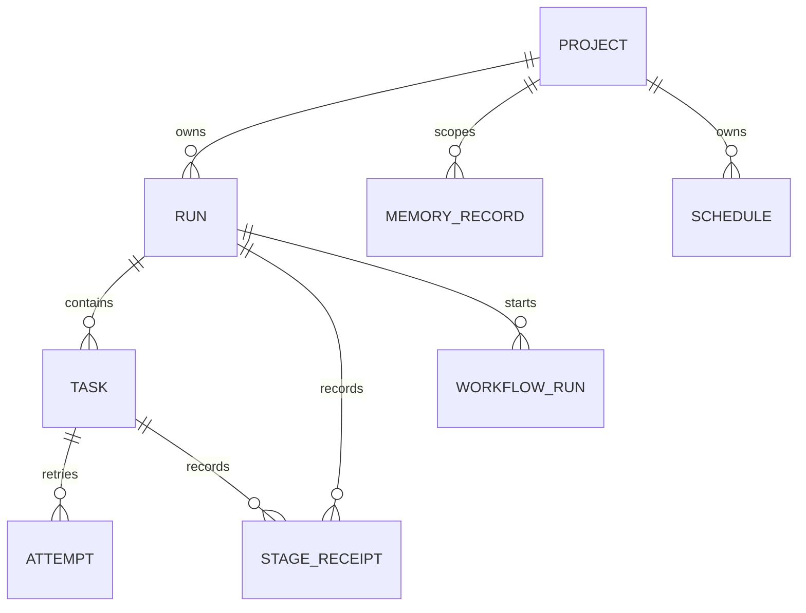

# Lane Pilot data model overview

TL;DR: Lane Pilot's server persists project settings, orchestration runs, stage evidence, task-notice receipts, knowledge and workflow engine records in plugin SQLite; workspace-owned stores retain their own field documentation.

## Core entities

The project-scoped settings table keys values by project, optional binding, and setting key (`src/rooms/storage/database.ts:48-56`). Runs contain PM thread, state, kind and timestamps; tasks contain task-v2 contract JSON; attempts track execution state and writer thread (`src/rooms/storage/database.ts:57-84`). Stage receipts bind stage input/output hashes and result metadata to a task and run (`src/rooms/storage/database.ts:155-173`).

## Domain references

The root plugin workspace owns the following schema families:

- [Orchestration and execution](data-model/orchestration.md) — project settings, runs, tasks, attempts, receipts, gates, task-notice receipts, tokens, check duration, secret issuance metadata, and workflow inbox/step facts.
- [Governance and handoffs](data-model/governance.md) — agent handoff cards and transition trails (`packages/handoff/src/store.ts`).
- [Knowledge and memory](data-model/knowledge.md) — project memory records and FTS5/trigram search indexes (`packages/memory-core/src/store.ts`).
- [Schedules](data-model/automation.md) — scheduled jobs and materialized schedule run rows (`src/rooms/schedule/server/services/scheduler.ts`).
- Evolution and trajectory crystallization (`src/rooms/migrations.ts:818-887`):
  - `lane_pilot_trajectory_delta` (`src/rooms/errands/models/trajectory-delta.ts`) — append-only ledger of course-correction interventions (`skill_request`, `rule_added`, `step_inserted`, `reference_branch`, `variant_selected`, `over_constraint`) guarded by `lane_pilot_trajectory_delta_no_delete`.
  - `lane_pilot_day_digest` (`src/rooms/migrations.ts:820-842`, accessed via `src/rooms/storage/analytics-store.ts`) — idempotent digests of Pilot runs, Pilot-activated chats, and completed non-errand user workflow runs guarded by `lane_pilot_day_digest_no_delete`.
  - `lane_pilot_skill_evolution` (`src/rooms/migrations.ts:843-863`) — append-only staged/published/rolled-back workflow and companion-skill evolution snapshots.

Workspace packages document their own schema tables and columns:

- [Workflow engine data model](../packages/workflow-engine/docs/data-model.md) — journal, draft, test and trigger stores.

The plugin's shared migration array (`src/rooms/migrations.ts`) composes slices from active rooms (`workflow-engine`, `handoff`, `memory-core`, `schedule`, `deferral`, `rollback`, `owner-waiting`, `lead`, `baseline`, `stage-return`, `outage`, `backlog`, `memory-tiers`, `checkers`, `specialist`, `errands`) alongside positional historical slices kept in `src/rooms/legacy-migrations.ts` so applied SQLite indices stay immutable. Their data does not imply foreign-key ownership where the table definition contains no foreign key.

The array is positional: the hub records every applied statement by index and refuses a plugin whose statement at an index differs, so a new statement is appended at the end of the array, never inside a package's list spread in the middle (`src/rooms/migrations.ts:1-3`, `:885-888`). A workflow-engine migration is therefore exported as its own appended list (`workflowNotVerifiedMigrations`, `workflowInboxMigrations`, `workflowStepFactsMigrations`, `workflowNodeFormMigrations`) instead of extending a middle-spread list (`packages/workflow-engine/src/ops-store.ts:43-45`). The hash lock `tests/fixtures/migrations.lock.json` pins every statement's index — one hash per statement — and `tests/migration-lineage.test.ts` fails the suite when a locked statement moved or a new one is missing from the lock.

<!-- lane-pilot:backlinks -->
## Referenced by

- [Lane Pilot architecture](architecture.md)
- [Repository conventions and boundaries](conventions.md)
- [Build and deploy Lane Pilot](deployment.md)
- [Development](guide/development.md)
- [Lane Pilot overview](overview.md)
