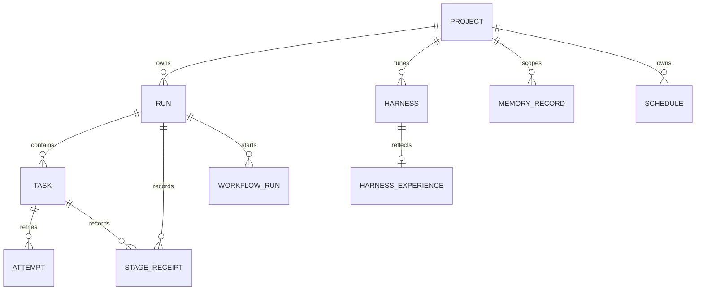

# Lane Pilot data model overview

TL;DR: Lane Pilot's server persists project settings, orchestration runs, stage evidence, task-notice receipts, knowledge and domain records in plugin SQLite; workspace-owned stores retain their own field documentation.

## Core entities

Harness trees are scoped by project, task area and writer key; attempts record their tree id and trial arm, while experience stores the reflection (`src/rooms/harness/migrations.ts:7-37`). The project-scoped settings table keys values by project, optional binding, and setting key (`src/rooms/storage/database.ts:48-56`). Runs contain PM thread, state, kind and timestamps; tasks contain task-v2 contract JSON; attempts track execution state and writer thread (`src/rooms/storage/database.ts:57-84`). Stage receipts bind stage input/output hashes and result metadata to a task and run (`src/rooms/storage/database.ts:155-173`).

## Domain references

The root plugin workspace owns the following schema families:

- [Orchestration and execution](data-model/orchestration.md) — project settings, runs, tasks, attempts, harness trees and experiences, receipts, gates, task-notice receipts, tokens, verification timing and secret issuance (`src/rooms/storage/database.ts:47-426`).
- [Owner profile and learning](data-model/knowledge.md) — Anamnesis record/evidence history in its separate SQLite store and automatic-learning observations, items and signals in the plugin database (`src/rooms/anamnesis/store.ts:52-72`, `src/rooms/learning/migrations.ts:1-10`, `:11-82`).
- [Schedules and world](data-model/automation.md) — scheduled jobs, scheduled runs, and the saved Pixel World (`src/rooms/schedule/store.ts:15-63`, `src/rooms/world/migrations.ts:1-13`).

Workspace packages document their own schema tables and columns:

- [Workflow engine data model](../packages/workflow-engine/docs/data-model.md) — journal, draft, test and trigger stores.
- [World simulation data model](../packages/world-sim/docs/data-model.md) — simulation entities, not BB plugin persistence.

The plugin's shared migration array includes stores exported by Jev, council, handoff, run-insights, workflow engine, schedule, learning and world packages, plus the harness room migration (`src/rooms/storage/database.ts:47-426`). Their data does not imply foreign-key ownership where the table definition contains no foreign key.

The array is positional: the hub records every applied statement by index and refuses a plugin whose statement at an index differs, so a new statement is appended at the end of the array, never inside a package's list spread in the middle (`src/rooms/storage/database.ts:422-425`). A workflow-engine migration is therefore exported as its own appended list instead of extending the middle-spread ops list (`packages/workflow-engine/src/ops-store.ts:43-45`). The hash lock `tests/fixtures/migrations.lock.json` pins every statement's index — one hash per statement, 251 entries — and `tests/migration-lineage.test.ts:34-43` fails the suite when a locked statement moved or a new one is missing from the lock.

<!-- lane-pilot:backlinks -->
## Referenced by

- [Anamnesis and owner profile](anamnesis.md)
- [Lane Pilot architecture](architecture.md)
- [Build and deploy Lane Pilot](deployment.md)
- [Project memory](memory.md)
- [Lane Pilot overview](overview.md)
