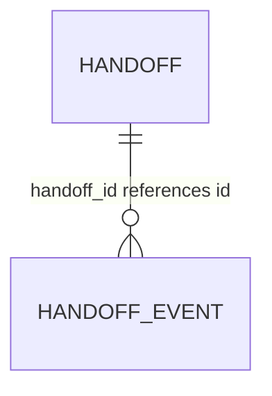

# Handoff data

TL;DR: The handoff store keeps inter-agent handoff cards and transition events in plugin SQLite (`packages/handoff/src/store.ts`).

## Relations

`lane_pilot_handoff_event.handoff_id` references `lane_pilot_handoff.id` and child rows cascade on parent deletion (`packages/handoff/src/store.ts:34-42`).

## Handoff

`lane_pilot_handoff` stores project/run, sender and recipient, owner/recipient threads, state, serialized card and receipt, lease holder/expiry, deadline and timestamps. `lane_pilot_handoff_event` is its transition trail and cascades with the card (`packages/handoff/src/store.ts:16-42`).

| Table | Meaning |
|---|---|
| `lane_pilot_handoff` | `id` identifies the handoff; `project_id` and optional `run_id` scope it; `from_agent` and `to_agent` identify participants; optional owner/recipient thread ids locate chats; `state` is the handoff state; `card_json` and optional `receipt_json` store request and result; `lease_holder` and `lease_expires_at` identify the lease and its epoch-millisecond expiry; `deadline_at` is an optional epoch-millisecond deadline; `created_at` and `updated_at` are epoch milliseconds. |
| `lane_pilot_handoff_event` | `id` orders events; `handoff_id` references the handoff; `from_state` may be empty at creation; `to_state` is the new state; `actor` identifies who changed it; `note` is optional context; `occurred_at` is epoch milliseconds. |

| Status field | Transitions |
|---|---|
| Handoff state | Contract transition rules validate moves; terminal completion releases the lease, and expired deadlines are handled by the store (`packages/handoff/src/contract.ts`, `packages/handoff/src/store.ts:14-42`). |

## Writers, readers and legacy tables

The handoff store is written by relay/handoff services and read by UI and agent services (`packages/handoff/src/store.ts`). The council, failure-triage and rule-proposal subsystems were removed; their positional historical table DDLs remain only in `src/rooms/legacy-migrations.ts` to keep migration indices immutable.

<!-- lane-pilot:backlinks -->
## Referenced by

- [Lane Pilot data model overview](../data-model.md)
