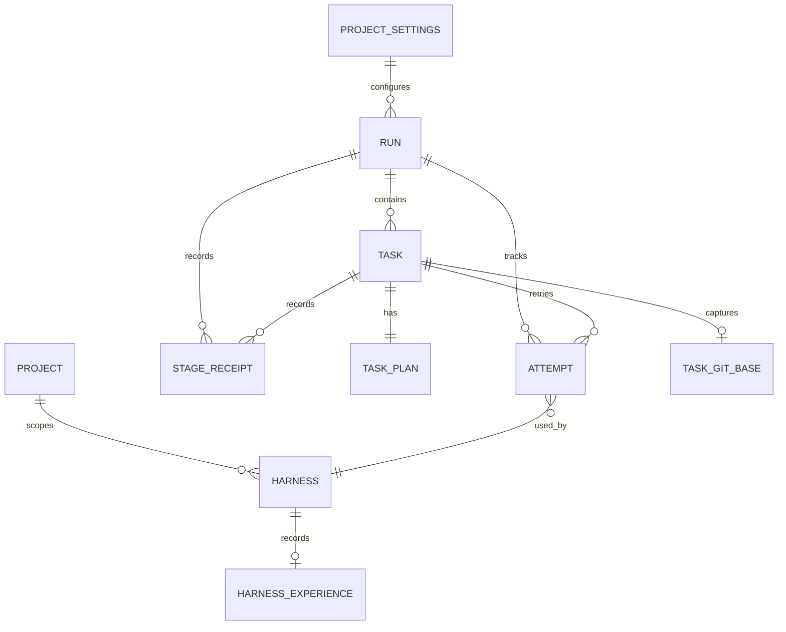

# Orchestration and execution data

TL;DR: Core orchestration tables hold project settings, run/task/attempt state, immutable stage and gate evidence, token usage, check timing, and secret issuance metadata.

## Relationships

Tables are created or extended in the ordered plugin migration list; the harness migration is appended after the other domain migrations (`src/rooms/storage/database.ts:47-244`, `:347-348`).

## Table meanings

| Table | Meaning | Lifecycle and invariants | Writers and readers |
|---|---|---|---|
| `lane_pilot_project_settings` | `project_id` project scope; `binding_id` workspace binding or empty default; `key` setting name; `value` serialized setting; `version` optimistic revision; `updated_at` epoch milliseconds. | Primary key is `(project_id,binding_id,key)`; `binding_id=''` is the project scope, while section settings use `section:<id>` (`src/rooms/storage/database.ts:48-56`, `:1072-1075`). | Settings APIs write; core and room settings readers load it. |
| `lane_pilot_setting_generation` | `project_id`, `binding_id`, `key` identify a setting; `version` is its generation counter. | Composite primary key; rows are initialized by copying existing setting versions (`src/rooms/storage/database.ts:236-244`). | Settings mutation code writes; version-aware UI/RPC reads. |
| `lane_pilot_run` | `id`; `project_id`; `pm_thread_id`; `state`; creation/update times; `kind` (`bb`/`cli`); `closed_at`, `closed_by`; writer workspace/environment/host; run policy and gate; helper policy; settings scopes; objective. | Current state check permits `pending`, `running`, `accepted`, `blocked`, `closed`; the rebuild maps non-null `closed_at` rows to `closed` (`src/rooms/storage/database.ts:95-111`). | Activation and run transitions write; runs UI, reconciler and scheduler read. |
| `lane_pilot_task` | `id`; parent `run_id`; `kind` (`bb`/`cli`); serialized task-v2 `contract_json`; `created_at`. | `run_id` references run; task id is the stable task key (`src/rooms/storage/database.ts:77-84`). | Writer dispatch writes; runs, reconciliation, acceptance and memory stages read. |
| `lane_pilot_attempt` | `id`, `run_id`, `task_id`, writer `thread_id`, `state`, `reason`, creation/update times, attempt number, pre-attempt dirt JSON, workspace/environment/decision JSON, holder thread, harness version, selected harness tree id and optional `new`/`old` trial arm. | The attempt table is created first; a later migration adds `attempt_no INTEGER NOT NULL DEFAULT 1` and pre-attempt dirt (`src/rooms/storage/database.ts:65-76`, `:92-93`). `transitionAttempt` writes a transition row for legal state changes and refused final-state changes; illegal moves are also journaled with `refused=1` before the function throws (`src/rooms/storage/database.ts:1182-1207`). | Dispatch and reconciliation write; writer, run UI, stability and acceptance read. |
| `lane_pilot_activation` | `project_id`; PM thread; run id; claim time. | `project_id` is the primary key, so the table stores at most one activation claim per project (`src/rooms/storage/database.ts:85-90`). | Activation writes; activation reconciliation reads. |
| `lane_pilot_harness` | `id`; project, area and writer key; version and parent tree; serialized tree and fingerprint; state; creator, notes and reason; creation, trial-start and decision times. | Schema permits `base`, `candidate`, `trial`, `adopted` and `retired`; editor code inserts candidates as `trial` and evaluation moves them to `adopted` or `retired`; writer key is `provider/model` or `*` (`src/rooms/harness/migrations.ts:7-24`, `src/rooms/harness/server/store.ts:20-25`). | Harness server creates the empty base and editor candidate; trial decisions update candidate state; attempt assignment selects an adopted or base tree (`src/rooms/harness/server/store.ts:58-97`, `src/rooms/harness/server/harness.ts:387-389`). |
| `lane_pilot_harness_experience` | `harness_id`; rendered edit verdicts; optional cue, lesson, evidence, confidence and rule id; creation time. | One reflection record per harness id; upsert replaces reflection fields (`src/rooms/harness/migrations.ts:25-34`, `src/rooms/harness/server/store.ts:122-127`). | Reflection writes; harness status and experience views read (`src/rooms/harness/server/store.ts:124-134`). |
| `lane_pilot_attempt.harness_tree_id`, `harness_arm` | Tree id and optional trial arm (`new` or `old`) assigned to an attempt. | Added to attempts with an index by tree and creation time (`src/rooms/harness/migrations.ts:35-37`). | Harness assigns before writer materialization; trial evaluation reads these assignments (`src/rooms/harness/server/store.ts:95-118`). |
| `lane_pilot_attempt_reasoning` | `attempt_id`; `trace_json` for provider/model/reasoning decision trace. | `attempt_id` references the attempt with `ON DELETE CASCADE` (`src/rooms/storage/database.ts:145-149`). | Writer selection writes; run receipts and UI read. |
| `lane_pilot_task_plan` | `task_id`; canonical plan text. | `task_id` references the task with `ON DELETE CASCADE` (`src/rooms/storage/database.ts:150-154`). | Dispatch writes; retry and Jev adapter read. |
| `lane_pilot_stage_receipt` | `run_id`, `task_id`, `stage_id`; contract version; state; input/output SHA-256; attempt index; provider/model/thread; result JSON, reason, update time. | State set: `pending`, `running`, `passed`, `failed`, `blocked`, `skipped`, `canceled`; attempt is 0–2; key is `(run_id,task_id,stage_id)` (`src/rooms/storage/database.ts:155-173`). | Stage runner writes; run monitor, retry, memory and acceptance read. |
| `lane_pilot_stage_event` | Event id; project/run/task/stage; state; input/output hashes; attempt; occurrence time. | Update and delete triggers reject mutation; the state set and attempt bound are declared on this table (`src/rooms/storage/database.ts:189-203`). | Stage transition recorder writes; analytics reads. |
| `lane_pilot_gate_event` | Event id; project/run/task; gate; status; hashes; attempt; occurrence time. | Gates are `owns-paths`, `validate`, `accept`, `verification`; statuses are `passed`, `rejected`, `failed`, `skipped`; append-only trigger blocks mutation (`src/rooms/storage/database.ts:204-218`). | Ownership, validation, acceptance and verification code write; monitor/analytics read. |
| `lane_pilot_task_git_base` | Task id; base ref and SHA; initial head SHA; branch; committed-diff flag; capture time. | `task_id` is the primary key and `compare_committed` is constrained to 0 or 1 (`src/rooms/storage/database.ts:219-227`). | Workspace setup writes; ownership and acceptance compare against it. |
| `lane_pilot_attempt_transition` | Attempt id; previous and next state; reason; refused flag; timestamp. | Rows record accepted and refused transitions; `refused` defaults to 0 (`src/rooms/storage/database.ts:257-260`, `:1182-1207`). | Attempt transition helper writes; run diagnostics and task-notice lookup read. |
| `lane_pilot_pm_notice` | `transition_id` identifies a terminal attempt transition; `attempt_id` identifies its attempt; `pm_thread_id` identifies the recipient; `sent_at` is epoch milliseconds. | `transition_id` is the primary key; insertion uses `INSERT OR IGNORE` to avoid recording one transition twice (`src/rooms/storage/database.ts:339-345`, `:1042-1045`). | Relay records handled outcomes; outcome lookup excludes recorded transitions (`src/rooms/relay/server/relay.ts:391-424`, `src/rooms/storage/database.ts:1042-1045`). Delivery and suppression rules are in [cross-cutting gotchas](../gotchas.md#stability-and-local-provider-setup). No cleanup job deletes these rows. |
| `lane_pilot_token_daily` | UTC day; project/provider/model; input, output, cached, total, uncached, cache-read and cache-write token counts. | Composite primary key `(day,project_id,provider_id,model)`; counts are token units (`src/rooms/storage/database.ts:262-272`). | Usage importer aggregates; usage screens and Pixel World inputs read. |
| `lane_pilot_token_cursor` | Thread id; project/provider; last sequence and event JSON; cumulative JSON; last model/provider/turn; update time. | `thread_id` is the primary key, yielding one cursor row per thread (`src/rooms/storage/database.ts:273-284`). | Usage event ingestion writes; replay/recovery reads. |
| `lane_pilot_check_duration` | Project id; normalized command key; duration milliseconds; exit code; event time. | `duration_ms` stores elapsed milliseconds for an observed command run (`src/rooms/storage/database.ts:291-294`). | Verification writes; adaptive timeout selection reads. |
| `lane_pilot_secret_issuance` | Id; time; project/run/task; consumer; thread; check command; secret name; host id; network. | The columns store secret names and routing metadata; there is no secret-value column (`src/rooms/storage/database.ts:318-331`). | Secret resolver writes; audit and security review reads. |

## Status transitions

| From | To | Writer and condition |
|---|---|---|
| Attempt state | Next attempted state | `transitionAttempt` checks legal moves and records each accepted or refused transition (`src/rooms/storage/database.ts:1182-1207`; `src/rooms/writer/server/dispatch.ts:10`). |
| Terminal attempt outcome | Reported or suppressed | Relay records a handled outcome; see [cross-cutting gotchas](../gotchas.md#stability-and-local-provider-setup) for delivery conditions (`src/rooms/relay/server/relay.ts:380-415`). |
| Harness state | `insertHarness` creates `base` or `trial`; editor candidates enter `trial`, then evaluation changes them to `adopted` or `retired` (`src/rooms/harness/server/store.ts:74-92`, `src/rooms/harness/server/harness.ts:387-389`, `:405-420`). |
| Stage receipt state | `pending` → `running` → terminal | Stage runners write a unique `(run, task, stage)` receipt; stage events preserve change history (`src/rooms/storage/database.ts:155-173`, `:713-738`). |
| Run state | `pending` → `running` → `accepted` or `blocked`; then `closed` | `createRun` initializes `pending`; `setRunState` updates run state, and `closeRun` writes `closed` only after open attempts end (`src/rooms/storage/database.ts:524-528`, `:568-585`). |

## Retention and cleanup

The migration list deletes obsolete lesson rows and orphaned FTS entries; it defines no general TTL for orchestration or PM-notice rows (`src/rooms/storage/database.ts:252-255`, `:339-345`). Startup recovery restores breakers and runs task reconciliation; the `attempt-worktree-sweep` separately releases finished attempt worktrees and expired sticky lane worktrees (`server.ts:231-271`, `:189-198`).

<!-- lane-pilot:backlinks -->
## Referenced by

- [Lane Pilot data model overview](../data-model.md)
- [Writer harness](../harness.md)
