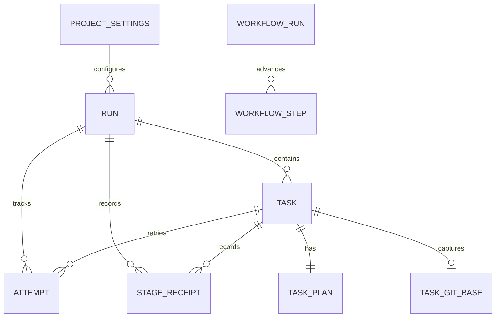

# Orchestration and execution data

TL;DR: Core orchestration tables hold project settings, run/task/attempt state, immutable stage and gate evidence, workflow event inbox and per-step evolution/form facts, token usage, check timing, and secret issuance metadata.

## Relationships

Tables are created or extended in the ordered plugin migration list (`src/rooms/migrations.ts`), including appended `workflowInboxMigrations`, `workflowStepFactsMigrations`, and `workflowNodeFormMigrations` (`packages/workflow-engine/src/inbox.ts`, `packages/workflow-engine/src/run-facts.ts`, `packages/workflow-engine/src/node-form.ts`).

## Table meanings

| Table | Meaning | Lifecycle and invariants | Writers and readers |
|---|---|---|---|
| `lane_pilot_project_settings` | `project_id` project scope; `binding_id` workspace binding or empty default; `key` setting name; `value` serialized setting; `version` optimistic revision; `updated_at` epoch milliseconds. | Primary key is `(project_id,binding_id,key)`; `binding_id=''` is the project scope, while section settings use `section:<id>` (`src/rooms/storage/database.ts:48-56`). | Settings APIs write; core and room settings readers load it. |
| `lane_pilot_setting_generation` | `project_id`, `binding_id`, `key` identify a setting; `version` is its generation counter. | Composite primary key; rows are initialized by copying existing setting versions. | Settings mutation code writes; version-aware UI/RPC reads. |
| `lane_pilot_run` | `id`; `project_id`; `pm_thread_id`; `state`; creation/update times; `kind` (`bb`/`cli`); `closed_at`, `closed_by`; writer workspace/environment/host; run policy and gate; helper policy; settings scopes; objective. | Current state check permits `pending`, `running`, `accepted`, `blocked`, `closed`; rebuild maps non-null `closed_at` rows to `closed`. | Activation and run transitions write; runs UI, reconciler and scheduler read. |
| `lane_pilot_task` | `id`; parent `run_id`; `kind` (`bb`/`cli`); serialized task-v2 `contract_json`; `created_at`. | `run_id` references run; task id is the stable task key (`src/rooms/storage/database.ts:77-84`). | Writer dispatch writes; runs, reconciliation, acceptance and memory stages read. |
| `lane_pilot_attempt` | `id`, `run_id`, `task_id`, writer `thread_id`, `state`, `reason`, creation/update times, attempt number, pre-attempt dirt JSON, workspace/environment/decision JSON, holder thread. | `transitionAttempt` writes a transition row for legal state changes and refused final-state changes; illegal moves are also journaled with `refused=1` before throwing. | Dispatch and reconciliation write; writer, run UI, stability and acceptance read. |
| `lane_pilot_activation` | `project_id`; PM thread; run id; claim time. | `project_id` is the primary key, storing at most one activation claim per project. | Activation writes; activation reconciliation reads. |
| `lane_pilot_attempt_reasoning` | `attempt_id`; `trace_json` for provider/model/reasoning decision trace. | `attempt_id` references the attempt with `ON DELETE CASCADE`. | Writer selection writes; run receipts and UI read. |
| `lane_pilot_task_plan` | `task_id`; canonical plan text. | `task_id` references the task with `ON DELETE CASCADE`. | Dispatch writes; retry reads. |
| `lane_pilot_stage_receipt` | `run_id`, `task_id`, `stage_id`; contract version; state; input/output SHA-256; attempt index; provider/model/thread; result JSON, reason, update time. | State set: `pending`, `running`, `passed`, `failed`, `blocked`, `skipped`, `canceled`; key is `(run_id,task_id,stage_id)`. | Stage runner writes; run monitor, retry, memory and acceptance read. |
| `lane_pilot_stage_event` | Event id; project/run/task/stage; state; input/output hashes; attempt; occurrence time. | Append-only triggers reject updates and deletes (`lane_pilot_stage_event_no_update`, `_no_delete`). | Stage transition recorder writes; analytics reads. |
| `lane_pilot_gate_event` | Event id; project/run/task; gate; status; hashes; attempt; occurrence time. | Gates are `owns-paths`, `validate`, `accept`, `verification`; statuses are `passed`, `rejected`, `failed`, `skipped`; append-only triggers block mutation. | Ownership, validation, acceptance and verification write; monitor/analytics read. |
| `lane_pilot_task_git_base` | Task id; base ref and SHA; initial head SHA; branch; committed-diff flag; capture time. | `task_id` is primary key; `compare_committed` is 0 or 1. | Workspace setup writes; ownership and acceptance compare against it. |
| `lane_pilot_attempt_transition` | Attempt id; previous and next state; reason; refused flag; timestamp. | Records accepted and refused transitions; triggers forbid update and delete. | Attempt transition helper writes; run diagnostics and task-notice lookup read. |
| `lane_pilot_pm_notice` | `transition_id` identifies a terminal attempt transition; `attempt_id` its attempt; `pm_thread_id` recipient; `sent_at` epoch milliseconds. | `INSERT OR IGNORE` prevents reporting one transition twice. | Relay records handled outcomes (`src/rooms/relay/server/services/relay.ts`). Delivery rules are in [cross-cutting gotchas](../gotchas.md). |
| `lane_pilot_token_daily` | UTC day; project/provider/model; input, output, cached, total, uncached, cache-read and cache-write token counts. | Composite primary key `(day,project_id,provider_id,model)`; counts are token units. | Usage importer aggregates; usage screens read. |
| `lane_pilot_token_cursor` | Thread id; project/provider; last sequence and event JSON; cumulative JSON; last model/provider/turn; update time. | Primary key `thread_id` gives one cursor row per thread. | Usage event ingestion writes; replay/recovery reads. |
| `lane_pilot_check_duration` | Project id; normalized command key; duration milliseconds; exit code; event time. | `duration_ms` stores elapsed milliseconds for an observed command run. | Verification writes; adaptive timeout selection reads. |
| `lane_pilot_secret_issuance` | Id; time; project/run/task; consumer; thread; check command; secret name; host id; network. | Stores secret names and routing metadata, never secret values. | Secret resolver writes; audit and security review reads. |
| `lane_pilot_schedule*` | Schedule rows and their runs; see [the schedule board](../schedule-board.md). | Schedule service writes and claims due rows (`src/rooms/schedule/server/services/scheduler.ts`). | `engine-clock` and the schedule board read. |
| `lane_pilot_owner_item` | Owner's inbox: key, source, kind, what/why, evidence, actions, wake, state; see [Waiting for the owner](../owner-waiting.md). | `postOwnerItem` inserts, `closeOwnerItem` closes (`src/rooms/owner-waiting/server/services/owner-items-service.ts`). | Plugin posters write; screen, daily digest and Telegram push read. |
| `lane_pilot_wf_inbox` | Durable append-only workflow event inbox: `id`, `name`, `key`, `payload_json`, `created_at`, `consumed_by`. | `insertInboxEvent` uses `INSERT OR IGNORE`; `claimUnconsumedInboxEvent` atomically sets `consumed_by` with attempt fencing (`packages/workflow-engine/src/inbox.ts:49-90`). | Trigger emitter writes (`LP_EVENTS`); workflow engine claims on wake. |
| `lane_pilot_wf_step` (step facts & form columns) | Per-step provider/model (`requested_*`, `answered_*`), tokens, cost (`cost_micro_usd`, `cost_state`), `duration_ms`, `verdict`, `failure_class`, `rework_visits`, `graph_version`, `attempt_id`, `session_id`, `form_used`, `fallback_taken`, `environment_fingerprint`. | Appended by `workflowStepFactsMigrations` and `workflowNodeFormMigrations` (`packages/workflow-engine/src/run-facts.ts:9-35`); deadlines live in `await_json.deadline`. | Workflow engine writes on step completion; evolution analytics reads. |

## Status transitions

| From | To | Writer and condition |
|---|---|---|
| Attempt state | Next attempted state | `transitionAttempt` checks legal moves and records each accepted or refused transition (`src/rooms/contracts/state-machine.ts`). |
| Terminal attempt outcome | Reported or suppressed | Relay records a handled outcome; see [cross-cutting gotchas](../gotchas.md) for delivery conditions (`src/rooms/relay/server/services/relay.ts`). |
| Stage receipt state | `pending` → `running` → terminal | Stage runners write a unique `(run, task, stage)` receipt; stage events preserve change history. |
| Run state | `pending` → `running` → `accepted` or `blocked`; then `closed` | `createRun` initializes `pending`; `setRunState` updates run state, and `closeRun` writes `closed` only after open attempts end. |

## Retention and cleanup

The migration list defines no general TTL for orchestration or PM-notice rows. Startup recovery restores breakers and reconciles active runs; worktree cleanup runs via the `lp.worktree-cleanup` system schedules (`src/rooms/schedule/server/services/system-schedules.ts:18-30`).

<!-- lane-pilot:backlinks -->
## Referenced by

- [Lane Pilot data model overview](../data-model.md)
