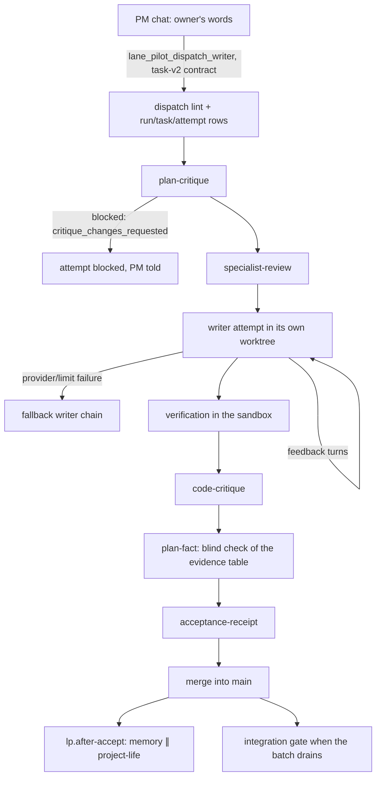
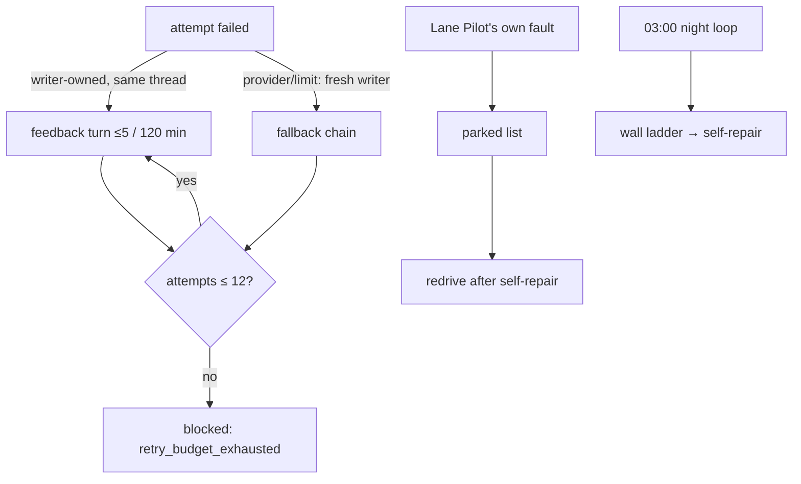

# The task pipeline

TL;DR: one task's path from the owner's words to merged code — dispatch lint, opinion stages, the writer attempt, verification, acceptance, merge — plus the retry ladder: feedback turns, the fallback writer chain, the 12-attempt budget, parking and the night wall. This page narrates the flow end to end; the detail pages ([plan-fact](../plan-fact.md), [task-board](../task-board.md), [wall](../wall.md), [relay](../relay.md)) hold the mechanics.

## How it works

1. **Intake.** The PM dispatches a task-v2 contract; `lane_pilot_dispatch_writer` lints it (checks that can fail, ownership) and creates the run, task and first attempt (`src/rooms/writer/server/dispatch.ts:1-82`, `src/rooms/tasks/server/contract-lint.ts:76-96`).
2. **Opinion stages.** `pm-read`, `plan-critique`, `specialist-review` and `code-critique` are advisory: an opinion never accepts a task but can stop one (`packages/contracts/src/stage-proof.ts:23-47`). Each obeys its `*.enabled` setting and `quality_mode` (`src/rooms/critique/quality-mode.ts:16-24`); a stage with no setting is receipted `skipped` (`src/rooms/critique/server/critique-runs.ts:47-60`). See [enabled settings](../enabled-settings.md).
3. **The writer attempt.** The attempt moves through the state machine (`src/rooms/runs/state-machine.ts:77-90`): queued → spawn_requested → running. The writer works in an isolated worktree; a question back to the same thread continues the attempt for at most `SESSION_MAX_TURNS` turns or `SESSION_MAX_MS` minutes (`src/rooms/runs/failure-class.ts:228-229`). A product question unanswered for an hour ends the attempt uncharged and posts to the owner's list (`src/rooms/writer/server/question-timeout.ts:33-40`).
4. **Verification and acceptance.** Checks run in the sandbox (`src/rooms/writer/server/verify.ts:1-80`); `plan-fact` checks the writer's evidence table blindly (`src/rooms/writer/server/plan-fact.ts:44-49`); the acceptance receipt needs at least one code-decided stage (`src/rooms/writer/server/finish.ts:628-640`, `packages/contracts/src/stage-proof.ts:55-61`).
5. **Merge.** An accepted attempt merges into main of the checkout; a conflict returns it to the writer, a dirty base waits (`src/rooms/writer/server/finish.ts:1-82`). `lp.after-accept` then runs memory-maintenance and project-life in parallel (`workflows/lp.after-accept.json`), and the integration gate re-checks main once the batch drains.

## The retry ladder

- A writer-owned failure (`validation_failed`, `empty_output`) retries with the same writer as a feedback turn; a provider or limit failure spawns a fresh writer down the fallback chain (`src/rooms/writer/server/start.ts:56-83`).
- Each retry spends the task's budget of `TASK_ATTEMPT_BUDGET` (12) charged attempts (`src/rooms/writer/retry-budget.ts:8`, `:35`); free classes (`merge`, `infra`, `dirty_base`, `harness`, `limit` …, `src/rooms/runs/failure-class.ts:185`) retry without charge, up to `FREE_RETRY_LIMIT` (`failure-class.ts:215`). Exhausted, the attempt blocks with `retry_budget_exhausted` and the task becomes a wall candidate only via `repeated_failure:` (`docs/wall.md`).
- A failure that is Lane Pilot's own fault (`PARKED_CLASSES`: harness, infra, dirty_base — `src/rooms/runs/failure-class.ts:213`) parks the task in `stability:parked` (`src/rooms/stability/server/stability.ts:13`); when a self-repair merges, the task redrives from the writer stage, bounded per project per sweep (`stability.ts:24-28`).
- The night loop (03:00) groups the day's failures into classes and follows the 3/10 → 5/100 → 6/500 recurrence ladder into `lps.self-repair` repairs with proofs (`docs/wall.md`, `src/rooms/self-repair/server/self-repair.ts`).

## Capabilities

- Dispatch a task from a PM chat (`lane_pilot_dispatch_writer`) or with `bb lane-pilot dispatch-bb` (`src/rooms/tools/server/cli.ts:388`).
- Watch attempts and stages on the Tasks screen or via `bb lane-pilot metrics <project-id>` (`src/rooms/tools/server/cli.ts:190-197`).
- Stop an attempt (PM stop → cancel_requested → canceled, `src/rooms/runs/state-machine.ts`).
- Parked tasks and redrives are internal: nothing lists them on a screen today (`src/rooms/stability/server/stability.ts:88-95`).
- Ship the merged batch: the PM pushes main, brings the project up its own way and proves it live ([ship](../ship.md)).
