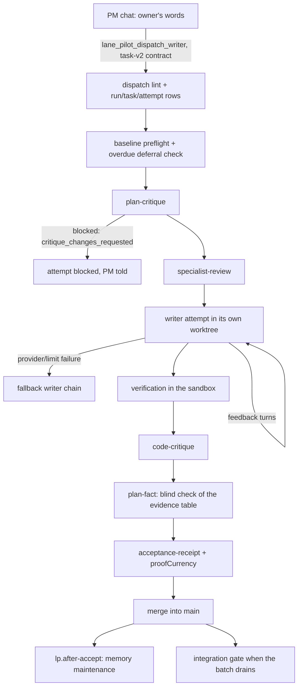
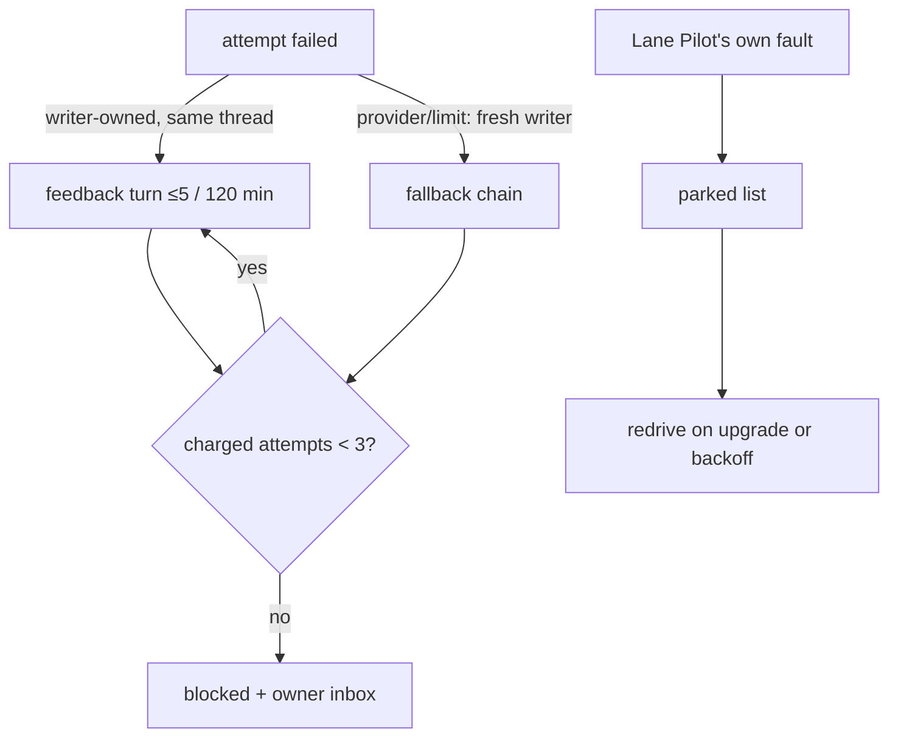

# The task pipeline

TL;DR: one task's path from the owner's words to merged code — dispatch lint, baseline preflight, opinion stages, the writer attempt, verification, acceptance, merge — plus the retry ladder: feedback turns, fallback writer chain, the `WRITER_RETRY_LIMIT` (3) cap, and parking. Detail pages ([plan-fact](../plan-fact.md), [task-board](../task-board.md), [relay](../relay.md), [baseline](../baseline.md)) hold the mechanics.

## How it works

1. **Intake.** The PM dispatches a task-v2 contract; `lane_pilot_dispatch_writer` lints it (checks that can fail, ownership) and creates the run, task and first attempt (`src/rooms/writer/server/services/dispatch.ts`, `src/rooms/tasks/models/contract-lint.ts`).
2. **Baseline preflight.** Before the first attempt starts, `baseline` checks for overdue deferrals (`src/rooms/baseline/server/services/baseline-service.ts:81-89`) and runs verification checks on the base commit in a throwaway worktree so pre-existing reds and already-done checks are separated from writer changes.
3. **Opinion stages.** `pm-read`, `plan-critique`, `specialist-review` and `code-critique` are advisory: an opinion never accepts a task but can stop one (`packages/contracts/src/stage-proof.ts`). Each obeys its setting and `quality_mode` (`src/rooms/contracts/quality-mode.ts`). See [enabled settings](../enabled-settings.md).
4. **The writer attempt.** The attempt moves through the state machine (`TRANSITION_TABLE` in `src/rooms/contracts/state-machine.ts`): `queued` → `spawn_requested` → `running`. The writer works in an isolated worktree (with credentials excluded via `src/rooms/verification/credential-paths.ts` and OS sandboxing); a question back to the same thread continues the attempt for at most `SESSION_MAX_TURNS` (5) turns or `SESSION_MAX_MS` (120 minutes, `src/rooms/contracts/failure-class.ts:247-254`). A product question unanswered for an hour ends the attempt uncharged and posts to the owner's list (`src/rooms/writer/server/services/question-timeout.ts`).
5. **Verification and acceptance.** Checks run in the sandbox (`src/rooms/writer/server/services/verify.ts`); `not_run` checks never satisfy acceptance, and `proofCurrency` (`src/rooms/verification/server/services/proof-currency.ts`) ensures recorded proofs are still valid against `HEAD`. `plan-fact` checks the writer's evidence table blindly (`src/rooms/writer/server/services/plan-fact.ts`); the acceptance receipt needs at least one code-decided stage (`packages/contracts/src/stage-proof.ts`).
6. **Merge.** An accepted attempt merges into main of the checkout; a conflict returns it to the writer and a dirty base waits via durable workflow timers (`src/rooms/writer/server/handlers/attempt-graph-steps.ts:222-279`). On settlement, `LP_EVENTS.TASK_SETTLED` is emitted (`src/rooms/writer/server/handlers/attempt-graph-steps.ts:238`), `lp.after-accept` runs `memory-maintainer` (`workflows/lp.after-accept.json`), and the integration gate re-checks main once the batch drains.

## The retry ladder

- A writer-owned failure (`validation_failed`, `empty_output`) retries with the same writer as a feedback turn (uncharged) up to `SESSION_MAX_TURNS` (5) turns / `SESSION_MAX_MS` (120 min), stopping early on `no progress` (same failure and diff twice in a row, `src/rooms/writer/server/handlers/attempt-graph-steps.ts:94-98`).
- Charged retries are capped at `WRITER_RETRY_LIMIT` (3, `src/rooms/contracts/state-machine.ts:93`, `src/rooms/writer/server/services/start-failure-route.ts:156-165`); provider or limit failures move to the fallback writer chain, and exhausted retries block and notify the owner inbox (`lane_pilot_owner_item`).
- A failure that is Lane Pilot's own fault or environment trouble (`PARKED_CLASSES`: harness, infra, dirty_base) parks the task in `stability` (`src/rooms/stability/server/services/stability.ts`); parked tasks redrive automatically on plugin upgrade or after infra backoff, bounded per sweep (`REDRIVE_PER_SWEEP = 3`).

## Capabilities

- Dispatch a task from a PM chat (`lane_pilot_dispatch_writer`) or with `bb lane-pilot dispatch-bb` (`src/rooms/tools/server/handlers/cli-commands.ts`).
- Watch attempts and stages on the Tasks screen or via `bb lane-pilot metrics <project-id>`.
- Stop an attempt (`cancel_requested` → `canceled`, `src/rooms/contracts/state-machine.ts`).
- Ship the merged batch: the PM pushes main, brings the project up its own way and proves it live ([ship](../ship.md)).
