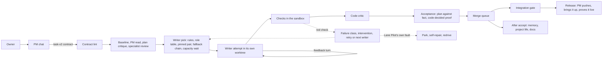

# How a piece of work flows

> Part of the [Lane Pilot guide](../../README.md#the-guide). Moved out of the root README on 2026-11-06.

Every piece of work in Lane Pilot is a graph (a workflow). The PM chat is the door: it talks to the owner and passes his words into the machine. It does not do the work itself. This section follows one code task from the owner's message to a pushed release. Defaults come from `docs/enabled-settings.md` and the settings catalog; a setting with no default listed is unset.

## 1. The PM chat as the door

- The owner enables Lane Pilot in the composer ("Enable Lane Pilot") of a new project chat. The UI needs a selected project and a resolvable writer binding, then starts the chat as a Claude Code PM session (it tries `claude-opus-5-5[1m]`, then `claude-opus-5-5`). See `docs/native-agent.md`.
- The PM prompt (`LANE_PILOT_PM_SESSION`) says: send every repository change, however small, through `lane_pilot_dispatch_writer`. The shell guard refuses PM edits of project files. The PM may write only `.agents/`, its chat folder, `docs/plans/`, `.env*` and `/tmp`.
- Asking the owner is the exception: only for business meaning, money or irreversible data, a missing secret, or a real ambiguity. A failing test or contract is dispatched as a fix, not asked about.
- Size rule in the prompt: one task is one outcome a strong writer finishes in 30 to 120 minutes (a page, a feature, an issue). Findings about one page go into one task; findings about different areas become separate tasks that run side by side.

| Need | PM tool |
|---|---|
| Change repository code | `lane_pilot_dispatch_writer`, then `lane_pilot_wait_writer`, `lane_pilot_update_task`, `lane_pilot_answer_writer`, `lane_pilot_cancel_task`, `lane_pilot_reassign_task` |
| Research, digest, post, anything that is not repo code | `lane_pilot_route` (picks a ready graph), then `lane_pilot_run_workflow`, `lane_pilot_workflow_status`, `lane_pilot_workflow_amend` |
| Heavy goal | `lane_pilot_phase` (answer, revise, return, correct, status) |
| Specialists, one browser step | `lane_pilot_helpers` (`specialist`, `wait_specialist`, `browser`) |
| Long browser or account work | `lane_pilot_errand`, `lane_pilot_wait_errand` |
| Council, schedule, memory, relay | `lane_pilot_council`, `lane_pilot_schedule`, `lane_pilot_memory`, `lane_pilot_relay` |
| Owner question as a form | `lane_pilot_ask_owner` |

## 2. The task-v2 contract and its lint

The PM writes a task-v2 contract. Required: `id`, `title`, `risk`, `lane`, `project_cwd`, `read_first`, `interfaces`, `invariants`, `out_of_scope`, `expected_outputs`, `owns_paths`, `never_touch`, `depends_on`, `objective`, `acceptance`, `verify`, `verification[]`. Each check in `verification[]` has `command`, `cwd`, optional `timeout_sec`, optional `secrets` (Env Catalog names) and optional `hidden`.

Optional fields include `display_title`, `kind` (feature, fix, check, docs, refactor, research, chore), `area`, `skills`, `quality_mode`, `qa_cases` with `qa_url`, `qa_env_class`, `qa_dev_server`, `convergence`, `files`, `appetite`, `forecast`, `promise`, `priority`, `clarify`, `drawing`, `wires`. The task standard (`display_title`, `kind`, `area`) is mandatory at dispatch. The first dispatch of a run must also carry the run `objective`.

`lane_pilot_dispatch_writer` lints the contract before any task or attempt exists. Errors return to the PM in one message, with no attempt spent. Warnings travel with the answer.

| Rule | What it enforces |
|---|---|
| Ownership | Paths are relative and safe. `expected_outputs`, `files[]` and tests of owned code lie inside `owns_paths` and outside `never_touch`. A path that does not exist and has no folder is an error (`owns_missing`, `output_missing`). |
| Checks that can fail | Rejects `true`, `exit 0`, a bare `echo`, `\|\| true`, a masked pipe exit, `--passWithNoTests`, and a check that only tests a file that already exists on the base. |
| Red before green | For risk medium or higher, a warning when no check names a file missing on the base (`no_red_before_green`). |
| One focused check | While an integration gate is active, a whole-suite command or a repeated runner chain is an error (`whole_suite_with_gate`). |
| Runnable | The check program must exist on the writer's machine; `cwd` must lie inside the project; a command that timed out before needs a larger `timeout_sec`. |
| Secrets | `secrets` names must exist in Env Catalog and pass `secrets.allow`. A missing name is a warning; the task then waits as `waiting_secret:NAME` and spends no attempt. |
| Acceptance size | More than 3 items in quick or standard mode is a warning only (`acceptance_too_many`). |
| Browser | With `quality_mode` full, `qa_cases` need `qa_url` (error). |
| Dependencies | `depends_on` a task that already ended blocked or canceled is an error; overlapping open `owns_paths` is a warning (the task waits). |

Dispatch also does the following.

- A repeat of the same task and plan within 30 minutes returns the existing task.
- A second member of a task family (`x`, `x.2`) while one runs or is parked returns `task_in_progress`.
- The wall can refuse a family (`wall_stop`).
- The `topic_loop` guard refuses a fourth task on a topic: three earlier families in 72 hours on the same file (small fix-like tasks owning at most 3 entries) or the same test. The machine hunts that topic instead (see `docs/wall.md`). A family counts only when a writer's work was judged (accepted, or rejected by the task's own checks), not when its attempts died of the provider or the machine; only the tasks sent since the owner last wrote in the PM chat count, and his message reopens a closed topic; a loop wall holds its topic for 72 hours.
- `batchAdvice` in the answer lists the open tasks that hold the new one and, when three or more own one path, the fix. A `grain` line warns when a task is far smaller than the project's median accepted task.
- A spend reserve check runs when a run token budget and a task `appetite.tokens` exist.

## 3. Stages before the writer

The graph `lp-task-pipeline` runs these steps in order (`docs/flows/task-pipeline.md`):

1. `pm-read`: a scout reads the task's `read_first` files itself, in the project checkout and read-only, and reports how that code works today and what the plan leaves open. Its brief names the task, the plan and where to start; it carries no file contents. Off by default (`pm_read.enabled` false, `pm_read.min_lines` 350). A failed read stops nothing.
2. `plan-critique`: by `quality_mode`. In `standard` it runs for risk high or critical, or when the run has 3 or more write tasks (`plan_critique.min_score` 7, `min_write_tasks` 3, `on_high_risk` true). In `plan_critique.mode` gate (default) a refusal stops the attempt before any writer starts.
3. `specialist-review`: off by default (`specialist.enabled` false; `specialist.when` high_risk).
4. `ownership-base`: records the ownership base commit; if it cannot be taken, the task is blocked with the reason.
5. `task-folder`, then the `writer` step (sections 4 to 9).

If a run has `run_gate=pre-merge`, dispatch blocks the run with a `run-gate` receipt before any of this.

## 4. The writer of a task

| Layer | How it works | Settings |
|---|---|---|
| Role to model table | Every agent step names a role; `role_model.<role>` names its model and optional pool (least loaded provider first). The writer is not a row of the table. See `docs/role-models.md`. | `role_model.<role>` |
| The writer | No model picks it per task: the writer is the project's `writer.provider` / `writer.model` / `writer.reasoning_effort` (global when the project sets none). The effort is clamped to what the live catalog lists. | `writer.provider`, `writer.model`, `writer.reasoning_effort` |
| Held provider | A provider whose usage window is spent (see `usage.skip_percent`) or a ZCode that cannot work now is skipped on the fallback chain. | `usage.skip_percent` 90 |
| Skills | By rule, no model: the skills the PM names in the contract `skills` (max 8, only those the BB list has), the skills named like the project folder, and the browser skill for a task checked on a page. A failed skill list leaves the role skills. | contract `skills` |
| Pinned pair | The task's provider and model stay for its life across restarts and redispatch. The pin moves only on a provider failure or a failure-class intervention, with the reason recorded. | `writer.pair_pin` on |
| Fallback chain | After the project writer come `writer.fallback1..3.*` (defaults: GLM 5.3 Flash, Gemini 3.8 Flash high, slot 3 off), then the PM model. A provider, limit or catalog fault walks the chain. | `writer.fallback_on_provider_failure` after_retry (or `immediate`) |
| Capacity wait | When every offered writer provider is over its window, the attempt ends blocked as `capacity_saturated:<reset>` instead of failing. | `writer.capacity_wait` on |

Sticky area writers: tasks of one `area` run one at a time. The area's writer takes the next task in its own thread for 3 hours after its last accepted task, unless the writer setting changed. After that a fresh writer starts with the area's history. Tasks with overlapping `owns_paths` also queue. Four lane queues (writing, checks, docs, research) can be capped with `queue.lane_caps` (no catalog row).

## 5. Worktree per attempt

- A git project gets a worktree of its own for every attempt (`docs/decisions.md`, ADR 1). Dependencies are linked or mirrored into it. The base commit is recorded so the attempt can be rolled back (`docs/rollback.md`).
- A folder without git runs in live-folder mode (`docs/gotchas.md`). There is no worktree, commit or merge. One writer works per folder, so tasks queue. A snapshot covers at most 50,000 paths. Backups of owned files last 7 days and refuse sets over 2 GiB. A task that is not accepted is rolled back from the backup of its `owns_paths`; files outside `owns_paths` are not restored. A folder with over 50,000 files needs git. The dispatch answer carries a `mode live-folder` warning.
- A task whose paths all lie inside a git repository nested in the folder moves into that repository and gets its own worktree (`mode repository`).
- Finished attempt environments and expired sticky worktrees are released by a sweep every 10 minutes (`attempt-worktree-sweep`).

## 6. Baseline before the writer, regression after acceptance

Details in `docs/baseline.md`.

- Before the first writer, the task's checks run once on the base in a throwaway worktree (skipped for mainfix tasks and live folders). `baseline.time_cap_sec` 300 bounds the estimated check time; checks with secrets are skipped.
- If every check is green on the base, a `fix` or `check` task closes accepted without a writer (`checks.require_red_on_base` medium). Another kind at that risk is stopped. Otherwise `baseline.already_built` decides: `notify` (default) tells the PM and the writer starts; `stop` ends the attempt before any writer.
- A check that cannot run, or is red only outside the task's files, stops the task before any writer and spends no attempt.
- After the merge, checks that were green on the base and are red on main are named to the PM and drive a `-mainfix` follow-up.
- The nightly `regress-nightly` pass (03:25) reruns recently accepted tasks' checks on main and bisects a regression to the commit and task. It never reverts or merges (`regress.nightly` on, `regress.last_n` 30, `regress.last_days` 14).

## 7. Checks in the sandbox

- A writer attempt ends with a `plan-fact` table. The writer attempt is gated by `owns_paths` and by `expected_outputs` existing with content; then every `verification[]` command runs in the sandbox.
- `sandbox.backend` is `auto`: Seatbelt on macOS, bubblewrap on Linux. If the backend is missing, the check fails closed.
- A failing command is run once more. A pass on re-run is recorded as flaky with machine-pressure evidence. A timeout (exit 124) is not repeated. A check that passed but ran no test fails.
- A check receives its Env Catalog `secrets` as environment variables and its output is masked; the writer never sees the values. A full failing output is saved under the task folder so the retry reads it.

## 8. Critics

| Stage | Default | Effect |
|---|---|---|
| `pm-read` | off | Context only. |
| `plan-critique` | on by risk, mode `gate` | Refusal stops the attempt before the writer. |
| `specialist-review` | off | Risk opinion. |
| `code-critique` | by risk (below), mode `advisory` | Findings go back to the writer for `code_critique.max_rounds` (1, max 3) repair rounds when `code_critique.auto_fix` (true). |

`quality_mode` (task field or project setting, default `standard`) selects the depth.

- `quick` disables both critiques.
- `standard` reads the project settings. With `code_critique.enabled` unset, `critic.code.default_for_risk` medium turns the code critic on for risk medium or higher.
- `full` enables both critiques on every task and requires `qa_url` next to `qa_cases`.

Advisory stops a task only on a block or a blocking finding on a rubric criterion; mode `gate` stops on any change request. Parsers read the form of each opinion: a critical or high finding must cite a file and line the critic was shown, or it is read as medium (`docs/overview.md`, "Stage proof").

## 9. Acceptance

- Stage proof: every stage declares what decides it. A code predicate (exit code, gate, receipt, schema, file) or `advisory` (a model's opinion). An opinion never accepts a task, though it can stop one.
- Before the acceptance receipt, the finish step collects the stages that passed (`writer-agent` gates, `verification`, advisory `code-critique`). A set with no code-decided stage blocks the attempt as `acceptance_without_code_proof`.
- `plan-fact` (`docs/plan-fact.md`): code checks each acceptance row's evidence in the writer's table against the diff and the check results, never the prose. `plan_fact.mode` is `record` by default (shows findings; a missing table is only skipped) or `gate` (an unproven item returns the task to the writer).
- `critic.challenge_high` (off) can require the code critic's pass for high or critical risk.
- `owner.words` (no catalog row): in code it is on unless set to `off`. A verified task waits in place, up to 6 hours, for the owner's yes recorded through `lane_pilot_queue` (action `word`); a no blocks it.
- The `acceptance-receipt` is validated against the acceptance-v2 schema. The acceptance card (`task_acceptance_card`) shows the contract, each stage with its proof kind, gate events, the plan-fact table, what did not run and the cost of the attempts.

## 10. Merge queue and conflicts

- The attempt merges into main of the project's checkout under one lock per checkout. If main moved, the attempt is replayed on the new main and the task's checks (those without secrets) run again before the merge.
- A conflict, or red replayed checks, goes back to the same writer in its own thread. It does not spend an attempt (failure class `merge`).
- If another merge holds the lock, the task polls every 20 seconds for up to 15 minutes, then blocks as `merge_queue_timeout`. A reminder wakes the PM when the holder frees the checkout.
- If the base checkout has uncommitted edits in files the task changes (`dirty_base`), Lane Pilot asks the chats working there to commit them and waits up to 2 hours, then blocks as `merge_blocked`. The task is parked and restarts by itself.
- After a merge, the task's checks run again on main. Two tasks green alone can break main together; a red result creates one `-mainfix` task, and a mainfix that breaks main again is reported, not chained.

## 11. Integration gate

The whole suite runs once per batch, not per task. `integration.gate_command` sets the command (empty means detected, `off` disables the gate). `integration.gate_when` is `queue_drained` (default) or `every_n`; `integration.gate_every` is 5. A failure is attributed to the writer whose task caused it and goes back to that writer. Without a gate, the PM runs the suite before shipping.

## 12. Browser check and the after-accept pass

- Browser check: when an accepted task carries `qa_cases` and `qa_url`, the same graph runs `lp.browser-qa` after acceptance (step `lp.qa-gate`). The task is not done until the check passes; on a failure the PM sends a follow-up task with the same `qa_url` and `qa_cases`. `lane_pilot_wait_writer` returns only after the verdict. In the code, an explicit `browser_qa.enabled` of false skips the check.
- After accept (`lp.after-accept`): the memory maintainer and the project-life maintainer run side by side. They write what the task taught and update PROGRESS and plans. A failure of either leaves the accepted task as it is.
- Docs are a separate nightly pass (`lp.docs-night`, `docs.maintain`): it rewrites `docs/`, `README.md` and `PROJECT.md` from the code, lints them, and reverts hand edits.
- Lane Pilot itself sends the PM batched task results: a blocked task within minutes, accepted tasks once none is at work or every 30 minutes.

## 13. Release

Shipping is a PM duty, not a graph stage (`docs/ship.md`). When every task of the batch is accepted: (1) `git push origin <branch>` from the checkout (a force-push is refused; a rejected push means fetch, report, dispatch an integrating writer); (2) bring the project up the way it already runs (`PROJECT.md`, package scripts, a deploy script under its `scripts/` folder, compose, systemd); (3) prove it live with a healthcheck, a request or the service log. The PM reports each command, its exit code and the live check.

- `bb lane-pilot reverify <task>` reruns an accepted task's checks on its merge commit. `bb lane-pilot revert <task> [--dry-run] [--no-gate]` takes the accepted work out in a scratch worktree and merges the revert (`docs/rollback.md`). `pause` and `resume` hold a run at stage boundaries.
- Heavy goals run as phases on the `lp.*` graphs in their own candidate worktree and branch (`docs/phases.md`). Each stage has 2 tries (6 over the phase's life) and a replan 2 times.
- Every 20 minutes the run-goal sweep checks finished runs: all accepted tasks' checks run together on main, and a red one is bisected to the culprit (`docs/run-goal.md`; `bb lane-pilot run-goal`).

## Sources

Where this page's claims start in the code: `src/rooms/writer/server/start.ts:46-66`, `src/rooms/runs/state-machine.ts:1-21`, `src/rooms/critique/server/index.ts:1-7`. The deep pages linked above cite the rest.

<!-- lane-pilot:backlinks -->
## Referenced by

- [Settings and experimental features](settings.md)
