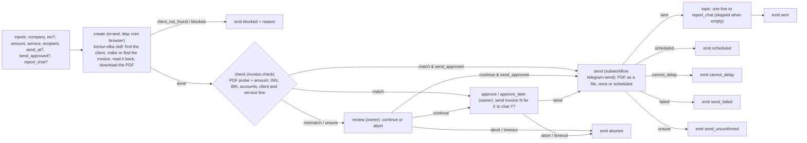

# invoice-send: an invoice in Kontur.Elba, checked, approved and sent

TL;DR: `workflows/invoice-send.json` creates or finds an invoice in Kontur.Elba on the Mac mini, verifies the PDF and requisites in code, asks the owner for approval (or skips the approve prompt when `send_approved` is `true`, after `review` if needed), and sends the PDF through `telegram-send` (`workflows/invoice-send.json:1-22`, `:61-150`).

`workflows/invoice-send.json` has status `tested` (`workflows/invoice-send.json:16`), backed by stub tests in `tests/workflow/chains-invoice.test.ts:1-96` and `tests/workflow/invoice-send-owner-said-send.test.ts:15-62` and rule tests in `tests/invoice-rules.test.ts:1-126`. It becomes published after one successful live run (`workflows/invoice-send.json:17-20`). Nothing is sent without the owner's approval: either `send_approved: true` (the owner's request already said to send, skipping `approve` / `approve_later` after a clean check or `review` `continue`) or the owner's `send` answer at `approve` / `approve_later` (`workflows/invoice-send.json:8-9`, `:30`, `:110-128`, `:198-209`).

## How it works

1. `create` runs as an `errand` agent with `kontur-elba` and `browser-automation` on `host_7sea4qaad8`, locates the existing client, avoids duplicates made the same day for the same client and amount, reads back saved invoice fields, and downloads the PDF (`workflows/invoice-send.json:62-74`). A missing/ambiguous client (`client_not_found`) or blocked page routes to `blocked` (`workflows/invoice-send.json:170-174`, `:196-197`).
2. `check` invokes `invoice.check` (`workflows/invoice-send.json:76-98`, `src/rooms/workflow/server/workflow-invoice.ts:31-48`). When `pdf_path` is present, `checkInvoicePdf` probes the file on `pdf_host` via `runOnHost` (`src/rooms/workflow/server/invoice-pdf.ts:26-55`), returning `unsure` if the machine is unreachable without hard errors or `mismatch` if the file check fails (`src/rooms/workflow/server/workflow-invoice.ts:37-43`). Otherwise `invoiceVerdict` settles `match`, `mismatch`, or `unsure` (`src/rooms/workflow/server/workflow-invoice.ts:45-46`, `packages/kit/src/invoice-rules.ts:68-74`).
3. On `match`, if `$inputs.send_approved == true` the graph goes straight to `send` (`workflows/invoice-send.json:198`); otherwise it branches to `approve` (when `$inputs.send_at == ''`) or `approve_later` (`workflows/invoice-send.json:110-128`, `:199-200`). On `mismatch` or `unsure`, it asks the owner at `review` first (`workflows/invoice-send.json:100-108`, `:201`); answering `continue` then goes straight to `send` when `$inputs.send_approved == true` or enters `approve` / `approve_later` (`workflows/invoice-send.json:202-204`).
4. On `send`, the `send` subworkflow node invokes `telegram-send` with `chat`, `file_path`, formatted caption `text`, and `send_at` (`workflows/invoice-send.json:130-137`). When `send.status == 'sent'`, `topic` posts a summary line via `telegram.send_rich` unless `report_chat` is empty, then emits `sent` (`workflows/invoice-send.json:139-156`, `:210-215`).

## Inputs and result

| Input | Meaning | Source |
|---|---|---|
| `company` (required) | Client as it appears in Elba (name or INN); must already exist | `workflows/invoice-send.json:24` |
| `inn` | Optional client INN compared against the saved invoice | `workflows/invoice-send.json:25` |
| `amount` (required) | Final invoice total in RUB, never recalculated | `workflows/invoice-send.json:26`, `:71` |
| `service` (required) | Service description in the owner's words | `workflows/invoice-send.json:27` |
| `recipient` (required) | Telegram chat (`@username`, numeric id, link, or `me`); no mail skill exists | `workflows/invoice-send.json:28` |
| `send_at` | Optional delay (`+2h`) or local time (`2026-11-03T07:00`) passed through `approve_later` and `telegram-send` | `workflows/invoice-send.json:29`, `:120-136` |
| `send_approved` | Boolean (`false` default); when `true`, the owner's request already said to send, skipping `approve` / `approve_later` after a clean check or `review` `continue` | `workflows/invoice-send.json:30`, `:198`, `:202` |
| `report_chat` | Optional Telegram chat or project topic for a one-line post-send report | `workflows/invoice-send.json:31`, `:139-150` |

The send itself uses the shared [telegram-send](telegram-send.md) subworkflow (`workflows/invoice-send.json:130-137`). Output fields are `status` (`sent`, `scheduled`, `aborted`, `blocked`, `send_failed`, `send_unconfirmed`, `cannot_delay`), `invoice_number`, `invoice_url`, `pdf_path`, `message_id`, `schedule_id`, `run_at`, `send_at`, `check_verdict`, and `reason` (`workflows/invoice-send.json:33-44`).

## The check (`invoice.check`, `invoiceVerdict`, and `checkInvoicePdf`)

- `checkInvoicePdf` validates that `pdf_path` is an absolute `.pdf` path without control characters and probes it on `pdf_host` (`host_7sea4qaad8`): file exists, non-empty size, `%PDF-` header, `%%EOF` trailer, and at least one page object or `/ObjStm` (`src/rooms/workflow/server/invoice-pdf.ts:16-55`).
- `hardProblems` checks invoice number, positive finite `request.amount` and `invoice.amount` within `0.005` RUB, client name, valid 10- or 12-digit `validInn` matching `request.inn`, optional `payee_inn`, Russian `pay_bik` (`^04\d{7}$`), and 20-digit `validAccount` / `validCorrAccount` control sums (`packages/kit/src/invoice-rules.ts:20-54`).
- `overlap` compares shared words ignoring `LEGAL_FORMS` (`packages/kit/src/invoice-rules.ts:56-65`). `invoiceVerdict` returns `match` when `company >= 0.6` and `service >= 0.5`, `mismatch` on any hard check failure, and `unsure` otherwise; no model is called and output sets `by: "rules"` (`packages/kit/src/invoice-rules.ts:68-74`, `src/rooms/workflow/server/workflow-invoice.ts:45-46`).

## Live run: the exact steps (needs the owner's real test invoice; do not do this from an agent)

Before: the build with this chain is on the hub; the project has an open Lane Pilot PM chat; on the Mac mini (`host_7sea4qaad8`) the Elba session works (`browser-cookies sync elba`, open `https://elba.kontur.ru` in the headless session: the organization is selected, no login form), `~/toolkit/telegram/tg` is logged in; there is a test client in Elba whose invoices the owner can cancel (`workflows/invoice-send.json:49-56`, `:228`).

1. Preflight: Workflows tab, `invoice-send`, or `bb plugin rpc call lane-pilot workflow_preflight --input '{"id":"invoice-send","projectId":"<project>"}'`. Every dependency (`kontur-elba`, `telegram-user`, `browser-automation`, tools) reports ready (`workflows/invoice-send.json:49-56`).
2. Start it as a first live run (`liveTrial` for a `tested` chain): the **Run for real** button of the Workflows tab with `company` = the test client, `inn` = its INN, `amount` = `100`, `service` = `Тест Lane Pilot`, `recipient` = `me`, `report_chat` empty; or `bb plugin rpc call lane-pilot workflow_run --input '{"id":"invoice-send","projectId":"<project>","liveTrial":true,"inputs":{"company":"<client>","inn":"<inn>","amount":100,"service":"Тест Lane Pilot","recipient":"me"}}'` (`workflows/invoice-send.json:16-20`, `:228`).
3. Watch `workflow_run_snapshot`: `create` runs in the browser (up to 40 min timeout); `check` runs in code (`workflows/invoice-send.json:73-98`). Read `verdict`, `reasons`, and `by`.
4. A form opens in the project's PM chat (and on the phone): `review` (only if `check.verdict` was not `match`) and then `approve` (`Send invoice ... to Telegram chat me?`, skipped when `send_approved` is `true`). Answer `send` (`workflows/invoice-send.json:100-118`, `:198-206`).
5. Compare the PDF in Saved Messages against the invoice in Elba and the run outputs (`invoice_number`, `invoice_url`, `pdf_path`) (`workflows/invoice-send.json:36-38`, `workflows/invoice-send.json:228`).
6. Run it a second time with the same inputs and answer `abort`: the Elba step reuses the same-day, same-amount invoice without creating a duplicate (`workflows/invoice-send.json:71`), and nothing is sent (`status: aborted`, `workflows/invoice-send.json:164-168`).
7. One live `sent` run promotes the chain to `published` (`workflows/invoice-send.json:16-20`). Cancel or delete the test invoice in Elba (never mark it paid or signed).

If a step fails: `create` blocked with a login wall means the Mini cookies expired; `client_not_found` means search did not yield one unique client (`workflows/invoice-send.json:71`); `send_unconfirmed` means inspect the chat before retrying (`workflows/invoice-send.json:182-186`).

## Scheduling it

Once published, the chain declares the `schedule` trigger (`workflows/invoice-send.json:22`), so the [schedule board](schedule-board.md) can run it with a cron rule in the owner's timezone. Scheduled runs without `send_approved: true` still pause at `approve` / `approve_later` (`timeoutMin: 1440`, `workflows/invoice-send.json:110-128`).

<!-- lane-pilot:backlinks -->
## Referenced by

- [telegram-send: the shared Telegram send fragment](telegram-send.md)
