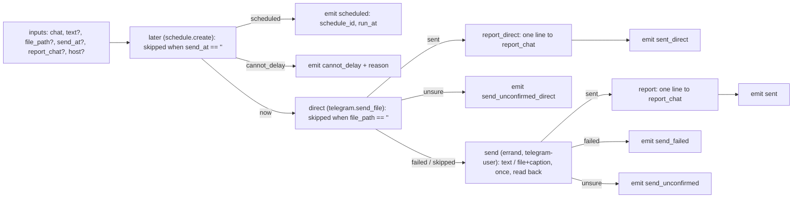

# telegram-send: the shared Telegram send fragment

TL;DR: `workflows/telegram-send.json` is an internal subworkflow fragment that either schedules a deferred send via `schedule.create`, sends a file directly via `telegram.send_file`, or falls back to the `errand` agent (`telegram-user` skill) with read-back confirmation (`workflows/telegram-send.json:44-105`, `workflows/telegram-send.json:150-163`).

`workflows/telegram-send.json` sets `internal: true` and status `published` (`workflows/telegram-send.json:11-12`). It is covered by stub tests (`tests/workflow/chains-telegram-send.test.ts:1-69`, `tests/schedule/schedule-create.test.ts:1-93`) and called as a subworkflow by [invoice-send](invoice-send.md) (`workflows/invoice-send.json:130-137`).

## How it works

1. `later` runs `schedule.create` (`workflows/telegram-send.json:44-53`, `src/rooms/schedule/server/schedule-agent-actions.ts:49-70`) unless `$inputs.send_at == ''` (`skip_out` sets `status: "now"`). If `send_at` parses as a valid future moment, it saves a one-off `once` workflow schedule and emits `scheduled`; if unparsable or rejected by the board, it emits `cannot_delay` (`workflows/telegram-send.json:138-153`).
2. When sending now, `direct` invokes `telegram.send_file` (`workflows/telegram-send.json:55-68`, `src/rooms/workflow/server/workflow-telegram.ts:36-50`) unless `$inputs.file_path == ''` (`skip_out` sets `status: "skipped"`). `sendFileCommand` executes `$HOME/toolkit/telegram/tg send-file` on `host` (`src/rooms/workflow/server/workflow-telegram.ts:17-20`).
3. `sendFileOutput` parses the last JSON line: `sent` or `already_there` returns `sent` (flowing through `report_direct` to `sent_direct`), `sent_unverified` returns `unsure` (emitting `send_unconfirmed_direct`), and any error returns `failed` (`src/rooms/workflow/server/workflow-telegram.ts:23-33`, `workflows/telegram-send.json:70-93`, `:155-157`).
4. When `direct` is skipped (text-only send) or returns `failed`, the graph falls through to the `send` `errand` agent using `telegram-user`, which checks chat history first and reports `sent`, `failed`, or `unsure` (`workflows/telegram-send.json:95-105`, `:157-162`).
5. On `sent`, `report` (or `report_direct`) posts one line via `telegram.send_rich` when `report_chat` is non-empty (`workflows/telegram-send.json:70-81`, `:107-118`).

## Inputs and result

| Input | Meaning | Source |
|---|---|---|
| `chat` (required) | Telegram chat (`@username`, numeric id, link, or `me`) | `workflows/telegram-send.json:15` |
| `text` | Message text, or file caption when `file_path` is set | `workflows/telegram-send.json:16` |
| `file_path` | Absolute file path on `host` to send as a file | `workflows/telegram-send.json:17` |
| `send_at` | Delay (`+2h`, `30m`) or local time (`2026-11-03T07:00`) for deferred scheduling | `workflows/telegram-send.json:18` |
| `report_chat` | Optional Telegram chat or project topic for a one-line post-send report | `workflows/telegram-send.json:19` |
| `host` | Sending machine holding `~/toolkit/telegram/tg` (default `host_7sea4qaad8`) | `workflows/telegram-send.json:20` |

Outputs: `status` (`sent`, `send_failed`, `send_unconfirmed`, `scheduled`, `cannot_delay`), `message_id`, `message_url`, `schedule_id`, `run_at` (wall clock in the owner's timezone), `send_at`, and `reason` (`workflows/telegram-send.json:22-30`).

## The delay path

`schedule.create` resolves `parseMoment` against `loadPushConfig(db).timezone` (`src/rooms/schedule/server/schedule-agent-actions.ts:56-60`, `src/rooms/schedule/time.ts:129-146`). It strips `send_at` from `c.inputs` so the scheduled run sends immediately without re-deferring (`src/rooms/schedule/server/schedule-agent-actions.ts:63`), sets `liveTrial: true`, names the schedule `Telegram → {{$inputs.chat}}`, and creates a `when: { type: "once", runAt }` entry via `services.schedules.save` (`src/rooms/schedule/server/schedule-agent-actions.ts:64-68`, `workflows/telegram-send.json:51`). Unrecognized time strings or past timestamps return `cannot_delay` (`src/rooms/schedule/server/schedule-agent-actions.ts:57-60`, `:67`).

## Rules of the send

- **Once:** Both `tg send-file` (looks back 50 messages for `already_there`) and the `send` agent check chat history before sending so retries do not duplicate (`workflows/telegram-send.json:59`, `:102`, `src/rooms/workflow/server/workflow-telegram.ts:28-30`).
- **Confirmed:** Unverified sends return `unsure` / `send_unconfirmed` and are never retried (`workflows/telegram-send.json:102`, `src/rooms/workflow/server/workflow-telegram.ts:31`).
- **Report:** `report_chat` routes confirmation through `telegram.send_rich` (`workflows/telegram-send.json:70-81`, `:107-118`).

<!-- lane-pilot:backlinks -->
## Referenced by

- [invoice-send: an invoice in Kontur.Elba, checked, approved and sent](invoice-send.md)
