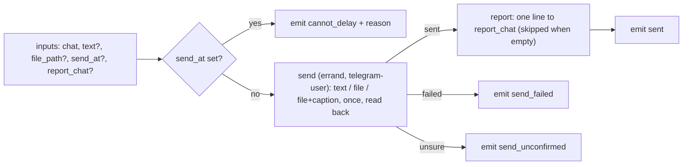

# telegram-send: the shared Telegram send fragment

`workflows/telegram-send.json`, `internal: true` — a fragment other graphs call as a subworkflow, never offered by the router.
Status **tested** on stubs (`tests/workflow/telegram-send.test.ts`). Used today by `invoice-send` (its `send` node).

## Inputs and result

| Input | |
| --- | --- |
| `chat` (required) | the Telegram chat: `@username`, a numeric id, a link, or `me` (the owner's Saved Messages) |
| `text` | the message text; with `file_path` it becomes the file's caption |
| `file_path` | a file on the sending machine, sent as a file |
| `send_at` | the delayed send time (ISO local `2026-11-03T07:00` or a delay `+2h`). **Declared, refused today**: no chain action can create a schedule, so a non-empty `send_at` ends the run `cannot_delay` before anything is sent |
| `report_chat` | a chat or project topic for a one-line report after the send; empty: none |

Outputs: `status` (`sent`, `send_failed`, `send_unconfirmed`, `cannot_delay`), `message_id`, `message_url`, `schedule_id`, `run_at`,
`send_at` (echoed), `reason`. `schedule_id`/`run_at` are always empty until the delay path exists.

## The delay path, and why it is refused

The fragment is meant to create a one-off schedule (`{kind:"workflow", workflowId:"telegram-send", inputs}` minus `send_at`,
`when:{type:"once", runAt|delay}` — `src/rooms/schedule/model.ts`, `normalizeSchedule`) and end `scheduled`. No action executor
available to graphs writes to the schedule board today: the pure actions (`packages/workflow-engine/src/actions.ts`) are code-only
and have no service access, the chain actions in `src/rooms/workflow/server/workflow-executors.ts` have no schedule key, and the PM
tool `lane_pilot_schedule` is bound to PM runs (`bb.agents.configure` in `src/rooms/tools/server/tools.ts`), not to chain helpers.
Until a `schedule.create`-style action exists, `send_at` is refused instead of silently sending now or guessing.

## Rules of the send

- Once: the helper reads the chat first; the file or text already there is reported `sent` with its id, never sent twice.
- Confirmed: only a message read back counts. A send that may have gone through ends `send_unconfirmed` and is never retried.
- `report_chat` names where the one-line confirmation goes (the same field as in `invoice-send`).
