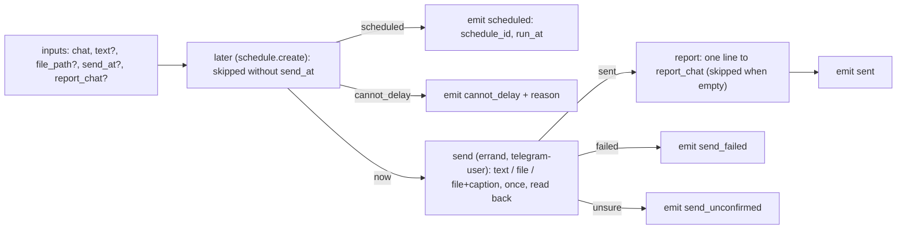

# telegram-send: the shared Telegram send fragment

`workflows/telegram-send.json`, `internal: true` — a fragment other graphs call as a subworkflow, never offered by the router.
Status **published** (a fragment: never started by hand, so its stub tests are its proof — `tests/workflow/chains-telegram-send.test.ts`, `tests/schedule/schedule-create.test.ts`). Used today by `invoice-send` (its `send` node).

## Inputs and result

| Input | |
| --- | --- |
| `chat` (required) | the Telegram chat: `@username`, a numeric id, a link, or `me` (the owner's Saved Messages) |
| `text` | the message text; with `file_path` it becomes the file's caption |
| `file_path` | a file on the sending machine, sent as a file |
| `send_at` | send later: a delay (`+2h`, `30m`) or a local time in the owner's zone (`2026-11-03T07:00`). Set, one run of this graph goes on the schedule board and the run ends `scheduled`; a text that is no time, or a past moment, ends `cannot_delay` |
| `report_chat` | a chat or project topic for a one-line report after the send; empty: none |

Outputs: `status` (`sent`, `send_failed`, `send_unconfirmed`, `scheduled`, `cannot_delay`), `message_id`, `message_url`, `schedule_id`, `run_at`
(the owner's wall clock, `2026-11-03 07:00`), `send_at` (echoed), `reason`.

## The delay path

`later` is the chain action `schedule.create` (`src/rooms/schedule/server/schedule-agent-actions.ts`): the moment comes from the run's own
input `send_at` (a delay `+2h`, `30m`, or a wall-clock time in the owner's zone `2026-11-03T07:00`, `src/rooms/schedule/time.ts`
`parseMoment`); the run's inputs minus `send_at` become one schedule of kind workflow (`telegram-send`, `when: once`), named
«Telegram → chat», created by `workflow:<run id>` and allowed as the graph's first live run (`liveTrial` on the task). The run ends
`scheduled` with `schedule_id` and `run_at` (the owner's wall clock) and sends nothing now; the scheduled run has no `send_at`, so it
sends and never puts itself off again. A text that is no time, or a moment the board refuses (already past), ends `cannot_delay` with
the reason and schedules nothing.

## Rules of the send

- Once: the helper reads the chat first; the file or text already there is reported `sent` with its id, never sent twice.
- Confirmed: only a message read back counts. A send that may have gone through ends `send_unconfirmed` and is never retried.
- `report_chat` names where the one-line confirmation goes (the same field as in `invoice-send`).
