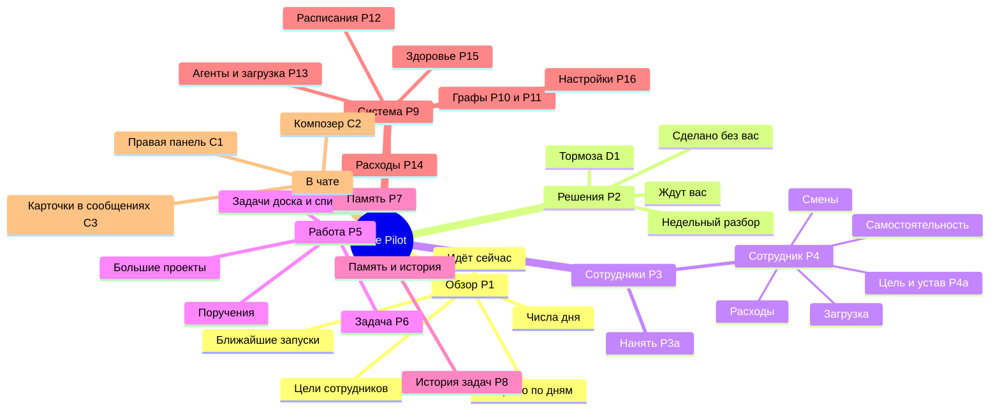

# Новый интерфейс Lane Pilot: карта экранов, кнопок и вызовов

> [!important] Зачем этот файл
> Один источник правды для переделки интерфейса. Каждая кнопка здесь связана с функцией в коде (RPC, команда BB SDK) и с тем, что эта функция меняет. Макеты нарисованы в Pencil, файл `lane-pilot-ui.pen`. План реализации лежит в `.ai-factory/plans/owner-console-redesign/`. Если экран или кнопка расходятся с этим файлом, правится этот файл, а за ним код.

## Принцип

Сейчас интерфейс устроен по инструментам: 9 пунктов меню, 6 вкладок × 3 уровня, переключатель «Basic/Advanced», 59 поверхностей. Новый интерфейс отвечает на вопросы владельца:

| Вопрос владельца | Раздел |
|---|---|
| Что происходит прямо сейчас? | **Обзор** |
| Что ждёт моего решения? | **Решения** |
| Кто на меня работает и идёт ли он к цели? | **Сотрудники** |
| Какие задачи идут и что с ними? | **Работа** |
| Что система знает и что уже было сделано? | **Память и история** |
| Как всё настроено? | **Система** |

Над всеми разделами есть переключатель области: «Все проекты», один проект или раздел проекта. Его значение запоминается (`remember_project`) и передаётся в каждый запрос как `projectId` / `sectionId`. Внутри чата область задаёт сам чат, её определяет `thread_scope`.

## Майндмап

## Сколько всего рисовать

| Код | Экран | Новый или перенос | Кадр в Pencil |
|---|---|---|---|
| S0 | Каркас: левое меню, переключатель области, тормоз | новый | Sidebar (компонент) |
| P1 | Обзор | новый | 6 · Обзор |
| P2 | Решения: Ждут вас, Недельный разбор, Сделано без вас | новый (Ждут вас — перенос `OwnerWaitingBoard`) | 1 · Решения, 10 · Недельный разбор |
| P3 | Сотрудники: список | новый | 2 · Сотрудники |
| P3a | Нанять сотрудника (мастер из 3 шагов) | новый | 11 · Нанять |
| P4 | Сотрудник: Цель и устав, Смены, Самостоятельность, Загрузка, Расходы | новый | 3 · Устав, 12 · Загрузка сотрудника |
| P4a | Изменить устав: черновик и утверждение | новый | внутри 3 · Устав (правая колонка) |
| P5 | Работа: Задачи, Большие проекты, Поручения | перенос `TaskBoard`, `ErrandsScreen` в новый каркас | 4 · Проекты и работа |
| P6 | Задача: этапы, приёмка, изменения, файлы | перенос `TaskPage` в новый каркас | 13 · Задача |
| P7 | Память | новый (записи — перенос `MemoryRecords`) | 8 · Память |
| P8 | История задач | новый | 9 · История |
| P9 | Система: плитки | новый | 5 · Система |
| P10 | Графы: библиотека и карта | перенос `WorkflowsScreen` без перерисовки | — |
| P11 | Граф: схема, прогон, редактор | перенос `WorkflowDetail`, `WorkflowDraftDetail` без перерисовки | — |
| P12 | Расписания: доска, календарь, форма, история | перенос `ScheduleBoard` без перерисовки | — |
| P13 | Агенты и загрузка | новый | 14 · Агенты и загрузка |
| P14 | Расходы | перенос `TokenUsage` + деньги `money_status` | 15 · Расходы |
| P15 | Здоровье и обслуживание | перенос `ServiceSegment` + учения и сбои | 16 · Здоровье |
| P16 | Настройки (система, проект, раздел) | перенос вкладок Team/Work/Knowledge | 17 · Настройки |
| C1 | Правая панель чата: Задачи, Память, История, Помощники | новый (объединяет `ThreadLivePanel` и `HelperThreadPanel`) | 7 · Чат + правая панель |
| C2 | Композер: включение, выбор сотрудника, значок, граница | перенос, только стиль | 18 · Чат: композер и карточки |
| C3 | Карточки в сообщениях: прогон, черновик задач, вопрос владельцу | перенос, только стиль | 18 · Чат: композер и карточки |
| D1 | Тормоза: остановить всех | новый | 19 · Тормоза |
| D2 | Единое подтверждение опасного действия | новый (заменяет `window.confirm`, `window.prompt` и действия без подтверждения) | 19 · Тормоза (нижний блок) |
| D3 | Экспорт графов | перенос без изменений | — |

**Итого:** 25 экранов и окон. Из них 17 новых, 8 переносов. Нарисовать нужно 19 кадров; P10, P11, P12, D3 и вложенные режимы графов и расписаний переезжают в каркас без перерисовки.

## Куда переезжает старое

| Сейчас | Становится |
|---|---|
| Меню «Сегодня → Ждут вас» | P2 · Решения → Ждут вас |
| Меню «Сегодня → Задачи», вкладка проекта «Runs → Board» | P5 · Работа → Задачи (одна доска, область задаёт переключатель) |
| Меню «Сегодня → Поручения» | P5 · Работа → Поручения |
| Меню «Сегодня → Расписание», вкладка «Automation → Schedule» | P12 · Система → Расписания |
| Меню «Настройка → Общие настройки» (`globals`) | P16 · Настройки, область «Система» |
| Меню «Настройка → Агенты» (`OwnedSettings`) | P13 · Агенты и загрузка → «Свои агенты» |
| Меню «Настройка → Графы», вкладка «Automation → Workflows» | P10 · Графы |
| Меню «Настройка → Токены» | P14 · Расходы |
| Вкладка проекта Overview | P1 · Обзор с областью проекта |
| Вкладка Team (`RoleModelsPanel`, `TeamTable`, `AgentAccess`, `ModelOverridesPanel`) | P13 · Агенты и загрузка (одна матрица вместо двух таблиц) |
| Вкладка Work | P16 · Настройки → «Работа и проверки» |
| Вкладка Knowledge → Memory | P7 · Память (записи) + P16 · Настройки → «Память» |
| Вкладка Knowledge → Docs | P16 · Настройки → «Документы» |
| Вкладка Runs → Analytics | P14 · Расходы → «Качество» (`WriterReuse`, `CriticValue`, `AcceptanceStats`) |
| Вкладка Runs → Service | P15 · Здоровье |
| Переключатель Basic/Advanced | Убран. Редкие поля сложены в «Ещё» внутри своей группы настроек |
| Боковые панели чата «Live» и «Помощники» | C1 · одна правая панель с вкладками |
| Ветка `OwnedSettings scope="globals"` (не показывается) | Удаляется |

Старые адреса (`?tab=team`, `runs/board` и другие из `LEGACY_TABS`) ведут на новые экраны, поэтому закладки и ссылки владельца продолжают работать.

## Экраны и кнопки

Обозначения в колонке «Вызов»: `rpc` — существующий метод, **NEW** — метод, которого ещё нет; он описан в разделе «Новые методы сервера». `sdk` — вызов BB Plugin SDK.

### S0 · Каркас

| Элемент | Что делает | Вызов | Что меняется |
|---|---|---|---|
| Пункты меню (6) | открывают раздел | маршрут `lane-pilot/<section>` | ничего |
| Значок на «Решения» | число решений в очереди «сейчас» | `rpc owner_waiting` | только чтение |
| Переключатель области | выбирает «Все проекты», проект или раздел | `rpc list_projects`, `rpc list_sections`, `rpc remember_project` | KV `preferences:lastProjectId` |
| Кнопка «Тормоз» (красная точка, если что-то остановлено) | открывает D1 | **NEW** `brakes_get` | только чтение |

### P1 · Обзор

| Элемент | Что делает | Вызов | Что меняется |
|---|---|---|---|
| 5 чисел: идёт, ждёт вас, закрыто сегодня, расход сегодня, целей в графике | сводка дня по области | **NEW** `console_overview` | только чтение |
| Таблица «Идёт сейчас»: задача, этап, сколько идёт, цена | живые задачи и графы | **NEW** `console_overview.active` (собирается из `task_board`, `work_graph_strips`) | только чтение |
| Строка таблицы | открывает P6 | маршрут `work/task/<runId>/<taskId>` | ничего |
| График «Закрыто по дням» (14 дней, принято / доделано / отменено / сорвалось) | | **NEW** `console_overview.closedByDay` | только чтение |
| Блок «Цели сотрудников» | прогресс к цели по каждому уставу | **NEW** `console_overview.goals` (из `specialist_overview`) | только чтение |
| Блок «Ближайшие запуски» | 5 следующих срабатываний | `rpc schedule_calendar` | только чтение |
| Кнопка «Все решения» | открывает P2 | маршрут | ничего |

### P2 · Решения

**Вкладка «Ждут вас»** — перенос `OwnerWaitingBoard`, кнопки сохраняются.

| Элемент | Что делает | Вызов | Что меняется |
|---|---|---|---|
| Счётчик «3 из 5 сегодня» | сколько решений уже показано сегодня | `rpc owner_waiting` + **NEW** поле `attention` | только чтение |
| Карточка: варианты ответа | ответ владельца | действие карточки: `owner_waiting_close`, `task_word`, `finish_run`, `schedule_run_now`, `schedule_pause`, `workflow_draft_grant`, `workflow_answer` | закрывает `lane_pilot_owner_item`, будит шаг графа или задачу |
| Карточка: «Подробнее» | доводы, ссылки на прогон и файлы | — | ничего |
| Карточка: «Отложить» | переносит в недельный разбор | `rpc deferral_defer` | `lane_pilot_deferral` |
| Ссылка на улику (прогон, задача, файл) | открывает P6 или файл | маршрут / `sdk navigate.experimental_openFilePreview` | ничего |
| Фильтр по проекту | | клиент | ничего |
| Настройки push (тихие часы, пояс) | | `rpc owner_waiting_config` | `owner_push.*` |

**Вкладка «Недельный разбор»**

| Элемент | Что делает | Вызов | Что меняется |
|---|---|---|---|
| Разделы разбора с вариантами и вариантом по умолчанию | | **NEW** `desk_get` | только чтение |
| Выбор варианта в пункте | ответ на пункт | **NEW** `desk_answer` | то же, что `bb lane-pilot desk answer` |
| «Принять все варианты по умолчанию» | | **NEW** `desk_accept_defaults` (D2 подтверждение) | то же, что `bb lane-pilot desk accept-defaults` |

**Вкладка «Сделано без вас»**

| Элемент | Что делает | Вызов | Что меняется |
|---|---|---|---|
| Лента: кто, что сделал, по какому праву, результат, улика | | **NEW** `actions_log` | только чтение |
| «Отменить» у обратимого действия | | вызов из строки ленты (`revert`, `schedule_pause`, `workflow_draft_rollback`) | по действию |

### D1 · Тормоза

| Элемент | Что делает | Вызов | Что меняется |
|---|---|---|---|
| Список: расписания, новая работа писателей, графы, сотрудники; у каждого «на паузе / работает» и сколько затронет | | **NEW** `brakes_get` | только чтение |
| Переключатель у каждого тормоза | | **NEW** `brakes_set` | KV `schedule.paused_all`, `conveyor`, `workflow.disabled` |
| «Остановить всех» (D2 подтверждение) | ставит все тормоза и останавливает идущие задачи | **NEW** `stop_all` | тормоза + `halt_run` / `cancel_attempt` по каждому активному прогону |

### P3 · Сотрудники

| Элемент | Что делает | Вызов | Что меняется |
|---|---|---|---|
| Карточка сотрудника: роль, проект, цель, прогресс и отметка «в графике / отстаёт», бюджет, самостоятельность | | `rpc list_agents` + `rpc specialist_overview` по проектам | только чтение |
| Карточка | открывает P4 | маршрут `staff/<projectId>/<domain>` | ничего |
| «Открыть чат» | чат сотрудника в правой панели | `sdk useOpenThreadPanel` / `navigate.toThread` | ничего |
| «Нанять» | открывает P3a | маршрут | ничего |
| Фильтр «На ставке / По заданию» | | клиент | ничего |

### P3a · Нанять сотрудника

| Шаг | Что делает | Вызов | Что меняется |
|---|---|---|---|
| 1. Роль | список ролей: «на ставке» (маркетолог, SEO) и «по заданию» | `rpc list_agents` | ничего |
| 2. Проект | выбор проекта и раздела | `rpc list_projects`, `rpc list_sections` | ничего |
| 3а. Для роли на ставке: «Начать знакомство» | запускает граф знакомства | `rpc workflow_run` с `mkt-project-intake` или `seo-project-intake` | `lane_pilot_wf_run`; вопросы приходят в P2 |
| 3б. Для роли по заданию: «Создать расписание» | открывает форму расписания с выбранной ролью | `rpc schedule_preview`, `rpc schedule_upsert` | `lane_pilot_schedule` |
| «Своя роль» | создаёт профиль | `rpc save_agent_profile` | KV `agents:v1` |

### P4 · Сотрудник

| Вкладка / элемент | Что делает | Вызов | Что меняется |
|---|---|---|---|
| Шапка: цель, сколько есть, сколько нужно, к какой дате, отметка графика | | **NEW** `specialist_detail` | только чтение |
| **Цель и устав:** метрика, формула, источник данных, ограничения, бюджеты, каналы, версия | | **NEW** `specialist_detail.charter` | только чтение |
| «Изменить устав» → P4a | черновик новой версии | **NEW** `charter_propose` | черновик в `lane_pilot_owner_item` |
| P4a «Утвердить» (D2 подтверждение) | новая версия устава | **NEW** `charter_approve` | `lane_pilot_sp_charter` + `.agents/<domain>/charter.json` |
| **Смены:** последняя и следующая смена, глубина, что сделано, какой граф выбран | | **NEW** `specialist_detail.shifts` (из `lane_pilot_schedule_run`, `wf_run`) | только чтение |
| «Запустить смену сейчас» | | `rpc schedule_run_now` | `lane_pilot_schedule_run` |
| **Самостоятельность:** классы действий × уровень «Наблюдает / Предлагает / Сам», выборка и уверенность | | **NEW** `specialist_detail.autonomy` | только чтение |
| Смена уровня (D2 подтверждение) | | **NEW** `specialist_autonomy_set` | `lane_pilot_sp_autonomy`, `sp_grant` |
| **Загрузка:** модель, скиллы, плагины, MCP, инструкции, откуда каждое | | **NEW** `agent_loadout` | только чтение |
| **Расходы:** потрачено / лимит за день, месяц, тест | | `rpc specialist_overview` + **NEW** `specialist_detail.caps` | только чтение |
| «Пауза сотрудника» | | `rpc schedule_pause` по его расписаниям | `lane_pilot_schedule` |

### P5 · Работа

| Вкладка / элемент | Что делает | Вызов | Что меняется |
|---|---|---|---|
| **Задачи:** доска или список, фильтры вида, поиск, окно «закрыто» | перенос `TaskBoard` | `rpc task_board`, `rpc work_graph_strips` | только чтение |
| Карточка | открывает P6 | маршрут | ничего |
| **Большие проекты:** графы `project-start`, `full-lifecycle`, `roadmap-driven` по этапам | | `rpc workflow_runs`, `rpc workflow_run_snapshot` | только чтение |
| «Начать проект» | запуск проектного графа с брифом | `rpc workflow_run` | `lane_pilot_wf_run` |
| **Поручения:** перенос `ErrandsScreen` | | `rpc errands_overview`, `rpc errands_diagnosis` | только чтение |

### P6 · Задача

Перенос `TaskPage`. Кнопки и вызовы те же: `cancel_attempt`, `retry_attempt`, `task_word`, `task_return_stage`, `list_run_stages`, `get_stage_result`, `workflow_run_snapshot`, `work_file_read`, `task_diff`. Меняется вид, и «Отменить» и «Нет» идут через D2 вместо действия без подтверждения и `window.prompt`.

### P7 · Память

| Элемент | Что делает | Вызов | Что меняется |
|---|---|---|---|
| Фильтр: факты, решения, правила, уроки, карточки | | клиент | ничего |
| Список записей: текст, откуда, кто записал, сколько раз использована | | `rpc memory_records_list` | только чтение |
| Карточки знаний | | **NEW** `memory_cards_list` | только чтение |
| Подробности записи: источник, задача-источник, история | | `rpc memory_records_list` (поля `originTaskId`, `sources`, `useCount`) | только чтение |
| «Удалить» (D2 подтверждение; для правил кнопки нет) | | `rpc memory_record_delete` | `lane_pilot_memory` и индексы |
| Поиск | | `rpc session_memory_search` | только чтение |

### P8 · История задач

| Элемент | Что делает | Вызов | Что меняется |
|---|---|---|---|
| Лента закрытых задач: итог, попытки, время, цена, коммит | | **NEW** `task_history` | только чтение |
| Фильтр по итогу и проекту, «ещё» | | **NEW** `task_history` (курсор) | только чтение |
| Раскрытие сорвавшейся задачи: причина, план, проверки, урок | | `rpc task_card`, `rpc task_acceptance_card` | только чтение |
| «Повторить с новым планом» | | `rpc task_return_stage` с `to: "planning"` | `lane_pilot_stage_return`, сообщение PM |

### P9 · Система

Шесть плиток ведут на P10–P16. У каждой плитки одна строка состояния: число графов и черновиков, число активных расписаний, ролей с изменённой моделью, расход за месяц, есть ли сбои, сколько настроек изменено. Данные: `workflow_list`, `schedule_list`, `get_role_models`, `money_status`, **NEW** `brakes_get`, `get_screen`.

### P13 · Агенты и загрузка

| Элемент | Что делает | Вызов | Что меняется |
|---|---|---|---|
| Матрица: роль × модель, скиллы, плагины, MCP, инструкции | одна таблица вместо `RoleModelsPanel` + `TeamTable` | **NEW** `agent_loadout` | только чтение |
| Значок «нет на хабе» у скилла | скилл в списке роли, но BB его не отдаст | **NEW** `agent_loadout.missing` | только чтение |
| Смена модели роли | | `rpc save_setting` (`role_model.<role>`) | `lane_pilot_project_settings` |
| Смена доступа роли (скиллы, плагины, MCP) | | `rpc save_setting` (`helper.role.<role>`) | `lane_pilot_project_settings` |
| «Как у уровня выше» | | `rpc reset_project_settings` | удаляет строку настройки |
| «Свои агенты»: создать, изменить, удалить | перенос `OwnedSettings` | `rpc save_agent_profile`, `rpc delete_agent` (D2) | KV `agents:v1` |
| «Сбросить все переопределения моделей» | | `rpc reset_model_overrides` (D2) | `lane_pilot_project_settings` |

### P14 · Расходы

Перенос `TokenUsage` (`token_usage`, `token_usage_sync`), сверху деньги и лимиты (`money_status`), снизу вкладка «Качество» с `WriterReuse`, `CriticValue`, `AcceptanceStats`.

### P15 · Здоровье

Перенос `ServiceSegment` (`resume_runs`, `native_install_status`, `native_install_start`, `stack_*`). Дополнительно только чтение: `canary_status`, сбои провайдеров (`bb lane-pilot outages` → тот же сервис), последние учения из `.agents/runs/drills`.

### P16 · Настройки

Одна страница с переключателем уровня «Система / Проект / Раздел» и группами: «Работа и проверки» (бывшая Work), «Память», «Документы», «Язык и уведомления». Вызовы те же: `get_screen`, `save_setting`, `reset_project_settings`, `set_locale`, `owner_waiting_config`, `docs_overview`. Поля с пометкой «наследуется» показывают, откуда взято значение.

### C1 · Правая панель чата

Слот: `app.slots.experimental_tab` с `id: "lane-pilot-live"` и `availability: "fixed"` (сейчас там `ThreadLivePanel`). Вкладка `lane-helper-thread` остаётся для открытия одного помощника.

| Элемент | Что делает | Вызов | Что меняется |
|---|---|---|---|
| Переключатель «Раздел / Весь проект» | область панели | **NEW** `thread_scope` | ничего |
| Блок репозитория: имя, ветка, CI, тесты, откаты | | **NEW** `thread_scope.repo` + **NEW** `repo_trust` | только чтение |
| **Задачи:** идёт, ждёт вас, в очереди, закрыто сегодня | | `rpc thread_live` + `rpc task_board` (по области) | только чтение |
| **Память:** записи области | | `rpc memory_records_list` | только чтение |
| **История:** закрытые задачи области | | **NEW** `task_history` | только чтение |
| **Помощники:** живые треды помощников, граф задач | перенос `HelperThreadPanel` | `rpc list_helper_threads`, `retry_attempt`, `cancel_attempt` (D2) | по действию |
| Внизу: самостоятельность в этом репозитории | | **NEW** `repo_trust` | только чтение |
| Поле «Дописать» | сообщение в чат | `sdk threads.send` | новый ход |

### C2, C3 · Композер и карточки в сообщениях

Переносятся без новых вызовов, меняется только стиль: `EnableLanePilotAction`, `ComposerAgentBadge`, `ComposerBoundary`, `RunCardDirective`, `LaneDraftCardDirective`, `OwnerAsk`.

## Новые методы сервера

| Метод | Room | Из чего собирается | Для экрана |
|---|---|---|---|
| `console_overview` | `runs` | `buildTaskBoard`, `work_graph_strips`, `lane_pilot_attempt`/`wf_run` итоги по дням в поясе владельца, `money_status`, `specialistOverview` | P1 |
| `thread_scope` | `runs` | `bb.sdk.threads.get`, `schedule-place.ts:placeOf`, `session_memory_project`, `createProjectGit.resolveExistingScope` | C1 |
| `task_history` | `runs` | `lane_pilot_task`, `lane_pilot_attempt`, `attempt_change` (merge SHA), `lp_attempt_metrics`, курсор по `finished_at` | P8, C1 |
| `owner_waiting.attention` | `owner-waiting` | `lane_pilot_owner_config` `decision_day`, `decisionCap` | P2 |
| `desk_get`, `desk_answer`, `desk_accept_defaults` | `reports` | `composeReviewDesk` и сервисы команд `desk` | P2 |
| `brakes_get`, `brakes_set`, `stop_all` | `owner-waiting` | KV `schedule.paused_all`, `conveyor`, `workflow.disabled`, `halt_run`, `cancel_attempt` | D1, S0 |
| `actions_log` | `specialist` | `sp_mutation_log`, `lane_pilot_wf_effect`, `lead_decision` | P2 |
| `specialist_detail` | `specialist` | `sp_charter`, `sp_ledger`, `sp_autonomy`, `sp_grant`, `schedule_run`, `wf_run`, `loopHealth` | P4 |
| `specialist_autonomy_set` | `specialist` | сервис команды `specialist autonomy grant/revoke` | P4 |
| `charter_propose`, `charter_approve` | `specialist` | `sp.charter_set` | P4a |
| `agent_loadout` | `settings` | `helper_access_view`, `ROLE_PROFILES`, `STANDALONE_SPECIALIST_SKILL_PACKS`, `EMPLOYEES`, `get_role_models`, `bb.sdk.skills.list` | P13, P4 |
| `memory_cards_list` | `memory` | `cards-repository.ts` | P7 |
| `repo_trust` | новый room `repo-trust` | `lane_pilot_gate_run` (`latestGateRun`), чеки откатов, GitHub id из `project-git` | C1, P4 |

## Открытые вопросы

| # | Вопрос | Решение по умолчанию в плане |
|---|---|---|
| 1 | С какого экрана открывать Lane Pilot? | P1 · Обзор |
| 2 | Область: переключатель вверху или все проекты сразу? | Переключатель, по умолчанию «Все проекты» |
| 3 | Шкала самостоятельности | «Наблюдает / Предлагает / Сам» = `observe` / `propose` / `bounded_auto` |
| 4 | Чат с сотрудником | Кнопка «Открыть чат» открывает тред в правой панели BB |
| 5 | Что убрать из «Системы» | Ничего не удаляется, всё уходит в P9–P16 |
| 6 | Правка и закрепление записи памяти | В этом плане только просмотр и удаление; правка — отдельный план |
| 7 | Доверие к репозиторию из GitHub Checks | В этом плане только своё: прогоны проверок Lane Pilot и откаты; GitHub Checks — отдельный план |
