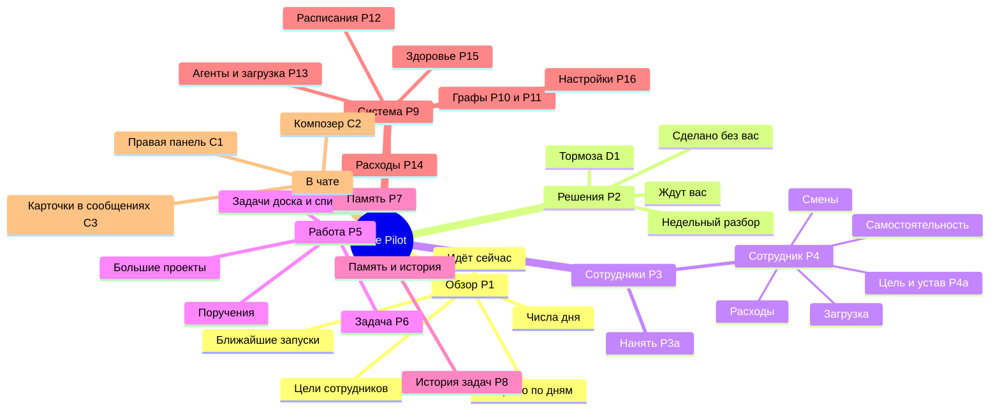

# Консоль Lane Pilot: карта экранов, кнопок и вызовов

> [!important] Зачем этот файл
> Справочная карта реализованной консоли владельца: экраны, кнопки, вызовы RPC и команды BB SDK с тем, что они меняют. Если экран или кнопка меняются в коде, этот файл обновляется вместе с ними.

## Принцип

Прежний интерфейс был устроен по инструментам (меню «Сегодня» / «Настройка», шесть вкладок на трёх уровнях, отдельный переключатель базовых и расширенных полей). Новая консоль отвечает на шесть вопросов владельца:

| Вопрос владельца | Раздел |
|---|---|
| Что происходит прямо сейчас? | **Обзор** |
| Что ждёт моего решения? | **Решения** |
| Кто на меня работает и идёт ли он к цели? | **Сотрудники** |
| Какие задачи идут и что с ними? | **Работа** |
| Что система знает и что уже было сделано? | **Память и история** |
| Как всё настроено? | **Система** |

Вверху тёмного сайдбара (`ScopeSwitcher`, на узком экране - в шапке) есть переключатель области: «Все проекты», один проект или раздел проекта. Его выбор запоминается (`remember_project`) и передаётся в запросы как `projectId` / `sectionId`. Внутри чата область задаёт сам тред через `thread_scope`.

## Майндмап

## Состав экранов

| Код | Экран | Маршрут / слот | Реализация |
|---|---|---|---|
| S0 | Каркас: левое меню, переключатель области, тормоз | все экраны консоли | `ConsoleShell`, `ScopeSwitcher`, `BrakeButton` |
| P1 | Обзор | `overview` | `OverviewScreen` |
| P2 | Решения: Ждут вас, Недельный разбор, Сделано без вас | `decisions` (`waiting`, `desk`, `autonomous`) | `DecisionsScreen`, `OwnerWaitingBoard`, `ReviewDesk`, `ActionsLog` |
| P3 | Сотрудники: список | `staff` | `StaffList` |
| P3a | Нанять сотрудника (мастер из 3 шагов) | `staff/hire` | `HireWizard` |
| P4 | Сотрудник: Цель и устав, Смены, Самостоятельность, Загрузка, Расходы | `staff/<projectId>/<domain>` | `StaffPage` |
| P4a | Изменить устав: черновик и утверждение | `staff/<projectId>/<domain>/edit` | `CharterEditor` |
| P5 | Работа: Задачи, Большие проекты, Поручения | `work` (`tasks`, `projects`, `errands`) | `WorkScreen`, `TaskBoard`, `BigProjects`, `ErrandsScreen` |
| P6 | Задача: этапы, приёмка, изменения, файлы | `work/task/<runId>/<taskId>` | `TaskPage` |
| P7 | Память | `memory/records` | `MemoryScreen` |
| P8 | История задач | `memory/history` | `HistoryScreen` |
| P9 | Система: плитки | `system` | `SystemHome` |
| P10 | Графы: библиотека и карта | `system/graphs` | `WorkflowsScreen` |
| P11 | Граф: схема, прогон, редактор | внутри `system/graphs` | `WorkflowDetail`, `WorkflowDraftDetail` |
| P12 | Расписания: доска, календарь, форма, история | `system/schedules` | `ScheduleBoard` |
| P13 | Агенты и загрузка | `system/agents` | `AgentsLoadout`, `OwnedSettings`, `ModelOverridesPanel` |
| P14 | Расходы и качество | `system/costs` (`spend`, `quality`) | `CostsScreen`, `TokenUsage` |
| P15 | Здоровье и обслуживание | `system/health` | `HealthScreen`, `ServiceSegment` |
| P16 | Настройки (система, проект, раздел) | `system/settings` (`work`, `memory`, `docs`, `notifications`) | `SettingsScreen` |
| C1 | Правая панель чата: Задачи, Память, История, Помощники | `experimental_tab` `lane-pilot-live` | `ChatPanel`, `ChatPanelTabs` |
| C2 | Композер: включение, выбор сотрудника, значок, граница | слоты композера BB | `EnableLanePilotAction`, `ComposerAgentBadge`, `ComposerBoundary` |
| C3 | Карточки в сообщениях: прогон, черновик задач, вопрос владельцу | `messageDirective`, `pendingInteraction` | `RunCardDirective`, `LaneDraftCardDirective`, `OwnerAsk` |
| D1 | Тормоза: остановить всех | диалог из `BrakeButton` | `BrakesDialog` |
| D2 | Единое подтверждение опасного действия | во всех опасных действиях | `ConfirmDialog` |
| D3 | Экспорт графов | внутри `system/graphs` | диалог экспорта графов |

## Соответствие прежних адресов

| Было | Стало |
|---|---|
| Меню «Сегодня → Ждут вас» (`scope="waiting"`) | P2 · Решения → Ждут вас (`decisions/waiting`) |
| Меню «Сегодня → Задачи», вкладка «Runs → Board» | P5 · Работа → Задачи (`work/tasks`, область задаёт переключатель) |
| Меню «Сегодня → Поручения» (`scope="errands"`) | P5 · Работа → Поручения (`work/errands`) |
| Меню «Сегодня → Расписание», вкладка «Automation → Schedule» | P12 · Система → Расписания (`system/schedules`) |
| Меню «Настройка → Общие настройки» (`scope="globals"`) | P16 · Система → Настройки, уровень «Система» (`system/settings`) |
| Меню «Настройка → Агенты» (`scope="agents"`) | P13 · Система → Агенты и загрузка → «Свои агенты» (`system/agents`) |
| Меню «Настройка → Графы», вкладка «Automation → Workflows» | P10 · Система → Графы (`system/graphs`) |
| Меню «Настройка → Токены» (`scope="tokens"`) | P14 · Система → Расходы (`system/costs`) |
| Вкладка проекта Overview | P1 · Обзор с областью проекта (`overview`) |
| Вкладка Team (`RoleModelsPanel`, `TeamTable`, `AgentAccess`, `ModelOverridesPanel`) | P13 · Система → Агенты и загрузка (единая матрица вместо двух таблиц) |
| Вкладка Work | P16 · Система → Настройки → «Работа и проверки» |
| Вкладка Knowledge → Memory | P7 · Память и история → Записи + P16 · Настройки → «Память» |
| Вкладка Knowledge → Docs | P16 · Настройки → «Документы» |
| Вкладка Runs → Analytics | P14 · Система → Расходы → «Качество» (`WriterReuse`, `CriticValue`, `AcceptanceStats`) |
| Вкладка Runs → Service | P15 · Система → Здоровье (`system/health`) |
| Переключатель базовых и расширенных настроек | Убран. Редкие поля сложены в блок «Ещё» внутри каждой группы настроек |
| Боковые панели чата «Live» и «Помощники» | C1 · единая правая панель `ChatPanel` с вкладками; `lane-helper-thread` остаётся для просмотра отдельного помощника |
| Ветка `OwnedSettings scope="globals"` | Удалена (недостижима) |

Старые адреса (`?tab=team`, `runs/board`, `LEGACY_TABS`, `LEGACY_SCOPES`) разрешаются через `resolveLegacyRoute` в `src/rooms/pages/models/nav-model.ts`, поэтому старые ссылки и закладки продолжают вести на нужные разделы.

## Экраны и кнопки

Обозначения в колонке «Вызов»: `rpc` — метод плагина (`src/rooms/contracts/`), `sdk` — вызов BB Plugin SDK.

### S0 · Каркас

| Элемент | Что делает | Вызов | Что меняется |
|---|---|---|---|
| Пункты меню (6 разделов + 6 страниц «Системы») | открывают раздел или страницу | маршрут `lane-pilot/<section>` (`ConsoleRoute`) | ничего |
| На узком экране (< 900 px) | сворачивает левое меню в выпадающий список `Select` | `CONSOLE_SECTIONS` + `SYSTEM_PAGES` | ничего |
| Значок на «Решения» | число решений в очереди «сейчас» | `rpc owner_waiting` | только чтение |
| Переключатель области (`ScopeSwitcher`) | выбирает «Все проекты», проект или раздел | `rpc list_projects`, `rpc list_sections`, `rpc remember_project` | KV `preferences:lastProjectId` |
| Кнопка «Тормоз» (`BrakeButton`, с плашкой пауз, если что-то остановлено) | открывает D1 (`BrakesDialog`) | `rpc brakes_get` | только чтение |

### P1 · Обзор

| Элемент | Что делает | Вызов | Что меняется |
|---|---|---|---|
| Переключатель периода (Сегодня / 7 дней / 30 дней) | выбирает окно подсчёта | `rpc console_overview` (`days: 1 \| 7 \| 30`) | только чтение |
| 5 чисел: идёт, ждёт вас, закрыто сегодня, расход сегодня, целей в графике | сводка дня по области | `rpc console_overview` | только чтение |
| Таблица «Идёт сейчас»: задача, проект, этап, сколько идёт, цена | живые задачи, графы и фазы | `rpc console_overview.active` | только чтение |
| Строка таблицы | открывает P6 (или тред батча) | маршрут `work/task/<runId>/<taskId>` / `sdk navigate.toThread` | ничего |
| График «Закрыто по дням» (принято / доделано / отменено / сорвалось) | динамика закрытий за период | `rpc console_overview.closedByDay` | только чтение |
| Блок «Цели сотрудников» | прогресс к цели по каждому уставу | `rpc console_overview.goals` | только чтение |
| Блок «Ближайшие запуски» | до 5 следующих срабатываний | `rpc schedule_calendar` | только чтение |
| Кнопка «Вся работа» / «Решения» | открывает P5 / P2 | маршрут | ничего |

### P2 · Решения

**Вкладка «Ждут вас»** (`OwnerWaitingBoard`, кнопки сохраняются; закрывающие действия и отказ подтверждаются через D2 `ConfirmDialog`).

| Элемент | Что делает | Вызов | Что меняется |
|---|---|---|---|
| Счётчик и разделы «Сейчас» / «Потом» | ранжированная очередь решений | `rpc owner_waiting` | только чтение |
| Карточка: варианты ответа | ответ владельца (при отказе `task_word` запрашивает причину в D2) | действие карточки: `owner_waiting_close`, `task_word`, `finish_run`, `schedule_run_now`, `schedule_pause`, `workflow_draft_grant`, `workflow_answer` | закрывает `lane_pilot_owner_item`, будит шаг графа или задачу |
| Карточка: «Подробнее» | доводы, ссылки на прогон и файлы | — | ничего |
| Карточка: «Отложить» | переносит в недельный разбор | `rpc deferral_defer` | `lane_pilot_deferral` |
| Ссылка на улику (прогон, задача) | открывает P6 | маршрут | ничего |
| Фильтр по проекту | задаётся переключателем области (при «Все проекты» — все) | клиент | ничего |

Настройки Telegram-уведомлений и тихих часов (`PushSettings`, `rpc owner_waiting_config`) находятся в **P16 · Настройки → Язык и уведомления**.

**Вкладка «Недельный разбор»** (`ReviewDesk`)

| Элемент | Что делает | Вызов | Что меняется |
|---|---|---|---|
| Разделы разбора с вариантами и вариантом по умолчанию | показывает вопросы недели | `rpc desk_get` | только чтение |
| Выбор варианта в пункте | ответ на пункт | `rpc desk_answer` | то же, что `bb lane-pilot desk answer` |
| «Принять все варианты по умолчанию» | подтверждение D2 | `rpc desk_accept_defaults` | то же, что `bb lane-pilot desk accept-defaults` |

**Вкладка «Сделано без вас»** (`ActionsLog`)

| Элемент | Что делает | Вызов | Что меняется |
|---|---|---|---|
| Лента: кто, что сделал, по какому праву, результат, улика | журнал автономных действий | `rpc actions_log` | только чтение |
| «Отменить» у обратимого действия | откатывает действие строки | вызов из поля `undo` строки ленты | по действию |

### D1 · Тормоза

| Элемент | Что делает | Вызов | Что меняется |
|---|---|---|---|
| Список: расписания, новая работа писателей, графы, сотрудники; у каждого «на паузе / работает» и число затронутых | состояние четырёх тормозов | `rpc brakes_get` | только чтение |
| Переключатель у каждого тормоза | ставит на паузу сразу; снятие паузы через D2 | `rpc brakes_set` | KV `schedule.paused_all`, `conveyor`, `workflow.disabled`, тормоз сотрудников |
| «Остановить всех» (D2 с вводом «СТОП» и причиной 3–300 знаков) | ставит тормоза и останавливает идущие прогоны | `rpc stop_all` | тормоза + остановка активных прогонов (`halted`) |

### P3 · Сотрудники

| Элемент | Что делает | Вызов | Что меняется |
|---|---|---|---|
| Карточка сотрудника: роль, проект, цель, прогресс и отметка «в графике / отстаёт», бюджет, самостоятельность | сводка по ролям | `rpc list_agents` + `rpc specialist_overview` по проектам | только чтение |
| Карточка | открывает P4 | маршрут `staff/<projectId>/<domain>` | ничего |
| «Открыть чат» | открывает чат сотрудника в боковой панели или переходит в тред | `sdk useOpenThreadPanel` / `navigate.toThread` | ничего |
| «Нанять» | открывает P3a | маршрут `staff/hire` | ничего |
| Фильтр «Все / На ставке / По заданию» | фильтрация списка | клиент | ничего |

### P3a · Нанять сотрудника

| Шаг | Что делает | Вызов | Что меняется |
|---|---|---|---|
| 1. Роль | список ролей: «на ставке» (маркетолог, SEO) и «по заданию» | `rpc list_agents` | ничего |
| 2. Проект | выбор проекта и раздела | `rpc list_projects`, `rpc list_sections` | ничего |
| 3а. Для роли на ставке: поля ввода и «Начать знакомство» | загружает форму и запускает граф знакомства | `rpc workflow_get`, `rpc workflow_run` с `mkt-project-intake` или `seo-project-intake` | `lane_pilot_wf_run`; вопросы приходят в P2 |
| 3б. Для роли по заданию: «Создать расписание» | открывает форму расписания с выбранной ролью | `rpc schedule_preview`, `rpc schedule_upsert` | `lane_pilot_schedule` |
| «Своя роль» | создаёт профиль | `rpc save_agent_profile` | KV `agents:v1` |

### P4 · Сотрудник

| Вкладка / элемент | Что делает | Вызов | Что меняется |
|---|---|---|---|
| Шапка: роль, проект, цель, отметка графика | сводка и управление | `rpc specialist_detail`, `rpc schedule_list` | только чтение |
| **Цель и устав:** метрика, формула, источник данных, ограничения, бюджеты, каналы, версия | текущий устав и ожидающий черновик | `rpc specialist_detail.charter` | только чтение |
| «Изменить устав» → P4a | черновик новой версии | `rpc charter_propose` | черновик в `lane_pilot_owner_item` |
| P4a «Утвердить» (D2 подтверждение) | новая версия устава | `rpc charter_approve` | `lane_pilot_sp_charter` + `.agents/<domain>/charter.json` |
| **Смены:** последняя и следующая смена, глубина, что сделано, какой граф выбран | история смен | `rpc specialist_detail.shifts` | только чтение |
| «Запустить смену сейчас» | запускает тик-расписание сотрудника | `rpc schedule_run_now` | `lane_pilot_schedule_run` |
| **Самостоятельность:** классы действий × уровень «Наблюдает / Предлагает / Сам», выборка, уверенность + доверие репозитория | уровни прав и статистика репозитория | `rpc specialist_detail.autonomy`, `rpc repo_trust` | только чтение |
| Смена уровня (D2 подтверждение) | меняет уровень автономности | `rpc specialist_autonomy_set` | `lane_pilot_sp_autonomy`, `sp_grant` |
| **Загрузка:** модель, скиллы, плагины, MCP, инструкции, значки «нет на хабе» | итоговая загрузка роли сотрудника | `rpc agent_loadout` (`role`) | только чтение |
| **Расходы:** потрачено / лимит за день, месяц, тест | прогресс-бары лимитов | `rpc specialist_detail.caps` | только чтение |
| «Пауза сотрудника» (D2 подтверждение) | ставит на паузу расписания сотрудника | `rpc schedule_pause` | `lane_pilot_schedule` |

### P5 · Работа

| Вкладка / элемент | Что делает | Вызов | Что меняется |
|---|---|---|---|
| **Задачи:** доска или список, фильтры вида, поиск, окно «закрыто» | `TaskBoard` по выбранной области | `rpc task_board`, `rpc work_graph_strips` | только чтение |
| Карточка | открывает P6 | маршрут `work/task/<runId>/<taskId>` | ничего |
| **Большие проекты:** графы `project-start`, `full-lifecycle`, `roadmap-driven` по этапам | запуск и прогресс проектных графов | `rpc workflow_runs`, `rpc workflow_run_snapshot` | только чтение |
| «Начать проект» | запуск проектного графа с брифом | `rpc workflow_run` | `lane_pilot_wf_run` |
| **Поручения:** реестр видов, модели, диагностика повторов и список | `ErrandsScreen` | `rpc errands_overview`, `rpc errands_diagnosis`, `rpc get_role_models`, `rpc save_setting` | глобальный `role_model.<role>` при смене модели |

### P6 · Задача

Перенос `TaskPage` (`work/task/<runId>/<taskId>`). Вызовы прежние: `task_card`, `task_acceptance_card`, `cancel_attempt`, `retry_attempt`, `task_word`, `task_return_stage`, `list_run_stages`, `get_stage_result`, `workflow_run_snapshot`, `work_file_read`, `task_diff`. «Отменить» и отказ подтверждаются через D2 `ConfirmDialog` вместо действия без подтверждения и `window.prompt`.

### P7 · Память (вкладка «Записи» раздела «Память и история»)

| Элемент | Что делает | Вызов | Что меняется |
|---|---|---|---|
| Фильтр: все, факты, решения, правила, уроки, карточки | фильтрация по виду | клиент | ничего |
| Список записей: текст, откуда, кто записал, сколько раз использована | записи проекта (при выбранном проекте) | `rpc memory_records_list` | только чтение |
| Карточки знаний | карточки проекта | `rpc memory_cards_list` | только чтение |
| Подробности записи: источник, задача-источник, история | панель деталей | `rpc memory_records_list` (`originTaskId`, `sources`, `useCount`) | только чтение |
| «Удалить» (D2 подтверждение; для правил кнопки нет) | удаляет не-rule запись | `rpc memory_record_delete` | `lane_pilot_memory` и индексы |
| Поиск | поиск с дебаунсом | `rpc session_memory_search` | только чтение |

### P8 · История задач (вкладка «История задач» раздела «Память и история»)

| Элемент | Что делает | Вызов | Что меняется |
|---|---|---|---|
| Лента закрытых задач: итог, попытки, время, цена, коммит | постраничный журнал | `rpc task_history` | только чтение |
| Фильтр по итогу и проекту, кнопка «Ещё» | курсорная подгрузка | `rpc task_history` (`outcome`, `cursor`) | только чтение |
| Раскрытие сорвавшейся/отменённой задачи: причина, план, проверки, урок | карточка и приёмка | `rpc task_card`, `rpc task_acceptance_card` | только чтение |
| «Повторить с новым планом» | возврат к планированию | `rpc task_return_stage` с `to: "planning"` | `lane_pilot_stage_return`, сообщение PM |

### P9 · Система

Шесть плиток ведут на P10–P16 (`SYSTEM_PAGES`). У каждой плитки одна строка состояния: число графов и черновиков на согласовании, число ролей и ролей с нехваткой в загрузке, число активных/приостановленных расписаний, расход за месяц (и лимит), состояние шлюза интеграции / простои / тормоза, число переопределённых настроек на уровне. Источники: `workflow_list`, `workflow_evolution_list`, `agent_loadout`, `schedule_list`, `money_status`, `brakes_get`, `canary_status`, `owner_waiting`, `get_screen`.

### P13 · Агенты и загрузка

| Элемент | Что делает | Вызов | Что меняется |
|---|---|---|---|
| Переключатель уровня «Система / Проект / Раздел» + фильтр по виду роли | выбор области и фильтрация матрицы | `rpc agent_loadout`, `rpc get_role_models`, `rpc list_projects`, `rpc list_sections` | только чтение |
| Единая матрица: роль × модель, скиллы, плагины, MCP, раскрываемые детали и доступ | заменяет прежние таблицы Team и RoleModels | `rpc agent_loadout` | только чтение |
| Значок «нет на хабе» у элемента загрузки | элемент есть в профиле, но отсутствует на хабе/хосте | `rpc agent_loadout` (`items[].missing`) | только чтение |
| Смена модели и пула отказоустойчивости роли | сохраняет модель и пул | `rpc save_setting` (`role_model.<role>`) | `lane_pilot_project_settings` |
| Смена доступа роли (скиллы, плагины, MCP) и режима контекста | настройка сужения сессий | `rpc save_setting` (`helper.role.<role>`, `helper.context_mode`) | `lane_pilot_project_settings` |
| «Как у уровня выше» | сброс переопределений роли | `rpc reset_project_settings` | удаляет строки настроек уровня |
| «Главный агент» проекта | агент по умолчанию для новых чатов | `rpc save_setting` (`main.agent`) | `lane_pilot_project_settings` |
| «Свои агенты»: создать, изменить, удалить | `OwnedSettings` (без ветки `scope="globals"`) | `rpc get_globals`, `rpc save_agent_profile`, `rpc delete_agent` (D2) | KV `agents:v1` |
| «Свои модели и агенты» (уровень «Система»): сброс переопределений | `ModelOverridesPanel` | `rpc list_model_overrides`, `rpc reset_model_overrides` (D2) | `lane_pilot_project_settings` |

### P14 · Расходы

Перенос `TokenUsage` (`token_usage`, `token_usage_sync`) и дневной таблицы расходов с лимитами (`money_status`) во вкладке «Расходы», а также вкладка «Качество» для выбранного проекта (`WriterReuse`, `CriticValue`, `AcceptanceStats`).

### P15 · Здоровье

Сверху карточки только для чтения: канарейка и пул писателей (`canary_status`), простои провайдеров за 7 дней (`outages_list`), последние учения (`drills_list`). Ниже перенесён блок обслуживания `ServiceSegment` (`resume_runs`, `native_install_status`, `native_install_start`, `stack_*`).

### P16 · Настройки

Одна страница (`SettingsScreen`) с переключателем уровня «Система / Проект / Раздел» и четырьмя группами: «Работа и проверки» (`work`), «Память» (`memory`), «Документы» (`docs`), «Язык и уведомления» (`notifications` — выбор языка и блок `PushSettings` через `owner_waiting_config`). Редкие поля внутри каждой группы сложены в раскрываемый блок «Ещё». Вызовы: `get_screen`, `save_setting`, `reset_project_settings`, `set_locale`, `owner_waiting_config`, `docs_overview`. Поля с пометкой «наследуется» показывают, откуда взято значение.

### C1 · Правая панель чата

Слот: `app.slots.experimental_tab` с `id: "lane-pilot-live"` и `availability: "fixed"` (`ChatPanel` в `src/rooms/runs/ui/chat-panel.tsx`), плюс кнопка в шапке треда (`open-thread-live`) и команды в палитре (`lane-pilot-live`, `lane-pilot-helpers`). Вкладка `lane-helper-thread` остаётся для открытия отдельного помощника.

| Элемент | Что делает | Вызов | Что меняется |
|---|---|---|---|
| Переключатель «Раздел / Весь проект» | область панели | `rpc thread_scope` | ничего |
| Карточка репозитория: имя/remote, состояние шлюза, число тестов, откаты за 30 дней | сводка доверия репозитория | `rpc thread_scope.repo` + `rpc repo_trust` | только чтение |
| **Задачи:** идёт, ждёт вас, в очереди, закрыто сегодня | живые задачи и доска по области | `rpc thread_live` + `rpc task_board` | только чтение |
| **Память:** записи области | записи без карточек, с фильтром раздела | `rpc memory_records_list` | только чтение |
| **История:** закрытые задачи области | последние 20 закрытых задач | `rpc task_history` | только чтение |
| **Помощники:** живые треды помощников, граф задач | перенос `HelperThreadsList` | `rpc list_helper_threads`, `retry_attempt`, `cancel_attempt` | по действию |
| Внизу: правила самостоятельности в репозитории | `merge_without_owner`, `migrations`, `deploy` | `rpc repo_trust.rules` | только чтение |
| Поле «Дописать» (`ThreadLiveFollowup`) | сообщение в чат | `sdk threads.send` | новый ход |

### C2, C3 · Композер и карточки в сообщениях

Работают без новых серверных вызовов, в едином стиле консоли: `EnableLanePilotAction`, `ComposerAgentBadge`, `ComposerBoundary`, `RunCardDirective`, `LaneDraftCardDirective`, `OwnerAsk`.

## Методы сервера консоли

| Метод | Room | Из чего собирается | Для экрана |
|---|---|---|---|
| `console_overview` | `runs` | `buildTaskBoard`, `work_graph_strips`, `lane_pilot_attempt`/`wf_run` итоги по дням в поясе владельца, `money_status`, `specialistOverview` | P1 |
| `thread_scope` | `runs` | `bb.sdk.threads.get`, `environments.get`, `session_memory_project`, `probeRepo` (кэш 5 мин) | C1 |
| `task_history` | `runs` | `lane_pilot_task`, `lane_pilot_attempt`, `attempt_change` (merge SHA), `lp_attempt_metrics`, курсор по `finished_at` | P8, C1 |
| `desk_get`, `desk_answer`, `desk_accept_defaults` | `reports` | `composeReviewDesk` и сервисы команд `desk` | P2 |
| `brakes_get`, `brakes_set`, `stop_all` | `owner-waiting` | сервисы паузы расписаний, конвейера, графов и сотрудников + остановка активных прогонов | D1, S0, P9 |
| `actions_log` | `specialist` | `sp_mutation_log`, `lane_pilot_wf_effect`, `lead_decision` | P2 |
| `specialist_detail` | `specialist` | `sp_charter`, `sp_ledger`, `sp_autonomy`, `sp_grant`, `schedule_run`, `wf_run`, `loopHealth` | P4 |
| `specialist_autonomy_set` | `specialist` | сервис команды `specialist autonomy grant/revoke` | P4 |
| `charter_propose`, `charter_approve` | `specialist` | `sp.charter_set` | P4a |
| `agent_loadout` | `settings` | `helper_access_view`, `ROLE_PROFILES`, `STANDALONE_SPECIALIST_SKILL_PACKS`, `EMPLOYEES`, `get_role_models`, `bb.sdk.skills.list`, хост-инвентарь MCP | P13, P4, P9 |
| `memory_cards_list` | `memory` | `cards-repository.ts` | P7 |
| `repo_trust` | `repo-trust` | `lane_pilot_gate_run` (`latestGateRun`), чеки откатов, статистика приёмки, `project-git` | C1, P4 |
| `outages_list` | `outage` | журнал простоев провайдеров за N дней | P15 |
| `drills_list` | `coverage` | сводка последних учений из `.agents/runs/drills` | P15 |

## Принятые решения

| # | Вопрос | Принятое решение |
|---|---|---|
| 1 | Начальный экран Lane Pilot | P1 · Обзор (`overview`), если адрес или legacy-scope не указывает другой раздел |
| 2 | Область вверху | Переключатель `ScopeSwitcher`, по умолчанию «Все проекты» |
| 3 | Шкала самостоятельности | «Наблюдает / Предлагает / Сам» = `observe` / `propose` / `bounded_auto` |
| 4 | Чат с сотрудником | Кнопка «Открыть чат» открывает панель помощника в треде (`HELPER_PANEL_ACTION`) или переходит в тред |
| 5 | Раздел «Система» | Все шесть инструментов перенесены в плитки P9 и боковую группу «Система» (P10–P16) |
| 6 | Правка и закрепление записи памяти | В текущей версии только просмотр и удаление фактов; правка остаётся отдельным планом |
| 7 | Доверие к репозиторию | Собирается из прогонов проверок Lane Pilot, откатов и статистики приёмки (без внешнего GitHub Checks API) |
| 8 | Удалённые поверхности и поля (Task 37) | Окончательно удалены: старый каркас с шестью вкладками (`project-nav`, `project-header`, `tabs-model`) и переключатель базовых/расширенных настроек (заменён блоком «Ещё» в группах); блок «Policy differences» и поле `policyDifferences` в `get_screen`; ветка `OwnedSettings scope="globals"` (`get_globals` / `save_globals` остались как резервный слой чтения KV `defaults:v1`); таблица `service-jobs`; пояснения «почему выбрана модель» на строках ролей; мастер первого запуска с комнатой `front` и RPC `first_run_*`; неиспользуемые поля `agent_loadout.hubSkills` и `thread_scope.isPm` |
