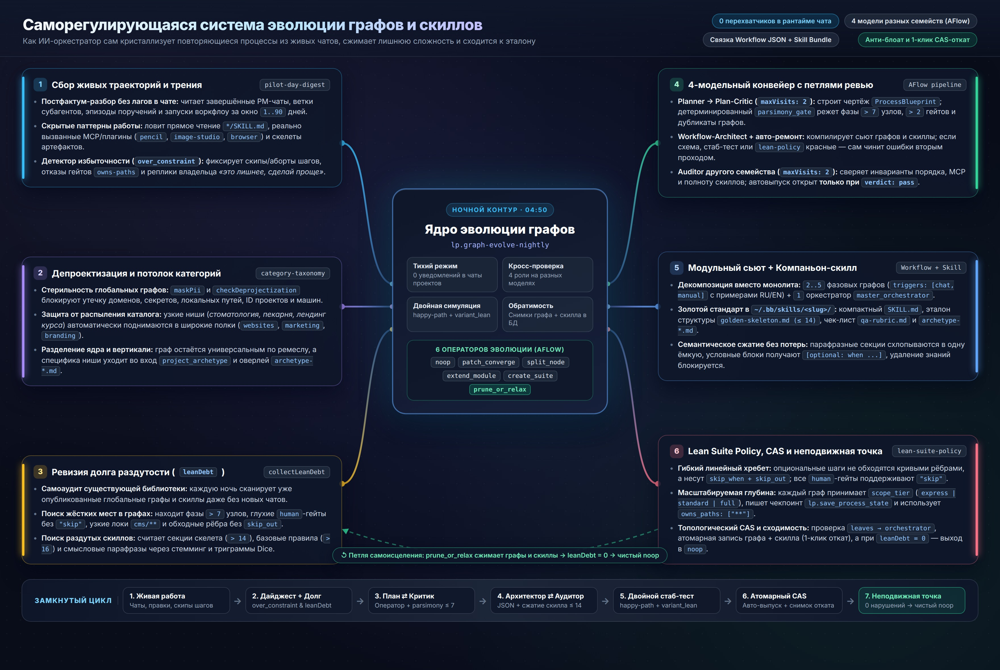
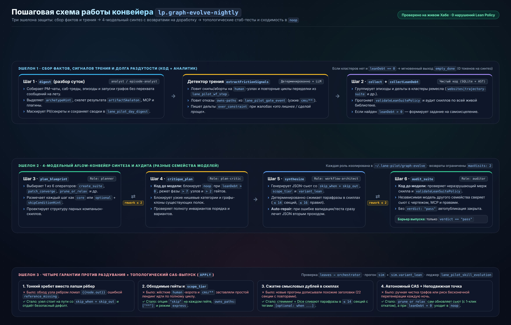
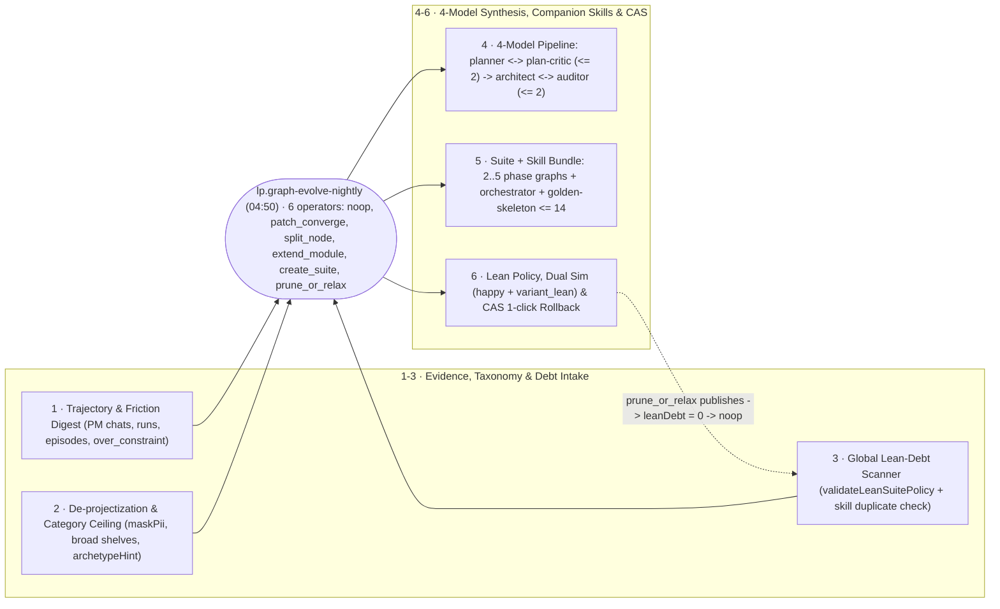
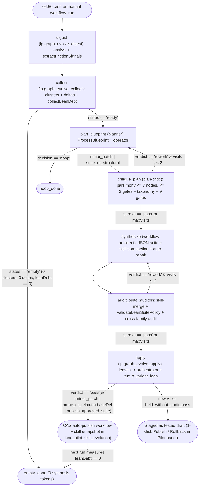

# Trajectory crystallization, skill intent resolution, and nightly workflow evolution

TL;DR: Without live per-message interceptors, `lp.graph-evolve-nightly` begins with autonomous deep trajectory digestion over Pilot runs, unactivated parent chats, child workflow runs, and user workflows (`src/rooms/night-graphs/server/pilot-day-digest.ts:231-389`), extracts friction signals (`extractFrictionSignals`, `src/rooms/night-graphs/friction-signals.ts:102-182`) and vertical `archetypeHint` + `artifactSkeleton` (`src/rooms/night-graphs/server/pilot-day-skeleton.ts:114-215`), writes masked interventions (including `over_constraint`) into `lane_pilot_trajectory_delta` (`src/rooms/errands/trajectory-delta.ts:19-46`, `src/rooms/errands/trajectory-delta.ts:126-192`) and daily summaries into `lane_pilot_day_digest` (`src/rooms/storage/pilot-day-digest-store.ts:296-317`), clusters episodes with `leanDebt` self-regulation (`src/rooms/night-graphs/server/graph-evolve-graph.ts:85-242`), runs a 4-model cross-family AFlow pipeline (`planner` -> `plan-critic` -> `workflow-architect` -> `auditor`) across 6 explicit evolution operators including `prune_or_relax` (`src/rooms/night-graphs/process-blueprint.ts:3-9`, `src/rooms/night-graphs/server/graph-evolve-pipeline.ts:134-374`), enforces a broad-discipline category ceiling (`src/rooms/night-graphs/category-taxonomy.ts:174-233`) and deterministic lean suite policy (`src/rooms/night-graphs/lean-suite-policy.ts:138-278`), semantically compacts and merges paired `Workflow JSON + ~/.bb/skills/<slug>/` Golden-Skeleton bundles (`src/rooms/night-graphs/server/companion-skill-merge.ts:55-114`, `218-350`), requires `auditVerdict === "pass"` before auto-publication (`src/rooms/night-graphs/server/graph-evolve-suite.ts:277`, `295-298`), and tracks coupled skill/workflow mutations in `lane_pilot_skill_evolution` (`src/rooms/storage/skill-evolution-store.ts:156-277`) for 1-click publish and rollback in the Pilot panel (`src/rooms/pilot-panel/server/workflow-drafts.ts:159-246`).

## System map & self-regulation loop

### Architectural mindmap (6 pillars around `lp.graph-evolve-nightly`)

### Node-by-node execution & fixed-point convergence (`workflows/lp.graph-evolve-nightly.json`)

## How it works

1. **Resolve skill intent and record actual skill usage**: `hasExplicitSkillIntent` detects RU/EN skill-request phrasing via `EXPLICIT_INTENT_RE` (`src/rooms/errands/skill-intent.ts:61-116`), and `resolveSkillIntent` ranks catalog entries by normalized name hits, `stems` from `@lane-pilot/workflow-engine`, and `SKILL_DOMAIN_SYNONYMS` across `copywriting`, `seo`, `design`, `qa`, and `architecture` (`src/rooms/errands/skill-intent.ts:29-51`, `src/rooms/errands/skill-intent.ts:122-208`). During episode enrichment, `episodeSkills` combines offered skills with un-offered skills discovered via `skillReadsOf` (`*/SKILL.md` file reads) and `directSkillCallsOf` (`skill` tool calls), emitting `{ name, offered: false, read, used }` (`src/rooms/errands/episode-enrich.ts:123-182`).
2. **Capture masked trajectory deltas (including `over_constraint`)**: `recordTrajectoryDelta` validates `TRAJECTORY_INTERVENTION_KINDS` (`skill_request`, `rule_added`, `step_inserted`, `reference_branch`, `variant_selected`, `over_constraint`, `src/rooms/errands/trajectory-delta.ts:19-26`), passes `rawSummary` through `redactKnown`, `scrubQuote`, and `maskPii`, resolves explicit skills, and executes `INSERT OR IGNORE` into the append-only table `lane_pilot_trajectory_delta` (`src/rooms/errands/trajectory-delta.ts:126-192`, upgraded with `over_constraint` CHECK constraint at `src/rooms/migrations.ts:855-875`).
3. **Deep trajectory digestion & friction extraction (`lp.graph_evolve_digest`)**: Every day at `50 4 * * *` (`GRAPH_EVOLVE_CRON`), `mountGraphEvolveNightly` triggers `lp.graph-evolve-nightly` under daily idempotency key `wfTerminalByIdemKey` (`src/rooms/night-graphs/server/graph-evolve-graph.ts:19-21`, `451-464`); manual `workflow_run` calls also accept `project_id`, `lookback_days` (`1..90`), and `publish_approved_suite` (`workflows/lp.graph-evolve-nightly.json:33-49`, `src/rooms/night-graphs/server/graph-evolve-graph.ts:327-335`). `digestPilotDayDialogues` (`src/rooms/night-graphs/server/pilot-day-digest.ts:231-389`) invokes `listPilotDayCandidates` (`src/rooms/storage/pilot-day-digest-store.ts:206-293`, re-exported via `src/rooms/storage/analytics-store.ts:166-171`) with optional `projectId` filtering over `DEFAULT_WINDOW_MS` × `lookbackDays` (`src/rooms/night-graphs/server/pilot-day-digest.ts:61`, `233-236`) to gather:
   - `lane_pilot_run` PM threads with `lane_pilot_task`, `lane_pilot_attempt`, and `lane_pilot_stage_receipt` records (`src/rooms/storage/pilot-day-digest-store.ts:216-242`).
   - Pilot-activated chats (`lane_pilot_activation`, `lane_pilot_pm_notice`) as well as unactivated parent chats discovered from `lane_pilot_wf_run` child triggers (`errand`, `specialist`, `web-research`, `research-dossier`, `browser-step`, `seo-*`, `sp.*`/`sp-*` via `CHILD_WF_FILTER` at `src/rooms/storage/pilot-day-digest-store.ts:49`, `245-266`).
   - Completed non-errand user `lane_pilot_wf_run` (`WF_RUN_TABLE`) runs (`src/rooms/storage/pilot-day-digest-store.ts:269-287`).
   `attachTrajectoryFacts` (`src/rooms/storage/pilot-day-digest-store.ts:130-203`) joins enriched child `episodes`, `childRuns`, `lane_pilot_gate_event` `owns-paths` rejections (`173-182`), and `listRunStepFrictionFacts` step skip/abort/rework/failure facts (`186-200`, `packages/workflow-engine/src/journal.ts:579-595`). `digestPilotDayDialogues` runs `extractFrictionSignals` (`src/rooms/night-graphs/server/pilot-day-digest.ts:279-282`, `src/rooms/night-graphs/friction-signals.ts:102-182`), merges `judgedCorrectionRows`, reads parent and up to 5 child thread outlines/events, extracts observed MCP servers (`metamcp`, `pencil`, `gitnexus`, `blender`) and BB plugins (`image-studio`, `browser-automation`, `env-catalog`) via `detectIntegrations` (`src/rooms/night-graphs/server/pilot-day-digest.ts:141-165`), masks all text via `maskText` (`68-69`), selects `analyst` when `richness >= 2` or `episode-analyst` otherwise (`311-312`), normalizes `categoryHint`, `archetypeHint`, and `artifactSkeleton` (`115-122`, `src/rooms/night-graphs/server/pilot-day-skeleton.ts:114-215`), persists both model-emitted and deterministically extracted `over_constraint` deltas (`319-350`), and stores daily summaries in `lane_pilot_day_digest` via `savePilotDayDigest` (`src/rooms/storage/pilot-day-digest-store.ts:296-317`).
4. **Cluster evidence & detect `leanDebt` (`lp.graph_evolve_collect`)**: `collectGraphEvolveEvidence` (`src/rooms/night-graphs/server/graph-evolve-graph.ts:120-255`) combines unprocessed deltas from `listUnprocessedTrajectoryDeltas`, enriched errand episodes, and `listPilotDayDigests` (promoting multi-task or delta-backed `pilot_run` items via `richPilotRun` at line `181`) while carrying `artifactSkeletons` and `archetypeHints` per cluster. Exact `processKey` clusters reaching `minCluster` or `richPilotRun` advance directly; remaining singletons are bucketed by `domainFamilyOf` into `${fam}|trajectory-suite` or `${dominant}|project-trajectory` (`50-58`, `198-221`). Simultaneously, `classifyGlobalWorkflowOwnership` and `collectLeanDebt` (`73-117`) scan evolution-managed global workflows via `validateLeanSuitePolicy` and companion skills via `readExistingCompanionSkills` (`MAX_GOLDEN_SKELETON_SECTIONS` / `hasSemanticDuplicates`), attaching `overConstraintCount`, `frictionSignals`, and `leanViolations` onto matching clusters or emitting synthetic `${debt.catId}|lean-self-regulation` clusters (`224-254`).
5. **Run the 4-model cross-family evolution pipeline (`planner` -> `plan-critic` -> `workflow-architect` -> `auditor`)**: When `collect.status` is not `'empty'`, `lp.graph-evolve-nightly` runs `plan_blueprint` (`lp.graph_evolve_plan`), short-circuits to `noop_done` when `decision == 'noop'`, or loops through `critique_plan` (`lp.graph_evolve_critique`, up to `visits('plan_blueprint') < 2`), `synthesize` (`lp.graph_evolve_synthesize`, with an automatic schema/lean-policy repair pass at `src/rooms/night-graphs/server/graph-evolve-graph.ts:399-409`), `audit_suite` (`lp.graph_evolve_audit`, up to `visits('synthesize') < 2`), and `apply` (`workflows/lp.graph-evolve-nightly.json:62-281`). Each role runs in `$HOME/.lane-pilot/graph-evolve` via `createLiveEvolveRoleRunner` + `resolveSpawnModel` (`src/rooms/night-graphs/server/graph-evolve-pipeline.ts:88-131`), with prompts modularized in `src/rooms/night-graphs/server/graph-evolve-prompts.ts:9-146`:
   - `planEvolutionBlueprint` (`planner`): emits a de-projectized `NormalizedProcessBlueprint` specifying one of the 6 AFlow operators (`operator`), `supersededWorkflowIds`, `orderInvariants`, `variantParameters`, `requiredIntegrations`, connected `phase_graph` (with `necessity: "core" | "optional"`, `skipConditionHint`, `standaloneChat`) + `master_orchestrator` specs, and paired `companionSkills` (`src/rooms/night-graphs/process-blueprint.ts:3-69`, `src/rooms/night-graphs/server/graph-evolve-pipeline.ts:134-154`).
   - `critiqueEvolutionBlueprint` (`plan-critic`): runs deterministic parsimony (`<= 7` executable stages, `<= 2` human gates, `hasLeanPressure` anti-`noop` check), category-ceiling, anti-clone, and `artifactSkeletons -> companionSkills` gates before auditing all 9 hard gates (`src/rooms/night-graphs/server/graph-evolve-pipeline.ts:184-247`, `src/rooms/night-graphs/server/graph-evolve-prompts.ts:54-77`).
   - `synthesizeSuiteAndSkillsFromBlueprint` (`workflow-architect`): compiles `ProcessBlueprint` into `GraphEvolveCandidate[]` JSON using `LEAN_PATTERNS_GUIDE` (`src/rooms/night-graphs/server/graph-evolve-prompts.ts:9-18`) and deterministically compacts/renders `CompanionSkillCandidate[]` bundles (`compileCompanionSkills` + `attachSkillsToWorkflowCandidates`, `src/rooms/night-graphs/server/graph-evolve-pipeline.ts:249-343`).
   - `auditSynthesizedSuite` (`auditor`): enforces deterministic `lintAndVerifyCompanionSkill` (`358-364`) and `validateLeanSuitePolicy` (`365-371`) gates before cross-family audit (`372-374`).
6. **Two-pass topological `subworkflow` validation, lean policy gate, paired skill/workflow CAS publication, and strict auditor gate**:
   - `topologicalSortSuite` orders candidates `leaves -> orchestrator` via `extractSubworkflowRefs` and isolates `subworkflow_cycle` graphs (`src/rooms/night-graphs/server/graph-evolve-suite.ts:75-151`).
   - `validateEvolveSuiteCandidates` (`204-259`) and `applyGraphEvolveCandidates` (`262-470`) run Pass-1 structure parsing, propagate `dependency_failed:<child>` atomically (`326-327`), enforce `checkDeprojectization` (`src/rooms/night-graphs/deprojectize.ts:80-119`), enforce `evalLeanPolicy` / `validateLeanSuitePolicy` (`src/rooms/night-graphs/server/graph-evolve-suite.ts:177-187`, `338-343`), perform Pass-2 `loadWorkflow` resolution, and execute `runDraftTest` across both `sim` and `sim.variant_lean` (`349-358`, `packages/workflow-engine/src/draft-test.ts:72-95`).
   - `classifyEvolutionDiff` marks topology, permission, breaking-input, skill-removal, `category_changed`, or `new_v1` changes as `structural_or_new`, while keeping skill additions, copy/check refinements, optional inputs, `skip_when_added`, `human_skip_enabled`, and `owns_paths_generalized` as `minor_patch` (`src/rooms/night-graphs/deprojectize.ts:42`, `131-229`).
   - Strict auditor gate: auto-publication (`minor_patch` with `baseDef`, `prune_or_relax` on an existing `baseDef`, or `publish_approved_suite: true`) requires `auditVerdict === "pass"` (`auditPassed` at `src/rooms/night-graphs/server/graph-evolve-suite.ts:277`, `295-298`); otherwise candidates are held as `tested` (`held_without_audit_pass`).
   - Matched companion skills are staged into `lane_pilot_skill_evolution` (`stageCompanionSkillsForDraft`, `src/rooms/night-graphs/server/companion-skill-evolve.ts:127-160`). On publication, workflows are CAS-written via `casWriteWorkflowFile`, paired companion skills are CAS-written via `publishMatchedSkillsOrRollbackWf` (`281-292`), obsolete narrow global workflows in `supersededWorkflowIds` are snapshotted and retired via `retireSupersededWorkflows` (`164-190`), `createStatusResolver.recordTest` stamps test receipts, and `recordPublishedSkillEvolutionEvents` flushes immutable `published` ledger rows (`295-329`, `src/rooms/night-graphs/server/graph-evolve-suite.ts:387-469`). Structural/new drafts without `publishApprovedSuite` (or held by the auditor gate) remain `status: "tested"` and post a `workflow_draft_proposed` owner item (`435-447`).
7. **Persist process state and operate from Pilot panel**: `.agents/pilot/process-state.json` is validated by `pilotProcessStateSchema` and updated via `readPilotProcessStateCas` / `writePilotProcessStateCas` (`src/rooms/pilot-panel/process-state.ts:3-19`, `86-159`), with `formatProcessStatePromptLine` projecting the stage and approved baseline into prompt lines (`161-172`). `PilotProcessStateSection` and `PilotWorkflowDraftsSection` render the checkpoint and evolution drafts in the right panel (`src/rooms/pilot-panel/ui/process-state-section.tsx:5-65`, `src/rooms/pilot-panel/ui/workflow-drafts-section.tsx:21-96`), backed by coupled `pilot_panel_publish_workflow_draft` and `pilot_panel_rollback_workflow_draft` (`src/rooms/pilot-panel/server/rpc.ts:73-76`, `src/rooms/pilot-panel/server/workflow-drafts.ts:159-246`).

## Closed-loop self-regulation (`over_constraint` / `leanDebt` convergence)

Evolution 2.1 treats workflow bloat, rigid human gates, narrow path locks, and duplicated skill sections as first-class evolution pressure rather than waiting for manual fixes:

1. **Friction capture (`extractFrictionSignals`)**: `listRunStepFrictionFacts` (`packages/workflow-engine/src/journal.ts:579-595`) and `attachTrajectoryFacts` (`src/rooms/storage/pilot-day-digest-store.ts:171-202`) feed step skips/aborts/repeated reworks and `owns-paths` rejections into `extractFrictionSignals` (`src/rooms/night-graphs/friction-signals.ts:102-182`), which combines them with bilingual RU/EN simplification patterns (`hasOverConstraintPhrase`, lines `53-99`) into deduplicated `FrictionSignal` items (`human_gate_bypass_or_abort`, `owns_paths_rejection`, `step_skipped_or_failed`, `user_simplification_request`). `digestPilotDayDialogues` records both model-detected and deterministic `over_constraint` rows in `lane_pilot_trajectory_delta` (`src/rooms/night-graphs/server/pilot-day-digest.ts:319-350`).
2. **Global catalog debt scan (`collectLeanDebt` & `classifyGlobalWorkflowOwnership`)**: Before planning, `classifyGlobalWorkflowOwnership` (`src/rooms/night-graphs/server/graph-evolve-graph.ts:73-82`, `277`, `296`) excludes all built-in shipped graphs (`origin === "builtin"`) and any human-authored global workflow (`lane_pilot_wf_draft.thread_id IS NOT NULL` without an evolution draft, which is also added to `reservedBuiltinIds`), while `collectLeanDebt` (`src/rooms/night-graphs/server/graph-evolve-graph.ts:96-117`) checks evolution-managed global workflows with `validateLeanSuitePolicy` and companion skills with `readExistingCompanionSkills` (`src/rooms/night-graphs/server/companion-skill-evolve.ts:48-67`, checking `sectionCount > 14`, `coreRuleCount > 16`, or `compactSemanticItems(...).collapsedCount > 0`). Any nonzero `leanDebtCount` prevents `noop` and routes debt into matching domain clusters or synthetic `${debt.catId}|lean-self-regulation` clusters (`src/rooms/night-graphs/server/graph-evolve-graph.ts:224-254`).
3. **Deterministic policy enforcement & fixed-point convergence**: `critiqueEvolutionBlueprint` (`src/rooms/night-graphs/server/graph-evolve-pipeline.ts:191-214`) rejects `noop` when `hasLeanPressure` holds and blocks >7 executable stages or >2 human gates per `phase_graph`. Once synthesized, `auditSynthesizedSuite` (`src/rooms/night-graphs/server/graph-evolve-pipeline.ts:365-371`) and `applyGraphEvolveCandidates` / `evalLeanPolicy` (`src/rooms/night-graphs/server/graph-evolve-suite.ts:262-343`) enforce `validateLeanSuitePolicy`, auto-publishing `prune_or_relax` updates when `baseDef` exists and `auditVerdict === "pass"` (`295-298`, `420-434`). After deltas are marked processed and the lean suite/compacted skill publishes to disk, subsequent runs measure `leanDebtCount === 0` and `overConstraintDeltas === 0`, converging cleanly to `noop`.

## Lean suite policy (`lean-suite-policy.ts`)

`validateLeanSuitePolicy` (`src/rooms/night-graphs/lean-suite-policy.ts:138-278`) enforces deterministic structural flexibility across all synthesized or self-regulated suites:

| Rule / Constant | Contract enforced | Violation Code(s) | Source |
|---|---|---|---|
| `MAX_PHASE_GRAPH_EXECUTABLE_NODES = 7` | At most 7 work nodes per `phase_graph` (excluding `note`, `emit`, `lp.save_process_state`) | `node_budget_exceeded` | `src/rooms/night-graphs/lean-suite-policy.ts:5`, `48-49`, `160-162` |
| `MAX_PHASE_GRAPH_HUMAN_GATES = 2` | At most 2 `human` gates per `phase_graph` | `human_gate_budget_exceeded` | `src/rooms/night-graphs/lean-suite-policy.ts:6`, `163-165` |
| Bypassable `human` gates | `options` includes `"skip"`, `out.answer_kind` allows `"skip"`, and outgoing edges allow `skip` (`whenAllowsSkip`) | `human_gate_not_skippable` | `src/rooms/night-graphs/lean-suite-policy.ts:96-109`, `166-172` |
| Optional stages (`skip_when` + `skip_out`) | Stages marked `necessity: "optional"`, matching `OPTIONAL_STAGE_ID_RE`, or reading `OPTIONAL_FEATURE_INPUTS` (`legacy_domain`, `content_factory_endpoint`, `identity_profile`, `semantic_core_artifact`) must declare `skip_when` and complete `valueSpecOf`-valid `skip_out` literals (multi-word strings wrapped in `'...'`) | `optional_stage_not_skippable`, `invalid_skip_out_literal` | `src/rooms/night-graphs/lean-suite-policy.ts:7-15`, `173-206` |
| No bypassed producers | If node `A` reads `{{B.field}}`, `B` must stay on every path to `A` with `skip_when` + `skip_out` (never bypassed via `canReachWithout(entry, A, B)`) | `bypassed_producer_without_skip_out` | `src/rooms/night-graphs/lean-suite-policy.ts:121-133`, `207-216` |
| Stack-neutral global `lp-task` | Global `lp-task` nodes cannot lock `owns_paths` to `NARROW_PREFIXES` (`cms/`, `src/collections/`, `payload`, `strapi/`, `migrations/`, etc.) without `"**"` | `narrow_framework_owns_paths` | `src/rooms/night-graphs/lean-suite-policy.ts:14`, `218-225` |
| `scope_tier` & forwarding | Every workflow declares optional `scope_tier` (`express\|standard\|full`, default `"standard"`), and `master_orchestrator` `subworkflow` nodes forward `scope_tier` | `missing_scope_tier` | `src/rooms/night-graphs/lean-suite-policy.ts:226-239` |
| Dual simulation (`variant_lean`) | `test.sim.variant_lean` runs with `input.scope_tier: "express"`, `"skip"` on every intermediate human gate, and `expect_status: "succeeded"` | `missing_variant_lean_test` | `src/rooms/night-graphs/lean-suite-policy.ts:240-257` |
| Chat routing & checkpoint | User-facing workflows declare `triggers: ["chat", "manual"]`, `>= 2` EN/RU `examples`, `>= 2` `not_for` entries, and an `lp.save_process_state` action node | `missing_chat_routing_metadata`, `missing_or_invalid_process_state_checkpoint` | `src/rooms/night-graphs/lean-suite-policy.ts:258-274` |

## Ontological discipline ceiling vs archetype hints

Evolution 2.0/2.1 enforces a strict separation between **universal craft categories** (top-level workflow shelves and reusable suites) and **vertical/domain subtypes** (parameterized inputs and modular skill overlays):

- **Digest-time vertical lifting**: `BROAD_CRAFT_CATEGORIES` defines the broad discipline shelves (`websites`, `branding`, `marketing`, `content`, `analytics`, `operations`, plus built-in shelves), while `EXACT_VERTICAL_LIFTS` and `liftNarrowCategory` inside `normalizeCategoryAndArchetype` automatically lift narrow vertical tags up to their parent discipline and record the subtype in `archetypeHint` (`src/rooms/night-graphs/server/pilot-day-skeleton.ts:40-151`).
- **De-projectization & taxonomy ceiling**: `category-taxonomy.ts` defines `BROAD_DYNAMIC_CATEGORIES` (`websites`, `branding`, `marketing`, `content`, `analytics`, `operations`, `media`, `src/rooms/night-graphs/category-taxonomy.ts:13-21`), `isAllowedBroadCategoryId` (`140-146`), and `validateCategoryAndIdentityGeneralization` (`174-233`). Any workflow category, ID, or localized title matching `NICHE_SLUG_PATTERNS` or `NICHE_TEXT_PATTERNS` raises `niche_category_violation` or `niche_workflow_identity` via `validateCategoryAndIdentityGeneralization`, failing both `critiqueEvolutionBlueprint` (`src/rooms/night-graphs/server/graph-evolve-pipeline.ts:184-230`) and `checkDeprojectization` (`src/rooms/night-graphs/deprojectize.ts:80-119`).
- **Archetype & deliverable skeleton extraction**: `normalizeArtifactSkeleton` extracts de-projectized `deliverableClass`, ordered `sections` (`>= 2`), `matrices`, and `qaChecks` (`src/rooms/night-graphs/server/pilot-day-skeleton.ts:184-215`) into `lane_pilot_day_digest` (`src/rooms/storage/pilot-day-digest-store.ts:78-91`, `296-308`), feeding `artifactSkeletons` and `archetypeHints` into `collectGraphEvolveEvidence` (`src/rooms/night-graphs/server/graph-evolve-graph.ts:145-156`, `225`, `234`) and `references/archetype-<slug>.md` overlays.

## Six explicit evolution operators (`ProcessBlueprint.operator`)

`EVOLUTION_OPERATORS`, `normalizeBlueprint`, and `resolveBlueprintOperator` (`src/rooms/night-graphs/process-blueprint.ts:77-84`, `src/rooms/night-graphs/process-blueprint.ts:209-263`) normalize legacy and explicit blueprints onto six AFlow evolution operators prompted by `buildPlannerPrompt` (`src/rooms/night-graphs/server/graph-evolve-prompts.ts:20-52`):

| Operator | Decision mapping | Intended behavior & gates | Source |
|---|---|---|---|
| `noop` | `decision: "noop"` | Drops noisy/covered clusters with zero graphs or skills; blocked by `critiqueEvolutionBlueprint` when rich clusters or `hasLeanPressure` exist | `src/rooms/night-graphs/process-blueprint.ts:232`, `src/rooms/night-graphs/server/graph-evolve-pipeline.ts:197-200`, `216-218` |
| `patch_converge` | `minor_patch` (no retired IDs) or `suite_or_structural` | Converges an existing global suite (`vN -> vN+1`) and companion skill (`merge_core_and_overlay`) across domains; retires obsolete narrow workflows in `supersededWorkflowIds` via `retireSupersededWorkflows` | `src/rooms/night-graphs/process-blueprint.ts:233-235`, `src/rooms/night-graphs/server/companion-skill-evolve.ts:164-190` |
| `split_node` | `suite_or_structural` | Decomposes an overloaded stage with recurring traps/retries into sequential stages plus a critic/human gate while keeping external inputs compatible | `src/rooms/night-graphs/server/graph-evolve-prompts.ts:36` |
| `extend_module` | `suite_or_structural` | Adds a distinct modular deliverable workflow and companion skill (e.g., `Brandbook` next to `UI Kit`) with optional handoff inputs | `src/rooms/night-graphs/server/graph-evolve-prompts.ts:37` |
| `create_suite` | `suite_or_structural` | Crystallizes `2..5` `phase_graph` nodes + `1` `master_orchestrator` + `create_bundle` skills; blocked by the anti-clone gate in `critiqueEvolutionBlueprint` if `existingGlobal` already covers the same category without `supersededWorkflowIds` | `src/rooms/night-graphs/server/graph-evolve-prompts.ts:38`, `src/rooms/night-graphs/server/graph-evolve-pipeline.ts:231-236` |
| `prune_or_relax` | `minor_patch` or `suite_or_structural` | Self-regulates existing global workflows & companion skills when `overConstraintCount > 0`, `leanViolations`, or bloated/duplicated skills exist: converts niche stages to `skip_when` + `skip_out`, makes human gates skippable, relaxes `owns_paths` to `["**"]`, compacts duplicate skill sections, and auto-publishes existing workflows on `auditVerdict === "pass"` | `src/rooms/night-graphs/process-blueprint.ts:9`, `233-235`, `src/rooms/night-graphs/server/graph-evolve-suite.ts:295-298`, `461-463` |

## Paired `Workflow JSON + ~/.bb/skills/<slug>/` crystallization & semantic compaction

- **Bounded CAS skill bundle contract (`skill-files.ts`)**: Companion skills live in `globalSkillsDir()` (`~/.bb/skills/<skillId>/`, `packages/workflow-engine/src/skill-files.ts:173-190`) and strictly allow `SKILL.md` (`< 8,192` UTF-8 bytes via `SKILL_MD_MAX_BYTES` and `<= 500` lines via `SKILL_MD_MAX_LINES`) plus 1-level `references/golden-skeleton.md`, `references/qa-rubric.md`, and `references/archetype-<slug>.md` (`<= 32,768` bytes each via `SKILL_REF_MAX_BYTES`, `packages/workflow-engine/src/skill-files.ts:9-13`, `198-227`). All reads/writes reject symlinks (`assertNotSymlink`), compute deterministic digests (`computeSkillBundleSha256`), and write atomically via `casWriteSkillBundle` and `restoreSkillBundleSnapshot` (`packages/workflow-engine/src/skill-files.ts:54-73`, `230-314`).
- **Semantic compaction & `[optional: when ...]` skeleton markers (`companion-skill-merge.ts`)**: `isSameSkillTopic` (`src/rooms/night-graphs/server/companion-skill-merge.ts:55-69`) uses `stems`, `grams`, and `dice` from `packages/workflow-engine/src/router.ts:113-124` (combining Szymkiewicz–Simpson stem containment `>= 0.8` after stripping `WEAK_STEMS` with trigram Dice similarity `>= 0.62`) so paraphrased duplicates across runs merge into a single richer heading/rule instead of proliferating. `compactSemanticItems` + `coalesceBestPair` (`71-114`) enforce `MAX_GOLDEN_SKELETON_SECTIONS` (`14`, line `15`) and `MAX_CORE_RULES` (`16`, line `16`), while `parseOptionalTag` (`28-34`) and `renderGoldenSkeleton` (`161-175`) preserve `[optional: when <condition>]` markers on conditional deliverable sections.
- **Non-destructive merge & skill lint gate**: `renderCompanionSkillBundle` (`218-258`) merges `merge_core_and_overlay` updates additively and logs `semantic_compacted` when items collapse (`235-241`). `verifyNonDestructiveSkillMerge` (`278-304`) checks exact matches, `isSameSkillTopic` equivalence, and `;`-coalesced titles (`270-272`) to block `missing_golden_section`, `missing_qa_check`, and `dropped_archetype_overlay` regressions, while `lintAndVerifyCompanionSkill` (`307-350`) enforces `validateSkillBundleFiles`, `lintSkillDir` (`src/rooms/forge/skill-lint.ts:94`), no nested `references/` links, and `checkDeprojectization`.
- **Coupled ledger & 1-click publish/rollback (`lane_pilot_skill_evolution`)**: `lane_pilot_skill_evolution` (`src/rooms/migrations.ts:834-854`) is an append-only SQLite ledger recording `staged`, `published`, and `rolled_back` snapshots (`candidateFiles`, `beforeFiles`, `beforeBundleSha256`, `afterBundleSha256`, `supersededWorkflowIds`, `supersededSnapshots`) via `appendSkillEvolutionEvent` (`src/rooms/storage/skill-evolution-store.ts:156-197`). When an owner clicks **Publish** (`publishPanelWorkflowDraft`) or **Rollback** (`rollbackPanelWorkflowDraft`), `src/rooms/pilot-panel/server/workflow-drafts.ts:159-246` atomically publishes or restores both the workflow draft and its coupled `~/.bb/skills/<slug>/` bundle (plus any retired workflow snapshots via `casWriteWorkflowFile`) in one operation.

## Trajectory crystallization, daily digestion, and skill intent

| Component | Responsibility | Source |
|---|---|---|
| `resolveSkillIntent` | Bilingual RU/EN stem and domain-synonym scoring against catalog items | `src/rooms/errands/skill-intent.ts:122-208` |
| `hasExplicitSkillIntent` | Detects explicit owner instructions to apply skills or rules via `EXPLICIT_INTENT_RE` | `src/rooms/errands/skill-intent.ts:61-116` |
| `episodeSkills` | Tracks `{ offered, read, used }` including un-offered `SKILL.md` reads | `src/rooms/errands/episode-enrich.ts:161-182` |
| `recordTrajectoryDelta` | Masks and deduplicates chat/run interventions (including `over_constraint`) in `lane_pilot_trajectory_delta` | `src/rooms/errands/trajectory-delta.ts:126-192` |
| `listUnprocessedTrajectoryDeltas` | Feeds unconsumed owner-accepted deltas to the nightly collector | `src/rooms/errands/trajectory-delta.ts:195-215` |
| `extractFrictionSignals` / `listRunStepFrictionFacts` | Detects human gate skip/abort/rework, narrow `owns-paths` rejections, step skip/fail, and RU/EN simplification requests | `src/rooms/night-graphs/friction-signals.ts:102-182`, `packages/workflow-engine/src/journal.ts:579-595` |
| `listPilotDayCandidates` / `attachTrajectoryFacts` | Queries `lane_pilot_run`, Pilot/child-triggered chats, and user workflows; attaches `episodes`, `childRuns`, `gateRejections`, and `wfStepSignals` | `src/rooms/storage/pilot-day-digest-store.ts:130-293` |
| `normalizeCategoryAndArchetype` / `normalizeArtifactSkeleton` | Lifts narrow verticals to broad categories, extracts `archetypeHint`, and sanitizes `artifactSkeleton` | `src/rooms/night-graphs/server/pilot-day-skeleton.ts:114-215` |
| `digestPilotDayDialogues` | Extracts MCP/plugins (`detectIntegrations`), runs `extractFrictionSignals`, picks `analyst` vs `episode-analyst`, writes deltas and `lane_pilot_day_digest` | `src/rooms/night-graphs/server/pilot-day-digest.ts:141-389` |
| `savePilotDayDigest` / `listPilotDayDigests` | Idempotently stores daily digests (with `artifact_skeleton_json` + `archetype_hint`) and supplies 14-day summaries to `collectGraphEvolveEvidence` | `src/rooms/storage/pilot-day-digest-store.ts:296-326` |

## 4-model pipeline, topological suite gate, and publication (`lp.graph-evolve-nightly`)

`lp.graph-evolve-nightly` (`src/rooms/workflow/builtin.ts:54`, `src/rooms/workflow/builtin.ts:195`) wires `digest` -> `collect` -> `plan_blueprint` -> `critique_plan` -> `synthesize` -> `audit_suite` -> `apply` -> `done`, with `empty_done` when `collect.status == 'empty'`, `noop_done` when `plan_blueprint.decision == 'noop'`, and bounded `maxVisits: 2` rework loops at `critique_plan -> plan_blueprint` and `audit_suite -> synthesize` (`workflows/lp.graph-evolve-nightly.json:62-281`).

| Gate / Pipeline Stage | Outcome | Source |
|---|---|---|
| `collectLeanDebt` / `collectGraphEvolveEvidence` | Computes `leanDebtCount` on evolution-managed global workflows, attaches `overConstraintCount`/`frictionSignals`/`leanViolations`, or emits `${catId}\|lean-self-regulation` | `src/rooms/night-graphs/server/graph-evolve-graph.ts:73-117`, `224-255` |
| `planEvolutionBlueprint` / `critiqueEvolutionBlueprint` | Produces de-projectized `NormalizedProcessBlueprint` (6 operators + `companionSkills`) and enforces parsimony, category ceiling, anti-clone, skeleton, and fidelity gates | `src/rooms/night-graphs/server/graph-evolve-pipeline.ts:134-247`, `src/rooms/night-graphs/category-taxonomy.ts:174-233` |
| `synthesizeSuiteAndSkillsFromBlueprint` / `auditSynthesizedSuite` | Compiles `GraphEvolveCandidate[]` + compacted `CompanionSkillCandidate[]` (with repair pass on schema/lean errors), runs `lintAndVerifyCompanionSkill` + `validateLeanSuitePolicy`, and audits blueprint/skill/MCP fidelity | `src/rooms/night-graphs/server/graph-evolve-pipeline.ts:249-374`, `src/rooms/night-graphs/server/graph-evolve-graph.ts:393-409` |
| `topologicalSortSuite` + `dependency_failed` | Resolves `subworkflow` graphs `leaves -> orchestrator`, isolates cycles (`subworkflow_cycle`), propagates child failures to parents | `src/rooms/night-graphs/server/graph-evolve-suite.ts:85-151`, `306-327` |
| `checkDeprojectization` finding (`abs_path`, `project_id`, `host_id`, `project_name_or_domain`, `secret_shape`, `forbidden_grant`, `niche_category_violation`, `niche_workflow_identity`) | Candidate rejected (`rejected_deprojectize`) before draft creation | `src/rooms/night-graphs/deprojectize.ts:5-119`, `src/rooms/night-graphs/server/graph-evolve-suite.ts:328-337` |
| `validateLeanSuitePolicy` (`evalLeanPolicy`) | Enforces node/gate budgets, skippable human/optional stages, linear `skip_when` + `skip_out`, `scope_tier`, `variant_lean`, chat triggers, and `lp.save_process_state` (`rejected_lean_policy`) | `src/rooms/night-graphs/lean-suite-policy.ts:138-278`, `src/rooms/night-graphs/server/graph-evolve-suite.ts:177-187`, `338-343` |
| `loadWorkflow` error or failing `runDraftTest` (`sim` + `variant_lean`) | Candidate rejected (`rejected_invalid` or `rejected_tests`) and blocked from parent resolution | `src/rooms/night-graphs/server/graph-evolve-suite.ts:344-358`, `packages/workflow-engine/src/draft-test.ts:72-95` |
| `minor_patch` with `baseDef`, `prune_or_relax` with `baseDef`, or `publish_approved_suite` when `audit_suite.verdict == 'pass'` | CAS-writes workflow + paired `~/.bb/skills/<slug>/` (`publishMatchedSkillsOrRollbackWf`), retires `supersededWorkflowIds`, stamps `createStatusResolver.recordTest`, logs `lane_pilot_skill_evolution`, posts `workflow_evolved_digest` with 1-click rollback | `src/rooms/night-graphs/server/graph-evolve-suite.ts:277`, `295-298`, `387-469`, `src/rooms/night-graphs/server/companion-skill-evolve.ts:281-329` |
| `structural_or_new`, `v1` without `publish_approved_suite`, or `audit_suite.verdict != 'pass'` (`held_without_audit_pass`) | Stages skill bundle in `lane_pilot_skill_evolution`; draft remains `tested` and posts `workflow_draft_proposed` for owner approval | `src/rooms/night-graphs/server/graph-evolve-suite.ts:297-298`, `377-384`, `435-447` |
| `listEvolutionDrafts`, `previousVersionSnapshot`, `listLatestActivePublishedSkillEvolutionsForDraft` | Powers panel draft listing and coupled workflow + skill + superseded-workflow publish/rollback | `packages/workflow-engine/src/draft-store.ts:215-263`, `src/rooms/storage/skill-evolution-store.ts:231-247`, `src/rooms/pilot-panel/server/workflow-drafts.ts:159-246` |

## Open bilingual dynamic graph categories (`category`)

`workflowSchema` and `normalizeWorkflow` (`packages/workflow-engine/src/schema.ts:23-26`, `275`, `447-450`) accept optional `category` (`slug` or `{ id, label: { en, ru } }`), while `validateWorkflow` (`packages/workflow-engine/src/validate.ts:78-80`) enforces `category_label_required` whenever `category.id` is outside the 9 built-in shelves (`WORKFLOW_CATEGORIES` in `src/rooms/workflow/categories.ts:5`).

- **Autonomous synthesis instead of manual built-in placeholders**: Manual built-in placeholders (such as the former built-in `site-creation` graph) were removed from `BUILTIN_SOURCES` (`src/rooms/workflow/builtin.ts:141-271`) so broad dynamic shelves such as `websites` (`{ id: "websites", label: { en: "Websites & Design", ru: "Сайты и дизайн" } }`) and their multi-graph suites are synthesized and evolved autonomously by `lp.graph-evolve-nightly` from real project trajectories (`src/rooms/night-graphs/server/graph-evolve-graph.ts:198-221`), while vertical differences live in `archetypeHint`, `project_archetype` inputs, and `references/archetype-<slug>.md` overlays.
- **Evolution, de-projectization, and UI/export surface**: `classifyEvolutionDiff` treats a `category.id` change on an existing published graph as `structural_or_new` (`category_changed` in `src/rooms/night-graphs/deprojectize.ts:42`, `222-224`), and `checkDeprojectization` rejects niche or project-specific category slugs/labels (`src/rooms/night-graphs/deprojectize.ts:80-119`, `src/rooms/night-graphs/category-taxonomy.ts:174-233`). Dynamic categories render as dedicated clusters, shelves, and filter chips across `src/rooms/workflow/ui/workflow-map.tsx:47-58` (deterministic `oklch` hues via `dynamicHue` / `catColor`), `176-225`, `550-577`, `src/rooms/workflow/ui/workflow-library-parts.tsx:28-64`, `96-131`, `src/rooms/workflow/ui/workflows.tsx:117-118`, `242`, `266-270`, and `src/rooms/workflow/workflow-export.ts:26-31`, `61-77`, `97-105`.

## Process state checkpoint (`lp.save_process_state`)

Synthesized workflows can checkpoint design/process state via `lp.save_process_state` (`src/rooms/pilot-panel/server/workflow-drafts.ts:248-277`), persisting `approvedDesignBaseline`, `stage`, `rejectedVariants`, and `activeSkills` in `.agents/pilot/process-state.json` via `writePilotProcessStateCas` (`src/rooms/pilot-panel/process-state.ts:86-159`) so downstream build/QA stages read the locked baseline through `formatProcessStatePromptLine` (`src/rooms/pilot-panel/process-state.ts:161-172`).

See [Everything is a graph](guide/graphs.md) for the workflow catalog and [Night policy](night-policy.md) for general night-loop boundaries.
