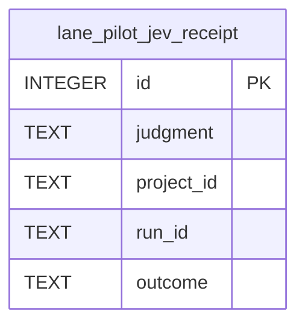

# Jev data model

TL;DR: Jev stores judgment receipts in SQLite and output-guard blocks and daily counters in the plugin key-value store; pages below describe both domains.

## Core entities

The table is created by `jevMigrations` (`packages/jev/src/receipts.ts:9-40`).

Plugin migrations add `fields_json` (`src/rooms/storage/database.ts:444-445`) and `input_json` (`src/rooms/storage/database.ts:480-481`).

The runner inserts a receipt after a cache miss when a DB is attached and the mode is not off (`packages/jev/src/run.ts:79-119`).

Output-guard state uses the `GUARD_BLOCKED_KEY` and `GUARD_STATS_KEY` storage keys (`packages/jev/src/output-guard.ts:17-18`, `packages/jev/src/output-guard.ts:31-35`).

## Domain areas

- [Judgment receipts](data-model/receipts.md): call evidence, sampled relabel input, label transitions, retention and query use cases.
- [Output-guard state](data-model/output-guard.md): blocked-output records and daily counters held in key-value storage.

<!-- lane-pilot:backlinks -->
## Referenced by

- [Output-guard state](data-model/output-guard.md)
- [Judgment receipts](data-model/receipts.md)
- [Jev output guard](features/output-guard.md)
- [Jev receipts, calibration and monitoring](features/receipt-calibration.md)
- [Jev workspace overview](overview.md)
