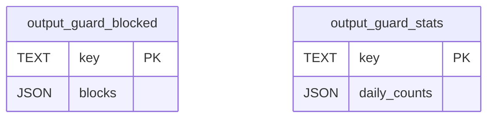

# Output-guard state

TL;DR: The output guard stores blocked-output metadata and per-day counters as JSON values in the plugin key-value store; it does not store withheld text.

## Key-value model

This diagram describes conceptual KV values passed through the injected `kv` dependency; they are not SQLite tables (`packages/jev/src/output-guard.ts:47-51`, `packages/jev/src/output-guard.ts:60-67`).

The keys are `output-guard:blocked` and `output-guard:stats` (`packages/jev/src/output-guard.ts:17-18`, `packages/jev/src/output-guard.ts:31-35`).

## Values and meanings

| Key / field | Meaning | Evidence |
|---|---|---|
| `output-guard:blocked` | Recent blocks retained as an array, at most 50 records | `packages/jev/src/output-guard.ts:17-18`, `packages/jev/src/output-guard.ts:74-96` |
| Block `at` | Unix timestamp in milliseconds when the output was blocked | `packages/jev/src/output-guard.ts:37-39`, `packages/jev/src/output-guard.ts:118-121` |
| Block `kind` | `writer`, `errand` or `browser` output category | `packages/jev/src/judgments/output-guard.ts:13-16` |
| Block `reason` | `secret` or `injection` classification | `packages/jev/src/judgments/output-guard.ts:15-16`, `packages/jev/src/output-guard.ts:117-121` |
| Block `projectId` | Project identifier associated with the output | `packages/jev/src/output-guard.ts:37-39`, `packages/jev/src/output-guard.ts:118` |
| Block `runId` | Run identifier, nullable when no run is attached | `packages/jev/src/output-guard.ts:37-39`, `packages/jev/src/output-guard.ts:118` |
| Block `subject` | Caller subject identifier, nullable | `packages/jev/src/output-guard.ts:37-39`, `packages/jev/src/output-guard.ts:118` |
| Block `receiptId` | Jev receipt ID for the blocking judgment, optional | `packages/jev/src/output-guard.ts:37-39`, `packages/jev/src/output-guard.ts:118` |
| `output-guard:stats` | Map keyed by UTC date, retained for 14 days | `packages/jev/src/output-guard.ts:33-35`, `packages/jev/src/output-guard.ts:57-67` |
| Daily `asked` | Count of outputs submitted to the judgment | `packages/jev/src/output-guard.ts:57-67`, `packages/jev/src/output-guard.ts:114` |
| Daily `notSampled` | Count skipped by shadow sampling | `packages/jev/src/output-guard.ts:57-67`, `packages/jev/src/output-guard.ts:110-112` |
| Daily `sensitive` | Count skipped from shadow judging when `looksSensitive` matches or input changed during redaction | `packages/jev/src/output-guard.ts:24-25`, `packages/jev/src/output-guard.ts:110-112` |

## Lifecycle

| From | To | Function | When |
|---|---|---|---|
| Existing or empty `output-guard:stats` | Updated date bucket | `count` | Asked, skipped or sensitive output increments a counter; older date buckets beyond the 14-day window are removed (`packages/jev/src/output-guard.ts:57-67`, `packages/jev/src/output-guard.ts:110-114`) |
| Existing or empty `output-guard:blocked` | Merged block array, last 50 entries | `appendBlock` | A Jev decision returns `by: "jev"` and `blocked: true` (`packages/jev/src/output-guard.ts:74-96`, `packages/jev/src/output-guard.ts:116-121`) |
| Block array | Read by self-repair watcher | Self-repair scan | New records can become guard incidents; repair handling matches a receipt ID and reason signature (`src/rooms/self-repair/server/self-repair.ts:367-373`, `src/rooms/self-repair/server/verdict.ts:54-59`) |

## Invariants and use cases

- Stored blocks contain metadata and the judgment receipt ID, not the withheld output text (`packages/jev/src/output-guard.ts:37-45`, `packages/jev/src/output-guard.ts:118-121`).
- Block append merges with existing KV data and deduplicates identifiers, but persistence is best-effort; a KV read or write failure leaves the output withheld without overwriting existing blocks with an empty base (`packages/jev/src/output-guard.ts:74-96`).
- The merge protects writes queued by one guard instance; two instances sharing a KV store can still lose a block on overlapping read/append/write operations (`packages/jev/src/output-guard.ts:69-71`).
- The guard writes both keys; self-repair reads the block key to raise incidents and associate resolution outcomes (`packages/jev/src/output-guard.ts:57-67`, `src/rooms/self-repair/server/self-repair.ts:367-373`, `src/rooms/self-repair/server/verdict.ts:54-59`).
- Stats have explicit 14-day pruning; block records are limited to the newest 50 but have no timestamp-based cleanup (`packages/jev/src/output-guard.ts:18`, `packages/jev/src/output-guard.ts:33-35`, `packages/jev/src/output-guard.ts:65`, `packages/jev/src/output-guard.ts:89-90`).

## Related pages

- [Data model overview](../data-model.md)
- [Output guard](../features/output-guard.md)

<!-- lane-pilot:backlinks -->
## Referenced by

- [Jev data model](../data-model.md)
