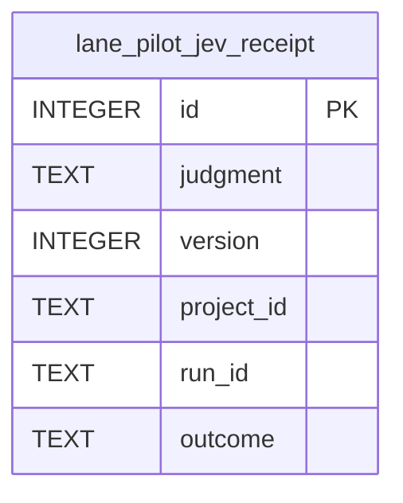

# Judgment receipts

TL;DR: Each row records one uncached, non-off judgment call; labels attach later, and pruning bounds retained receipts by age and count.

## Entity map

`id` is the primary key; indexes support judgment/time, project/time and run lookup (`packages/jev/src/receipts.ts:10-38`).

The plugin appends `fields_json` and `input_json` columns to the base table (`src/rooms/storage/database.ts:444-445`, `src/rooms/storage/database.ts:480-481`).

## Table: `lane_pilot_jev_receipt`

Purpose: a record of model call context and outcome for calibration, auditing and monitoring (`packages/jev/src/receipts.ts:3-7`). The runner stores the redacted state hash and size, not the state text (`packages/jev/src/run.ts:109-119`).

Sampled `input_json` is retained separately for model relabeling (`packages/jev/src/receipts.ts:61-70`).

| Field | Meaning | Evidence |
|---|---|---|
| `id` | Auto-incrementing receipt identifier; also determines the periodic pruning trigger | `packages/jev/src/receipts.ts:10-12`, `packages/jev/src/receipts.ts:81-83` |
| `judgment` | Dotted judgment ID; groups reports and labels by capability | `packages/jev/src/receipts.ts:12`, `packages/jev/src/calibrate.ts:89-103` |
| `version` | Judgment's semantic version; separates receipt cohorts after question/decision changes | `packages/jev/src/receipts.ts:13`, `packages/jev/src/registry.ts:20-27` |
| `model` | Model ID that answered, or null when unavailable | `packages/jev/src/receipts.ts:14`, `packages/jev/src/run.ts:113-114` |
| `mode` | `shadow` or `active`; `off` calls are not written | `packages/jev/src/receipts.ts:15`, `packages/jev/src/run.ts:109-111` |
| `project_id` | Project scope for settings and project-sliced reports | `packages/jev/src/receipts.ts:16`, `packages/jev/src/watch.ts:82-96` |
| `run_id` | Parent run identifier for correlating a judgment call with run activity | `packages/jev/src/receipts.ts:17` |
| `subject` | Caller-provided item identifier within the run, when supplied | `packages/jev/src/receipts.ts:18` |
| `input_sha256` | SHA-256 of the serialized, redacted judgment state | `packages/jev/src/receipts.ts:19` |
| `input_chars` | Character count of serialized state | `packages/jev/src/receipts.ts:20` |
| `questions` | Number of questions in the judgment call | `packages/jev/src/receipts.ts:21` |
| `batch_size` | Number of same-state judgment entries sharing the provider request; default 1 | `packages/jev/src/receipts.ts:22` |
| `status` | `ok`, `disabled`, `timeout`, `error`, `breaker_open`, `budget` or `invalid` | `packages/jev/src/receipts.ts:23`, `packages/jev/src/types.ts:25-30` |
| `answers_json` | Serialized answer summary with values, top probabilities and confidence; not the full state | `packages/jev/src/receipts.ts:24`, `packages/jev/src/receipts.ts:74-80` |
| `decision` | Short judgment decision text, `escalate:<target>`, or null when no decision was produced | `packages/jev/src/receipts.ts:25`, `packages/jev/src/run.ts:135-142` |
| `decided_by` | `jev`, `fallback` or `escalated` | `packages/jev/src/receipts.ts:26` |
| `escalated_to` | Escalation target, otherwise null | `packages/jev/src/receipts.ts:27` |
| `thresholds_json` | Effective thresholds used for the receipt | `packages/jev/src/receipts.ts:28` |
| `latency_ms` | Request latency in milliseconds | `packages/jev/src/receipts.ts:29` |
| `tokens_in`, `tokens_out` | Provider token counts apportioned across grouped judgments; null on failure | `packages/jev/src/receipts.ts:30-31` |
| `outcome` | Later label; common prefixes are `agree` and `disagree`, with suffixes identifying label source | `packages/jev/src/receipts.ts:32`, `packages/jev/src/labels-outcome.ts:5-13`, `packages/jev/src/calibrate.ts:77-83` |
| `outcome_at` | Unix timestamp in milliseconds when the label was written | `packages/jev/src/receipts.ts:33`, `packages/jev/src/receipts.ts:86-88` |
| `at` | Unix timestamp in milliseconds when the receipt was inserted | `packages/jev/src/receipts.ts:34`, `packages/jev/src/receipts.ts:72-80` |
| `fields_json` | Serialized map of top-level state field names to character sizes; no field content | `src/rooms/storage/database.ts:444-445`, `packages/jev/src/receipts.ts:74-80` |
| `input_json` | Redacted original judgment input for a deterministic one-in-five sample, capped at 8 KiB | `src/rooms/storage/database.ts:480-481`, `packages/jev/src/receipts.ts:58-70` |

## Status and label transitions

`status` is assigned once from the provider call result at insertion; this package does not update it afterward (`packages/jev/src/run.ts:109-127`, `packages/jev/src/receipts.ts:72-80`).

| From | To | Function | When |
|---|---|---|---|
| No row | `mode = shadow` or `active` | `createJev` → `insertReceipt` | Non-cached call with DB and non-off mode; mode comes from the resolved judgment setting (`packages/jev/src/run.ts:79-119`) |
| No row | `decided_by = jev`, `fallback` or `escalated` | `createJev` → `insertReceipt` | Set from the returned decision branch (`packages/jev/src/run.ts:79-119`) |
| No row | `status = ok` or a call failure status | `insertReceipt` called from `createJev` | Non-cached call with DB and non-off mode; status is copied from provider result (`packages/jev/src/run.ts:79-127`) |
| `outcome = NULL` | `agree...` or `disagree...` | `recordOutcome` | The receipt label is updated with its timestamp (`packages/jev/src/receipts.ts:86-88`) |
| `outcome = NULL` | `agree:model` or `disagree:model` | Model relabeling workflow plans sampled inputs (`packages/jev/src/labels-model.ts:22-37`) | `recordOutcome` persists a returned label (`packages/jev/src/receipts.ts:86-88`) |

`recordOutcome` itself does not require the prior value to be null (`packages/jev/src/receipts.ts:86-88`). Normal outcome queries select only `outcome IS NULL` rows (`packages/jev/src/labels-outcome.ts:27-30`). Model label planning also selects only `outcome IS NULL` rows (`packages/jev/src/labels-model.ts:29-31`).

## Invariants

- `mode`, `status` and `decided_by` have SQLite check constraints and enumerated values (`packages/jev/src/receipts.ts:15`, `packages/jev/src/receipts.ts:23-26`).
- State content is absent from the base receipt (`packages/jev/src/receipts.ts:3-7`).
- Sampled `input_json` is redacted and may be truncated such that it is not valid JSON (`packages/jev/src/receipts.ts:58-70`).
- A cache hit creates no receipt, and no receipt is written when no database is attached or mode is off (`packages/jev/src/run.ts:109-111`).
- Retention deletes rows older than 30 days and trims to 50,000 rows; insert triggers pruning every hundredth row ID (`packages/jev/src/receipts.ts:55-56`, `packages/jev/src/receipts.ts:81-93`).

## Writers and readers by use case

| Use case | Writers | Readers |
|---|---|---|
| Record an actual judgment call | `createJev` invokes `insertReceipt` (`packages/jev/src/run.ts:79-119`) | Read use cases are listed below |
| Add a known later truth | `recordOutcome` updates a receipt label (`packages/jev/src/receipts.ts:86-88`) | Query use case is listed below |
| Add an independent model label | `planModelLabels` selects sampled input rows (`packages/jev/src/labels-model.ts:22-37`); `recordOutcome` persists the label (`packages/jev/src/receipts.ts:86-88`) | `labelSource` classifies labels (`packages/jev/src/calibrate.ts:77-83`) |
| Retain and prune | Insert path triggers `pruneReceipts` periodically (`packages/jev/src/receipts.ts:81-93`) | Cleanup deletes by age and row bound (`packages/jev/src/receipts.ts:90-93`) |

Reader use cases: `summarizeReceipts` groups receipts for operational summaries (`packages/jev/src/receipts.ts:95-100`).

`calibrateReceipts` reads labeled receipts for threshold calibration (`packages/jev/src/calibrate.ts:89-103`).

`jevWatch` reads judgment and project slices for monitoring (`packages/jev/src/watch.ts:79-96`).

Outcome labeling selects unlabeled rows (`packages/jev/src/labels-outcome.ts:27-30`).

## Related pages

- [Data model overview](../data-model.md)
- [Receipt calibration and monitoring](../features/receipt-calibration.md)

<!-- lane-pilot:backlinks -->
## Referenced by

- [Jev data model](../data-model.md)
