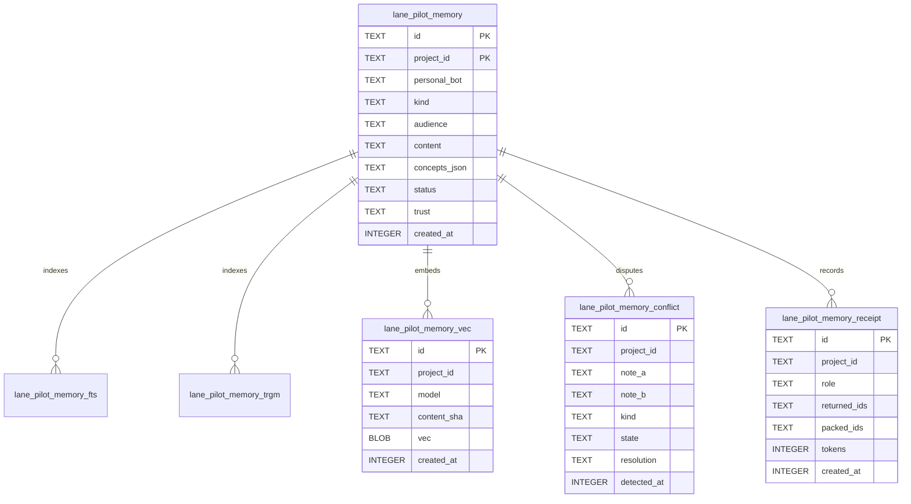

# Memory core data model

TL;DR: Memory core manages SQLite tables for records, virtual FTS5/trigram indexes, vector embeddings, conflict holds, and retrieval receipts.

## Core entities

## Storage architecture

The data model operates entirely in SQLite using `better-sqlite3` bindings (`packages/memory-core/src/store.ts:11-13`). Table responsibilities are partitioned as follows:
- `lane_pilot_memory`: the canonical fact store containing content, status, trust, and metadata (`packages/memory-core/src/store.ts:15-20`).
- `lane_pilot_memory_fts` & `lane_pilot_memory_trgm`: virtual FTS5 tables maintaining full-text BM25 word tokens and 3-character substrings (`packages/memory-core/src/store.ts:17, 67, 85-86`).
- `lane_pilot_memory_vec`: stores 768-dimensional (`EMBED_DIM` in `packages/memory-core/src/vectors.ts:14`) `Float32Array` embeddings for dense vector cosine similarity searches, indexed by `memory_vec_project` (`packages/memory-core/src/vectors.ts:24-27`).
- `lane_pilot_memory_conflict`: holds conflicting pairs of notes, suppressing them from retrieval until an operator resolves the dispute (`packages/memory-core/src/conflict-store.ts:17-34`).
- `lane_pilot_memory_receipt`: captures an append-only audit trail of retrieved note IDs and token counts delivered to agent roles (`packages/memory-core/src/lifecycle.ts:100-105`).
- Auxiliary operational tables: `lane_pilot_memory_promotion` tracks cold note re-activations (`packages/memory-core/src/store.ts:465-467`), `lane_pilot_memory_miss` logs queries that yielded zero results (`packages/memory-core/src/store.ts:481-483`), and `lane_pilot_memory_probe` logs synthetic health check runs (`packages/memory-core/src/store.ts:548-551`).

Migrations for `lane_pilot_memory` and `lane_pilot_memory_fts` reside in the parent plugin (`src/rooms/migrations.ts:160-171`), documented by `MEMORY_SCHEMA` (`packages/memory-core/src/store.ts:15-20`), while `lane_pilot_memory_trgm` (`trigramReady` in `packages/memory-core/src/store.ts:60-75`) and `lane_pilot_memory_vec` (`vectorsReady` in `packages/memory-core/src/vectors.ts:19-32`) are created lazily upon first use.

## Domain areas

- [Memory records and receipts](data-model/records.md): canonical fact storage, FTS5 indexes, status transitions, and audit receipts.
- [Memory conflicts](data-model/conflicts.md): pairwise disagreement detection, hold states, and human resolution outcomes.
- [Memory vectors](data-model/vectors.md): embedding storage, Float32Array blob encoding, and model synchronization.

<!-- lane-pilot:backlinks -->
## Referenced by

- [Memory core workspace overview](overview.md)
