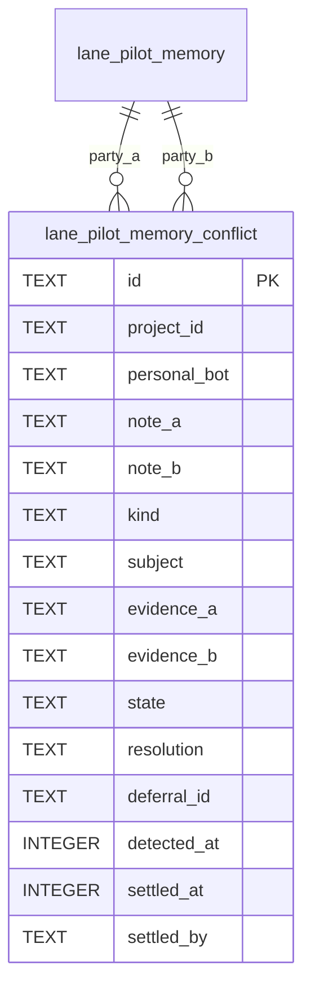

# Memory conflicts data model

TL;DR: The `lane_pilot_memory_conflict` table tracks contradictory memory notes, holding them from search until human resolution.

## Entity relationships

## Table: `lane_pilot_memory_conflict`

Purpose: register pairs of active notes that contradict each other on facts, literals, or polarity, holding both invisible to agents until human resolution (`packages/memory-core/src/conflict-store.ts:5-15`).

| Field | Meaning | Allowed values and source | Units / Format | Evidence |
|---|---|---|---|---|
| `id` | Conflict identifier generated by `conflictId` (`packages/memory-core/src/conflicts.ts:108`, `packages/memory-core/src/conflict-store.ts:71`) | Deterministic string format `mc_<idA10>_<idB10>` | Hex prefix | `packages/memory-core/src/conflicts.ts:108` |
| `project_id` | Project identifier owning the conflict | Non-empty project ID string | UTF-8 string | `packages/memory-core/src/conflict-store.ts:19` |
| `personal_bot` | Personal bot namespace | `""` (shared) or bot name (`"claude"`, `"codex"`, etc.) | String | `packages/memory-core/src/conflict-store.ts:20` |
| `note_a` | ID of the first conflicting note sorted by ID in `holdConflict` (`packages/memory-core/src/conflict-store.ts:68-74`) | Record ID string | Hex string | `packages/memory-core/src/conflict-store.ts:21, 72-74` |
| `note_b` | ID of the second conflicting note sorted by ID in `holdConflict` (`packages/memory-core/src/conflict-store.ts:68-74`) | Record ID string | Hex string | `packages/memory-core/src/conflict-store.ts:22, 72-74` |
| `kind` | Category of contradiction typed by `ConflictKind` (`packages/memory-core/src/conflicts.ts:14`) | `"value"`, `"polarity"`, `"literal"` | String | `packages/memory-core/src/conflict-store.ts:23` |
| `subject` | Common subject topic or file path | Shared file path or up to 3 shared tags from `sameThing` (`packages/memory-core/src/conflicts.ts:59-66`), sliced to 200 chars in `holdConflict` (`packages/memory-core/src/conflict-store.ts:73`) | String | `packages/memory-core/src/conflict-store.ts:24, 73`, `packages/memory-core/src/conflicts.ts:59-66` |
| `evidence_a` | Excerpt from note A captured as `evidenceA` (`packages/memory-core/src/conflicts.ts:74, 78, 88`) | Excerpt text up to 300 chars | String | `packages/memory-core/src/conflict-store.ts:25` |
| `evidence_b` | Excerpt from note B captured as `evidenceB` (`packages/memory-core/src/conflicts.ts:74, 78, 88`) | Excerpt text up to 300 chars | String | `packages/memory-core/src/conflict-store.ts:26` |
| `state` | Current workflow state | `"held"`, `"settled"` | String | `packages/memory-core/src/conflict-store.ts:27` |
| `resolution` | Chosen resolution strategy typed by `ConflictResolution` (`packages/memory-core/src/conflict-store.ts:38`) | `"keep_a"`, `"keep_b"`, `"keep_both"`, `"drop_both"`, `"moot"`, or null if held | String | `packages/memory-core/src/conflict-store.ts:28` |
| `deferral_id` | Linked owner deferral identifier | Deferral item ID or null | String | `packages/memory-core/src/conflict-store.ts:29, 91` |
| `detected_at` | Timestamp of conflict detection | Milliseconds since Unix epoch | Epoch ms | `packages/memory-core/src/conflict-store.ts:30` |
| `settled_at` | Timestamp of settlement | Milliseconds since Unix epoch, or null if held | Epoch ms | `packages/memory-core/src/conflict-store.ts:31, 95` |
| `settled_by` | Actor or evidence documenting resolution | Operator name, user description, or evidence string | String | `packages/memory-core/src/conflict-store.ts:32, 95` |

### Lifecycle of `state`

| Initial state | Next state | Function | Trigger condition | Evidence |
|---|---|---|---|---|
| (new) | `"held"` | `holdConflict` (`packages/memory-core/src/conflict-store.ts:68-76`) | Detected by `findConflicts` (`packages/memory-core/src/conflicts.ts:95-105`) or held in `store.ts` (`packages/memory-core/src/store.ts:164-171`) | `packages/memory-core/src/conflict-store.ts:68-76` |
| `"held"` | `"settled"` | `markSettled` (`packages/memory-core/src/conflict-store.ts:94-96`) | Operator or owner resolves conflict via review UI or deferral action | `packages/memory-core/src/conflict-store.ts:94-96` |

### Invariants

- Deterministic ID: `conflictId` (`packages/memory-core/src/conflicts.ts:108`, `packages/memory-core/src/conflict-store.ts:71`) derives ID from sorted 10-character prefixes of both note IDs.
- Pair uniqueness: composite unique constraint on `(project_id, note_a, note_b)` (`packages/memory-core/src/conflict-store.ts:33`).
- Automatic exclusion: while `state = 'held'`, `heldClause` injects a SQL condition suppressing both `note_a` and `note_b` from all search queries, brief packing, and markdown exports (`packages/memory-core/src/conflict-store.ts:62-65`, `packages/memory-core/src/store.ts:309`).
- Active budget count: held notes remain `status = 'active'` in storage, ensuring their token footprint counts against budgets while under review (`packages/memory-core/src/conflict-store.ts:8-10`).

### Writers and readers

- Writers:
  - `holdConflict`: writes newly detected disagreements (`packages/memory-core/src/conflict-store.ts:68-76`) or replacements of stable notes in `store.ts` (`packages/memory-core/src/store.ts:164-171`).
  - `setDeferral`: links a conflict row to an owner deferral ID (`packages/memory-core/src/conflict-store.ts:90-92`).
  - `markSettled`: records operator resolution, changing state to `"settled"` (`packages/memory-core/src/conflict-store.ts:94-96`).
- Readers:
  - `heldClause`: checked in all search queries (`searchMemoryRecords`, `listMemory`, `visibility`) (`packages/memory-core/src/conflict-store.ts:62-65`, `packages/memory-core/src/store.ts:309`).
  - `getConflict` / `listConflicts`: queried by owner review interfaces and deferral checks (`packages/memory-core/src/conflict-store.ts:78-88`).

<!-- lane-pilot:backlinks -->
## Referenced by

- [Memory core data model](../data-model.md)
