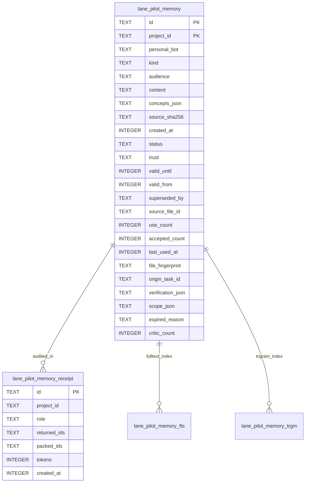

# Memory records and receipts data model

TL;DR: The `lane_pilot_memory` table stores project facts and rules with lifecycle statuses, accompanied by FTS5 virtual indexes and retrieval receipts.

## Entity relationships

## Table: `lane_pilot_memory`

Purpose: canonical storage for project conventions (`kind = 'core'`) and contextual facts (`kind = 'note'`) (`packages/memory-core/src/store.ts:15-20`).

| Field | Meaning | Allowed values and source | Units / Format | Evidence |
|---|---|---|---|---|
| `id` | Unique record identity hash | 64-character SHA-256 hex string computed by `memoryRecordId` | Hex string | `packages/memory-core/src/candidates.ts:57-63` |
| `project_id` | Project identifier owning the record | Non-empty project string from environment or settings | UTF-8 string | `packages/memory-core/src/store.ts:26` |
| `personal_bot` (`packages/memory-core/src/store.ts:18`) | Bot namespace from `MEMORY_PERSONAL_BOTS` (`packages/memory-core/src/settings.ts:3`) parsed as `personalBot` (`packages/memory-core/src/settings.ts:58`) | Allowed bot names | String | `packages/memory-core/src/store.ts:18` |
| `kind` (`packages/memory-core/src/store.ts:18`) | Storage category typed by `MemoryKind` (`packages/memory-core/src/settings.ts:6`) | `"core"` or `"note"` | String | `packages/memory-core/src/store.ts:18` |
| `audience` (`packages/memory-core/src/store.ts:18`) | Visibility level from `MEMORY_AUDIENCES` (`packages/memory-core/src/settings.ts:1`) typed by `MemoryAudience` (`packages/memory-core/src/settings.ts:4`) | `"owner"`, `"subagent"`, `"export"` | String | `packages/memory-core/src/store.ts:18` |
| `content` (`packages/memory-core/src/store.ts:18`) | Fact text up to `MAX_ENTRY_BYTES` (`packages/memory-core/src/candidates.ts:4, 96`), screened by `memoryContentIssue` (`packages/memory-core/src/candidates.ts:15-18`) | Text string | UTF-8 text | `packages/memory-core/src/store.ts:18` |
| `concepts_json` (`packages/memory-core/src/store.ts:18`) | Serialized `concepts` array parsed in `candidates.ts` (`packages/memory-core/src/candidates.ts:99, 103`) | Up to 24 strings | JSON string | `packages/memory-core/src/store.ts:18` |
| `source_sha256` | Hash of source material distilling this fact | 64-character SHA-256 hex string | Hex string | `packages/memory-core/src/store.ts:26` |
| `created_at` (`packages/memory-core/src/store.ts:18`) | Epoch timestamp recorded at insertion time | Milliseconds since Unix epoch | Epoch ms | `packages/memory-core/src/store.ts:18` |
| `status` (`packages/memory-core/src/store.ts:19`) | Corpus status typed by `MemoryStatus` (`packages/memory-core/src/settings.ts:8-9`) | `"active"`, `"superseded"`, `"expired"` | String | `packages/memory-core/src/store.ts:19` |
| `trust` (`packages/memory-core/src/store.ts:19`) | Source trustworthiness typed by `MemoryTrust` (`packages/memory-core/src/settings.ts:10-11`) | `"confirmed"`, `"observed"` | String | `packages/memory-core/src/store.ts:19` |
| `valid_until` (`packages/memory-core/src/store.ts:19`) | Expiration timestamp mapped from candidate `validUntil` (`packages/memory-core/src/settings.ts:17`) | Epoch ms or null | Epoch ms | `packages/memory-core/src/store.ts:19` |
| `valid_from` (`packages/memory-core/src/store.ts:19`) | Start timestamp mapped from candidate `validFrom` (`packages/memory-core/src/settings.ts:19`) | Epoch ms | Epoch ms | `packages/memory-core/src/store.ts:19` |
| `superseded_by` | ID of replacement record | 64-char hex record ID or null | Hex string | `packages/memory-core/src/store.ts:31` |
| `source_file_id` (`packages/memory-core/src/store.ts:19`) | File identifier from `sourceFileId` (`packages/memory-core/src/files.ts:106`) | File ID string or null | String | `packages/memory-core/src/store.ts:19` |
| `use_count` | Number of times delivered in briefs | Non-negative integer incremented by `recordMemoryMixed` | Count | `packages/memory-core/src/lifecycle.ts:95` |
| `accepted_count` | Number of successful attempts using this fact | Non-negative integer incremented by `recordMemoryAccepted` | Count | `packages/memory-core/src/lifecycle.ts:115` |
| `last_used_at` | Timestamp of last brief delivery | Epoch ms or null if never delivered | Epoch ms | `packages/memory-core/src/lifecycle.ts:95` |
| `file_fingerprint` (`packages/memory-core/src/store.ts:19`) | Content hash from `fileFingerprint` (`packages/memory-core/src/fingerprint.ts:14-23`) | 16-character hex hash or null | Hex string | `packages/memory-core/src/store.ts:19` |
| `origin_task_id` (`packages/memory-core/src/store.ts:19`) | Task identifier from input `originTaskId` (`packages/memory-core/src/store.ts:99`) | Task ID string or null | String | `packages/memory-core/src/store.ts:19` |
| `verification_json` | Audit list of vouchers | JSON array of `{ by: string, sha: string, at: number }` objects | JSON string | `packages/memory-core/src/store.ts:40-42, 214` |
| `scope_json` (`packages/memory-core/src/store.ts:19`) | Scope hierarchy array managed via `sharedScope` and `UNASSIGNED_SCOPE` (`packages/memory-core/src/sections.ts:18-20`) | Scopes array | JSON string | `packages/memory-core/src/store.ts:19` |
| `expired_reason` | Retirement cause typed by `ExpiredReason` (`packages/memory-core/src/lifecycle.ts:9`) | `"budget"`, `"idle"`, `"dated"`, `"refuted"`, or null | String | `packages/memory-core/src/lifecycle.ts:9` |
| `critic_count` | Number of times inspected by reviewers | Non-negative integer incremented by `recordCriticUse` | Count | `packages/memory-core/src/lifecycle.ts:109` |

### Lifecycle of `status`

| Initial state | Next state | Function | Trigger condition | Evidence |
|---|---|---|---|---|
| (new) | `"active"` | `storeMemoryRecords` (`packages/memory-core/src/store.ts:214`) | Candidate passes admission checks and budgets | `packages/memory-core/src/store.ts:212-218` |
| `"active"` | `"superseded"` | `hideRecord` (`packages/memory-core/src/lifecycle.ts:30-34`) | Replaced by newer record via `supersedes` (`packages/memory-core/src/store.ts:182-185`), `sourceFileId` (`packages/memory-core/src/store.ts:177`), or `sameSubject` (`packages/memory-core/src/store.ts:187`) | `packages/memory-core/src/store.ts:172` |
| `"active"` | `"expired"` | `hideRecord` (`packages/memory-core/src/lifecycle.ts:30-34`) | Evicted for budget (`expired_reason = 'budget'`) | `packages/memory-core/src/store.ts:206` |
| `"active"` | `"expired"` | `hideRecord` (`packages/memory-core/src/lifecycle.ts:30-34`) | Not used for 90 days (`expired_reason = 'idle'`) | `packages/memory-core/src/lifecycle.ts:38-41` |
| `"active"` | `"expired"` | `hideRecord` (`packages/memory-core/src/lifecycle.ts:30-34`) | Valid date passed (`valid_until <= now`, `expired_reason = 'dated'`) | `packages/memory-core/src/lifecycle.ts:38-41` |
| `"active"` | `"expired"` | `hideRecord` (`packages/memory-core/src/lifecycle.ts:30-34`) | Refuted by `noteRefutedByCheck` (`packages/memory-core/src/lifecycle.ts:12-17`, `src/rooms/storage/database.ts:11-14`) | Reason `"refuted"` |
| `"expired"` | `"active"` | `storeMemoryRecords` (`packages/memory-core/src/store.ts:220`) | Record revived when fact is restated by new candidate or source file | `packages/memory-core/src/store.ts:152-154, 219-224` |

### Lifecycle of `trust`

| Initial state | Next state | Function | Trigger condition | Evidence |
|---|---|---|---|---|
| (new) | `"confirmed"` | `storeMemoryRecords` (`packages/memory-core/src/store.ts:214`) | Inserted with confirmed trust, rule origin, or file origin without hedging | `packages/memory-core/src/store.ts:123-125` |
| (new) | `"observed"` | `storeMemoryRecords` (`packages/memory-core/src/store.ts:214`) | Inserted with observed trust or contains hedged phrasing | `packages/memory-core/src/store.ts:125` |
| `"observed"` | `"confirmed"` | `verify` in `store.ts` (`packages/memory-core/src/store.ts:225-234`) | Corroborated when `source_sha256` differs (`packages/memory-core/src/store.ts:150`) | Upgraded to confirmed |

### Invariants

- Primary key is composite: `(project_id, id)` (`packages/memory-core/src/store.ts:210`).
- Protected shelves: core records (`kind = 'core'`) and rules (`isRule` in `packages/memory-core/src/store.ts:43`) are filtered from `victims` (`packages/memory-core/src/store.ts:200`) and never evicted.
- Index synchronization: active records are registered via `addToIndexes` (`packages/memory-core/src/store.ts:84-87`, `packages/memory-core/src/store.ts:216`, `packages/memory-core/src/store.ts:222`). Inactive records are purged by `dropMemoryIndexes` (`packages/memory-core/src/store.ts:78-81`) passed to `hideRecord` (`packages/memory-core/src/lifecycle.ts:30-34`).

### Writers and readers

- Writers:
  - `storeMemoryRecords` / `storeMemoryRecordsKeepingOverflow`: insert new candidates, demote core overflows, update indexes (`packages/memory-core/src/store.ts:121-240, 262-274`).
  - `expireMemory`: scans and expires idle/dated records (`packages/memory-core/src/lifecycle.ts:37-41`).
  - `hideRecordsOfFile`: marks records superseded/expired when their source file is deleted or modified (`packages/memory-core/src/store.ts:277-280`).
  - `recordMemoryMixed` / `recordMemoryAccepted` / `recordCriticUse`: update usage counters and timestamps (`packages/memory-core/src/lifecycle.ts:94-97, 108-117`).
- Readers:
  - `searchMemoryRecords` / `searchMemoryAllSections`: FTS5 and trigram searches (`packages/memory-core/src/store.ts:319-353`).
  - `listMemory`: tag and kind listing (`packages/memory-core/src/store.ts:398-405`).
  - `coreShelf`: queries active core conventions for prompts (`packages/memory-core/src/store.ts:246-252`).
  - `pendingVectors`: queries active records missing vector embeddings (`packages/memory-core/src/vectors.ts:40-47`).

## Table: `lane_pilot_memory_receipt`

Purpose: records an audit log of memory IDs retrieved and delivered to roles during session spawning (`packages/memory-core/src/lifecycle.ts:100-105`).

| Field | Meaning | Allowed values and source | Units / Format | Evidence |
|---|---|---|---|---|
| `id` | Receipt record ID | Format `mr_<now>_<role>_<packedIds>` | String | `packages/memory-core/src/lifecycle.ts:102` |
| `project_id` | Project identifier | Non-empty project string | String | `packages/memory-core/src/lifecycle.ts:103` |
| `role` | Recipient agent role | `"pm"`, `"writer"`, `"critic"`, `"helper"` | String | `packages/memory-core/src/lifecycle.ts:100, 103` |
| `returned_ids` | Search result candidate IDs | JSON array of record ID strings | JSON string | `packages/memory-core/src/lifecycle.ts:104` |
| `packed_ids` | IDs included within token budget | JSON array of record ID strings | JSON string | `packages/memory-core/src/lifecycle.ts:104` |
| `tokens` | Total estimated tokens packed | Non-negative integer (bytes / 4) | Tokens | `packages/memory-core/src/lifecycle.ts:104` |
| `created_at` | Timestamp recorded in `recordMemoryReceipt` (`packages/memory-core/src/lifecycle.ts:100-105`) | Milliseconds since Unix epoch | Epoch ms | `packages/memory-core/src/lifecycle.ts:103` |

### Writers and readers

- Writers: `recordMemoryReceipt` writes a new row each time an agent context is packed (`packages/memory-core/src/lifecycle.ts:100-105`, `src/rooms/writer/server/spawn.ts:3`).
- Readers: audit scripts and test suites inspecting delivered IDs and token consumption (`scripts/lp-wall-morning.sql:106`, `tests/server/memory-receipt.test.ts:10`).

<!-- lane-pilot:backlinks -->
## Referenced by

- [Memory core data model](../data-model.md)
