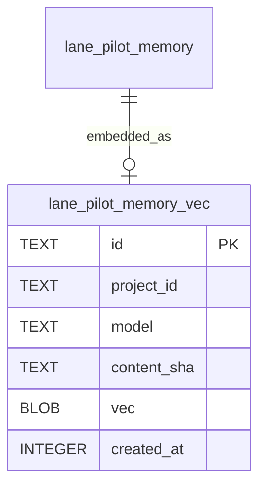

# Memory vectors data model

TL;DR: The `lane_pilot_memory_vec` table stores 768-dimensional float embeddings for semantic cosine similarity search.

## Entity relationships



## Table: `lane_pilot_memory_vec`

Purpose: stores dense vector representations generated by `EMBED_MODEL` (`"gemini-embedding-2"`) for each active memory record, enabling cosine similarity calculations in SQLite (`packages/memory-core/src/vectors.ts:4-32`).

| Field | Meaning | Allowed values and source | Units / Format | Evidence |
|---|---|---|---|---|
| `id` | Memory record ID | 64-char hex string matching `lane_pilot_memory.id` | Hex string | `packages/memory-core/src/vectors.ts:24, 43-47` |
| `project_id` | Project identifier owning the record | Non-empty project ID string | UTF-8 string | `packages/memory-core/src/vectors.ts:24, 52-53` |
| `model` | Embedding model identifier | Pinned constant `EMBED_MODEL` (`"gemini-embedding-2"`) | String | `packages/memory-core/src/vectors.ts:13, 24, 53` |
| `content_sha` (`packages/memory-core/src/vectors.ts:25`) | Hash computed by `contentSha` (`packages/memory-core/src/vectors.ts:34, 53`) | 32-character prefix of SHA-256 hash | Hex string | `packages/memory-core/src/vectors.ts:25, 34` |
| `vec` | Serialized `EMBED_DIM` float vector (`packages/memory-core/src/vectors.ts:14`) stored as raw BLOB (`packages/memory-core/src/vectors.ts:25`) via `unit` (`packages/memory-core/src/vectors.ts:53, 56-61`) | 768 32-bit floats | Binary buffer | `packages/memory-core/src/vectors.ts:25, 52-54` |
| `created_at` (`packages/memory-core/src/vectors.ts:25`) | Timestamp in `storeVectors` (`packages/memory-core/src/vectors.ts:50-54`) | Milliseconds since Unix epoch | Epoch ms | `packages/memory-core/src/vectors.ts:25, 50-54` |

### Indexing and storage

The table initializes by dropping the legacy index and creating `memory_vec_project` on project and model (`packages/memory-core/src/vectors.ts:26-27`):
```sql
DROP INDEX IF EXISTS lane_pilot_memory_vec_project;
CREATE INDEX IF NOT EXISTS memory_vec_project ON lane_pilot_memory_vec(project_id, model);
```

### Invariants

- Dimension consistency: stored vectors match `EMBED_DIM` (`packages/memory-core/src/vectors.ts:14`); `denseRank` verifies `matrix.dim` matches query length (`packages/memory-core/src/vectors.ts:88`).
- Unit normalization: stored vectors are normalized via `unit` (`packages/memory-core/src/vectors.ts:56-61`). In `denseRank` (`packages/memory-core/src/vectors.ts:89-95`), unit vectors allow cosine similarity to be computed as a direct dot product.
- Staleness detection: `pendingVectors` compares `contentSha(record.content)` and `model` with existing vector rows; any mismatch flags the record for re-embedding (`packages/memory-core/src/vectors.ts:41-48`).
- In-memory matrix cache: `projectMatrix` caches all project vectors in a contiguous `Float32Array` within a `WeakMap` keyed on the SQLite database handle; cache keys incorporate record count and max creation timestamp (`packages/memory-core/src/vectors.ts:67-82`).

### Writers and readers

- Writers:
  - `storeVectors`: batch-inserts or replaces normalized float vectors and updates content hashes (`packages/memory-core/src/vectors.ts:50-54`).
  - `src/rooms/memory/server/embeddings.ts`: background job that queries `pendingVectors` and calls external embedding API (`src/rooms/memory/server/embeddings.ts:1-3`).
- Readers:
  - `pendingVectors`: queries active records missing up-to-date embeddings (`packages/memory-core/src/vectors.ts:41-48`).
  - `denseRank`: performs in-memory dot product ranking of project vectors against query vector (`packages/memory-core/src/vectors.ts:85-97`).
  - `denseRows`: incorporates dense vector rankings into search result ordering (`packages/memory-core/src/store.ts:360-377`).

<!-- lane-pilot:backlinks -->
## Referenced by

- [Memory core data model](../data-model.md)
