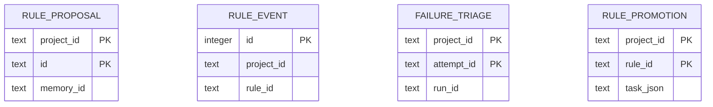

# Run insights data model

TL;DR: The package owns rule proposals/events, failure-triage results, and rule-promotion records in the host SQLite database.

## Entity map

Proposal, triage, and promotion use composite primary keys; events use an autoincrement ID. These tables declare no foreign keys among themselves ([proposal](packages/run-insights/src/rule-schema.ts:7-23), [events](packages/run-insights/src/rule-schema.ts:63-74), [triage](packages/run-insights/src/triage.ts:8-25), [promotion](packages/run-insights/src/rule-forms.ts:16-26)).

## Domain pages

- [Rules](data-model/rules.md): proposal/event fields, transitions, and use.
- [Failure triage](data-model/failure-triage.md): per-attempt result and rerun semantics.
- [Rule forms and promotion](data-model/rule-forms.md): form provenance and mechanism tasks.

## Migration ownership

The package exports migrations and the host composes them in shared storage ([migrations](packages/run-insights/src/rule-schema.ts:5-6), [host composition](src/rooms/migrations.ts:3-8)). Migration changes append schema fields, including audience and forms ([migration sequence](packages/run-insights/src/rule-schema.ts:51-96)). See root [data model](../../../docs/data-model.md) and [governance data model](../../../docs/data-model/governance.md).

<!-- lane-pilot:backlinks -->
## Referenced by

- [Run insights](overview.md)
