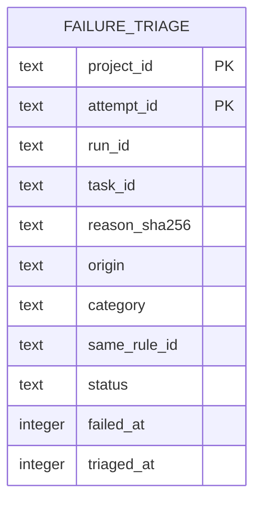

# Failure triage data model

TL;DR: `lane_pilot_failure_triage` stores one classification result for each project/attempt and reason version.

## Entity map

Composite key is `(project_id,attempt_id)`; no foreign key is declared ([schema](packages/run-insights/src/triage.ts:8-25)).

## Fields

| Field | Meaning, values, and units |
|---|---|
| `project_id`, `attempt_id` | Project and failed attempt identity, composite primary key ([schema](packages/run-insights/src/triage.ts:8-25)). |
| `run_id`, `task_id` | Run and task identity used in reporting ([schema](packages/run-insights/src/triage.ts:8-25)). |
| `reason_sha256` | SHA-256 of triage version plus reason; detects reason/version change ([column](packages/run-insights/src/triage.ts:8-25), [digest comparison](packages/run-insights/src/triage.ts:144-157), [stored digest](packages/run-insights/src/triage.ts:160-172)). |
| `reason` | Failure reason passed to judge and reports ([schema](packages/run-insights/src/triage.ts:8-25)). |
| `origin`, `origin_confidence` | Cause label: writer, orchestrator, environment, task, unclear; confidence is the classifier's confidence value ([columns](packages/run-insights/src/triage.ts:8-25), [vocabulary](packages/run-insights/src/triage.ts:28-48)). |
| `category`, `category_confidence` | Mistake label: missing output, broke checks, outside scope, skipped checks, acceptance unmet, other; confidence is the classifier's confidence value ([columns](packages/run-insights/src/triage.ts:8-25), [criteria](packages/run-insights/src/triage.ts:50-60)). |
| `same_rule_id` | Optional rule identifier selected by the same-rule question ([column](packages/run-insights/src/triage.ts:8-25), [question](packages/run-insights/src/triage.ts:62-74), [stored value](packages/run-insights/src/triage.ts:160-172)). |
| `status`, `detail` | Status is `ok` or `error`; detail is supplemental text ([schema](packages/run-insights/src/triage.ts:8-25)). |
| `failed_at`, `triaged_at` | Epoch-millisecond failure and triage times ([schema](packages/run-insights/src/triage.ts:22-24), [save](packages/run-insights/src/triage.ts:160-174)). |

## Status lifecycle

| From | To | Function and condition |
|---|---|---|
| Missing/current hash mismatch | `ok` | `saveTriage` records a successful classification ([query/save](packages/run-insights/src/triage.ts:144-174)). |
| Missing/current hash mismatch | `error` | `saveTriage` records failure; error does not suppress retry ([query/save](packages/run-insights/src/triage.ts:147-174)). |
| `ok` | eligible again | Changed reason/version changes the digest checked by `untriagedAttempts` ([version/hash](packages/run-insights/src/triage.ts:80-82), [query](packages/run-insights/src/triage.ts:144-159)). |

## Invariants and use

- One row per project/attempt; run/task/rule IDs are not foreign-key constrained ([schema](packages/run-insights/src/triage.ts:8-25)).
- Only `ok` suppresses further triage; host self-repair writes results and reports read them; rule trial reads successful matches for recurrence ([query](packages/run-insights/src/triage.ts:147-159), [report consumer](src/rooms/self-repair/server/collect.ts:6), [trial consumer](packages/run-insights/src/rule-trial.ts:61-69)).
- No cleanup or retention job is defined in this workspace.

<!-- lane-pilot:backlinks -->
## Referenced by

- [Run insights data model](../data-model.md)
