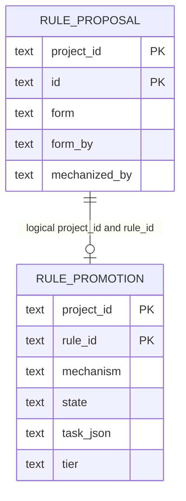

# Rule forms and promotion data model

TL;DR: Form metadata extends rule proposals; promotion rows store one mechanism-task candidate per project/rule.

## Entity map

Relation is logical; no foreign key is declared ([promotion table](packages/run-insights/src/rule-forms.ts:16-26), [proposal form columns](packages/run-insights/src/rule-schema.ts:92-96)).

## Fields

| Field | Meaning, values, and units |
|---|---|
| Proposal `form` | `always`, `skill`, `check`, `hook`, `memory` ([vocabulary](packages/run-insights/src/rule-schema.ts:97-101)). |
| `cue`, `confidence` | Nullable situation cue and reflection confidence ([migration](packages/run-insights/src/rule-schema.ts:92-96)). |
| `form_reason`, `form_by` | Selection reason and provenance (`heuristic`, `jev`, `owner`, `reflection` accepted by setter) ([migration](packages/run-insights/src/rule-forms.ts:8-13), [setter](packages/run-insights/src/rule-forms.ts:153-158)). |
| `mechanized_by`, `mechanized_at` | Caller-recorded enforcing mechanism and epoch-millisecond timestamp ([migration](packages/run-insights/src/rule-forms.ts:8-13), [writer](packages/run-insights/src/rule-forms.ts:160-164)). |
| Promotion `project_id`, `rule_id` | Project and rule composite primary key ([schema](packages/run-insights/src/rule-forms.ts:16-26)). |
| `mechanism`, `state`, `tier` | Caller-provided text; database adds no allowed-value constraints ([schema](packages/run-insights/src/rule-forms.ts:16-26)). |
| `task_json` | Serialized task contract; lookup reads `$.id`, failure update may add `$.fail_reason` ([insert](packages/run-insights/src/rule-forms.ts:189-193), [update and lookup](packages/run-insights/src/rule-forms.ts:201-214)). |
| `created_at`, `updated_at` | Epoch-millisecond create/update times ([schema](packages/run-insights/src/rule-forms.ts:16-26)). |

## State lifecycle

| From | To | Function and condition |
|---|---|---|
| Missing | Caller-provided state | `insertRulePromotion` inserts; duplicate project/rule is ignored ([source](packages/run-insights/src/rule-forms.ts:189-193)). |
| Existing | Caller-provided state | `setPromotionRowState` updates timestamp and optional JSON failure reason ([source](packages/run-insights/src/rule-forms.ts:201-209)). |
| Any form provenance | New form/provenance | `setRuleForm` enforces setter priority ([source](packages/run-insights/src/rule-forms.ts:153-158)). |

## Invariants and use

- One promotion row per project/rule ([schema](packages/run-insights/src/rule-forms.ts:16-26)). Owner/reflection form choices are protected from lower-priority updates ([setter](packages/run-insights/src/rule-forms.ts:153-158)).
- Form classification writes metadata; host CLI, digest, and promotion services read it ([classifier persistence](packages/run-insights/src/rule-forms.ts:146-175), [host promotion](src/rooms/rule-forms/promotion-service.ts:1-2)).
- No cleanup or retention job is defined in this workspace.

<!-- lane-pilot:backlinks -->
## Referenced by

- [Run insights data model](../data-model.md)
