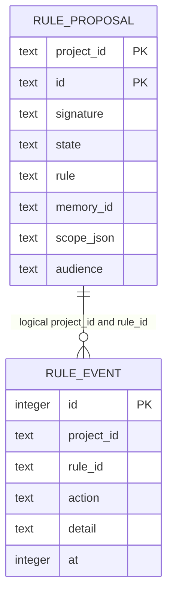

# Rules data model

TL;DR: `lane_pilot_rule_proposal` stores project rules; `lane_pilot_rule_event` records rule actions, uses, and tier labels.

## Entity map

The relation is logical; no foreign key is declared ([proposal schema](packages/run-insights/src/rule-schema.ts:7-23), [event schema](packages/run-insights/src/rule-schema.ts:63-74)).

## `lane_pilot_rule_proposal`

| Fields | Meaning, values, and units |
|---|---|
| `project_id`, `id` | Project and rule identity; composite primary key. ID is derived from signature ([schema](packages/run-insights/src/rule-schema.ts:7-23), [ID function](packages/run-insights/src/rule-proposals.ts:7-20)). |
| `signature`, `rule` | Normalized failure key and human-readable instruction ([schema](packages/run-insights/src/rule-schema.ts:7-23)). |
| `author`, `state` | Author: sweep, pm, owner, model. State: proposed, accepted, rejected, revoked ([schema](packages/run-insights/src/rule-schema.ts:24-49), [types](packages/run-insights/src/rule-schema.ts:103-105)). |
| `occurrences`, `task_count` | Evidence count and distinct task count updated by proposal logic ([upsert](packages/run-insights/src/rule-proposals.ts:103-132)). |
| `examples_json`, `evidence_json` | JSON examples and evidence references (run/task/attempt/reason) ([schema](packages/run-insights/src/rule-schema.ts:24-42), [types](packages/run-insights/src/rule-schema.ts:106-117)). |
| `memory_id` | Nullable shared-memory identifier; accepted-rule queries require matching memory row ([query](packages/run-insights/src/rule-proposals.ts:167-175)). |
| `*_at` timestamps | Epoch milliseconds for first/last seen, update, decision, trial start, and mechanism timing ([schema](packages/run-insights/src/rule-schema.ts:24-42), [extensions](packages/run-insights/src/rule-schema.ts:55-74)). |
| Trial fields | `decided_by` is owner/auto; `trial_state` is trial/confirmed; revision starts at 1; retirement reason is nullable ([schema](packages/run-insights/src/rule-schema.ts:55-62), [type](packages/run-insights/src/rule-schema.ts:134-138)). |
| `scope_json`, `audience`, `always_on` | Scope is section/path JSON; audience writer/pm/both defaults writer; always-on integer boolean defaults 0 ([migration](packages/run-insights/src/rule-schema.ts:72-84)). |
| Form fields | Form is always/skill/check/hook/memory. Cue, confidence, reason, setter, mechanism, and timestamp extend metadata ([migration](packages/run-insights/src/rule-schema.ts:92-101), [mechanism migration](packages/run-insights/src/rule-forms.ts:8-13)). |

## State lifecycle

| From | To | Function and condition |
|---|---|---|
| Absent | proposed | Proposal upsert creates a row ([source](packages/run-insights/src/rule-proposals.ts:39-81), [lesson path](packages/run-insights/src/rule-proposals.ts:103-132)). |
| Proposed | proposed | Matching evidence refreshes counts/examples; revision updates wording only while proposed ([upsert](packages/run-insights/src/rule-proposals.ts:103-132), [revision](packages/run-insights/src/rule-proposals.ts:153-158)). |
| Proposed | accepted/rejected/revoked | `decideRuleProposal` updates only when stored state matches `from` ([source](packages/run-insights/src/rule-proposals.ts:159-165)). |
| Accepted | accepted | `reviseAdoptedRule` updates wording, memory ID, revision, and trial start ([source](packages/run-insights/src/rule-trial.ts:41-45)). |
| Adopted trial | confirm/revise/retire outcome | `decideRuleTrial` computes an action; host persists consequences ([source](packages/run-insights/src/rule-trial.ts:128-156)). |
| Rule action | event row | `logRuleEvent` appends; `logRulesShown` writes one shown event per rule/detail ([source](packages/run-insights/src/rule-trial.ts:6-21)). |

## Invariants and use

- Proposal key is project plus ID. Decision helper uses compare-and-swap; upserts refresh evidence without changing existing wording/decision ([schema](packages/run-insights/src/rule-schema.ts:20-23), [decision/upsert](packages/run-insights/src/rule-proposals.ts:103-165)).
- Proposal rows are written by sweeps and proposal/form/trial helpers, and read for writer rule injection, PM relevance, trials, and rule forms ([writer](src/rooms/writer/server/writer-knowledge.ts:1), [PM](src/rooms/learning/pm-rules.ts:1)).
- Events feed history, trial-use counts, and current tier ([event operations](packages/run-insights/src/rule-trial.ts:6-28), [trial reader](packages/run-insights/src/rule-trial.ts:61-90), [tier reader](packages/run-insights/src/rule-ladder.ts:9-13)).
- No cleanup or retention job for these tables is defined in this workspace.

<!-- lane-pilot:backlinks -->
## Referenced by

- [Run insights data model](../data-model.md)
