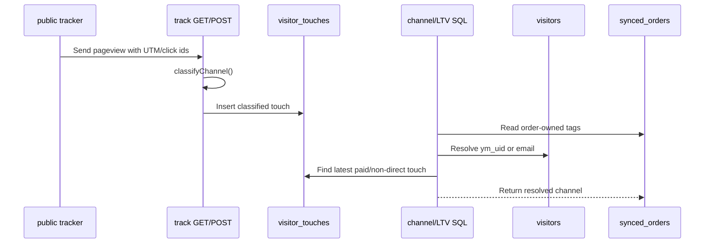

---
title: Channel attribution SQL
type: component
status: active
confidence: medium
created: '2026-09-02'
updated: 2026-10-22
tags:
- component
- attribution
- channels
- yclid
sources:
  - server/utils/attribution.ts
  - server/utils/marketing-visits.ts
  - server/api/track.get.ts
  - server/api/track.post.ts
  - server/api/channels/analytics.get.ts
  - server/api/analytics/ltv.get.ts
  - server/api/yandex-direct/campaign-revenue.get.ts
  - server/utils/attribution-markov.ts
  - migrations/0006_visitors_and_events.sql
  - migrations/0029_visitors_email_lower_index.sql
  - tests/server/yandex-direct-campaign-revenue.spec.ts---

# Channel attribution SQL

<!-- body:start -->
TL;DR: This component owns the shared channel vocabulary and the Last Paid Click cascade used by channel and LTV reports. Tracker handlers persist classified touches, while `getAttributionSql()` resolves an order through its own tags, paid touches, recent non-direct touches, visitor identity, and an earlier tagged order (`server/utils/attribution.ts:13`, `server/utils/attribution.ts:122`, `server/api/track.post.ts:83`).

## Purpose

Attribution in Treba is a layered contract, not a single UTM field. The JavaScript classifier is used when a tracker event is written. The SQL helpers are used when dashboard reports classify an order after the fact. Keeping both paths in one utility gives the reports the same channel names and makes the `yclid` priority visible at the source (`server/utils/attribution.ts:66`, `server/utils/attribution.ts:122`).

The first layer is order-owned evidence. A non-empty, non-zero `yclid` is Yandex Direct; Yandex CPC, Google click ids/CPC, organic, social/SMM/CPM, email, and referral have their respective mappings. If no source or medium exists, a search referrer becomes SEO and otherwise the visit is direct; unrecognized tagged traffic becomes other (`server/utils/attribution.ts:80`, `server/utils/attribution.ts:82`, `server/utils/attribution.ts:84`, `server/utils/attribution.ts:86`, `server/utils/attribution.ts:91`).

The second layer is touch history. `getAttributionSql()` selects the latest paid `visitor_touches` row at or before the order, without a maximum age. If there is no paid touch, it considers the latest non-direct touch within seven days. It then falls back to visitor-level yclid/first UTM/referrer evidence, then to the latest earlier tagged order for the same email, and finally to `direct` (`server/utils/attribution.ts:122`, `server/utils/attribution.ts:131`, `server/utils/attribution.ts:139`, `server/utils/attribution.ts:145`, `server/utils/attribution.ts:158`).

The visitor join is itself part of attribution. Reports match an order to `visitors.ym_uid` when `client_id` is present, then fall back to case-insensitive email when the client id is missing. The query chooses the ym_uid match first and the earliest first visit as a tie-breaker (`server/utils/attribution.ts:166`, `server/utils/attribution.ts:168`, `server/utils/attribution.ts:173`, `server/utils/attribution.ts:176`). This is why the email index migration matters to the report path (`migrations/0029_visitors_email_lower_index.sql:1`, `migrations/0029_visitors_email_lower_index.sql:5`).

## Public API

| Symbol | file:line | Purpose |
|---|---|---|
| `PAID_CHANNELS` | `server/utils/attribution.ts:13` | Set of channels eligible for the paid-touch arm. |
| `CHANNEL_LABELS` | `server/utils/attribution.ts:15` | Human-readable labels for report output. |
| `CHANNEL_ORDER` | `server/utils/attribution.ts:27` | Stable display ordering for channel rows. |
| `isWhitePageHop()` | `server/utils/attribution.ts:42` | Detects a satellite/white-page hop from an explicit flag, `clk=1`, or hostname. |
| `classifyChannel()` | `server/utils/attribution.ts:66` | Classifies one tracker event from UTM, click ids, referrer, and white-page evidence. |
| `getAttributionSql()` | `server/utils/attribution.ts:122` | Returns the order-attribution `COALESCE` expression used by SQL reports. |
| `getVisitorLateralJoinSql()` | `server/utils/attribution.ts:166` | Returns the visitor lookup join used by those reports. |

`orderOwnChannelSql()` is intentionally private, but it is the first arm inside `getAttributionSql()` and therefore part of the effective public report contract (`server/utils/attribution.ts:98`, `server/utils/attribution.ts:124`).

Markov path extraction imports the same `classifyChannel` utility rather than maintaining a second channel-priority implementation (`server/utils/attribution-markov.ts:13-17`). This makes the shared vocabulary a cross-model contract: a classifier edit affects tracker touches, Last Paid Click reports, and subsequent Markov recomputes, while persisted Markov rows remain unchanged until the worker writes them again (`server/utils/attribution-markov.ts:502`, `server/utils/attribution-markov.ts:543-574`).

## Flow

1. The GET pixel and POST event paths both upsert the visitor and write the event; pageviews then insert a touch with the classified channel (`server/api/track.get.ts:44`, `server/api/track.get.ts:63`, `server/api/track.get.ts:73`, `server/api/track.post.ts:56`, `server/api/track.post.ts:72`, `server/api/track.post.ts:83`).
2. POST normalizes a non-empty `yclid` to `yandex/cpc` before the visitor/event/touch write, so malformed or rewritten UTM cannot demote a Direct click (`server/api/track.post.ts:27`, `server/api/track.post.ts:33`, `server/api/track.post.ts:37`).
3. Channel analytics and LTV inject the shared SQL expression and visitor lateral join into their own aggregate queries (`server/api/channels/analytics.get.ts:20`, `server/api/channels/analytics.get.ts:40`, `server/api/channels/analytics.get.ts:186`, `server/api/analytics/ltv.get.ts:15`, `server/api/analytics/ltv.get.ts:17`).
4. The Direct campaign report has an additional account/campaign attribution contract, so it should not be assumed to be identical to the channel report even when it uses the same yclid and touch concepts (`server/api/yandex-direct/campaign-revenue.get.ts:73`, `server/api/yandex-direct/campaign-revenue.get.ts:138`).

## Channel contract

| Channel | Evidence rule | Display order |
|---|---|---:|
| `yandex_direct` | Non-empty/non-zero `yclid`, or Yandex CPC. | `1` |
| `google_ads` | Non-empty `gclid`, or Google CPC. | `2` |
| `white_page` | Explicit white-page signal or recognized hop. | `2.5` |
| `seo` | Organic medium or known search referrer. | `3` |
| `smm` | Social, SMM, or CPM medium. | `4` |
| `email` | Email medium. | `5` |
| `referral` | Referral medium. | `6` |
| `direct` | No attribution evidence after the cascade. | `7` |
| `other` | Tagged but not matched by a known rule. | `8` |

The paid-touch set currently contains `yandex_direct`, `google_ads`, `smm`, `email`, and `white_page` (`server/utils/attribution.ts:13`). That list is broader than the short header comment in the same file and is the one SQL uses for paid-touch selection. The labels and order are separate maps, so changing a key without updating both creates a row that can be classified but not presented consistently (`server/utils/attribution.ts:15`, `server/utils/attribution.ts:27`).

## Report consumers

`/api/channels/analytics` uses the cascade in its aggregate, daily, and recurring queries, then defines additional channel metadata for the response (`server/api/channels/analytics.get.ts:20`, `server/api/channels/analytics.get.ts:74`, `server/api/channels/analytics.get.ts:93`, `server/api/channels/analytics.get.ts:186`). `/api/analytics/ltv` uses the same helper but maintains a local label map for its output (`server/api/analytics/ltv.get.ts:15`, `server/api/analytics/ltv.get.ts:46`). This shared SQL therefore reduces classification drift but does not centralize every display label.

## Gotchas

- White-page detection runs before yclid in the JavaScript classifier. A `clk=1` hop or recognized referrer is deliberately `white_page`, even if other fields look paid (`server/utils/attribution.ts:42`, `server/utils/attribution.ts:77`).
- A non-empty yclid wins over conflicting UTM. Do not move the yclid arm below source/medium checks (`server/utils/attribution.ts:80`, `server/api/track.post.ts:33`, `server/api/track.post.ts:37`).
- The paid-touch arm has no age cap; the seven-day bound applies only to the non-direct fallback (`server/utils/attribution.ts:131`, `server/utils/attribution.ts:139`).
- `pravtreba` has no visitor-touch path in the shared SQL comment, so those rows fall through to later arms rather than gaining a touch attribution automatically (`server/utils/attribution.ts:129`).
- Visitor matching is by ym_uid first and lowercased email second. Removing the email fallback loses orders whose `client_id` is absent (`server/utils/attribution.ts:166`, `server/utils/attribution.ts:169`).
- Channel analytics and LTV can still diverge because each endpoint owns response labels/metadata and may add domain-specific query branches (`server/api/channels/analytics.get.ts:93`, `server/api/analytics/ltv.get.ts:46`).

## Verification

When changing this utility, test both tracker writes and at least one report query. Direct revenue fixtures cover yclid/LPC behavior and the current connected-account response rules, making them a useful regression suite for the most sensitive downstream consumer (`tests/server/yandex-direct-campaign-revenue.spec.ts:140`, `tests/server/yandex-direct-campaign-revenue.spec.ts:267`). The email fallback also depends on the lower-email index migration, so SQL performance changes should be checked with the migration applied (`migrations/0029_visitors_email_lower_index.sql:5`).

<!-- body:end -->
